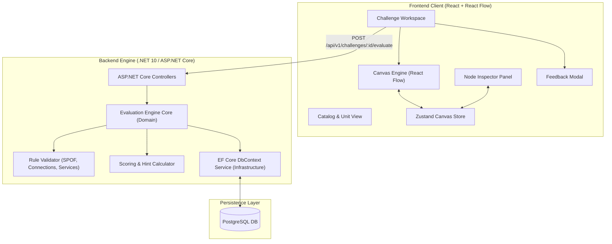
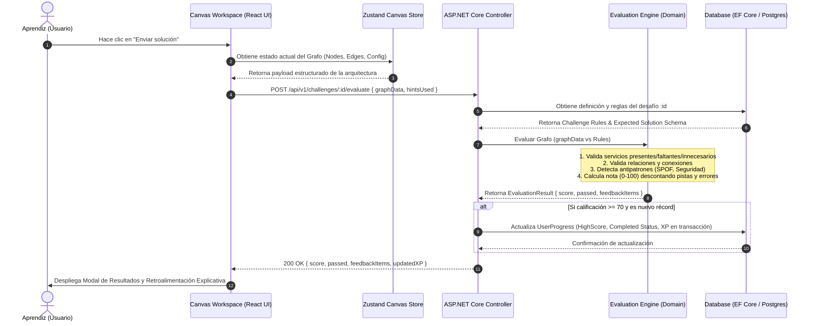
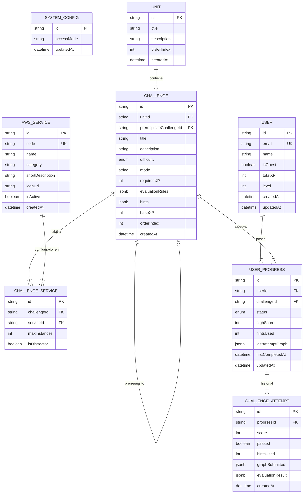

# Arquitectura del Sistema y Decisiones Técnicas - AWS Architecture Quest

## 1. Introducción y Visión General

Este documento describe la arquitectura de software y las decisiones técnicas para la plataforma **AWS Architecture Quest**. 
Define la estructura de componentes, el flujo de datos, el estilo arquitectónico del Frontend y Backend, la estrategia de persistencia y las decisiones clave para garantizar que el sistema cumpla con los requisitos funcionales, no funcionales y las reglas de negocio establecidos.

---

## 2. Stack Tecnológico Seleccionado

| Capa / Componente | Tecnología Seleccionada | Razón Técnica y Beneficios |
| :--- | :--- | :--- |
| **Estructura de Repositorio** | **Multi-App Monorepo (`apps/`)** | Organización modular desacoplada: frontend web en `apps/web` y solución backend .NET 10 en `apps/api`. |
| **Frontend Framework** | **React + TypeScript** | Tipado estricto de componentes visuales y estado. Reutilización futura en React Native. |
| **Canvas Engine** | **React Flow** | Biblioteca especializada para la gestión interactiva de grafos, nodos Drag & Drop y conectores SVG. |
| **Gestión de Estado UI** | **Zustand** | Estado global liviano e independiente de React Context para alto rendimiento en interacciones del Canvas a 60 FPS. |
| **Estilos y UI** | **Tailwind CSS** | Estilizado modular, responsivo y mantenible con utilidades atómicas. |
| **Backend Framework** | **.NET 10 (ASP.NET Core Web API / C#)** | Plataforma de altísimo rendimiento, tipado estricto, compilación optimizada y soporte nativo a contenedores. |
| **ORM / Acceso a Datos**| **Entity Framework Core 10 (EF Core + Npgsql)** | Mapeo objeto-relacional tipado con LINQ, migraciones robustas y soporte nativo para columnas `jsonb`. |
| **Base de Datos** | **PostgreSQL (con JSONB)** | Modelo relacional para usuarios, servicios y progreso, con soporte JSONB para grafos y reglas declarativas de desafíos. |

---

## 3. Estilo de Arquitectura

El sistema adopta una **Arquitectura Desacoplada Cliente-Servidor (Decoupled SPA / Backend API)** basada en principios de **Clean Architecture**:

```text
┌─────────────────────────────────────────────────────────────┐
│                      FRONTEND (SPA)                         │
│  React + React Flow + Zustand + Tailwind CSS                │
└──────────────────────────────┬──────────────────────────────┘
                               │ HTTP / REST API (JSON)
┌──────────────────────────────▼──────────────────────────────┐
│            BACKEND API (.NET 10 / ASP.NET Core)             │
│ ┌──────────────────┐ ┌──────────────────┐ ┌───────────────┐ │
│ │  Controllers /   │ │  Domain Core /   │ │ Infrastructure│ │
│ │   API Endpoints  │ │ Evaluation Engine│ │ EF Core / Npg │ │
│ └──────────────────┘ └──────────────────┘ └───────────────┘ │
└──────────────────────────────┬──────────────────────────────┘
                               │ SQL / Npgsql Driver
┌──────────────────────────────▼──────────────────────────────┐
│                    PERSISTENCIA (PostgreSQL)                │
└─────────────────────────────────────────────────────────────┘
```

### 3.1. Arquitectura del Frontend (Client Layer)
* **Component-Driven Architecture:** División modular de componentes de UI (Catálogo, Workspace, Canvas, Inspector de Nodos, Modal de Evaluación).
* **State-Driven Canvas Store:** El estado del canvas (nodos colocados, coordenadas, conexiones y parámetros) se gestiona mediante un Store de Zustand aislado para prevenir renderizados innecesarios en la interfaz global.

### 3.2. Arquitectura del Backend (.NET 10 Clean Architecture)
Organizada en capas concéntricas desacopladas:
* **`AwsQuest.Domain` (Core Domain Layer):** Entidades del modelo de datos, enums y el **Motor de Evaluación de Arquitecturas (`EvaluationEngine`)** puro, libre de dependencias de frameworks o base de datos.
* **`AwsQuest.Application` (Application Layer):** Casos de uso, interfaces de repositorios, DTOs de petición/respuesta y validadores con `FluentValidation`.
* **`AwsQuest.Infrastructure` (Infrastructure Layer):** Implementación de `AppDbContext` con EF Core 10, mapeo `Npgsql`, migraciones de base de datos, servicio de JWT y el Seeder de desafíos.
* **`AwsQuest.Api` (Presentation Layer):** Controladores REST de ASP.NET Core, configuración de inyección de dependencias, middlewares de manejo global de excepciones y Swagger/OpenAPI.

---

## 4. Sistema de Componentes Principales



### Componentes Clave:
1. **Canvas Engine (Frontend):** Encapsula React Flow, gestiona eventos Drag & Drop, renderiza nodos de servicios AWS y conexiones dinámicas.
2. **Evaluation Engine Core (Backend Domain):** Módulo puro en C# que recibe el grafo armado en el frontend (`GraphDto`), carga las reglas del desafío y ejecuta las validaciones en memoria.
3. **Rule Validator Sub-engine:** Evaluadores especializados en:
   * Presencia/ausencia de servicios requeridos e innecesarios.
   * Validez de relaciones/conexiones entre componentes.
   * Detección de patrones y antipatrones (ej. Single Point of Failure, base de datos expuesta).
4. **EF Core Data Service:** Interfaz de acceso a datos fuertemente tipada con `AppDbContext` para gestionar usuarios, catálogo de desafíos y registros de progreso.

---

## 5. Diagramas de Flujo de Información

### 5.1. Diagrama de Secuencia: Envío y Evaluación de una Solución



---

## 6. Estrategia de Persistencia y Modelo de Datos

### 6.1. Diagrama de Entidad-Relación (Modelo Conceptual EF Core)



### 6.2. Estructura JSONB de Reglas Declarativas (`Challenge.EvaluationRules`)
Los desafíos se definen mediante estructuras declarativas JSON serializadas con `System.Text.Json` para cumplir con el requisito de extensibilidad (RNF-08):

```json
{
  "requiredServices": ["AWS_ALB", "AWS_EC2", "AWS_RDS"],
  "forbiddenServices": ["AWS_IGW_DIRECT_RDS"],
  "minInstances": { "AWS_EC2": 2 },
  "requiredConnections": [
    { "from": "AWS_ALB", "to": "AWS_EC2" },
    { "from": "AWS_EC2", "to": "AWS_RDS" }
  ],
  "antiPatterns": [
    {
      "type": "SINGLE_POINT_OF_FAILURE",
      "condition": "count(AWS_EC2) < 2",
      "penalty": 20,
      "feedback": "Tu arquitectura utiliza una única instancia EC2, lo que genera un Single Point of Failure. Para alta disponibilidad usa un Auto Scaling Group."
    }
  ]
}
```

---

## 7. Decisiones Adicionales de Infraestructura y Extensibilidad

### 7.1. Preparación para Clientes Futuros (Aplicación Móvil)
* La API REST construida en ASP.NET Core (.NET 10) utiliza payloads JSON estándar y agnósticos de la plataforma cliente.
* Las reglas de validación residen exclusivamente en el Backend, garantizando que una futura app móvil (React Native o Flutter) consuma la misma lógica de evaluación sin duplicar código.

### 7.2. Despliegue e Infraestructura (Roadmap MVP / Post-MVP)
* **Entorno MVP:** Contenedores Docker para ASP.NET Core Web API (.NET 10) y PostgreSQL, desplegables en servicios livianos o servidor local.
* **Fase de Producción AWS (Post-MVP):**
  * Frontend: Amazon S3 + CloudFront (CDN).
  * Backend: ECS Fargate o EC2 (.NET 10 container) detrás de un Application Load Balancer.
  * Persistencia: Amazon RDS para PostgreSQL.

### 7.3. Estrategia de Autenticación y Modo Invitado (Guest Mode)
* **Acceso Inmediato (Modo Invitado):** Para reducir la fricción inicial y optimizar el embudo de aprendizaje, un nuevo usuario puede interactuar de inmediato sin registrarse. El sistema genera un identificador anónimo de sesión (`isGuest: true`) mediante JWT emitido por ASP.NET Core.
* **Estructura de Claims JWT Estándar:**
  ```json
  {
    "sub": "c7a10294-9b21-4d32-bb19-201a89c89012",
    "name": "Carlos López",
    "email": "aprendiz@awsquest.dev",
    "isGuest": false,
    "role": "Learner",
    "exp": 1726300000
  }
  ```
  *(Para un usuario invitado, `email` es omitido/nulo y `isGuest` es `true`).*
* **Persistencia y Migración:** Al registrarse o iniciar sesión posteriormente mediante credenciales o Google OAuth (JWT), el progreso asociado a la sesión anónima se transfiere de forma transparente a la cuenta definitiva del usuario.

### 7.4. Estructura de Código: Organización del Repositorio (`apps/web` y `apps/api`)
El repositorio se organiza de forma modular para albergar de manera independiente tanto la aplicación cliente web como la solución backend en .NET 10:

```text
aws-architecture-quest/
├── apps/
│   ├── web/                         # React + React Flow + Zustand + Tailwind CSS (Vite)
│   │   ├── package.json
│   │   └── src/
│   └── api/                         # Solución Backend en .NET 10
│       ├── src/
│       │   ├── AwsQuest.Domain/     # Entidades, Enums, Motor de Evaluación en memoria
│       │   ├── AwsQuest.Application/# Casos de uso, DTOs, FluentValidation, Interfaces
│       │   ├── AwsQuest.Infrastructure/ # AppDbContext (EF Core 10), Npgsql, JWT, Seeder
│       │   └── AwsQuest.Api/        # Controllers REST, Program.cs, Middlewares
│       ├── tests/
│       │   └── AwsQuest.UnitTests/  # Tests unitarios del motor de evaluación (xUnit)
│       └── AwsQuest.sln             # Archivo de solución .NET
├── content/
│   └── challenges/                  # Archivos YAML/JSON declarativos de desafíos educativos
└── docker-compose.yml               # Orquestación de PostgreSQL para desarrollo local
```

### 7.5. Contenido como Código y Seeder Declarativo
* Los desafíos y unidades se definen como archivos declarativos (JSON/YAML) en `content/challenges/`.
* Un servicio de inicialización en C# (`ChallengeSeeder.cs`) lee los archivos durante el arranque o ejecución de tareas administrativas, los deserializa y sincroniza en PostgreSQL usando EF Core, permitiendo versionar todo el contenido educativo en Git mediante Pull Requests.

---

## 8. Matriz de Trazabilidad Arquitectónica

| Requisito / Regla de Negocio | Decisión Arquitectónica Asociada |
| :--- | :--- |
| **RNF-01 (Canvas a 60 FPS)** | Zustand Store aislado para gestionar el canvas fuera del ciclo global de React. |
| **RNF-02 (Evaluación < 2s)** | Engine puro de validación en memoria en el Backend .NET 10 (C# de alto rendimiento). |
| **RNF-07 / RNF-11 (Desacoplamiento / Móvil)** | API RESTful agnóstica con Motor de Reglas aislado en servidor ASP.NET Core. |
| **RNF-08 / RF-21 (Extensibilidad Declarativa)** | Almacenamiento JSONB de reglas en PostgreSQL con EF Core 10 (`Npgsql`) y Seeder declarativo en C#. |
| **RN-01 (Modo Libre / Progresivo)** | Filtro dinámico en controladores ASP.NET Core según la política de acceso configurada. |
| **RN-09 / RN-10 (Récords y XP sin Farmeo)** | Transacciones Atómicas en EF Core (`AppDbContext.Database.BeginTransactionAsync()`) para actualizar XP solo en récords. |
| **Modo Invitado / Reducción Fricción** | Identificador de sesión anónimo con migración automática a cuenta definitiva vía ASP.NET Core JWT. |
| **Mantenibilidad y Rendimiento** | Clean Architecture en .NET 10 con compilación optimizada y separación estricta de capas. |
