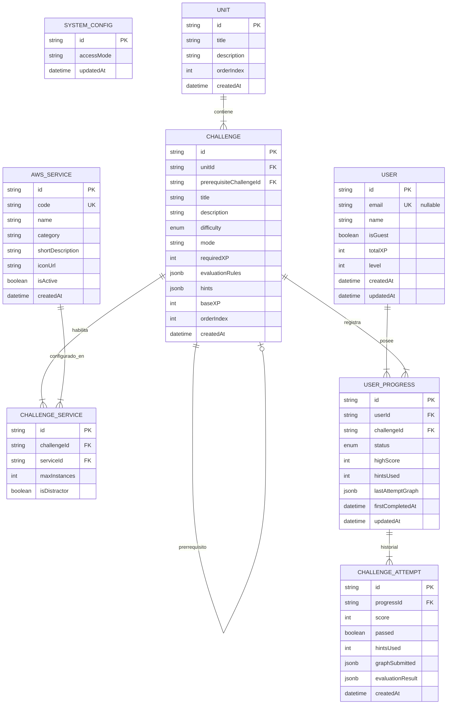

# Modelo de Datos y Especificación de Persistencia - AWS Architecture Quest

## 1. Introducción y Paradigma de Modelado

Este documento define la estructura de datos, relaciones, restricciones de integridad, estrategias de indexación y manejo de concurrencia para **AWS Architecture Quest**.

El sistema adopta un **Modelo Híbrido Relacional + Documental (JSONB)** implementado sobre **PostgreSQL** y gestionado mediante **Entity Framework Core 10 (EF Core 10 + Npgsql)** en el backend **.NET 10**:
* **Capa Relacional:** Garantiza la integridad referencial para Usuarios, Unidades, Desafíos, Progreso e Historial de Envíos.
* **Capa JSONB:** Almacena de forma estandarizada y declarativa el catálogo de servicios permitidos, las reglas de evaluación pedagógica y el grafo semántico de la arquitectura enviada.

---

## 2. Diagrama Entidad-Relación Detallado (ERD)



---

## 3. Especificación del Esquema de Entidades y Mapeo EF Core 10

### 3.1. Enums de Dominio (`AwsQuest.Domain.Enums`)

```csharp
namespace AwsQuest.Domain.Enums;

public enum AccessMode
{
    OpenAccess = 1,
    Progressive = 2
}

public enum DifficultyLevel
{
    Easy = 1,
    Intermediate = 2,
    Hard = 3,
    Integrator = 4
}

public enum ProgressStatus
{
    NotStarted = 1,
    InProgress = 2,
    Completed = 3
}
```

### 3.2. Modelos de Entidad (`AwsQuest.Domain.Entities`)

```csharp
namespace AwsQuest.Domain.Entities;

using AwsQuest.Domain.Enums;

public class SystemConfig
{
    public string Id { get; set; } = "global_config";
    public AccessMode AccessMode { get; set; } = AccessMode.OpenAccess;
    public DateTime UpdatedAt { get; set; } = DateTime.UtcNow;
}

public class User
{
    public Guid Id { get; set; } = Guid.NewGuid();
    public string? Email { get; set; } // Nullable para soportar Modo Invitado (isGuest: true)
    public string Name { get; set; } = string.Empty;
    public bool IsGuest { get; set; } = false;
    public int TotalXP { get; set; } = 0;
    public int Level { get; set; } = 1;
    public DateTime CreatedAt { get; set; } = DateTime.UtcNow;
    public DateTime UpdatedAt { get; set; } = DateTime.UtcNow;

    public ICollection<UserProgress> Progress { get; set; } = new List<UserProgress>();
}

public class Unit
{
    public Guid Id { get; set; } = Guid.NewGuid();
    public string Title { get; set; } = string.Empty;
    public string Description { get; set; } = string.Empty;
    public int OrderIndex { get; set; }
    public DateTime CreatedAt { get; set; } = DateTime.UtcNow;

    public ICollection<Challenge> Challenges { get; set; } = new List<Challenge>();
}

public class AwsService
{
    public Guid Id { get; set; } = Guid.NewGuid();
    public string Code { get; set; } = string.Empty; // ej: "AWS_EC2", "AWS_RDS"
    public string Name { get; set; } = string.Empty;
    public string Category { get; set; } = string.Empty; // ej: "Compute", "Database", "Networking"
    public string ShortDescription { get; set; } = string.Empty;
    public string IconUrl { get; set; } = string.Empty;
    public bool IsActive { get; set; } = true;
    public DateTime CreatedAt { get; set; } = DateTime.UtcNow;

    public ICollection<ChallengeService> ChallengeServices { get; set; } = new List<ChallengeService>();
}

public class Challenge
{
    public Guid Id { get; set; } = Guid.NewGuid();
    public Guid UnitId { get; set; }
    public Guid? PrerequisiteChallengeId { get; set; }
    public string Title { get; set; } = string.Empty;
    public string Description { get; set; } = string.Empty;
    public DifficultyLevel Difficulty { get; set; }
    public string Mode { get; set; } = "BUILDER";
    public int RequiredXP { get; set; } = 0;
    public string EvaluationRulesJson { get; set; } = "{}"; // Mapeado a JSONB
    public string HintsJson { get; set; } = "[]";           // Mapeado a JSONB
    public int BaseXP { get; set; } = 100;
    public int OrderIndex { get; set; }
    public DateTime CreatedAt { get; set; } = DateTime.UtcNow;

    public Unit Unit { get; set; } = null!;
    public Challenge? Prerequisite { get; set; }
    public ICollection<Challenge> DependentChallenges { get; set; } = new List<Challenge>();
    public ICollection<ChallengeService> AllowedServices { get; set; } = new List<ChallengeService>();
    public ICollection<UserProgress> ProgressRecords { get; set; } = new List<UserProgress>();
}

public class ChallengeService
{
    public Guid Id { get; set; } = Guid.NewGuid();
    public Guid ChallengeId { get; set; }
    public Guid ServiceId { get; set; }
    public int? MaxInstances { get; set; }
    public bool IsDistractor { get; set; } = false;

    public Challenge Challenge { get; set; } = null!;
    public AwsService Service { get; set; } = null!;
}

public class UserProgress
{
    public Guid Id { get; set; } = Guid.NewGuid();
    public Guid UserId { get; set; }
    public Guid ChallengeId { get; set; }
    public ProgressStatus Status { get; set; } = ProgressStatus.NotStarted;
    public int HighScore { get; set; } = 0;
    public int HintsUsed { get; set; } = 0;
    public string? LastAttemptGraphJson { get; set; } // Mapeado a JSONB
    public DateTime? FirstCompletedAt { get; set; }
    public DateTime UpdatedAt { get; set; } = DateTime.UtcNow;

    public User User { get; set; } = null!;
    public Challenge Challenge { get; set; } = null!;
    public ICollection<ChallengeAttempt> Attempts { get; set; } = new List<ChallengeAttempt>();
}

public class ChallengeAttempt
{
    public Guid Id { get; set; } = Guid.NewGuid();
    public Guid ProgressId { get; set; }
    public int Score { get; set; }
    public bool Passed { get; set; }
    public int HintsUsed { get; set; } = 0;
    public string GraphSubmittedJson { get; set; } = "{}";   // Mapeado a JSONB
    public string EvaluationResultJson { get; set; } = "{}"; // Mapeado a JSONB
    public DateTime CreatedAt { get; set; } = DateTime.UtcNow;

    public UserProgress Progress { get; set; } = null!;
}
```

### 3.3. Configuración Fluent API (`AppDbContext` en EF Core 10)

```csharp
namespace AwsQuest.Infrastructure.Persistence;

using Microsoft.EntityFrameworkCore;
using AwsQuest.Domain.Entities;

public class AppDbContext(DbContextOptions<AppDbContext> options) : DbContext(options)
{
    public DbSet<SystemConfig> SystemConfigs => Set<SystemConfig>();
    public DbSet<User> Users => Set<User>();
    public DbSet<Unit> Units => Set<Unit>();
    public DbSet<AwsService> AwsServices => Set<AwsService>();
    public DbSet<Challenge> Challenges => Set<Challenge>();
    public DbSet<ChallengeService> ChallengeServices => Set<ChallengeService>();
    public DbSet<UserProgress> UserProgresses => Set<UserProgress>();
    public DbSet<ChallengeAttempt> ChallengeAttempts => Set<ChallengeAttempt>();

    protected override void OnModelCreating(ModelBuilder modelBuilder)
    {
        base.OnModelCreating(modelBuilder);

        // SystemConfig
        modelBuilder.Entity<SystemConfig>(entity =>
        {
            entity.ToTable("system_configs");
            entity.HasKey(e => e.Id);
            entity.Property(e => e.Id).HasMaxLength(50);
            entity.Property(e => e.AccessMode).HasConversion<string>().HasMaxLength(30);
        });

        // User
        modelBuilder.Entity<User>(entity =>
        {
            entity.ToTable("users");
            entity.HasKey(e => e.Id);
            entity.HasIndex(e => e.Email).IsUnique().HasFilter("\"email\" IS NOT NULL");
            entity.Property(e => e.Email).HasMaxLength(255).IsRequired(false);
            entity.Property(e => e.Name).HasMaxLength(120).IsRequired();
        });

        // Unit
        modelBuilder.Entity<Unit>(entity =>
        {
            entity.ToTable("units");
            entity.HasKey(e => e.Id);
            entity.HasIndex(e => e.OrderIndex).IsUnique();
            entity.Property(e => e.Title).HasMaxLength(150).IsRequired();
        });

        // AwsService
        modelBuilder.Entity<AwsService>(entity =>
        {
            entity.ToTable("aws_services");
            entity.HasKey(e => e.Id);
            entity.HasIndex(e => e.Code).IsUnique();
            entity.Property(e => e.Code).HasMaxLength(50).IsRequired();
            entity.Property(e => e.Name).HasMaxLength(100).IsRequired();
            entity.Property(e => e.Category).HasMaxLength(50).IsRequired();
            entity.Property(e => e.IconUrl).HasMaxLength(255);
        });

        // Challenge
        modelBuilder.Entity<Challenge>(entity =>
        {
            entity.ToTable("challenges");
            entity.HasKey(e => e.Id);
            entity.HasIndex(e => new { e.UnitId, e.OrderIndex }).IsUnique();
            entity.HasIndex(e => e.UnitId);
            entity.HasIndex(e => e.PrerequisiteChallengeId);
            entity.Property(e => e.Title).HasMaxLength(150).IsRequired();
            entity.Property(e => e.Difficulty).HasConversion<string>().HasMaxLength(30);
            entity.Property(e => e.Mode).HasMaxLength(50).HasDefaultValue("BUILDER");
            entity.Property(e => e.EvaluationRulesJson).HasColumnType("jsonb").IsRequired();
            entity.Property(e => e.HintsJson).HasColumnType("jsonb").IsRequired();

            entity.HasOne(e => e.Unit)
                .WithMany(u => u.Challenges)
                .HasForeignKey(e => e.UnitId)
                .OnDelete(DeleteBehavior.Restrict);

            entity.HasOne(e => e.Prerequisite)
                .WithMany(c => c.DependentChallenges)
                .HasForeignKey(e => e.PrerequisiteChallengeId)
                .OnDelete(DeleteBehavior.SetNull);
        });

        // ChallengeService
        modelBuilder.Entity<ChallengeService>(entity =>
        {
            entity.ToTable("challenge_services");
            entity.HasKey(e => e.Id);
            entity.HasIndex(e => new { e.ChallengeId, e.ServiceId }).IsUnique();
            entity.HasIndex(e => e.ChallengeId);
            entity.HasIndex(e => e.ServiceId);

            entity.HasOne(e => e.Challenge)
                .WithMany(c => c.AllowedServices)
                .HasForeignKey(e => e.ChallengeId)
                .OnDelete(DeleteBehavior.Cascade);

            entity.HasOne(e => e.Service)
                .WithMany(s => s.ChallengeServices)
                .HasForeignKey(e => e.ServiceId)
                .OnDelete(DeleteBehavior.Restrict);
        });

        // UserProgress
        modelBuilder.Entity<UserProgress>(entity =>
        {
            entity.ToTable("user_progress");
            entity.HasKey(e => e.Id);
            entity.HasIndex(e => new { e.UserId, e.ChallengeId }).IsUnique();
            entity.HasIndex(e => new { e.UserId, e.Status });
            entity.HasIndex(e => e.ChallengeId);
            entity.Property(e => e.Status).HasConversion<string>().HasMaxLength(30);
            entity.Property(e => e.LastAttemptGraphJson).HasColumnType("jsonb");

            entity.HasOne(e => e.User)
                .WithMany(u => u.Progress)
                .HasForeignKey(e => e.UserId)
                .OnDelete(DeleteBehavior.Cascade);

            entity.HasOne(e => e.Challenge)
                .WithMany(c => c.ProgressRecords)
                .HasForeignKey(e => e.ChallengeId)
                .OnDelete(DeleteBehavior.Cascade);
        });

        // ChallengeAttempt
        modelBuilder.Entity<ChallengeAttempt>(entity =>
        {
            entity.ToTable("challenge_attempts");
            entity.HasKey(e => e.Id);
            entity.HasIndex(e => new { e.ProgressId, e.CreatedAt });
            entity.Property(e => e.GraphSubmittedJson).HasColumnType("jsonb").IsRequired();
            entity.Property(e => e.EvaluationResultJson).HasColumnType("jsonb").IsRequired();

            entity.HasOne(e => e.Progress)
                .WithMany(p => p.Attempts)
                .HasForeignKey(e => e.ProgressId)
                .OnDelete(DeleteBehavior.Cascade);
        });
    }
}
```

---

## 4. Especificación de Esquemas JSONB Declarativos

Para garantizar que los datos complejos sean validados estrictamente en la aplicación y agnósticos de la UI (Cumplimiento Dimensión 5):

### 4.1. Grafo Semántico de Arquitectura (`graphSubmitted` y `lastAttemptGraph`)
Separa las decisiones semánticas de la arquitectura de la representación gráfica del cliente web:

```json
{
  "$schema": "http://json-schema.org/draft-07/schema#",
  "type": "object",
  "required": ["components", "connections"],
  "properties": {
    "components": {
      "type": "array",
      "items": {
        "type": "object",
        "required": ["id", "serviceCode", "config"],
        "properties": {
          "id": { "type": "string" },
          "serviceCode": { "type": "string", "example": "AWS_EC2" },
          "config": {
            "type": "object",
            "properties": {
              "isMultiAz": { "type": "boolean" },
              "autoScaling": { "type": "boolean" },
              "instanceCount": { "type": "integer" }
            }
          }
        }
      }
    },
    "connections": {
      "type": "array",
      "items": {
        "type": "object",
        "required": ["fromComponentId", "toComponentId"],
        "properties": {
          "fromComponentId": { "type": "string" },
          "toComponentId": { "type": "string" },
          "connectionType": { "type": "string", "default": "HTTP_HTTPS" }
        }
      }
    }
  }
}
```

---

## 5. Estrategia de Índices y Optimización de Queries

### 5.1. Índices SQL y GIN
* **Índices de Llaves Foráneas (B-Tree):**
  * `idx_challenges_unit`: `CREATE INDEX ON challenges(unit_id);` (Acelera listado de desafíos por unidad).
  * `idx_user_progress_user_status`: `CREATE INDEX ON user_progress(user_id, status);` (Acelera cálculo de XP y filtros de catálogo).
* **Índices GIN para JSONB:**
  * `CREATE INDEX idx_challenges_eval_rules ON challenges USING gin (evaluation_rules_json);` (Permite búsquedas por tipos de regla).

### 5.2. Prevención de Consultas N+1 en EF Core 10
En la capa de aplicación (`AwsQuest.Application`), la carga del catálogo y del progreso del usuario se realiza mediante proyecciones LINQ optimizadas (`.Select()` y `.AsNoTracking()`) que EF Core traduce a una consulta SQL consolidada:

```csharp
// Carga del catálogo completo con progreso del usuario en 1 sola consulta SQL optimizada
var catalog = await _context.Units
    .AsNoTracking()
    .OrderBy(u => u.OrderIndex)
    .Select(u => new UnitCatalogDto
    {
        Id = u.Id,
        Title = u.Title,
        Description = u.Description,
        Challenges = u.Challenges
            .OrderBy(c => c.OrderIndex)
            .Select(c => new ChallengeSummaryDto
            {
                Id = c.Id,
                Title = c.Title,
                Difficulty = c.Difficulty.ToString(),
                BaseXP = c.BaseXP,
                Progress = c.ProgressRecords
                    .Where(p => p.UserId == currentUserId)
                    .Select(p => new UserProgressSummaryDto
                    {
                        Status = p.Status.ToString(),
                        HighScore = p.HighScore
                    })
                    .FirstOrDefault()
            })
            .ToList()
    })
    .ToListAsync(cancellationToken);
```

---

## 6. Concurrencia, Transacciones e Idempotencia

### 6.1. Actualización Atómica de Récord y XP (Prevención de Race Conditions)
Para prevenir discrepancias en el cálculo de XP cuando se procesan envíos concurrentes, el cálculo y la asignación se ejecutan dentro de una **Transacción Atómica de EF Core** (`IDbContextTransaction`):

```csharp
await using var transaction = await _context.Database.BeginTransactionAsync(IsolationLevel.ReadCommitted, cancellationToken);
try
{
    // 1. Obtener progreso actual con seguimiento de entidad
    var currentProgress = await _context.UserProgresses
        .FirstOrDefaultAsync(p => p.UserId == userId && p.ChallengeId == challengeId, cancellationToken);

    if (currentProgress == null)
    {
        currentProgress = new UserProgress
        {
            UserId = userId,
            ChallengeId = challengeId,
            Status = ProgressStatus.InProgress
        };
        _context.UserProgresses.Add(currentProgress);
        await _context.SaveChangesAsync(cancellationToken);
    }

    var previousHighScore = currentProgress.HighScore;
    var isNewHighScore = newScore > previousHighScore;

    // 2. Registrar el intento individual (Idempotencia en historial)
    var attempt = new ChallengeAttempt
    {
        ProgressId = currentProgress.Id,
        Score = newScore,
        Passed = newScore >= 70,
        HintsUsed = hintsUsed,
        GraphSubmittedJson = graphSubmittedJson,
        EvaluationResultJson = evaluationResultJson,
        CreatedAt = DateTime.UtcNow
    };
    _context.ChallengeAttempts.Add(attempt);

    // 3. Si hay nuevo récord, actualizar HighScore y sumar la diferencia de XP al Usuario
    if (isNewHighScore)
    {
        var xpDifference = (int)Math.Floor((newScore - previousHighScore) * (baseXP / 100.0));

        currentProgress.HighScore = newScore;
        currentProgress.Status = newScore >= 70 ? ProgressStatus.Completed : ProgressStatus.InProgress;
        currentProgress.LastAttemptGraphJson = graphSubmittedJson;
        currentProgress.UpdatedAt = DateTime.UtcNow;

        if (newScore >= 70 && currentProgress.FirstCompletedAt == null)
        {
            currentProgress.FirstCompletedAt = DateTime.UtcNow;
        }

        var user = await _context.Users.FindAsync([userId], cancellationToken);
        if (user != null)
        {
            user.TotalXP += xpDifference;
            user.Level = 1 + (user.TotalXP / 150);
            user.UpdatedAt = DateTime.UtcNow;
        }
    }

    await _context.SaveChangesAsync(cancellationToken);
    await transaction.CommitAsync(cancellationToken);
}
catch (Exception)
{
    await transaction.RollbackAsync(cancellationToken);
    throw;
}
```

---

## 7. Matriz de Verificación Técnica (Checklist de 5 Dimensiones)

| Dimensión Técnica | Criterio de Verificación | Estado de Cumplimiento | Evidencia en el Esquema |
| :--- | :--- | :--- | :--- |
| **1. Integridad y Tipado** | Tipos nativos estrictos, constraints `UNIQUE`, `NOT NULL` y comportamientos FK. | **Aprobado** | Enums nativos C# (`AccessMode`, `DifficultyLevel`), catálogo relacional `AwsService`, tabla intermedia `ChallengeService`, `.HasIndex(p => new { p.UserId, p.ChallengeId }).IsUnique()`, índice filtrado `HasFilter("\"email\" IS NOT NULL")`, `OnDelete(DeleteBehavior.Cascade/Restrict/SetNull)`. |
| **2. Trazabilidad Negocio** | Resuelve cada Caso de Uso (CU-01 a CU-08) y Regla de Negocio (RN-01 a RN-13). | **Aprobado** | `SystemConfig` soporta RN-01; `ChallengeService` soporta RN-03/RN-04; `User.IsGuest` soporta Modo Invitado; `UserProgress` soporta RN-02, RN-09, RN-10; `ChallengeAttempt` soporta auditoría CU-05; migración soporta RN-13 / CU-08. |
| **3. Auditoría de Queries** | Índices B-Tree en FKs, índices GIN en JSONB y prevención de N+1. | **Aprobado** | Índices en `(UserId, Status)`, `UnitId`, `ChallengeId`, GIN en `evaluation_rules_json`, proyecciones LINQ optimizadas con `.AsNoTracking()` en EF Core 10. |
| **4. Concurrencia y Datos** | Prevención de Deadlocks, idempotencia y actualización atómica de XP. | **Aprobado** | Transacciones `IDbContextTransaction` atómicas para incremento de XP y creación única de intentos por UUID. |
| **5. Independencia UI** | Esquema agnóstico del cliente visual (sobrevive a cambio de Web a Móvil). | **Aprobado** | Grafo JSONB normalizado (`components`, `serviceCode`, `connections`) libre de coordenadas visuales o dependencias de React Flow. |


