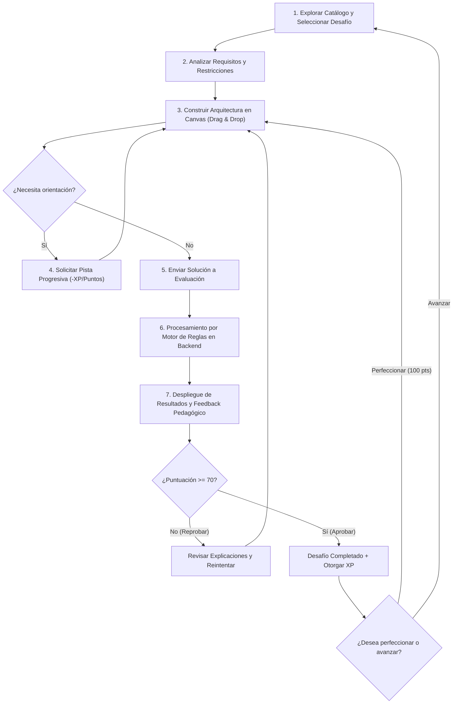

# Mecánicas de Juego - AWS Architecture Quest

## 1. Introducción y Filosofía del Juego

**AWS Architecture Quest** es una plataforma educativa gamificada diseñada para enseñar arquitectura cloud en Amazon Web Services mediante la **resolución activa de problemas reales**.

### Principios Fundamentales del Juego
1. **Pensar como un Arquitecto:** En lugar de memorizar definiciones de servicios, el jugador aprende a analizar requisitos de negocio (alta disponibilidad, escalabilidad, seguridad, costos) y seleccionar las piezas adecuadas para diseñar una solución.
2. **Entorno Seguro de Aprendizaje:** Los errores son oportunidades formativas. No existen sistemas punitivos de vidas, bloqueos temporales ni costos por equivocarse.
3. **Reintentos Ilimitados:** El jugador tiene total libertad para experimentar, refactorizar su arquitectura y volver a enviar soluciones para mejorar su comprensión y puntuación.
4. **Retroalimentación Formativa Explicativa:** Cada evaluación desglosa con claridad **por qué** una decisión fue correcta o errónea, conectando la arquitectura con las buenas prácticas oficiales del *AWS Well-Architected Framework*.

---

## 2. Ciclo Principal de Juego (Core Gameplay Loop)



---

## 3. Mecánicas de Inicio y Modalidades de Desafío

### 3.1. Modalidades de Juego
* **Architecture Builder (MVP):** El desafío inicializa con un **Canvas en blanco**. El jugador debe diseñar la solución desde cero seleccionando y conectando servicios desde la paleta.
* **Fix the Architecture (MVP):** El canvas se inicializa con una **arquitectura preexistente que contiene errores** (ej. una base de datos expuesta públicamente o un servidor sin balanceador). El jugador debe inspeccionar, diagnosticar, eliminar o reconfigurar los componentes defectuosos.
* **Modalidades Futuras (Post-MVP):** *Scaling Challenge*, *Security Audit*, *Cost Optimization* e *Incident Response*.

### 3.2. Catálogo Filtrado y Límites de Servicios (`ChallengeService`)
* Cada desafío define un conjunto limitado de servicios AWS disponibles en la paleta lateral.
* **Servicios Distractores:** Para fomentar el pensamiento crítico, la paleta puede incluir servicios válidos de AWS que no corresponden a la solución del caso (ej. Amazon S3 en un problema exclusivo de base de datos relacional).
* **Límites de Instanciación (`maxInstances`):** Si el problema estipula un límite (ej. *"máximo 2 instancias EC2"*), la interfaz restringe la adición de componentes adicionales al alcanzar dicho número.

---

## 4. Mecánicas de Construcción en el Canvas

### 4.1. Interacción Visual (Drag & Drop)
* **Adición:** El usuario arrastra una tarjeta de servicio desde la paleta hacia el lienzo.
* **Posicionamiento:** Los componentes pueden moverse libremente por el canvas para organizar visualmente las capas de la arquitectura (Edge $\rightarrow$ Cómputo $\rightarrow$ Datos).
* **Eliminación:** Seleccionar un nodo o conector y presionar la tecla `Delete`/`Backspace` o el botón de papelera lo remueve inmediatamente.

### 4.2. Conexiones y Topología Arquitectónica
* Las relaciones entre servicios se trazan conectando el **Handle de salida (Source)** de un nodo con el **Handle de entrada (Target)** de otro.
* Las conexiones representan flujos lógicos (HTTP/HTTPS, tráfico de base de datos, colas asíncronas).

### 4.3. Inspección y Configuración de Parámetros
Al hacer clic sobre un nodo en el canvas, se despliega un panel lateral de inspección para ajustar parámetros de alto nivel cuando el desafío lo requiera:
* **Amazon EC2:** Habilitar inclusión en *Auto Scaling Group (ASG)* o definir recuento de réplicas.
* **Amazon RDS:** Habilitar despliegue *Multi-AZ* o réplicas de lectura.
* **Amazon S3 / VPC:** Configurar acceso público o privado.

### 4.4. Control de Estado y Reinicio
* **Botón "Reiniciar Canvas":** Restablece el lienzo al estado inicial del desafío (vacío en Builder o con los errores originales en Fix) tras confirmación del usuario.

---

## 5. Mecánicas del Sistema de Pistas

Las pistas están diseñadas para orientar al jugador sin entregarle la respuesta de inmediato:

```text
┌─────────────────────────────────────────────────────────────┐
│ PISTA 1 (Conceptual):                                       │
│ "Piensa en cómo distribuirías el tráfico entre servidores." │
│ Penalización: -5 puntos                                     │
└──────────────────────────────┬──────────────────────────────┘
                               │ Requiere haber visto Pista 1
┌──────────────────────────────▼──────────────────────────────┐
│ PISTA 2 (Estructural):                                      │
│ "Tu aplicación requiere un balanceador delante de las EC2." │
│ Penalización adicional: -10 puntos                          │
└──────────────────────────────┬──────────────────────────────┘
                               │ Requiere haber visto Pista 2
┌──────────────────────────────▼──────────────────────────────┐
│ PISTA 3 (Servicio Concreto):                                │
│ "Utiliza un Application Load Balancer (ALB) conectado a EC2"│
│ Penalización adicional: -15 puntos                          │
└─────────────────────────────────────────────────────────────┘
```

### Reglas del Sistema de Pistas:
1. **Desbloqueo Secuencial Estricto (RN-06):** No es posible saltar a la Pista 2 sin desbloquear primero la Pista 1.
2. **Advertencia de Penalización (RF-12):** Antes de revelar una pista, el sistema despliega un diálogo advirtiendo el descuento de puntos sobre la nota máxima alcanzable en ese intento.
3. **Persistencia de Pistas Reveladas:** Una vez desbloqueada una pista en un desafío, permanece visible para futuros reintentos del mismo desafío.

---

## 6. Mecánicas de Envío, Evaluación y Diagnóstico

### 6.1. Habilitación del Envío
* El botón **"Enviar solución"** se habilita únicamente cuando el canvas contiene al menos 1 componente colocado.
* Durante la evaluación (tiempo $< 2$ segundos), la interfaz muestra un estado de carga y bloquea interacciones en el canvas para evitar condiciones de carrera.

### 6.2. Criterios de Evaluación del Motor de Reglas
El motor de reglas en el backend analiza el grafo de arquitectura bajo cuatro dimensiones:
1. **Servicios Requeridos:** Verifica que todos los servicios esenciales estén presentes.
2. **Servicios Innecesarios / Distractores:** Penaliza la inclusión de servicios redundantes o no solicitados.
3. **Conexiones y Flujo de Tráfico:** Valida que las relaciones entre nodos sean correctas (ej. ALB $\rightarrow$ EC2 $\rightarrow$ RDS).
4. **Detección de Antipatrones:**
   * *Single Point of Failure (SPOF):* Una sola instancia EC2 en un escenario de alta disponibilidad.
   * *Exposición Insegura:* Conexión directa desde Internet a una base de datos RDS sin pasar por la capa de cómputo.
   * *Falta de Redundancia de Datos:* Base de datos sin Multi-AZ cuando se exige tolerancia a fallos.

### 6.3. Reporte de Retroalimentación Pedagógica
El modal de resultados presenta:
* **Puntuación Global (0-100).**
* **Ítems Aprobados (Check verde):** Resalta los aciertos arquitectónicos y las buenas prácticas aplicadas.
* **Ítems Fallados (Cruz roja):** Explica el principio técnico o concepto de AWS que no se cumplió y cómo corregirlo.
* **Desglose de Pistas:** Detalla el impacto de las penalizaciones aplicadas por pistas.

---

## 7. Mecánicas de Puntuación, Victoria y Reintentos

### 7.1. Escala de Calificación
* **Rango:** 0 a 100 puntos.
* **Cálculo Base:**
  $$\text{Puntaje} = \max\left(0, \; 100 - \sum \text{Penalizaciones por Errores} - \sum \text{Penalizaciones por Pistas}\right)$$

### 7.2. Condición de Victoria / Aprobación (RN-02)
* **Aprobado ($\text{Puntaje} \ge 70$):** El desafío se marca como **`COMPLETED`**, se otorga la XP correspondiente y se evalúa el desbloqueo del siguiente contenido.
* **No Aprobado ($\text{Puntaje} < 70$):** El desafío permanece en estado **`IN_PROGRESS`**, no se otorga XP y se invita al jugador a reintentar utilizando las pistas y la retroalimentación.

### 7.3. Conservación de Récord Histórico (*High Score* - RN-09)
* El sistema siempre almacena la **máxima nota histórica** obtenida por el usuario.
* Si un jugador que obtuvo 85 puntos vuelve a jugar y saca 70 puntos, su récord guardado se mantiene en 85 puntos.

### 7.4. Reintentos Ilimitados (RN-11)
* El jugador puede reintentar cualquier desafío cuantas veces lo desee, fomentando la búsqueda de la solución perfecta (100/100 puntos).

---

## 8. Mecánicas de Progresión, Experiencia (XP) y Desbloqueo

### 8.1. Otorgamiento de Experiencia (XP) y Prevención de Farmeo (RN-10)
Para evitar que un jugador acumule XP ilimitada repitiendo el mismo desafío:
* La XP se otorga **únicamente al alcanzar un nuevo récord personal** de puntuación.
* **Fórmula de XP Ganada:**
  $$\text{XP Ganada} = \left\lfloor (\text{Nueva Calificación} - \text{Calificación Récord Previa}) \times \frac{\text{BaseXP}}{100} \right\rfloor$$

* *Ejemplo práctico:*
  1. **Primer intento:** Calificación de 80 en un desafío con `baseXP = 100`.
     $$\text{XP} = (80 - 0) \times \frac{100}{100} = +80 \text{ XP}$$
  2. **Segundo intento:** Calificación de 75 (menor al récord de 80).
     $$\text{XP} = 0 \text{ XP adicionales}$$
  3. **Tercer intento:** Calificación perfecta de 100.
     $$\text{XP} = (100 - 80) \times \frac{100}{100} = +20 \text{ XP}$$
  * **Total acumulado en el desafío:** 100 XP.

### 8.2. Sistema de Niveles de Usuario
* El nivel del usuario aumenta conforme acumula XP total:
  $$\text{Nivel} = 1 + \left\lfloor \frac{\text{TotalXP}}{150} \right\rfloor$$

### 8.3. Mecánicas de Accesibilidad a Desafíos (RN-01)
* **Modo Libre (Open Access):** Todos los desafíos y unidades están desbloqueados desde el inicio para aprendizaje no lineal.
* **Modo Progresivo:** Los desafíos avanzados requieren haber aprobado el desafío prerrequisito (`prerequisiteChallengeId`) o contar con el nivel de XP requerido (`requiredXP`).

---

## 9. Matriz de Resumen de Reglas y Mecánicas

| Momento del Juego | Acción del Jugador | Mecánica / Regla Aplicada | Trazabilidad |
| :--- | :--- | :--- | :--- |
| **Inicio** | Selección de Desafío | Filtro por Modo Libre o validación de Prerrequisitos / XP. | RN-01, CU-01 |
| **Workspace** | Lectura del caso | Carga de contexto y servicios autorizados (`ChallengeService`). | RN-03, RN-04, CU-02 |
| **Diseño** | Drag & Drop y Conexiones | Interacción fluida en canvas, verificación de límites. | RF-05, RF-07, RNF-01 |
| **Dificultad** | Solicita ayuda | Pistas secuenciales con penalización de nota confirmada. | RN-06, RN-07, CU-04 |
| **Validación** | Clic en "Enviar solución" | Motor en memoria analiza topología, SPOF y reglas. | RF-13, RF-14, RNF-02 |
| **Resultados** | Lectura de feedback | Desglose pedagógico de errores y conceptos de AWS. | RF-15, RN-08, CU-05 |
| **Progresión** | Aprobación ($\ge 70$) | Guardado de High Score, cálculo de XP anti-farmeo. | RN-02, RN-09, RN-10 |
| **Persistencia** | Registro de cuenta | Migración transparente de progreso de sesión de invitado. | RF-20, RN-13, CU-08 |
