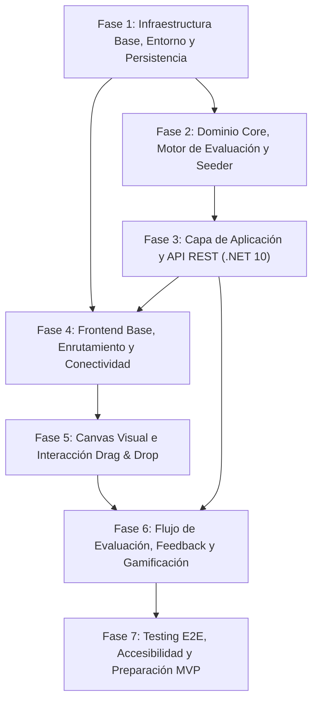

# Plan de Implementación - AWS Architecture Quest

## 1. Introducción y Estrategia de Ejecución

Este documento define la **hoja de ruta y el orden secuencial recomendado de desarrollo** para la plataforma **AWS Architecture Quest**, estructurado a partir del análisis integral de todos los requerimientos funcionales (`02-functional-requirements.md`), no funcionales (`03-non-functional-requirements.md`), reglas de negocio (`04-business-rules.md`), casos de uso (`05-use-cases.md`), arquitectura (`06-architecture.md`), modelo de persistencia (`07-data-model.md`), contrato de API REST (`08-api-spec.md`), especificación de frontend (`09-frontend-bootstrap.md`), mecánicas de juego (`10-game-mechanics.md`), diseño UI/UX (`11-ui-ux.md`) y bootstrap de backend (`specs/backend-bootstrap.md`).

### Principios del Plan de Desarrollo
1. **Enfoque Bottom-Up en Capas (Clean Architecture):** El núcleo de dominio y las reglas de negocio en memoria (`AwsQuest.Domain`) se construyen y prueban primero de manera aislada antes de acoplarlos a la infraestructura y controladores.
2. **Desacoplamiento Estricto por Contrato:** La especificación formal de la API REST (`08-api-spec.md`) actúa como contrato inmutable entre el backend (.NET 10) y el cliente web (React).
3. **Validación Incremental por Milestones:** Cada fase concluye con un hito técnico verificable y medible que habilita la siguiente fase sin retrabajos.
4. **Cero Dependencias Circulares:** Las tareas dentro de cada fase están ordenadas de acuerdo con su árbol de dependencias naturales.

---

## 2. Mapa de Dependencias entre Fases



---

## 3. Fases de Implementación Detalladas

---

### Fase 1: Infraestructura Base, Entorno y Persistencia

**Objetivo:** Establecer el entorno de desarrollo local, la base de datos PostgreSQL con soporte JSONB, la solución de backend en .NET 10 y el espacio de trabajo frontend en `apps/web`.

#### Tareas en Orden Recomendado:
1. **1.1. Orquestación Local (Docker Compose):**
   * Configurar `docker-compose.yml` para levantar PostgreSQL 15.3 con extensión `pgcrypto` para UUIDs.
   * Configurar variables de entorno y cadena de conexión local (`appsettings.Development.json`).
2. **1.2. Estructuración de la Solución Backend (`apps/api/AwsQuest.sln`):**
   * Crear y configurar los 4 proyectos de Clean Architecture (`AwsQuest.Domain`, `AwsQuest.Application`, `AwsQuest.Infrastructure`, `AwsQuest.Api`) y el proyecto de pruebas (`tests/AwsQuest.UnitTests`).
   * Configurar referencias de proyectos según la matriz de dependencias permitidas.
   * Instalar paquetes NuGet requeridos (`Npgsql.EntityFrameworkCore.PostgreSQL`, `FluentValidation`, `Microsoft.AspNetCore.Authentication.JwtBearer`, `BCrypt.Net-Next`).
3. **1.3. Modelado y Mapeo EF Core 10 (`AwsQuest.Infrastructure`):**
   * Definir `AppDbContext` con Fluent API para las 8 entidades (`SystemConfig`, `User`, `Unit`, `AwsService`, `Challenge`, `ChallengeService`, `UserProgress`, `ChallengeAttempt`).
   * Configurar tipos de columna `jsonb` para grafos y reglas declarativas.
   * Configurar índice condicional único para email (`HasFilter("\"email\" IS NOT NULL")`) para soporte de Modo Invitado.
   * Generar y ejecutar la migración inicial de base de datos (`InitialCreate`).
4. **1.4. Inicialización del Espacio de Trabajo Frontend (`apps/web`):**
   * Inicializar la aplicación Vite con React 18+ y TypeScript en `apps/web`.
   * Configurar Tailwind CSS, PostCSS y directivas globales de estilos.

> [!IMPORTANT]
> **Milestone 1 — Infraestructura y Persistencia Operativa:**
> PostgreSQL se ejecuta en contenedor, las migraciones de EF Core se aplican correctamente creando las tablas e índices, la API de .NET 10 compila sin advertencias con `net10.0` y el cliente Vite inicia localmente.

---

### Fase 2: Dominio Core, Motor de Evaluación y Seeder Declarativo

**Objetivo:** Desarrollar el motor de evaluación de arquitecturas en memoria (`EvaluationEngine`), las reglas de antipatrones y el mecanismo de carga de desafíos desde archivos declarativos.

#### Tareas en Orden Recomendado:
1. **2.1. Modelos de Dominio y Enums (`AwsQuest.Domain`):**
   * Implementar enums (`AccessMode`, `DifficultyLevel`, `ProgressStatus`, `FeedbackItemStatus`, `FeedbackCategory`).
   * Implementar modelos del grafo semántico (`SemanticGraph`, `GraphComponent`, `GraphConnection`).
   * Implementar modelos de reglas declarativas (`ChallengeEvaluationRules`, `AntiPatternRule`).
2. **2.2. Motor de Evaluación (`EvaluationEngine` en `AwsQuest.Domain`):**
   * Implementar `ServicePresenceEvaluator` (validación de servicios requeridos, prohibidos y distractores).
   * Implementar `ConnectionEvaluator` (validación de relaciones topológicas válidas).
   * Implementar `AntiPatternEvaluator` (detección de SPOF, bases de datos expuestas a internet, falta de Multi-AZ).
   * Implementar `ScoreCalculator` (cálculo de 0 a 100, deducción de pistas y errores).
3. **2.3. Suite de Pruebas Unitarias del Motor (`AwsQuest.UnitTests`):**
   * Crear tests unitarios con xUnit para validar escenarios: arquitecturas 100% correctas, arquitecturas con SPOF, detección de servicios distractores, deducción de pistas y cálculo de puntajes límite.
4. **2.4. Contenido Declarativo y Seeder (`content/challenges/` & `ChallengeSeeder`):**
   * Crear la estructura de carpetas `content/challenges/` y archivos JSON/YAML con el catálogo inicial de servicios AWS (EC2, RDS, ALB, S3) y desafíos de ejemplo (Fácil, Intermedio con ALB+EC2+RDS).
   * Implementar `ChallengeSeeder` en `AwsQuest.Infrastructure` para sincronizar el contenido declarativo en PostgreSQL al iniciar la aplicación.

> [!IMPORTANT]
> **Milestone 2 — Motor de Dominio Verificado y Datos Semilla Cargados:**
> El `EvaluationEngine` supera el 100% de las pruebas unitarias en memoria y el `ChallengeSeeder` sincroniza exitosamente las unidades, servicios y desafíos en PostgreSQL.

---

### Fase 3: Capa de Aplicación y Endpoints de la API REST

**Objetivo:** Implementar los casos de uso, servicios de aplicación, autenticación JWT, middlewares globales y controladores REST según `08-api-spec.md`.

#### Tareas en Orden Recomendado:
1. **3.1. DTOs, Envelopes y Validadores (`AwsQuest.Application`):**
   * Definir DTOs de petición/respuesta y envelopes estándar (`ApiResponse<T>`, `ApiErrorResponse`).
   * Implementar reglas de validación con `FluentValidation` (`RegisterDtoValidator`, `EvaluateArchitectureDtoValidator`, etc.).
2. **3.2. Módulo de Autenticación y Modo Invitado:**
   * Implementar `JwtService` y `PasswordHasher`.
   * Implementar `AuthService`: generación de sesión de invitado (`POST /api/v1/auth/guest`), registro con migración atómica de progreso (`POST /api/v1/auth/register` - RN-13/CU-08), login (`POST /api/v1/auth/login`) y consulta de perfil (`GET /api/v1/auth/me`).
   * Configurar middleware `JwtBearer` en `AwsQuest.Api`.
3. **3.3. Módulo de Catálogo y Desafíos:**
   * Implementar `CatalogService` y `UnitsController` (`GET /api/v1/units` con filtrado Open Access vs. Progressive).
   * Implementar `ChallengeService` y `ChallengesController` (`GET /api/v1/challenges/{id}`).
4. **3.4. Módulo de Pistas y Evaluación:**
   * Implementar `HintService` (`POST /api/v1/challenges/{id}/hints/unlock` - RN-06/RN-07).
   * Implementar `EvaluationService` (`POST /api/v1/challenges/{id}/evaluate` con transacción atómica `IDbContextTransaction` para actualización de High Score y XP incremental sin refarmeo - RN-09/RN-10).
   * Implementar `GET /api/v1/challenges/{id}/attempts` para historial de intentos.
5. **3.5. Módulos de Servicios Maestros y Configuración del Sistema:**
   * Implementar `ServicesController` (`GET /api/v1/services`).
   * Implementar `SystemConfigController` (`GET /api/v1/system/config`, `PATCH /api/v1/system/config`).
6. **3.6. Manejo Global de Excepciones y Swagger:**
   * Implementar `ApiExceptionMiddleware` / `IExceptionHandler` para capturar excepciones y responder con códigos unificados (`CHALLENGE_NOT_FOUND`, `INVALID_GRAPH_PAYLOAD`, etc.).
   * Configurar Swagger/OpenAPI con soporte de autenticación Bearer.

> [!IMPORTANT]
> **Milestone 3 — Backend API 100% Funcional y Verificable:**
> Todos los endpoints REST responden de acuerdo con `08-api-spec.md`, protegen rutas mediante JWT, gestionan invitados y transacciones de XP correctamente y están documentados en Swagger UI.

---

### Fase 4: Frontend Base, Enrutamiento y Conectividad

**Objetivo:** Construir la base del cliente SPA en React, la infraestructura de comunicación HTTP, el gestor de estado global y el soporte de temas.

#### Tareas en Orden Recomendado:
1. **4.1. Configuración de Cliente HTTP y Autenticación (`apps/web`):**
   * Configurar instancia de Axios (`shared/api/httpClient.ts`) con interceptores para inyectar token JWT.
   * Implementar `useAuthStore` (Zustand) con persistencia en `localStorage` para token y datos del usuario.
   * Implementar hook `useGuestSession` para inicializar automáticamente una sesión anónima al entrar por primera vez.
2. **4.2. Configuración de Enrutamiento y Layout Global:**
   * Configurar React Router con `createBrowserRouter` (`RootLayout`, `/catalog`, `/challenges/:id`, `/login`, `/register`).
   * Implementar `RootLayout` con Header persistente (Logo, Nivel, barra de XP, toggle de tema y badge de sesión/invitado).
3. **4.3. Proveedor de Tema (Dark / Light Mode):**
   * Implementar selector de tema persistente sincronizado con clases de Tailwind (`dark`).
4. **4.4. Integración de TanStack Query y Feature de Catálogo:**
   * Configurar `QueryClientProvider` en `App.tsx`.
   * Implementar `unitApi.ts` y hook `useUnits.ts`.
   * Construir pantalla `CatalogPage`: acordeones de unidades temáticas, selector de Modo Libre vs. Progresivo y tarjetas `ChallengeCard` con badges de dificultad y estado de bloqueo.

> [!IMPORTANT]
> **Milestone 4 — Navegación y Consumo del Catálogo Operativo:**
> El usuario puede navegar por la app, se le asigna una sesión de invitado automáticamente, puede alternar entre Dark y Light Mode y visualiza el catálogo de unidades y desafíos cargado desde la API.

---

### Fase 5: Canvas Visual e Interacción Drag & Drop

**Objetivo:** Implementar el área de trabajo interactiva del desafío utilizando React Flow y Zustand para manipulación fluida a 60 FPS.

#### Tareas en Orden Recomendado:
1. **5.1. Store de Canvas Aislado (`features/canvas/stores/useCanvasStore.ts`):**
   * Implementar store de Zustand para administrar nodos, conexiones (*edges*), nodo seleccionado, adición, eliminación y reseteo.
2. **5.2. Componentes Personalizados de React Flow:**
   * Construir `AwsServiceNode.tsx`: renderizado de icono oficial AWS, nombre, categoría, handles de entrada/salida (*Target/Source*) y estados (default, hover, selected, error).
   * Construir `CustomConnectionEdge.tsx`: línea SVG bezier con animación de flujo de datos y botón de eliminación.
3. **5.3. Layout del Workspace del Desafío (`features/challenge`):**
   * Construir `ChallengePage.tsx` con disposición ergonómica en 3 paneles:
     * **Barra superior (`WorkspaceHeader`):** Título, badge de dificultad, contador de pistas y botón principal "Enviar solución".
     * **Panel lateral izquierdo (`ProblemContextPanel` & `ServicePalette`):** Pestañas de caso/requisitos y paleta de servicios arrastrables con control de límites máximos (`maxInstances`) y distractores.
     * **Panel central (`ArchitectureCanvas`):** Lienzo React Flow con Dot Grid y barra de herramientas flotante (`CanvasToolbar` con zoom y botón "Reiniciar Canvas").
     * **Panel lateral derecho (`HintDrawer`):** Cajón colapsable con pistas secuenciales y diálogo de advertencia de penalización de puntos.
4. **5.4. Integración de Hooks del Desafío:**
   * Implementar `challengeApi.ts`, `useChallenge(id)` y `useUnlockHint()`.

> [!IMPORTANT]
> **Milestone 5 — Workspace Interactivo y Diagramación Completa:**
> El usuario puede abrir cualquier desafío, arrastrar servicios al canvas, conectarlos, ajustar parámetros, desbloquear pistas secuenciales y reiniciar el lienzo fluidamente.

---

### Fase 6: Flujo de Evaluación, Feedback y Gamificación

**Objetivo:** Conectar el envío de la arquitectura con el motor de evaluación del backend, desplegar los resultados pedagógicos y actualizar la progresión gamificada en tiempo real.

#### Tareas en Orden Recomendado:
1. **6.1. Serialización del Grafo y Mutación de Evaluación:**
   * Implementar función de transformación del estado del canvas (nodos/aristas de React Flow) hacia el DTO semántico `EvaluateArchitectureDto` (libre de coordenadas visuales).
   * Implementar hook `useEvaluateChallenge.ts` con TanStack Query Mutation.
2. **6.2. Modal de Evaluación y Resultados (`EvaluationModal`):**
   * Construir `ScoreGauge.tsx`: medidor radial animado de puntuación (0 a 100).
   * Construir `FeedbackList.tsx`: lista de aciertos (verde) y fallos (rojo) con explicaciones pedagógicas de buenas prácticas de AWS.
   * Implementar botones de acción: *"Reintentar solución"* (conserva canvas para corregir) y *"Siguiente Desafío"*.
3. **6.3. Gamificación y Migración de Progreso:**
   * Actualizar dinámicamente el Header tras completar un desafío (animación de XP sumada y cálculo de nivel).
   * Construir `AuthModal.tsx`: modal para que un usuario invitado cree una cuenta permanente y migre automáticamente su récord e historial sin perder su progreso (**CU-08 / RN-13**).
4. **6.4. Historial de Intentos en Workspace:**
   * Mostrar en el panel de contexto o pestaña dedicada el listado de intentos previos del usuario consultados desde `GET /api/v1/challenges/{id}/attempts`.

> [!IMPORTANT]
> **Milestone 6 — Core Gameplay Loop Completado End-to-End:**
> El ciclo completo de juego funciona sin fricción: Seleccionar desafío $\rightarrow$ Diseñar arquitectura $\rightarrow$ Solicitar pistas $\rightarrow$ Enviar a evaluar $\rightarrow$ Recibir nota y explicaciones $\rightarrow$ Sumar XP $\rightarrow$ Migrar cuenta.

---

### Fase 7: Testing E2E, Accesibilidad y Preparación para Release MVP

**Objetivo:** Validar la calidad integral del producto, cumplimiento de requisitos no funcionales (rendimiento a 60 FPS, evaluación $<2$s, contraste AA), ampliación de contenido educativo y empaquetado para despliegue.

#### Tareas en Orden Recomendado:
1. **7.1. Pruebas de Integración y End-to-End (E2E):**
   * Crear pruebas de integración en backend (`AwsQuest.IntegrationTests`) con `WebApplicationFactory`.
   * Pruebas de flujo completo en frontend (Playwright o Cypress): flujo invitado $\rightarrow$ resolución de desafío $\rightarrow$ registro de usuario $\rightarrow$ verificación de XP persistida.
2. **7.2. Auditoría de Accesibilidad (a11y) y UX:**
   * Verificar ratios de contraste de color ($\ge 4.5:1$) en Dark y Light Mode (WCAG 2.1 AA).
   * Comprobar navegación por teclado (foco visible, teclas `Delete`, `Escape`).
3. **7.3. Carga y Curaduría de Contenido Educativo MVP:**
   * Redactar y versionar en `content/challenges/` los desafíos iniciales cubriendo las unidades clave:
     * *Unidad 1:* Fundamentos de Cómputo (EC2 y configuraciones básicas).
     * *Unidad 2:* Alta Disponibilidad y Balanceo (ALB + EC2 en múltiples zonas).
     * *Unidad 3:* Capa de Datos Resiliente (RDS Multi-AZ + cómputo).
     * *Unidad 4:* Desafío Integrador de 3 Capas (Web + App + DB).
4. **7.4. Optimización y Contenedorización:**
   * Configurar `Dockerfile` multi-stage para `AwsQuest.Api` (.NET 10).
   * Configurar build de producción de `apps/web` (Vite / Nginx).

> [!IMPORTANT]
> **Milestone 7 — Versión MVP Lista para Lanzamiento (Release Ready):**
> La plataforma cumple con todos los criterios de aceptación, 100% de trazabilidad entre requisitos y código, catálogo educativo inicial cargado y empaquetado reproducible mediante contenedores Docker.

---

## 4. Matriz de Trazabilidad entre Fases y Documentación del Proyecto

| Fase del Plan | Requisitos Funcionales (`02`) | Requisitos No Funcionales (`03`) | Reglas de Negocio (`04`) | Casos de Uso (`05`) | Documentos de Referencia |
| :--- | :--- | :--- | :--- | :--- | :--- |
| **Fase 1: Infra & Persistencia** | - | RNF-08, RNF-13 | - | - | `06-architecture`, `07-data-model`, `specs/backend-bootstrap` |
| **Fase 2: Dominio & Seeder** | RF-21, RF-22 | RNF-07, RNF-08 | RN-03, RN-04, RN-05, RN-08 | - | `06-architecture`, `07-data-model`, `10-game-mechanics` |
| **Fase 3: Backend API** | RF-01, RF-02, RF-04, RF-10 a RF-20 | RNF-02, RNF-12, RNF-13 | RN-01, RN-02, RN-06, RN-07, RN-09, RN-10, RN-13 | CU-01, CU-02, CU-04, CU-05, CU-07, CU-08 | `06-architecture`, `07-data-model`, `08-api-spec` |
| **Fase 4: Frontend Base** | RF-01, RF-04, RF-20 | RNF-03, RNF-04, RNF-05, RNF-10 | RN-01, RN-13 | CU-01, CU-08 | `08-api-spec`, `09-frontend-bootstrap`, `11-ui-ux` |
| **Fase 5: Canvas Workspace** | RF-02, RF-03, RF-05 a RF-09, RF-10 a RF-12 | RNF-01, RNF-06 | RN-03, RN-04, RN-05, RN-06, RN-07, RN-11 | CU-02, CU-03, CU-04, CU-06 | `09-frontend-bootstrap`, `10-game-mechanics`, `11-ui-ux` |
| **Fase 6: Evaluación & Gamificación** | RF-13 a RF-19, RF-20 | RNF-02, RNF-06, RNF-13 | RN-02, RN-08, RN-09, RN-10, RN-12, RN-13 | CU-05, CU-08 | `08-api-spec`, `10-game-mechanics`, `11-ui-ux` |
| **Fase 7: Testing E2E & Release** | Todos (Validación Integral) | RNF-01 a RNF-13 | RN-01 a RN-13 | CU-01 a CU-08 | Todos los documentos (`01` a `11`) |

---

## 5. Resumen de Milestones de Progreso

```text
┌─────────────────────────────────────────────────────────────────────────────┐
│                       MILESTONES DE PROGRESO DEL PROYECTO                   │
├─────────────────────────────────────────────────────────────────────────────┤
│  M1: Infraestructura y Persistencia Operativa (.NET 10 + PostgreSQL + Vite) │
│  M2: Motor de Dominio Verificado y Contenido Semilla Cargado                │
│  M3: Backend API 100% Funcional y Verificable con Swagger                   │
│  M4: Navegación y Consumo del Catálogo en Frontend Operativo                │
│  M5: Workspace Interactivo y Diagramación React Flow a 60 FPS               │
│  M6: Core Gameplay Loop Completado End-to-End con Feedback y XP             │
│  M7: Versión MVP Lista para Lanzamiento (Release Ready)                     │
└─────────────────────────────────────────────────────────────────────────────┘
```
