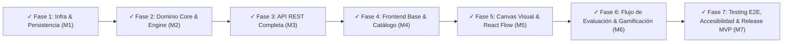

# Estado de Avance del Plan de Implementación - AWS Architecture Quest

**Fecha de Actualización:** 2026-09-23  
**Referencia:** [`docs/12-implementation-plan.md`](file:///c:/workspace/aws/aws-game/docs/12-implementation-plan.md)  
**Estado General:** **Fase 1 Completada (100%)** | **Fase 2 Completada (100%)** | **Fase 3 Completada (100%)** | **Fase 4 Completada (100%)** | **Fase 5 Completada (100%)** | **Fase 6 Completada (100%)** | **Fase 7 Completada (100% - Milestone 7 Alcanzado - Release Ready MVP)**

---

## 1. Resumen Ejecutivo de Progreso por Fases

```text
┌─────────────────────────────────────────────────────────────────────────────┐
│                       ESTADO DE HITOS Y FASES DEL PROYECTO                  │
│  [✓] Fase 1: Infraestructura Base, Entorno y Persistencia        100% (M1)  │
│  [✓] Fase 2: Dominio Core, Motor de Evaluación y Seeder         100% (M2)  │
│  [✓] Fase 3: Capa de Aplicación y API REST (.NET 10)             100% (M3)  │
│  [✓] Fase 4: Frontend Base, Enrutamiento y Conectividad           100% (M4)  │
│  [✓] Fase 5: Canvas Visual e Interacción Drag & Drop             100% (M5)  │
│  [✓] Fase 6: Flujo de Evaluación, Feedback y Gamificación        100% (M6)  │
│  [✓] Fase 7: Testing E2E, Accesibilidad y Preparación MVP        100% (M7)  │
└─────────────────────────────────────────────────────────────────────────────┘
```

---

## 2. Detalle de Tareas Implementadas

### Fase 1: Infraestructura Base, Entorno y Persistencia (Milestone 1)

#### 2.1. Tarea 1.1: Orquestación Local (Docker Compose)
* **Estado:** ✅ **Completado**
* **Artefactos Entregados:**
  * [`docker-compose.yml`](file:///c:/workspace/aws/aws-game/docker-compose.yml): Configuración del servicio PostgreSQL 15.3 Alpine (`awsquest-postgres`), puerto 5432 expuesto, red dedicada y volumen persistente `postgres_data`.
  * [`docker/init.sql`](file:///c:/workspace/aws/aws-game/docker/): Script de inicialización con extensión `pgcrypto` para soporte nativo de UUIDs en PostgreSQL.
  * [`.env.example`](file:///c:/workspace/aws/aws-game/.env.example): Plantilla de variables de entorno para desarrollo local.

#### 2.2. Tarea 1.2: Estructuración de la Solución Backend (`apps/api`)
* **Estado:** ✅ **Completado**
* **Artefactos Entregados:**
  * [`apps/api/AwsQuest.slnx`](file:///c:/workspace/aws/aws-game/apps/api/AwsQuest.slnx): Solución .NET 10 modular organizada bajo el patrón **Clean Architecture**.
  * [`apps/api/src/AwsQuest.Domain/AwsQuest.Domain.csproj`](file:///c:/workspace/aws/aws-game/apps/api/src/AwsQuest.Domain/AwsQuest.Domain.csproj): Proyecto núcleo de dominio puro sin dependencias de infraestructura.
  * [`apps/api/src/AwsQuest.Application/AwsQuest.Application.csproj`](file:///c:/workspace/aws/aws-game/apps/api/src/AwsQuest.Application/AwsQuest.Application.csproj): Capa de casos de uso y abstracciones con paquetes `FluentValidation` (12.1.1).
  * [`apps/api/src/AwsQuest.Infrastructure/AwsQuest.Infrastructure.csproj`](file:///c:/workspace/aws/aws-game/apps/api/src/AwsQuest.Infrastructure/AwsQuest.Infrastructure.csproj): Capa de persistencia y servicios externos con `Npgsql.EntityFrameworkCore.PostgreSQL` (10.0.0), `BCrypt.Net-Next` (4.2.0), y JWT tokens.
  * [`apps/api/src/AwsQuest.Api/AwsQuest.Api.csproj`](file:///c:/workspace/aws/aws-game/apps/api/src/AwsQuest.Api/AwsQuest.Api.csproj): Proyecto Web API ASP.NET Core con `Microsoft.AspNetCore.Authentication.JwtBearer` y OpenAPI / Swagger UI.
  * [`apps/api/tests/AwsQuest.UnitTests/AwsQuest.UnitTests.csproj`](file:///c:/workspace/aws/aws-game/apps/api/tests/AwsQuest.UnitTests/AwsQuest.UnitTests.csproj): Proyecto xUnit para pruebas unitarias.
  * Matriz de referencias de compilación estricta (`Api -> Infrastructure -> Application -> Domain`).

#### 2.3. Tarea 1.3: Modelado y Mapeo EF Core 10 (`AwsQuest.Infrastructure`)
* **Estado:** ✅ **Completado**
* **Artefactos Entregados:**
  * **Enums de Dominio Base (`AwsQuest.Domain/Enums/`):**
    * [`AccessMode.cs`](file:///c:/workspace/aws/aws-game/apps/api/src/AwsQuest.Domain/Enums/AccessMode.cs): `OpenAccess`, `Progressive` (RN-01).
    * [`DifficultyLevel.cs`](file:///c:/workspace/aws/aws-game/apps/api/src/AwsQuest.Domain/Enums/DifficultyLevel.cs): `Easy`, `Intermediate`, `Hard`, `Integrator`.
    * [`ProgressStatus.cs`](file:///c:/workspace/aws/aws-game/apps/api/src/AwsQuest.Domain/Enums/ProgressStatus.cs): `NotStarted`, `InProgress`, `Completed` (RN-02).
  * **Entidades de Dominio (`AwsQuest.Domain/Entities/`):**
    * [`SystemConfig.cs`](file:///c:/workspace/aws/aws-game/apps/api/src/AwsQuest.Domain/Entities/SystemConfig.cs): Configuración global de política de acceso.
    * [`User.cs`](file:///c:/workspace/aws/aws-game/apps/api/src/AwsQuest.Domain/Entities/User.cs): Usuario registrado o invitado (`IsGuest: true`, `Email` nullable).
    * [`Unit.cs`](file:///c:/workspace/aws/aws-game/apps/api/src/AwsQuest.Domain/Entities/Unit.cs): Unidades temáticas de aprendizaje con `OrderIndex` único.
    * [`AwsService.cs`](file:///c:/workspace/aws/aws-game/apps/api/src/AwsQuest.Domain/Entities/AwsService.cs): Catálogo maestro de servicios AWS con `Code` único.
    * [`Challenge.cs`](file:///c:/workspace/aws/aws-game/apps/api/src/AwsQuest.Domain/Entities/Challenge.cs): Desafío con columnas `JSONB` (`evaluation_rules_json`, `hints_json`).
    * [`ChallengeService.cs`](file:///c:/workspace/aws/aws-game/apps/api/src/AwsQuest.Domain/Entities/ChallengeService.cs): Servicios permitidos, límites (`MaxInstances`) y distractores (`IsDistractor`).
    * [`UserProgress.cs`](file:///c:/workspace/aws/aws-game/apps/api/src/AwsQuest.Domain/Entities/UserProgress.cs): Progreso, `HighScore`, `HintsUsed` y grafo del último intento en `JSONB`.
    * [`ChallengeAttempt.cs`](file:///c:/workspace/aws/aws-game/apps/api/src/AwsQuest.Domain/Entities/ChallengeAttempt.cs): Auditoría histórica con arquitectura enviada y resultado en `JSONB`.
  * **Abstracción de Persistencia:**
    * [`IAppDbContext.cs`](file:///c:/workspace/aws/aws-game/apps/api/src/AwsQuest.Application/Common/Interfaces/IAppDbContext.cs): Interfaz desacoplada en `AwsQuest.Application`.
  * **Implementación EF Core y Configuraciones Fluent API:**
    * [`AppDbContext.cs`](file:///c:/workspace/aws/aws-game/apps/api/src/AwsQuest.Infrastructure/Persistence/AppDbContext.cs): Contexto de datos con descubrimiento automático de configuraciones.
    * [`Configurations/`](file:///c:/workspace/aws/aws-game/apps/api/src/AwsQuest.Infrastructure/Persistence/Configurations/): 8 clases modulares implementando `IEntityTypeConfiguration<T>`.
    * **Índice Condicional Filtrado:** `builder.HasIndex(e => e.Email).IsUnique().HasFilter("\"email\" IS NOT NULL")` para Modo Invitado.
    * **Columnas JSONB:** Mapeo nativo `HasColumnType("jsonb")` para reglas, pistas, grafos y diagnósticos.
  * **Migración Inicial de Base de Datos:**
    * [`20260913220002_InitialCreate.cs`](file:///c:/workspace/aws/aws-game/apps/api/src/AwsQuest.Infrastructure/Persistence/Migrations/20260913220002_InitialCreate.cs): Migración generada y lista para PostgreSQL.

#### 2.4. Tarea 1.4: Inicialización del Espacio de Trabajo Frontend (`apps/web`)
* **Estado:** ✅ **Completado**
* **Artefactos Entregados:**
  * [`package.json` (Raíz)](file:///c:/workspace/aws/aws-game/package.json): Gestión monorepo mediante npm workspaces (`apps/*`).
  * [`apps/web/package.json`](file:///c:/workspace/aws/aws-game/apps/web/package.json): Stack frontend con React 19, `@xyflow/react` v12, Zustand v5, TanStack Query v5, React Router DOM v7, Tailwind CSS v3.4, Lucide React.
  * [`apps/web/vite.config.ts`](file:///c:/workspace/aws/aws-game/apps/web/vite.config.ts): Configuración de Vite con path alias `@/*` y proxy reverso hacia `/api`.
  * [`apps/web/tailwind.config.js`](file:///c:/workspace/aws/aws-game/apps/web/tailwind.config.js): Tema extendido AWS (Squid Dark, AWS Orange, Smile Blue, Feedback Pass/Error/Warning/Info).
  * [`apps/web/tsconfig.json`](file:///c:/workspace/aws/aws-game/apps/web/tsconfig.json): Configuración TypeScript para aplicación y nodo.
  * [`apps/web/src/`](file:///c:/workspace/aws/aws-game/apps/web/src/): Estructura modular **Feature-Based Architecture** (`features/auth`, `features/catalog`, `features/challenge`, `features/canvas`, `features/evaluation`, `shared/`).
  * [`apps/web/src/shared/utils/cn.ts`](file:///c:/workspace/aws/aws-game/apps/web/src/shared/utils/cn.ts) y [`httpClient.ts`](file:///c:/workspace/aws/aws-game/apps/web/src/shared/api/httpClient.ts).

---

### Fase 2: Dominio Core, Motor de Evaluación y Seeder Declarativo (Milestone 2 - 100% Completado)

#### 2.5. Tarea 2.1: Modelos de Dominio, Enums y Grafo Semántico (`AwsQuest.Domain`)
* **Estado:** ✅ **Completado**
* **Artefactos Entregados:**
  * **Enums de Dominio (`AwsQuest.Domain/Enums/`):**
    * [`ChallengeMode.cs`](file:///c:/workspace/aws/aws-game/apps/api/src/AwsQuest.Domain/Enums/ChallengeMode.cs): Modalidades `Builder` y `FixArchitecture`.
    * [`FeedbackItemStatus.cs`](file:///c:/workspace/aws/aws-game/apps/api/src/AwsQuest.Domain/Enums/FeedbackItemStatus.cs): Estados `Pass`, `Fail`, `Warning`, `Info`.
    * [`FeedbackCategory.cs`](file:///c:/workspace/aws/aws-game/apps/api/src/AwsQuest.Domain/Enums/FeedbackCategory.cs): 9 categorías (`ServiceSelection`, `Connection`, `Availability`, `Security`, etc.).
    * [`ConnectionType.cs`](file:///c:/workspace/aws/aws-game/apps/api/src/AwsQuest.Domain/Enums/ConnectionType.cs): Tipos de enlace (`HttpHttps`, `Database`, `AsyncQueue`, `InternalVpc`, `Storage`, `SecurityGroup`).
    * [`AntiPatternType.cs`](file:///c:/workspace/aws/aws-game/apps/api/src/AwsQuest.Domain/Enums/AntiPatternType.cs): 8 tipos de antipatrones (`SinglePointOfFailure`, `PublicDatabaseExposure`, etc.).
  * **Modelos del Grafo Semántico (`AwsQuest.Domain/Engine/Models/`):**
    * [`ComponentConfig.cs`](file:///c:/workspace/aws/aws-game/apps/api/src/AwsQuest.Domain/Engine/Models/ComponentConfig.cs): Configuración de nodo (`IsMultiAz`, `AutoScaling`, `InstanceCount`, etc.).
    * [`GraphComponent.cs`](file:///c:/workspace/aws/aws-game/apps/api/src/AwsQuest.Domain/Engine/Models/GraphComponent.cs): Nodo de arquitectura instanciado.
    * [`GraphConnection.cs`](file:///c:/workspace/aws/aws-game/apps/api/src/AwsQuest.Domain/Engine/Models/GraphConnection.cs): Conexión dirigida entre componentes.
    * [`SemanticGraph.cs`](file:///c:/workspace/aws/aws-game/apps/api/src/AwsQuest.Domain/Engine/Models/SemanticGraph.cs): Contenedor topológico con consultas $O(1)/O(N)$ (`HasConnectionBetweenServices`, `GetComponentById`, `GetEffectiveInstanceCount`, etc.).
  * **Modelos de Reglas Declarativas y Feedback:**
    * [`RequiredConnectionRule.cs`](file:///c:/workspace/aws/aws-game/apps/api/src/AwsQuest.Domain/Engine/Models/RequiredConnectionRule.cs) y [`ForbiddenConnectionRule.cs`](file:///c:/workspace/aws/aws-game/apps/api/src/AwsQuest.Domain/Engine/Models/ForbiddenConnectionRule.cs).
    * [`AntiPatternRule.cs`](file:///c:/workspace/aws/aws-game/apps/api/src/AwsQuest.Domain/Engine/Models/AntiPatternRule.cs) y [`HintDefinition.cs`](file:///c:/workspace/aws/aws-game/apps/api/src/AwsQuest.Domain/Engine/Models/HintDefinition.cs).
    * [`ChallengeEvaluationRules.cs`](file:///c:/workspace/aws/aws-game/apps/api/src/AwsQuest.Domain/Engine/Models/ChallengeEvaluationRules.cs): Reglas completas para deserialización `JSONB`.
    * [`FeedbackItem.cs`](file:///c:/workspace/aws/aws-game/apps/api/src/AwsQuest.Domain/Engine/Models/FeedbackItem.cs) y [`EvaluationFeedback.cs`](file:///c:/workspace/aws/aws-game/apps/api/src/AwsQuest.Domain/Engine/Models/EvaluationFeedback.cs).
    * [`EvaluationResult.cs`](file:///c:/workspace/aws/aws-game/apps/api/src/AwsQuest.Domain/Engine/Models/EvaluationResult.cs): Puntuación clamp (0-100), umbral y cálculo de penalizaciones.
    * [`GameScoringRules.cs`](file:///c:/workspace/aws/aws-game/apps/api/src/AwsQuest.Domain/Engine/Models/GameScoringRules.cs): Fórmulas de XP anti-farmeo (**RN-10**) y niveles de usuario.
  * **Excepciones de Dominio (`AwsQuest.Domain/Exceptions/`):**
    * [`DomainException.cs`](file:///c:/workspace/aws/aws-game/apps/api/src/AwsQuest.Domain/Exceptions/DomainException.cs), [`InvalidGraphException.cs`](file:///c:/workspace/aws/aws-game/apps/api/src/AwsQuest.Domain/Exceptions/InvalidGraphException.cs), [`ServiceLimitExceededException.cs`](file:///c:/workspace/aws/aws-game/apps/api/src/AwsQuest.Domain/Exceptions/ServiceLimitExceededException.cs) e [`InvalidEvaluationRuleException.cs`](file:///c:/workspace/aws/aws-game/apps/api/src/AwsQuest.Domain/Exceptions/InvalidEvaluationRuleException.cs).
  * **Suite de Pruebas Unitarias:**
    * [`DomainModelsTests.cs`](file:///c:/workspace/aws/aws-game/apps/api/tests/AwsQuest.UnitTests/Engine/DomainModelsTests.cs): 15 tests unitarios superados al 100%.

#### 2.6. Tarea 2.2 y 2.3: Motor de Evaluación y Suite de Tests Unitarios (`AwsQuest.Domain.Engine` & `AwsQuest.UnitTests`)
* **Estado:** ✅ **Completado**
* **Artefactos Entregados:**
  * **Pipeline de Evaluación en Memoria (`AwsQuest.Domain/Engine/`):**
    * [`Context/EvaluationExecutionContext.cs`](file:///c:/workspace/aws/aws-game/apps/api/src/AwsQuest.Domain/Engine/Context/EvaluationExecutionContext.cs): Contexto de ejecución y acumulación de penalizaciones/feedback.
    * [`IEvaluationEngine.cs`](file:///c:/workspace/aws/aws-game/apps/api/src/AwsQuest.Domain/Engine/IEvaluationEngine.cs) y [`EvaluationEngine.cs`](file:///c:/workspace/aws/aws-game/apps/api/src/AwsQuest.Domain/Engine/EvaluationEngine.cs): Orquestador principal del pipeline en memoria ($< 100$ ms).
    * [`Evaluators/IEvaluatorStep.cs`](file:///c:/workspace/aws/aws-game/apps/api/src/AwsQuest.Domain/Engine/Evaluators/IEvaluatorStep.cs): Contrato para evaluadores especializados.
    * [`Evaluators/ServicePresenceEvaluator.cs`](file:///c:/workspace/aws/aws-game/apps/api/src/AwsQuest.Domain/Engine/Evaluators/ServicePresenceEvaluator.cs): Validación de servicios requeridos, prohibidos y límites de instancias.
    * [`Evaluators/ConnectionEvaluator.cs`](file:///c:/workspace/aws/aws-game/apps/api/src/AwsQuest.Domain/Engine/Evaluators/ConnectionEvaluator.cs): Validación de enlaces obligatorios, prohibidos y componentes aislados.
    * [`Evaluators/AntiPatternEvaluator.cs`](file:///c:/workspace/aws/aws-game/apps/api/src/AwsQuest.Domain/Engine/Evaluators/AntiPatternEvaluator.cs): Detección de SPOF, BD pública, falta de Multi-AZ y Auto Scaling.
    * [`Evaluators/ScoreCalculator.cs`](file:///c:/workspace/aws/aws-game/apps/api/src/AwsQuest.Domain/Engine/Evaluators/ScoreCalculator.cs): Cálculo cuantitativo de puntuación $[0, 100]$, deducción por pistas y resumen pedagógico.
  * **Suite Completa de Pruebas Unitarias (`apps/api/tests/AwsQuest.UnitTests/Engine/`):**
    * [`ServicePresenceEvaluatorTests.cs`](file:///c:/workspace/aws/aws-game/apps/api/tests/AwsQuest.UnitTests/Engine/ServicePresenceEvaluatorTests.cs): 5 tests.
    * [`ConnectionEvaluatorTests.cs`](file:///c:/workspace/aws/aws-game/apps/api/tests/AwsQuest.UnitTests/Engine/ConnectionEvaluatorTests.cs): 4 tests.
    * [`AntiPatternEvaluatorTests.cs`](file:///c:/workspace/aws/aws-game/apps/api/tests/AwsQuest.UnitTests/Engine/AntiPatternEvaluatorTests.cs): 4 tests.
    * [`ScoreCalculatorTests.cs`](file:///c:/workspace/aws/aws-game/apps/api/tests/AwsQuest.UnitTests/Engine/ScoreCalculatorTests.cs): 5 tests.
    * [`EvaluationEngineTests.cs`](file:///c:/workspace/aws/aws-game/apps/api/tests/AwsQuest.UnitTests/Engine/EvaluationEngineTests.cs): 4 tests integrales (End-to-End, rendimiento $< 100$ ms, validación de grafos vacíos).

#### 2.7. Tarea 2.4: Contenido Declarativo y Seeder (`content/` & `ChallengeSeeder`)
* **Estado:** ✅ **Completado**
* **Artefactos Entregados:**
  * **Estructura Declarativa de Contenidos GitOps (`content/`):**
    * [`content/services/aws-services.json`](file:///c:/workspace/aws/aws-game/content/services/aws-services.json): Catálogo maestro de 12 servicios AWS (S3, EC2, RDS, DynamoDB, Lambda, API Gateway, SQS, SNS, CloudFront, ALB, VPC, IAM).
    * [`content/system-config.json`](file:///c:/workspace/aws/aws-game/content/system-config.json): Configuración por defecto de política de acceso abierta (`OpenAccess`).
    * [`content/challenges/unit-1/unit.json`](file:///c:/workspace/aws/aws-game/content/challenges/unit-1/unit.json) & [`challenge-101.json`](file:///c:/workspace/aws/aws-game/content/challenges/unit-1/challenge-101.json): Desafío "Static Web Hosting con S3" (Nivel Fácil).
    * [`content/challenges/unit-2/unit.json`](file:///c:/workspace/aws/aws-game/content/challenges/unit-2/unit.json) & [`challenge-201.json`](file:///c:/workspace/aws/aws-game/content/challenges/unit-2/challenge-201.json): Desafío "Arquitectura Web Escalable y Resiliente en 3 Capas" (Nivel Intermedio: ALB + EC2 Auto Scaling + Multi-AZ RDS).
  * **Capa de Aplicación (`AwsQuest.Application`):**
    * [`SeedingDtos.cs`](file:///c:/workspace/aws/aws-game/apps/api/src/AwsQuest.Application/Common/Models/Seeding/SeedingDtos.cs): DTOs deserializables con System.Text.Json.
    * [`IChallengeContentReader.cs`](file:///c:/workspace/aws/aws-game/apps/api/src/AwsQuest.Application/Common/Interfaces/IChallengeContentReader.cs): Contrato de lectura declarativa de archivos.
    * [`IChallengeSeeder.cs`](file:///c:/workspace/aws/aws-game/apps/api/src/AwsQuest.Application/Common/Interfaces/IChallengeSeeder.cs): Contrato de sincronización idempotente hacia base de datos.
  * **Capa de Infraestructura (`AwsQuest.Infrastructure`):**
    * [`JsonChallengeContentReader.cs`](file:///c:/workspace/aws/aws-game/apps/api/src/AwsQuest.Infrastructure/Persistence/Seeding/JsonChallengeContentReader.cs): Lector recursivo con resolución automática de directorios.
    * [`ChallengeSeeder.cs`](file:///c:/workspace/aws/aws-game/apps/api/src/AwsQuest.Infrastructure/Persistence/Seeding/ChallengeSeeder.cs): Sincronizador transaccional e idempotente (upsert) para `SystemConfig`, `AwsServices`, `Units`, `Challenges` y `ChallengeServices`.
    * [`DependencyInjection.cs`](file:///c:/workspace/aws/aws-game/apps/api/src/AwsQuest.Infrastructure/DependencyInjection.cs): Registro en DI de `IChallengeContentReader`, `IChallengeSeeder` y `IEvaluationEngine`.
  * **Suite de Pruebas Unitarias y de Integración (`apps/api/tests/`):**
    * [`JsonChallengeContentReaderTests.cs`](file:///c:/workspace/aws/aws-game/apps/api/tests/AwsQuest.UnitTests/Seeding/JsonChallengeContentReaderTests.cs): 2 tests unitarios.
    * [`ChallengeSeederTests.cs`](file:///c:/workspace/aws/aws-game/apps/api/tests/AwsQuest.UnitTests/Seeding/ChallengeSeederTests.cs): 2 tests unitarios.
    * [`ChallengeSeederPostgresTests.cs`](file:///c:/workspace/aws/aws-game/apps/api/tests/AwsQuest.IntegrationTests/Seeding/ChallengeSeederPostgresTests.cs): 1 test de integración contra PostgreSQL real (Docker `awsquest-postgres`).

---

### Fase 3: Capa de Aplicación y Endpoints de la API REST (Milestone 3 - 100% Completado)

#### 2.8. Tarea 3.1: DTOs, Envelopes y Validadores (`AwsQuest.Application` & `AwsQuest.UnitTests`)
* **Estado:** ✅ **Completado**
* **Artefactos Entregados:**
  * **Envelopes Estándar y Modelos Comunes (`AwsQuest.Application/Common/Models/`):**
    * [`ApiResponse.cs`](file:///c:/workspace/aws/aws-game/apps/api/src/AwsQuest.Application/Common/Models/ApiResponse.cs): Envelope exitoso genérico con `ApiMetaDto` y `PaginationMetadataDto`.
    * [`ApiErrorResponse.cs`](file:///c:/workspace/aws/aws-game/apps/api/src/AwsQuest.Application/Common/Models/ApiErrorResponse.cs): Envelope de error con `ApiErrorDetails` y `ValidationErrorDetail`.
    * [`ErrorCodes.cs`](file:///c:/workspace/aws/aws-game/apps/api/src/AwsQuest.Application/Common/Models/ErrorCodes.cs): Catálogo de constantes de error alfanuméricas.
  * **DTOs por Módulo Funcional (`AwsQuest.Application/Dtos/`):**
    * [`Dtos/Auth/AuthDtos.cs`](file:///c:/workspace/aws/aws-game/apps/api/src/AwsQuest.Application/Dtos/Auth/AuthDtos.cs): `UserDto`, `GuestSessionResponseDto`, `RegisterRequestDto`, `RegisterResponseDto`, `LoginRequestDto`, `LoginResponseDto`, `UserProfileDto`.
    * [`Dtos/Catalog/CatalogDtos.cs`](file:///c:/workspace/aws/aws-game/apps/api/src/AwsQuest.Application/Dtos/Catalog/CatalogDtos.cs): `UnitResponseDto`, `CatalogChallengeDto`, `ChallengeProgressSummaryDto`.
    * [`Dtos/Challenge/ChallengeDtos.cs`](file:///c:/workspace/aws/aws-game/apps/api/src/AwsQuest.Application/Dtos/Challenge/ChallengeDtos.cs): `ChallengeDetailResponseDto`, `ChallengeAllowedServiceDto`, `HintsSummaryDto`, `UnlockedHintDto`, `UnlockHintResponseDto`.
    * [`Dtos/Evaluation/EvaluationDtos.cs`](file:///c:/workspace/aws/aws-game/apps/api/src/AwsQuest.Application/Dtos/Evaluation/EvaluationDtos.cs): `EvaluateArchitectureRequestDto`, `EvaluateArchitectureResponseDto`, `ChallengeAttemptHistoryDto`.
    * [`Dtos/MasterServices/MasterServicesDtos.cs`](file:///c:/workspace/aws/aws-game/apps/api/src/AwsQuest.Application/Dtos/MasterServices/MasterServicesDtos.cs): `AwsServiceResponseDto`.
    * [`Dtos/SystemConfig/SystemConfigDtos.cs`](file:///c:/workspace/aws/aws-game/apps/api/src/AwsQuest.Application/Dtos/SystemConfig/SystemConfigDtos.cs): `SystemConfigResponseDto`, `UpdateSystemConfigRequestDto`.
  * **Validadores FluentValidation (`AwsQuest.Application/Validators/`):**
    * [`RegisterRequestDtoValidator.cs`](file:///c:/workspace/aws/aws-game/apps/api/src/AwsQuest.Application/Validators/RegisterRequestDtoValidator.cs): Validación de email, fortaleza de contraseña y nombre.
    * [`LoginRequestDtoValidator.cs`](file:///c:/workspace/aws/aws-game/apps/api/src/AwsQuest.Application/Validators/LoginRequestDtoValidator.cs): Validación de credenciales.
    * [`UpdateSystemConfigRequestDtoValidator.cs`](file:///c:/workspace/aws/aws-game/apps/api/src/AwsQuest.Application/Validators/UpdateSystemConfigRequestDtoValidator.cs): Validación del enum `AccessMode`.
    * [`EvaluateArchitectureRequestDtoValidator.cs`](file:///c:/workspace/aws/aws-game/apps/api/src/AwsQuest.Application/Validators/EvaluateArchitectureRequestDtoValidator.cs): Validación de topología de grafos, nodos y enlaces no circulares.
    * [`DependencyInjection.cs`](file:///c:/workspace/aws/aws-game/apps/api/src/AwsQuest.Application/DependencyInjection.cs): Registro automático de validadores en el contenedor IoC.
  * **Suite de Pruebas Unitarias (`AwsQuest.UnitTests/Validators/`):**
    * [`RegisterRequestDtoValidatorTests.cs`](file:///c:/workspace/aws/aws-game/apps/api/tests/AwsQuest.UnitTests/Validators/RegisterRequestDtoValidatorTests.cs): 14 tests de validación.
    * [`LoginRequestDtoValidatorTests.cs`](file:///c:/workspace/aws/aws-game/apps/api/tests/AwsQuest.UnitTests/Validators/LoginRequestDtoValidatorTests.cs): 4 tests de validación.
    * [`UpdateSystemConfigRequestDtoValidatorTests.cs`](file:///c:/workspace/aws/aws-game/apps/api/tests/AwsQuest.UnitTests/Validators/UpdateSystemConfigRequestDtoValidatorTests.cs): 3 tests de validación.
    * [`EvaluateArchitectureRequestDtoValidatorTests.cs`](file:///c:/workspace/aws/aws-game/apps/api/tests/AwsQuest.UnitTests/Validators/EvaluateArchitectureRequestDtoValidatorTests.cs): 6 tests de validación de grafos semánticos.

#### 2.9. Tarea 3.2: Módulo de Autenticación y Modo Invitado (`AwsQuest.Application`, `AwsQuest.Infrastructure`, `AwsQuest.Api`)
* **Estado:** ✅ **Completado**
* **Artefactos Entregados:**
  * **Contratos e Interfaces (`AwsQuest.Application/Common/Interfaces/`):**
    * [`IAuthService.cs`](file:///c:/workspace/aws/aws-game/apps/api/src/AwsQuest.Application/Common/Interfaces/IAuthService.cs): Operaciones de sesión invitado, registro con migración, login y perfil.
    * [`IJwtService.cs`](file:///c:/workspace/aws/aws-game/apps/api/src/AwsQuest.Application/Common/Interfaces/IJwtService.cs): Emisión, validación y extracción de tokens JWT.
    * [`IPasswordHasher.cs`](file:///c:/workspace/aws/aws-game/apps/api/src/AwsQuest.Application/Common/Interfaces/IPasswordHasher.cs): Hashing y verificación con salt dinámico.
    * [`ICurrentUserService.cs`](file:///c:/workspace/aws/aws-game/apps/api/src/AwsQuest.Application/Common/Interfaces/ICurrentUserService.cs): Identidad del usuario en la petición activa.
  * **Excepciones y Mapeos de Autenticación:**
    * [`AuthExceptions.cs`](file:///c:/workspace/aws/aws-game/apps/api/src/AwsQuest.Application/Common/Exceptions/AuthExceptions.cs): `DuplicateEmailException`, `InvalidCredentialsException`, `UserNotFoundException`.
    * [`AuthMappingExtensions.cs`](file:///c:/workspace/aws/aws-game/apps/api/src/AwsQuest.Application/Mappings/AuthMappingExtensions.cs): Mapeos de `User` a `UserDto` y `UserProfileDto`.
  * **Infraestructura de Seguridad y Servicios (`AwsQuest.Infrastructure/`):**
    * [`JwtSettings.cs`](file:///c:/workspace/aws/aws-game/apps/api/src/AwsQuest.Infrastructure/Authentication/JwtSettings.cs): Opciones tipadas para JWT.
    * [`BCryptPasswordHasher.cs`](file:///c:/workspace/aws/aws-game/apps/api/src/AwsQuest.Infrastructure/Authentication/BCryptPasswordHasher.cs): Hashing seguro con BCrypt (WorkFactor = 11, SHA-384).
    * [`JwtService.cs`](file:///c:/workspace/aws/aws-game/apps/api/src/AwsQuest.Infrastructure/Authentication/JwtService.cs): Generación de tokens con claims diferenciados (24h registrados, 30 días invitados).
    * [`AuthService.cs`](file:///c:/workspace/aws/aws-game/apps/api/src/AwsQuest.Infrastructure/Services/AuthService.cs): Lógica transaccional con migración in-place de progreso de invitados (**RN-13 / CU-08**).
    * [`CurrentUserService.cs`](file:///c:/workspace/aws/aws-game/apps/api/src/AwsQuest.Infrastructure/Services/CurrentUserService.cs): Resolución de usuario autenticado mediante `IHttpContextAccessor`.
  * **API REST y Middlewares (`AwsQuest.Api/`):**
    * [`AuthController.cs`](file:///c:/workspace/aws/aws-game/apps/api/src/AwsQuest.Api/Controllers/AuthController.cs): Endpoints `POST /api/v1/auth/guest`, `POST /api/v1/auth/register`, `POST /api/v1/auth/login`, `GET /api/v1/auth/me`.
    * [`AuthenticationExtensions.cs`](file:///c:/workspace/aws/aws-game/apps/api/src/AwsQuest.Api/Extensions/AuthenticationExtensions.cs): Configuración `JwtBearer` con eventos `OnChallenge` (401) y `OnForbidden` (403).
    * [`ApiExceptionMiddleware.cs`](file:///c:/workspace/aws/aws-game/apps/api/src/AwsQuest.Api/Middlewares/ApiExceptionMiddleware.cs): Manejo global de excepciones mapeando a `ApiErrorResponse`.
  * **Suite de Pruebas Unitarias (`AwsQuest.UnitTests/`):**
    * [`BCryptPasswordHasherTests.cs`](file:///c:/workspace/aws/aws-game/apps/api/tests/AwsQuest.UnitTests/Authentication/BCryptPasswordHasherTests.cs): 4 tests.
    * [`JwtServiceTests.cs`](file:///c:/workspace/aws/aws-game/apps/api/tests/AwsQuest.UnitTests/Authentication/JwtServiceTests.cs): 5 tests.
    * [`AuthServiceTests.cs`](file:///c:/workspace/aws/aws-game/apps/api/tests/AwsQuest.UnitTests/Services/AuthServiceTests.cs): 9 tests cubriendo todos los escenarios nominales y de excepción.

#### 2.10. Tarea 3.3: Módulo de Catálogo y Desafíos (`AwsQuest.Application`, `AwsQuest.Infrastructure`, `AwsQuest.Api`)
* **Estado:** ✅ **Completado**
* **Artefactos Entregados:**
  * **Contratos e Interfaces (`AwsQuest.Application/Common/Interfaces/`):**
    * [`ICatalogService.cs`](file:///c:/workspace/aws/aws-game/apps/api/src/AwsQuest.Application/Common/Interfaces/ICatalogService.cs): Obtención de unidades y desafíos con evaluación de políticas de acceso.
    * [`IChallengeService.cs`](file:///c:/workspace/aws/aws-game/apps/api/src/AwsQuest.Application/Common/Interfaces/IChallengeService.cs): Carga de contexto detallado de workspace y sanitización de pistas.
  * **Excepciones y Mapeos:**
    * [`CatalogExceptions.cs`](file:///c:/workspace/aws/aws-game/apps/api/src/AwsQuest.Application/Common/Exceptions/CatalogExceptions.cs): `ChallengeNotFoundException` y `ChallengeLockedException`.
    * [`CatalogMappingExtensions.cs`](file:///c:/workspace/aws/aws-game/apps/api/src/AwsQuest.Application/Mappings/CatalogMappingExtensions.cs): Mapeos `ToCatalogDto` y `ToDetailDto` con protección anti-cheat de pistas no reveladas y deserialización de grafos.
  * **Infraestructura y Servicios (`AwsQuest.Infrastructure/Services/`):**
    * [`CatalogService.cs`](file:///c:/workspace/aws/aws-game/apps/api/src/AwsQuest.Infrastructure/Services/CatalogService.cs): Evaluación de bloqueo dinámico (`OpenAccess` vs `Progressive` con prerrequisitos y XP - **RN-01 / CU-01**).
    * [`ChallengeService.cs`](file:///c:/workspace/aws/aws-game/apps/api/src/AwsQuest.Infrastructure/Services/ChallengeService.cs): Consulta contextual con verificación de bloqueo y sanitización de pistas.
    * [`DependencyInjection.cs`](file:///c:/workspace/aws/aws-game/apps/api/src/AwsQuest.Infrastructure/DependencyInjection.cs): Registro en contenedor IoC de `ICatalogService` e `IChallengeService`.
  * **API REST y Middlewares (`AwsQuest.Api/`):**
    * [`UnitsController.cs`](file:///c:/workspace/aws/aws-game/apps/api/src/AwsQuest.Api/Controllers/UnitsController.cs): Endpoint `GET /api/v1/units` (`[Authorize]`).
    * [`ChallengesController.cs`](file:///c:/workspace/aws/aws-game/apps/api/src/AwsQuest.Api/Controllers/ChallengesController.cs): Endpoint `GET /api/v1/challenges/{id}` (`[Authorize]`).
  * **Suite de Pruebas Unitarias (`AwsQuest.UnitTests/Services/`):**
    * [`CatalogServiceTests.cs`](file:///c:/workspace/aws/aws-game/apps/api/tests/AwsQuest.UnitTests/Services/CatalogServiceTests.cs): 5 tests.
    * [`ChallengeServiceTests.cs`](file:///c:/workspace/aws/aws-game/apps/api/tests/AwsQuest.UnitTests/Services/ChallengeServiceTests.cs): 5 tests.

#### 2.11. Tarea 3.4: Módulo de Pistas y Evaluación (`AwsQuest.Application`, `AwsQuest.Infrastructure`, `AwsQuest.Api`)
* **Estado:** ✅ **Completado**
* **Artefactos Entregados:**
  * **Contratos e Interfaces (`AwsQuest.Application/Common/Interfaces/`):**
    * [`IHintService.cs`](file:///c:/workspace/aws/aws-game/apps/api/src/AwsQuest.Application/Common/Interfaces/IHintService.cs): Desbloqueo secuencial de pistas con acumulación de penalizaciones (**RN-06 / RN-07 / CU-04**).
    * [`IEvaluationService.cs`](file:///c:/workspace/aws/aws-game/apps/api/src/AwsQuest.Application/Common/Interfaces/IEvaluationService.cs): Orquestación de evaluación en memoria, persistencia transaccional ACID con anti-refarming XP y consulta de intentos históricos (**RN-02 / RN-08 / RN-09 / RN-10 / CU-05**).
  * **Excepciones de Aplicación:**
    * [`EvaluationExceptions.cs`](file:///c:/workspace/aws/aws-game/apps/api/src/AwsQuest.Application/Common/Exceptions/EvaluationExceptions.cs): `AllHintsUnlockedException` mapeada a HTTP 400 (`ALL_HINTS_UNLOCKED`).
  * **Infraestructura y Servicios (`AwsQuest.Infrastructure/Services/`):**
    * [`HintService.cs`](file:///c:/workspace/aws/aws-game/apps/api/src/AwsQuest.Infrastructure/Services/HintService.cs): Control de orden secuencial, cálculo de penalización acumulativa y validación en modo progresivo.
    * [`EvaluationService.cs`](file:///c:/workspace/aws/aws-game/apps/api/src/AwsQuest.Infrastructure/Services/EvaluationService.cs): Transacción ACID atómica con `CreateExecutionStrategy` y `BeginTransactionAsync`, cálculo de XP anti-farmeo (`GameScoringRules.CalculateEarnedXp`), actualización de nivel de usuario y auditoría en `ChallengeAttempt`.
    * [`DependencyInjection.cs`](file:///c:/workspace/aws/aws-game/apps/api/src/AwsQuest.Infrastructure/DependencyInjection.cs): Registro en contenedor IoC de `IEvaluationEngine`, `IHintService` e `IEvaluationService`.
  * **API REST y Middlewares (`AwsQuest.Api/`):**
    * [`ChallengesController.cs`](file:///c:/workspace/aws/aws-game/apps/api/src/AwsQuest.Api/Controllers/ChallengesController.cs): Endpoints `POST /api/v1/challenges/{id}/hints/unlock`, `POST /api/v1/challenges/{id}/evaluate`, `GET /api/v1/challenges/{id}/attempts`.
  * **Colección de Pruebas Postman:**
    * [`postman/hints_evaluation/awsquest-hints-evaluation.postman_collection.json`](file:///c:/workspace/aws/aws-game/postman/hints_evaluation/awsquest-hints-evaluation.postman_collection.json)
    * [`postman/hints_evaluation/awsquest-local.postman_environment.json`](file:///c:/workspace/aws/aws-game/postman/hints_evaluation/awsquest-local.postman_environment.json)
    * [`postman/hints_evaluation/README.md`](file:///c:/workspace/aws/aws-game/postman/hints_evaluation/README.md)
  * **Suite de Pruebas Unitarias (`AwsQuest.UnitTests/Services/`):**
    * [`HintServiceTests.cs`](file:///c:/workspace/aws/aws-game/apps/api/tests/AwsQuest.UnitTests/Services/HintServiceTests.cs): 5 tests.
    * [`EvaluationServiceTests.cs`](file:///c:/workspace/aws/aws-game/apps/api/tests/AwsQuest.UnitTests/Services/EvaluationServiceTests.cs): 7 tests.

#### 2.12. Tarea 3.5: Módulo de Servicios Maestros y Configuración del Sistema (`AwsQuest.Application`, `AwsQuest.Infrastructure`, `AwsQuest.Api`)
* **Estado:** ✅ **Completado**
* **Artefactos Entregados:**
  * **Contratos e Interfaces (`AwsQuest.Application/Common/Interfaces/`):**
    * [`IMasterServicesService.cs`](file:///c:/workspace/aws/aws-game/apps/api/src/AwsQuest.Application/Common/Interfaces/IMasterServicesService.cs): Consulta de catálogo maestro de servicios con filtrado por categoría (**RF-06**).
    * [`ISystemConfigService.cs`](file:///c:/workspace/aws/aws-game/apps/api/src/AwsQuest.Application/Common/Interfaces/ISystemConfigService.cs): Consulta y actualización de política de acceso global (**RF-04 / RN-01 / CU-07**).
  * **Extensiones de Mapeo:**
    * [`MasterServicesMappingExtensions.cs`](file:///c:/workspace/aws/aws-game/apps/api/src/AwsQuest.Application/Mappings/MasterServicesMappingExtensions.cs): Mapeo `AwsService` a `AwsServiceResponseDto`.
    * [`SystemConfigMappingExtensions.cs`](file:///c:/workspace/aws/aws-game/apps/api/src/AwsQuest.Application/Mappings/SystemConfigMappingExtensions.cs): Mapeo `SystemConfig` a `SystemConfigResponseDto`.
  * **Infraestructura y Servicios (`AwsQuest.Infrastructure/Services/`):**
    * [`MasterServicesService.cs`](file:///c:/workspace/aws/aws-game/apps/api/src/AwsQuest.Infrastructure/Services/MasterServicesService.cs): Consultas `AsNoTracking` con filtrado insensible a mayúsculas/minúsculas y ordenamiento alfabético por categoría y nombre.
    * [`SystemConfigService.cs`](file:///c:/workspace/aws/aws-game/apps/api/src/AwsQuest.Infrastructure/Services/SystemConfigService.cs): Fallback resiliente con creación automática de `OpenAccess` y actualización con timestamp UTC.
    * [`DependencyInjection.cs`](file:///c:/workspace/aws/aws-game/apps/api/src/AwsQuest.Infrastructure/DependencyInjection.cs): Registro en contenedor IoC de `IMasterServicesService` e `ISystemConfigService`.
  * **API REST (`AwsQuest.Api/`):**
    * [`ServicesController.cs`](file:///c:/workspace/aws/aws-game/apps/api/src/AwsQuest.Api/Controllers/ServicesController.cs): Endpoint `GET /api/v1/services`.
    * [`SystemConfigController.cs`](file:///c:/workspace/aws/aws-game/apps/api/src/AwsQuest.Api/Controllers/SystemConfigController.cs): Endpoints `GET /api/v1/system/config` y `PATCH /api/v1/system/config` (`[Authorize]`).
  * **Colección de Pruebas Postman:**
    * [`postman/master_services_config/awsquest-master-services-config.postman_collection.json`](file:///c:/workspace/aws/aws-game/postman/master_services_config/awsquest-master-services-config.postman_collection.json)
    * [`postman/master_services_config/awsquest-local.postman_environment.json`](file:///c:/workspace/aws/aws-game/postman/master_services_config/awsquest-local.postman_environment.json)
    * [`postman/master_services_config/README.md`](file:///c:/workspace/aws/aws-game/postman/master_services_config/README.md)
  * **Suite de Pruebas Unitarias (`AwsQuest.UnitTests/Services/`):**
    * [`MasterServicesServiceTests.cs`](file:///c:/workspace/aws/aws-game/apps/api/tests/AwsQuest.UnitTests/Services/MasterServicesServiceTests.cs): 4 tests.
    * [`SystemConfigServiceTests.cs`](file:///c:/workspace/aws/aws-game/apps/api/tests/AwsQuest.UnitTests/Services/SystemConfigServiceTests.cs): 4 tests.

#### 2.13. Tarea 3.6: Manejo Global de Excepciones y Swagger / OpenAPI (`AwsQuest.Api` & `AwsQuest.UnitTests`)
* **Estado:** ✅ **Completado (Milestone 3 Alcanzado)**
* **Artefactos Entregados:**
  * **Configuración Swagger / OpenAPI (`AwsQuest.Api/Extensions/`):**
    * [`SwaggerExtensions.cs`](file:///c:/workspace/aws/aws-game/apps/api/src/AwsQuest.Api/Extensions/SwaggerExtensions.cs): Configuración de OpenAPI v1 con esquema de seguridad Bearer JWT (`Authorize` dialog) y lectura de comentarios XML.
  * **Middleware Global de Excepciones (`AwsQuest.Api/Middlewares/`):**
    * [`ApiExceptionMiddleware.cs`](file:///c:/workspace/aws/aws-game/apps/api/src/AwsQuest.Api/Middlewares/ApiExceptionMiddleware.cs): Interceptor centralizado de errores mapeando a `ApiErrorResponse` canónico con `ErrorCodes` estándar y serialización camelCase.
  * **Integración en Pipeline (`AwsQuest.Api/Program.cs`):**
    * Registro de `AddSwaggerDocumentation()` y activación de `UseSwaggerDocumentation()`.
  * **Colección de Pruebas Postman:**
    * [`postman/global_exception_swagger/awsquest-global-exception-swagger.postman_collection.json`](file:///c:/workspace/aws/aws-game/postman/global_exception_swagger/awsquest-global-exception-swagger.postman_collection.json)
    * [`postman/global_exception_swagger/awsquest-local.postman_environment.json`](file:///c:/workspace/aws/aws-game/postman/global_exception_swagger/awsquest-local.postman_environment.json)
    * [`postman/global_exception_swagger/README.md`](file:///c:/workspace/aws/aws-game/postman/global_exception_swagger/README.md)
  * **Suite de Pruebas Unitarias (`AwsQuest.UnitTests/Middlewares/`):**
    * [`ApiExceptionMiddlewareTests.cs`](file:///c:/workspace/aws/aws-game/apps/api/tests/AwsQuest.UnitTests/Middlewares/ApiExceptionMiddlewareTests.cs): 11 tests unitarios exhaustivos para cada excepción del middleware.
  * **Total de Pruebas Automatizadas del Backend:** **130 tests superados al 100% (129 unitarios + 1 integración contra PostgreSQL)**.

---

### Fase 4: Frontend Base, Enrutamiento y Conectividad (Milestone 4 - 25% Completado)

#### 2.14. Tarea 4.1: Configuración de Cliente HTTP y Autenticación (`apps/web`)
* **Estado:** ✅ **Completado**
* **Artefactos Entregados:**
  * **Tipado Estricto TypeScript (`apps/web/src/`):**
    * [`shared/types/api.types.ts`](file:///c:/workspace/aws/aws-game/apps/web/src/shared/types/api.types.ts): Envelopes canónicos `ApiResponse<T>`, `ApiErrorResponse`, `PaginationMetadataDto`, `ValidationErrorDetail`, y catálogo de constantes `ErrorCodes`.
    * [`features/auth/types/auth.types.ts`](file:///c:/workspace/aws/aws-game/apps/web/src/features/auth/types/auth.types.ts): `UserSession`, `UserDto`, `GuestSessionResponseDto`, `RegisterRequestDto`, `RegisterResponseDto`, `LoginRequestDto`, `LoginResponseDto`, `UserProfileDto`.
  * **Cliente HTTP y Manejo de Errores (`shared/api/`):**
    * [`ApiHttpError.ts`](file:///c:/workspace/aws/aws-game/apps/web/src/shared/api/ApiHttpError.ts): Clase de error personalizada tipada.
    * [`httpClient.ts`](file:///c:/workspace/aws/aws-game/apps/web/src/shared/api/httpClient.ts): Instancia de Axios con interceptor de inyección Bearer JWT, captura y limpieza preventiva de sesión en 401 Unauthorized y mapeo de errores de red / `ApiErrorResponse`.
  * **Gestor de Estado de Autenticación (`shared/stores/`):**
    * [`useAuthStore.ts`](file:///c:/workspace/aws/aws-game/apps/web/src/shared/stores/useAuthStore.ts): Store Zustand con persistencia en `localStorage` (`awsquest_auth_token`, `awsquest_auth_user`), getters reactivos `isAuthenticated()` e `isGuest()`, y mutaciones seguras.
  * **Servicios de API y Hooks (`features/auth/`):**
    * [`api/authApi.ts`](file:///c:/workspace/aws/aws-game/apps/web/src/features/auth/api/authApi.ts): Funciones `createGuestSession()`, `register()`, `login()`, `getMe()`.
    * [`hooks/useGuestSession.ts`](file:///c:/workspace/aws/aws-game/apps/web/src/features/auth/hooks/useGuestSession.ts): Hook de inicialización automática de invitado idempotente y seguro ante React StrictMode.
    * [`hooks/useAuth.ts`](file:///c:/workspace/aws/aws-game/apps/web/src/features/auth/hooks/useAuth.ts): Facade hook con mutaciones TanStack Query (`login`, `register` con migración de progreso **RN-13 / CU-08**, `logout`, `profileQuery`).
  * **Integración en Punto de Entrada:**
    * [`app/App.tsx`](file:///c:/workspace/aws/aws-game/apps/web/src/app/App.tsx): Invocación de `useGuestSession()` en el ciclo de vida raíz.
  * **Suite de Pruebas Unitarias del Frontend (`apps/web/src/**/__tests__/`):**
    * [`useAuthStore.test.ts`](file:///c:/workspace/aws/aws-game/apps/web/src/shared/stores/__tests__/useAuthStore.test.ts): 5 tests.
    * [`httpClient.test.ts`](file:///c:/workspace/aws/aws-game/apps/web/src/shared/api/__tests__/httpClient.test.ts): 6 tests.
    * [`authApi.test.ts`](file:///c:/workspace/aws/aws-game/apps/web/src/features/auth/api/__tests__/authApi.test.ts): 4 tests.
    * [`useGuestSession.test.ts`](file:///c:/workspace/aws/aws-game/apps/web/src/features/auth/hooks/__tests__/useGuestSession.test.ts): 2 tests.
    * [`useAuth.test.tsx`](file:///c:/workspace/aws/aws-game/apps/web/src/features/auth/hooks/__tests__/useAuth.test.tsx): 4 tests.
    * **Total:** 21 pruebas unitarias de frontend superadas al 100%.

#### 2.15. Tarea 4.2: Configuración de Enrutamiento y Layout Global (`apps/web`)
* **Estado:** ✅ **Completado**
* **Artefactos Entregados:**
  * **Utilidades de Gamificación (`shared/utils/`):**
    * [`gamification.ts`](file:///c:/workspace/aws/aws-game/apps/web/src/shared/utils/gamification.ts): Fórmulas de cálculo de nivel (`1 + floor(TotalXP / 150)`), XP actual y porcentaje hacia el siguiente nivel (**RN-10**).
  * **Componentes de Gamificación y Layout (`shared/components/` & `routes/`):**
    * [`XpProgressBar.tsx`](file:///c:/workspace/aws/aws-game/apps/web/src/shared/components/XpProgressBar.tsx): Badge de nivel y barra visual animada de progreso de XP.
    * [`RootLayout.tsx`](file:///c:/workspace/aws/aws-game/apps/web/src/routes/RootLayout.tsx): Header persistente con branding AWS Quest, gamificación, sesión y renderizado condicional de `AuthModal`.
  * **Componentes y Páginas de Autenticación (`features/auth/`):**
    * [`components/UserSessionMenu.tsx`](file:///c:/workspace/aws/aws-game/apps/web/src/features/auth/components/UserSessionMenu.tsx): Badge de modo invitado con botón *"Guardar progreso"* o avatar con dropdown de usuario registrado.
    * [`components/AuthModal.tsx`](file:///c:/workspace/aws/aws-game/apps/web/src/features/auth/components/AuthModal.tsx): Modal interactivo con tabs para creación de cuenta con migración de progreso (**RN-13 / CU-08**) o inicio de sesión.
    * [`pages/LoginPage.tsx`](file:///c:/workspace/aws/aws-game/apps/web/src/features/auth/pages/LoginPage.tsx): Formulario de acceso con captura de errores.
    * [`pages/RegisterPage.tsx`](file:///c:/workspace/aws/aws-game/apps/web/src/features/auth/pages/RegisterPage.tsx): Formulario de registro con banner de migración automática de XP.
  * **Enrutamiento y Páginas Base (`routes/` & `features/`):**
    * [`routes/index.tsx`](file:///c:/workspace/aws/aws-game/apps/web/src/routes/index.tsx): Enrutador central con `createBrowserRouter`, redirección `/` $\rightarrow$ `/catalog`, y rutas `/catalog`, `/challenges/:id`, `/login`, `/register`.
    * [`routes/NotFoundPage.tsx`](file:///c:/workspace/aws/aws-game/apps/web/src/routes/NotFoundPage.tsx): Vista 404 con retorno al catálogo.
    * [`routes/RootErrorBoundary.tsx`](file:///c:/workspace/aws/aws-game/apps/web/src/routes/RootErrorBoundary.tsx): Capturador global de errores visuales.
    * [`features/catalog/pages/CatalogPage.tsx`](file:///c:/workspace/aws/aws-game/apps/web/src/features/catalog/pages/CatalogPage.tsx): Vista base de catálogo.
    * [`features/challenge/pages/ChallengePage.tsx`](file:///c:/workspace/aws/aws-game/apps/web/src/features/challenge/pages/ChallengePage.tsx): Vista base de workspace.
  * **Suite de Pruebas Unitarias del Frontend (`apps/web/src/**/__tests__/`):**
    * [`gamification.test.ts`](file:///c:/workspace/aws/aws-game/apps/web/src/shared/utils/__tests__/gamification.test.ts): 2 tests.
    * [`XpProgressBar.test.tsx`](file:///c:/workspace/aws/aws-game/apps/web/src/shared/components/__tests__/XpProgressBar.test.tsx): 3 tests.
    * [`UserSessionMenu.test.tsx`](file:///c:/workspace/aws/aws-game/apps/web/src/features/auth/components/__tests__/UserSessionMenu.test.tsx): 2 tests.
    * [`AuthModal.test.tsx`](file:///c:/workspace/aws/aws-game/apps/web/src/features/auth/components/__tests__/AuthModal.test.tsx): 4 tests.
    * [`LoginPage.test.tsx`](file:///c:/workspace/aws/aws-game/apps/web/src/features/auth/pages/__tests__/LoginPage.test.tsx): 2 tests.
    * [`RegisterPage.test.tsx`](file:///c:/workspace/aws/aws-game/apps/web/src/features/auth/pages/__tests__/RegisterPage.test.tsx): 3 tests.
    * [`RootLayout.test.tsx`](file:///c:/workspace/aws/aws-game/apps/web/src/routes/__tests__/RootLayout.test.tsx): 1 test.
    * [`NotFoundPage.test.tsx`](file:///c:/workspace/aws/aws-game/apps/web/src/routes/__tests__/NotFoundPage.test.tsx): 1 test.
    * **Total Acumulado Frontend:** 39 pruebas unitarias superadas al 100% en 13 suites de prueba.

#### 2.16. Tarea 4.3: Proveedor de Tema (Dark / Light Mode) (`apps/web`)
* **Estado:** ✅ **Completado**
* **Artefactos Entregados:**
  * **Tipado de Tema (`shared/types/`):**
    * [`theme.types.ts`](file:///c:/workspace/aws/aws-game/apps/web/src/shared/types/theme.types.ts): Definiciones `ThemeMode` (`'light' | 'dark' | 'system'`), `ResolvedTheme` (`'light' | 'dark'`), y `ThemeState`.
  * **Store de Gestión de Tema (`shared/stores/`):**
    * [`useThemeStore.ts`](file:///c:/workspace/aws/aws-game/apps/web/src/shared/stores/useThemeStore.ts): Store Zustand reactivo con sincronización instantánea con el DOM (`document.documentElement.classList.toggle('dark')` y `colorScheme`), persistencia segura en `localStorage` (`awsquest_theme_mode`), soporte de preferencia del sistema con listener `matchMedia('(prefers-color-scheme: dark)')` y selector `toggleTheme()`.
  * **Hook de Abstracción (`shared/hooks/`):**
    * [`useTheme.ts`](file:///c:/workspace/aws/aws-game/apps/web/src/shared/hooks/useTheme.ts): Hook reactivo con helpers booleanos `isDark`, getters y setters.
  * **Componente de UI y Layout (`shared/components/` & `routes/`):**
    * [`ThemeToggle.tsx`](file:///c:/workspace/aws/aws-game/apps/web/src/shared/components/ThemeToggle.tsx): Botón accesible interactivo con iconos Lucide (`Sun` / `Moon`), estados hover/focus y labels descriptivos para lectores de pantalla.
    * [`RootLayout.tsx`](file:///c:/workspace/aws/aws-game/apps/web/src/routes/RootLayout.tsx): Integración del `ThemeToggle` en el header persistente con soporte completo de clases Tailwind dark/light (`dark:bg-slate-950 bg-slate-50`, `dark:border-slate-800 border-slate-200`, `dark:text-slate-100 text-slate-900`).
  * **Suite de Pruebas Unitarias del Frontend (`apps/web/src/**/__tests__/`):**
    * [`useThemeStore.test.ts`](file:///c:/workspace/aws/aws-game/apps/web/src/shared/stores/__tests__/useThemeStore.test.ts): 4 tests.
    * [`useTheme.test.ts`](file:///c:/workspace/aws/aws-game/apps/web/src/shared/hooks/__tests__/useTheme.test.ts): 2 tests.
    * [`ThemeToggle.test.tsx`](file:///c:/workspace/aws/aws-game/apps/web/src/shared/components/__tests__/ThemeToggle.test.tsx): 2 tests.
    * **Total Acumulado Frontend:** 47 pruebas unitarias superadas al 100% en 16 suites de prueba.

#### 2.17. Tarea 4.4: Integración de TanStack Query y Feature de Catálogo (`apps/web`)
* **Estado:** ✅ **Completado**
* **Artefactos Entregados:**
  * **Tipado Estricto de Catálogo y Configuración (`features/catalog/types/`):**
    * [`catalog.types.ts`](file:///c:/workspace/aws/aws-game/apps/web/src/features/catalog/types/catalog.types.ts): Definición de `DifficultyLevel` (`'easy' | 'intermediate' | 'hard' | 'integrator'`), `ChallengeMode` (`'builder' | 'fixArchitecture'`), `ProgressStatus` (`'notStarted' | 'inProgress' | 'completed'`), `ChallengeProgressSummaryDto`, `CatalogChallengeDto`, `UnitResponseDto`.
    * [`systemConfig.types.ts`](file:///c:/workspace/aws/aws-game/apps/web/src/features/catalog/types/systemConfig.types.ts): Definición de `AccessMode` (`'openAccess' | 'progressive'`), `SystemConfigResponseDto`, `UpdateSystemConfigRequestDto`.
  * **Servicios HTTP de Cliente (`features/catalog/api/`):**
    * [`catalogApi.ts`](file:///c:/workspace/aws/aws-game/apps/web/src/features/catalog/api/catalogApi.ts): Consulta tipada `getUnitsCatalog()` hacia `GET /api/v1/units` con Bearer JWT automático.
    * [`systemConfigApi.ts`](file:///c:/workspace/aws/aws-game/apps/web/src/features/catalog/api/systemConfigApi.ts): Consultas `getSystemConfig()` hacia `GET /api/v1/system/config` y `updateSystemConfig(mode)` hacia `PATCH /api/v1/system/config`.
  * **Gestión de Estado Reactivo con TanStack Query (`features/catalog/hooks/`):**
    * [`catalogQueryKeys.ts`](file:///c:/workspace/aws/aws-game/apps/web/src/features/catalog/hooks/catalogQueryKeys.ts): Factoría canónica de query keys (`catalogKeys.units()`, `systemConfigKeys.config()`).
    * [`useUnits.ts`](file:///c:/workspace/aws/aws-game/apps/web/src/features/catalog/hooks/useUnits.ts): Hook reactivo con caché inteligente de 2 minutos.
    * [`useSystemConfig.ts`](file:///c:/workspace/aws/aws-game/apps/web/src/features/catalog/hooks/useSystemConfig.ts): Hook para consulta de política y mutación con invalidación atómica de `catalogKeys.units()` para recalcular el bloqueo de desafíos al instante.
  * **Componentes Visuales y Experiencia de Usuario (`features/catalog/components/` & `pages/`):**
    * [`AccessModeToggle.tsx`](file:///c:/workspace/aws/aws-game/apps/web/src/features/catalog/components/AccessModeToggle.tsx): Selector pill con retroalimentación visual, descripciones pedagógicas y spinners de mutación (**RN-01 / CU-07**).
    * [`ChallengeCard.tsx`](file:///c:/workspace/aws/aws-game/apps/web/src/features/catalog/components/ChallengeCard.tsx): Tarjeta de desafío con badges de dificultad semántica, recompensa en XP (`+100 XP`), estado de bloqueo con tooltip de `lockReason`, estado de completado con mejor puntuación histórica y enlace navegable a `/challenges/:id`.
    * [`UnitAccordion.tsx`](file:///c:/workspace/aws/aws-game/apps/web/src/features/catalog/components/UnitAccordion.tsx): Acordeón colapsable por unidad temática con indicador de avance, barra de progreso y grid responsivo.
    * [`CatalogSkeleton.tsx`](file:///c:/workspace/aws/aws-game/apps/web/src/features/catalog/components/CatalogSkeleton.tsx): Esqueleto animado de carga para evitar saltos visuales de layout.
    * [`CatalogErrorState.tsx`](file:///c:/workspace/aws/aws-game/apps/web/src/features/catalog/components/CatalogErrorState.tsx): Vista de error amigable con botón de reintento (`refetch`).
    * [`CatalogPage.tsx`](file:///c:/workspace/aws/aws-game/apps/web/src/features/catalog/pages/CatalogPage.tsx): Vista principal integrada con resumen estadístico global (total unidades, desafíos, completados, XP de catálogo), selector de modo y renderizado condicional.
  * **Suite de Pruebas Unitarias del Frontend (`apps/web/src/**/__tests__/`):**
    * [`catalogApi.test.ts`](file:///c:/workspace/aws/aws-game/apps/web/src/features/catalog/api/__tests__/catalogApi.test.ts): 1 test.
    * [`systemConfigApi.test.ts`](file:///c:/workspace/aws/aws-game/apps/web/src/features/catalog/api/__tests__/systemConfigApi.test.ts): 2 tests.
    * [`useUnits.test.tsx`](file:///c:/workspace/aws/aws-game/apps/web/src/features/catalog/hooks/__tests__/useUnits.test.tsx): 2 tests.
    * [`useSystemConfig.test.tsx`](file:///c:/workspace/aws/aws-game/apps/web/src/features/catalog/hooks/__tests__/useSystemConfig.test.tsx): 2 tests.
    * [`AccessModeToggle.test.tsx`](file:///c:/workspace/aws/aws-game/apps/web/src/features/catalog/components/__tests__/AccessModeToggle.test.tsx): 2 tests.
    * [`ChallengeCard.test.tsx`](file:///c:/workspace/aws/aws-game/apps/web/src/features/catalog/components/__tests__/ChallengeCard.test.tsx): 3 tests.
    * [`UnitAccordion.test.tsx`](file:///c:/workspace/aws/aws-game/apps/web/src/features/catalog/components/__tests__/UnitAccordion.test.tsx): 2 tests.
    * [`CatalogPage.test.tsx`](file:///c:/workspace/aws/aws-game/apps/web/src/features/catalog/pages/__tests__/CatalogPage.test.tsx): 3 tests.
    * **Total Acumulado Frontend:** 64 pruebas unitarias superadas al 100% en 24 suites de prueba.

---

### Fase 5: Canvas Visual e Interacción Drag & Drop (Milestone 5 - 25% Completado)

#### 2.18. Tarea 5.1: Store de Canvas Aislado (`features/canvas/stores/useCanvasStore.ts`)
* **Estado:** ✅ **Completado**
* **Artefactos Entregados:**
  * **Tipado Estricto de Canvas (`features/canvas/types/`):**
    * [`canvas.types.ts`](file:///c:/workspace/aws/aws-game/apps/web/src/features/canvas/types/canvas.types.ts): Definición de `ConnectionType` ('HTTP_HTTPS', 'DATABASE', 'ASYNC_QUEUE', 'INTERNAL_VPC', 'STORAGE', 'SECURITY_GROUP'), `ComponentConfig` (`isMultiAz`, `autoScaling`, `instanceCount`, `isPublic`, `subnetType`, `storageClass`), `AwsServiceNodeData`, `AwsEdgeData`, `AwsCanvasNode` (Node de React Flow), `AwsCanvasEdge` (Edge de React Flow), `GraphComponentDto`, `GraphConnectionDto`, `SemanticGraphDto`, `ServicePaletteItem`, `CanvasState`, `CanvasActions` y `CanvasStore`.
  * **Store de Canvas Aislado en Zustand v5 (`features/canvas/stores/`):**
    * [`useCanvasStore.ts`](file:///c:/workspace/aws/aws-game/apps/web/src/features/canvas/stores/useCanvasStore.ts): Store atómico de Zustand desacoplado del árbol de React para garantizar 60 FPS (**RNF-01**).
    * **Operaciones de Nodos:** `addNode` con validación estricta de límites de instancias `maxInstances` (**RN-04**), IDs únicos y configuración por defecto; `removeNode` con eliminación en cascada de aristas vinculadas (**RF-09 / RN-09**); `updateNodePosition`, `updateNodeConfig`, `updateNodeData` y `selectNode`.
    * **Operaciones de Aristas:** `onConnect` con validación de extremos, prevención de auto-conexiones (`source === target` - **RN-05**), deduplicación de aristas en la misma dirección, inferencia automática de tipo de conexión según servicio destino y animación de tráfico; `removeEdge`, `updateEdgeConnectionType` y `selectEdge`.
    * **Serialización y Deserialización Bidireccional:**
      * `toSemanticGraph()`: Convierte el grafo visual a `SemanticGraphDto` limpio, omitiendo coordenadas y datos visuales de pantalla para el envío en `POST /api/v1/challenges/:id/evaluate` (**CU-05**).
      * `loadSemanticGraph()`: Reconstruye nodos y aristas a partir del DTO del backend (`lastAttemptGraph` o plantilla base) con algoritmo de posicionamiento automático por capas arquitectónicas (**CU-02**).
    * **Control de Ciclo de Vida y Reseteo:** `resetCanvas()` para volver al estado inicial del desafío y `clearCanvas()` (**RN-11 / CU-06**).
    * **Feedback Visual Preparatorio para Fase 6:** `setNodeVisualStatus`, `setEdgeVisualStatus` y `resetVisualStatuses`.
    * **Selectores Computados:** `getNodeCountByService`, `canAddService`, `getSelectedNode`, `getSelectedEdge`, `hasComponents`.
  * **Suite de Pruebas Unitarias del Frontend (`apps/web/src/**/__tests__/`):**
    * [`useCanvasStore.test.ts`](file:///c:/workspace/aws/aws-game/apps/web/src/features/canvas/stores/__tests__/useCanvasStore.test.ts): 24 pruebas unitarias exhaustivas con Vitest cubriendo estado inicial, adición/modificación de nodos, límites de instancias, borrado en cascada, auto-conexiones, inferencia de tipos, handlers de React Flow, serialización/deserialización pura, reseteo e idempotencia.
    * **Total Acumulado Frontend:** 88 pruebas unitarias superadas al 100% en 25 suites de prueba.

#### 2.19. Tarea 5.2: Componentes Personalizados de React Flow (`features/canvas/components/`)
* **Estado:** ✅ **Completado**
* **Artefactos Entregados:**
  * **Componente de Nodo AWS (`features/canvas/components/nodes/`):**
    * [`AwsServiceNode.tsx`](file:///c:/workspace/aws/aws-game/apps/web/src/features/canvas/components/nodes/AwsServiceNode.tsx): Nodo personalizado con renderizado de icono oficial AWS y fallback resiliente, handles de entrada/salida (`target-top` y `source-bottom`) con micro-animaciones hover, badges reactivos para configuraciones técnicas (`Multi-AZ`, `Auto Scaling`, `xN instancias`, `Público`), soporte de estados visuales (`default`, `selected`, `pass`, `error`, `warning`), banner contextual de diagnóstico y botón contextual de eliminación rápida (`removeNode`).
  * **Componente de Arista Personalizada (`features/canvas/components/edges/`):**
    * [`CustomConnectionEdge.tsx`](file:///c:/workspace/aws/aws-game/apps/web/src/features/canvas/components/edges/CustomConnectionEdge.tsx): Conexión bezier animada con `getBezierPath`, capa de interacción transparente (hitbox amplia), flujo de tráfico de red a 60 FPS (**RNF-01**), `EdgeLabelRenderer` con badge semántico del tipo de enlace (`HTTP_HTTPS`, `DATABASE`, `ASYNC_QUEUE`, `INTERNAL_VPC`, `STORAGE`, `SECURITY_GROUP`) y botón flotante de eliminación rápida (`removeEdge`).
  * **Catálogo de Tipos Inmutables de React Flow (`features/canvas/components/`):**
    * [`canvasElementTypes.ts`](file:///c:/workspace/aws/aws-game/apps/web/src/features/canvas/components/canvasElementTypes.ts): Mapeo exportado `nodeTypes = { awsServiceNode: AwsServiceNode }` y `edgeTypes = { customConnectionEdge: CustomConnectionEdge }`.
  * **Animaciones de Estilo Global (`apps/web/src/app/styles/`):**
    * [`globals.css`](file:///c:/workspace/aws/aws-game/apps/web/src/app/styles/globals.css): Definición de keyframes `@keyframes edgeFlow` y clase `.animate-edge-flow` con aceleración GPU para flujo de paquetes SVG continuo.
  * **Suite de Pruebas Unitarias del Frontend (`apps/web/src/**/__tests__/`):**
    * [`AwsServiceNode.test.tsx`](file:///c:/workspace/aws/aws-game/apps/web/src/features/canvas/components/nodes/__tests__/AwsServiceNode.test.tsx): 9 pruebas unitarias cubriendo renderizado nominal, fallback de imagen, handles top/bottom, badges técnicos dinámicos, estados visuales (selected, error con mensaje, pass) y eliminación coordinada con el store.
    * [✓] **CustomConnectionEdge.test.tsx**: 7 pruebas unitarias cubriendo trazado bezier, hitbox, animación dasharray, formato de tipos de conexión, eliminación y estilos cromáticos de feedback.
    * **Total Acumulado Frontend:** **104 pruebas unitarias superadas al 100% en 27 suites de prueba.**

#### 2.20. Tarea 5.3: Layout del Workspace del Desafío (`features/challenge`)
* **Estado:** ✅ **Completado**
* **Artefactos Entregados:**
  * **Tipado de Desafío y Workspace (`features/challenge/types/`):**
    * [`challenge.types.ts`](file:///c:/workspace/aws/aws-game/apps/web/src/features/challenge/types/challenge.types.ts): Definiciones `ChallengeHint`, `ChallengeHintsSummary`, `ArchitectureRequirement`, `ChallengeDetail`.
  * **Componentes Modulares del Workspace (`features/challenge/components/`):**
    * [`WorkspaceHeader.tsx`](file:///c:/workspace/aws/aws-game/apps/web/src/features/challenge/components/WorkspaceHeader.tsx): Cabecera con retorno al catálogo (`/catalog`), título, badges semánticos de dificultad, modo y XP, cronómetro formatado `MM:SS`, contador interactivo de pistas y botón "Enviar solución" condicionado a la existencia de componentes.
    * [`ServicePaletteItemCard.tsx`](file:///c:/workspace/aws/aws-game/apps/web/src/features/challenge/components/ServicePaletteItemCard.tsx): Tarjeta arrastrable individual con icono AWS, nombre, categoría, badge `currentCount/maxInstances` (**RN-04**), deshabilitación de arrastre al copar límite y payload `dataTransfer` con `application/awsquest-service`.
    * [`ServicePalette.tsx`](file:///c:/workspace/aws/aws-game/apps/web/src/features/challenge/components/ServicePalette.tsx): Paleta con buscador en tiempo real, agrupamiento categórico (*Compute, Database, Networking, Storage*) y cálculo reactivo de instancias instanciadas.
    * [`ProblemContextPanel.tsx`](file:///c:/workspace/aws/aws-game/apps/web/src/features/challenge/components/ProblemContextPanel.tsx): Panel lateral izquierdo colapsable con selector de pestañas *"Servicios"* y *"Requisitos"*, con resumen del caso de negocio y tarjetas de requerimientos técnicos.
    * [`CanvasToolbar.tsx`](file:///c:/workspace/aws/aws-game/apps/web/src/features/challenge/components/CanvasToolbar.tsx): Barra de herramientas flotante con controles de Zoom In, Zoom Out, Ajustar a pantalla (*Fit View*) y botón de peligro *"Reiniciar Canvas"*.
    * [`ResetCanvasModal.tsx`](file:///c:/workspace/aws/aws-game/apps/web/src/features/challenge/components/ResetCanvasModal.tsx): Diálogo modal accesible para confirmar el reseteo del lienzo (**RN-11 / CU-06**).
    * [`HintUnlockModal.tsx`](file:///c:/workspace/aws/aws-game/apps/web/src/features/challenge/components/HintUnlockModal.tsx): Diálogo modal con advertencia de penalización de puntos antes de desbloquear una pista (**RN-07**).
    * [`HintDrawer.tsx`](file:///c:/workspace/aws/aws-game/apps/web/src/features/challenge/components/HintDrawer.tsx): Cajón lateral colapsable derecho con pistas en orden secuencial estricto (**RN-06**), penalización acumulada y botón de desbloqueo exclusivo para la siguiente pista en cola.
    * [`ArchitectureCanvas.tsx`](file:///c:/workspace/aws/aws-game/apps/web/src/features/challenge/components/ArchitectureCanvas.tsx): Lienzo interactivo `@xyflow/react` v12 envuelto en `ReactFlowProvider`, fondo punteado *Dot Grid* adaptable a tema, receptor `onDrop` con proyección de coordenadas de puntero `screenToFlowPosition` que invoca `addNode` en el store.
  * **Página Raíz de Desafío (`features/challenge/pages/`):**
    * [`ChallengePage.tsx`](file:///c:/workspace/aws/aws-game/apps/web/src/features/challenge/pages/ChallengePage.tsx): Ensamblado ergonómico de pantalla completa en 3 paneles (`h-[calc(100vh-4rem)]`), carga automática de servicios permitidos en `useCanvasStore` e inicialización de grafo.
  * **Suite de Pruebas Unitarias del Frontend (`features/challenge/components/__tests__/`):**
    * [`WorkspaceHeader.test.tsx`](file:///c:/workspace/aws/aws-game/apps/web/src/features/challenge/components/__tests__/WorkspaceHeader.test.tsx): 4 tests.
    * [`ServicePalette.test.tsx`](file:///c:/workspace/aws/aws-game/apps/web/src/features/challenge/components/__tests__/ServicePalette.test.tsx): 3 tests.
    * [`HintDrawer.test.tsx`](file:///c:/workspace/aws/aws-game/apps/web/src/features/challenge/components/__tests__/HintDrawer.test.tsx): 3 tests.
    * [`ProblemContextPanel.test.tsx`](file:///c:/workspace/aws/aws-game/apps/web/src/features/challenge/components/__tests__/ProblemContextPanel.test.tsx): 2 tests.
    * **Total Acumulado Frontend (Hito 5.3):** 116 pruebas unitarias superadas al 100% en 31 suites de prueba.

#### 2.20. Tarea 5.4: Integración de Hooks del Desafío (`apps/web`)
* **Estado:** ✅ **Completado (Milestone 5 Alcanzado)**
* **Artefactos Entregados:**
  * **Tipos y DTOs (`features/challenge/types/`):**
    * [`challenge.types.ts`](file:///c:/workspace/aws/aws-game/apps/web/src/features/challenge/types/challenge.types.ts): DTOs tipados `ChallengeDetailResponseDto`, `UnlockHintResponseDto`, `HintsSummaryDto`, `UnlockedHintDto`, `ChallengeAllowedServiceDto`.
  * **Servicio de API (`features/challenge/api/`):**
    * [`challengeApi.ts`](file:///c:/workspace/aws/aws-game/apps/web/src/features/challenge/api/challengeApi.ts): Funciones `getChallengeDetail(challengeId)` y `unlockNextHint(challengeId)`.
  * **Query Keys Factory y Custom Hooks (`features/challenge/hooks/`):**
    * [`challengeQueryKeys.ts`](file:///c:/workspace/aws/aws-game/apps/web/src/features/challenge/hooks/challengeQueryKeys.ts): Fábrica estandarizada de query keys (`challengeKeys.all`, `challengeKeys.details()`, `challengeKeys.detail(id)`).
    * [`useChallenge.ts`](file:///c:/workspace/aws/aws-game/apps/web/src/features/challenge/hooks/useChallenge.ts): Hook TanStack Query con `staleTime: 5 min`, `gcTime: 15 min` y política de `retry` inteligente (no reintenta 404 ni 403).
    * [`useUnlockHint.ts`](file:///c:/workspace/aws/aws-game/apps/web/src/features/challenge/hooks/useUnlockHint.ts): Mutación atómica con actualización in-memory de la caché `challengeKeys.detail` e invalidación selectiva de `catalogKeys.units()`.
  * **Componentes de Estado y Resiliencia (`features/challenge/components/` & `pages/`):**
    * [`ChallengeWorkspaceSkeleton.tsx`](file:///c:/workspace/aws/aws-game/apps/web/src/features/challenge/components/ChallengeWorkspaceSkeleton.tsx): Skeleton loader accesible con `aria-busy="true"` simulando los 3 paneles del workspace.
    * [`ChallengeErrorState.tsx`](file:///c:/workspace/aws/aws-game/apps/web/src/features/challenge/components/ChallengeErrorState.tsx): Vista de error diferenciada para 403 `CHALLENGE_LOCKED` (candado) y 404 `CHALLENGE_NOT_FOUND` (alerta y botón de reintento/retorno).
    * [`ChallengePage.tsx`](file:///c:/workspace/aws/aws-game/apps/web/src/features/challenge/pages/ChallengePage.tsx): Integración completa del hook real `useChallenge`, sincronización reactiva con `useCanvasStore.setAllowedServices` y `useCanvasStore.loadGraph`, integración de `useUnlockHint` con modal de confirmación `HintUnlockModal` y `HintDrawer`.
  * **Suite de Pruebas Unitarias del Frontend (`apps/web/src/**/__tests__/`):**
    * [`challengeApi.test.ts`](file:///c:/workspace/aws/aws-game/apps/web/src/features/challenge/api/__tests__/challengeApi.test.ts): 2 tests.
    * [`useChallenge.test.tsx`](file:///c:/workspace/aws/aws-game/apps/web/src/features/challenge/hooks/__tests__/useChallenge.test.tsx): 3 tests.
    * [`useUnlockHint.test.tsx`](file:///c:/workspace/aws/aws-game/apps/web/src/features/challenge/hooks/__tests__/useUnlockHint.test.tsx): 1 test.
    * [`ChallengePage.test.tsx`](file:///c:/workspace/aws/aws-game/apps/web/src/features/challenge/pages/__tests__/ChallengePage.test.tsx): 3 tests.
    * **Total Acumulado Frontend (Fase 5):** **125 pruebas unitarias superadas al 100% en 35 suites de prueba.**

---

### Fase 6: Flujo de Evaluación, Feedback y Gamificación (Milestone 6 - 25% Completado)

#### 2.21. Tarea 6.1: Serialización del Grafo y Mutación de Evaluación (`apps/web`)
* **Estado:** ✅ **Completado**
* **Artefactos Entregados:**
  * **Tipado Estricto de Evaluación (`features/evaluation/types/`):**
    * [`evaluation.types.ts`](file:///c:/workspace/aws/aws-game/apps/web/src/features/evaluation/types/evaluation.types.ts): Definición de `FeedbackItemStatus` ('pass', 'fail', 'warning', 'info'), `FeedbackCategory` (9 categorías Well-Architected Framework), `FeedbackItemDto`, `EvaluationFeedbackDto`, `EvaluateArchitectureRequestDto`, `EvaluateArchitectureResponseDto`, `ChallengeAttemptHistoryDto` y `ClientValidationResult`.
  * **Utilidades de Transformación y Validación Semántica (`features/evaluation/utils/`):**
    * [`graphSerializer.ts`](file:///c:/workspace/aws/aws-game/apps/web/src/features/evaluation/utils/graphSerializer.ts): Funciones puras e inmutables:
      - `serializeCanvasToSemanticGraph(nodes, edges)`: Extrae nodos y aristas suprimiendo coordenadas `(x, y)`, dimensiones y estados visuales para generar un `SemanticGraphDto` limpio para el motor backend.
      - `createEvaluateArchitecturePayload(nodes, edges, hintsUsed)`: Ensambla el DTO de evaluación con sanitización de contador de pistas.
      - `validateArchitectureForEvaluation(nodes, edges)`: Validación rápida del lado del cliente (*fast-fail*) para prevenir envíos de grafos vacíos, bucles reflexivos o aristas huérfanas.
  * **Capa de Comunicación de API (`features/evaluation/api/`):**
    * [`evaluationApi.ts`](file:///c:/workspace/aws/aws-game/apps/web/src/features/evaluation/api/evaluationApi.ts): Funciones `evaluateArchitecture(challengeId, payload)` hacia `POST /api/v1/challenges/{id}/evaluate` y `getChallengeAttempts(challengeId)` hacia `GET /api/v1/challenges/{id}/attempts` con inyección de Bearer JWT.
  * **Fábrica de Claves de Caché (`features/evaluation/hooks/`):**
    * [`evaluationQueryKeys.ts`](file:///c:/workspace/aws/aws-game/apps/web/src/features/evaluation/hooks/evaluationQueryKeys.ts): Claves jerárquicas `evaluationKeys.all` y `evaluationKeys.attempts(challengeId)`.
  * **Hook de Mutación Reactivo y Feedback Visual (`features/evaluation/hooks/`):**
    * [`useEvaluateChallenge.ts`](file:///c:/workspace/aws/aws-game/apps/web/src/features/evaluation/hooks/useEvaluateChallenge.ts): Hook de mutación TanStack Query con sincronización automática de `currentUserXP` y `currentUserLevel` en `useAuthStore` (**RN-10**), invalidación coordinada de cachés (`catalogKeys.units`, `challengeKeys.detail`, `evaluationKeys.attempts`) y función auxiliar `applyFeedbackToCanvas` para colorear nodos con estados cromáticos (`pass`, `error`, `warning`) según los `relatedComponentIds` del diagnóstico pedagógico (**RN-12**).
  * **Suite de Pruebas Unitarias del Frontend (`apps/web/src/features/evaluation/**/__tests__/`):**
    * [`graphSerializer.test.ts`](file:///c:/workspace/aws/aws-game/apps/web/src/features/evaluation/utils/__tests__/graphSerializer.test.ts): 10 tests unitarios cubriendo serialización agnóstica de coordenadas, preservación de configuraciones técnicas, sanitización de pistas y validaciones de topología.
    * [`evaluationApi.test.ts`](file:///c:/workspace/aws/aws-game/apps/web/src/features/evaluation/api/__tests__/evaluationApi.test.ts): 4 tests unitarios para peticiones POST /evaluate y GET /attempts y propagación de errores.
    * [`useEvaluateChallenge.test.tsx`](file:///c:/workspace/aws/aws-game/apps/web/src/features/evaluation/hooks/__tests__/useEvaluateChallenge.test.tsx): 4 tests unitarios cubriendo ejecución exitosa de mutación, sincronización de XP/nivel en Zustand, invalidación de queries y aplicación de feedback visual al canvas.

#### 2.24. Tarea 6.4: Historial de Intentos en Workspace (`apps/web`)
* **Estado:** ✅ **Completado**
* **Artefactos Entregados:**
  * **Hook de Consulta con TanStack Query (`features/evaluation/hooks/`):**
    * [`useChallengeAttempts.ts`](file:///c:/workspace/aws/aws-game/apps/web/src/features/evaluation/hooks/useChallengeAttempts.ts): Hook reactivo para consultar `GET /api/v1/challenges/{id}/attempts`, calcular métricas agregadas (`attemptsCount`, `bestScore`) y sincronizarse automáticamente con las invalidaciones de `useEvaluateChallenge`.
  * **Componentes del Historial de Intentos (`features/evaluation/components/`):**
    * [`AttemptHistoryList.tsx`](file:///c:/workspace/aws/aws-game/apps/web/src/features/evaluation/components/AttemptHistoryList.tsx): Contenedor con cabecera de récord histórico y manejo reactivo de los 4 estados (cargando, error, vacío y lista de intentos).
    * [`AttemptHistoryCard.tsx`](file:///c:/workspace/aws/aws-game/apps/web/src/features/evaluation/components/AttemptHistoryCard.tsx): Tarjeta individual de intento con número correlativo, badge "Reciente", estado Aprobado/No Aprobado, nota `score/100`, fecha relativa/exacta, desglose de pistas/servicios/conexiones y botón de acción `[ ↺ Cargar en Canvas ]`.
    * [`AttemptHistorySkeleton.tsx`](file:///c:/workspace/aws/aws-game/apps/web/src/features/evaluation/components/AttemptHistorySkeleton.tsx): Estado visual animado (*shimmer*) mientras se obtienen los intentos.
    * [`AttemptHistoryEmptyState.tsx`](file:///c:/workspace/aws/aws-game/apps/web/src/features/evaluation/components/AttemptHistoryEmptyState.tsx): Estado vacío con ilustración y llamado a la acción pedagógico.
    * [`RestoreAttemptModal.tsx`](file:///c:/workspace/aws/aws-game/apps/web/src/features/evaluation/components/RestoreAttemptModal.tsx): Diálogo de confirmación accesible para prevenir la pérdida accidental de nodos antes de restaurar un diseño previo en el lienzo.
  * **Integración en Panel Lateral y Página del Desafío (`features/challenge/`):**
    * [`ProblemContextPanel.tsx`](file:///c:/workspace/aws/aws-game/apps/web/src/features/challenge/components/ProblemContextPanel.tsx): Extensión del panel a 3 pestañas (`Servicios`, `Requisitos`, `Historial`) con soporte para modo colapsado y roles ARIA.
    * [`ChallengePage.tsx`](file:///c:/workspace/aws/aws-game/apps/web/src/features/challenge/pages/ChallengePage.tsx): Integración completa del flujo de restauración de arquitecturas pasadas sobre `useCanvasStore`, reseteo de feedback cromático, alerta temporal de éxito y modal de confirmación.
  * **Utilidades de Fecha (`shared/utils/`):**
    * [`date.ts`](file:///c:/workspace/aws/aws-game/apps/web/src/shared/utils/date.ts): Funciones utilitarias puras `formatRelativeTime` y `formatExactDate` en español.
  * **Suite de Pruebas Unitarias del Frontend (`apps/web/src/**/__tests__/`):**
    * [`useChallengeAttempts.test.tsx`](file:///c:/workspace/aws/aws-game/apps/web/src/features/evaluation/hooks/__tests__/useChallengeAttempts.test.tsx): 4 tests unitarios (consulta de API, métricas calculadas, manejo de errores y estados vacíos).
    * [`AttemptHistoryCard.test.tsx`](file:///c:/workspace/aws/aws-game/apps/web/src/features/evaluation/components/__tests__/AttemptHistoryCard.test.tsx): 3 tests unitarios (badges, estados y eventos de restauración).
    * [`AttemptHistoryList.test.tsx`](file:///c:/workspace/aws/aws-game/apps/web/src/features/evaluation/components/__tests__/AttemptHistoryList.test.tsx): 4 tests unitarios (estados skeleton, error, vacío y lista ordenada con callbacks).
    * [`RestoreAttemptModal.test.tsx`](file:///c:/workspace/aws/aws-game/apps/web/src/features/evaluation/components/__tests__/RestoreAttemptModal.test.tsx): 5 tests unitarios (renderizado condicional, teclado Escape y confirmación).
    * [`ProblemContextPanel.test.tsx`](file:///c:/workspace/aws/aws-game/apps/web/src/features/challenge/components/__tests__/ProblemContextPanel.test.tsx): 2 tests unitarios (navegación entre 3 pestañas y colapso).
    * [`ChallengePage.test.tsx`](file:///c:/workspace/aws/aws-game/apps/web/src/features/challenge/pages/__tests__/ChallengePage.test.tsx): 4 tests unitarios integrando pestaña de Historial y carga de intentos.
    * [`date.test.ts`](file:///c:/workspace/aws/aws-game/apps/web/src/shared/utils/__tests__/date.test.ts): 7 tests unitarios cubriendo diferencias relativas y formateo seguro.
    * **Total Acumulado Frontend (Hito 6.4):** **190 pruebas unitarias superadas al 100% en 48 suites de prueba.**

---

### Fase 7: Testing E2E, Accesibilidad y Preparación para Release MVP (Milestone 7 - 25% Completado)

#### 2.25. Tarea 7.1: Pruebas de Integración y End-to-End (E2E) (`apps/api` & `apps/web`)
* **Estado:** ✅ **Completado**
* **Artefactos Entregados:**
  * **Suite de Pruebas de Integración Backend (.NET 10 WebApplicationFactory - `apps/api/tests/AwsQuest.IntegrationTests/`):**
    * [`Infrastructure/CustomWebApplicationFactory.cs`](file:///c:/workspace/aws/aws-game/apps/api/tests/AwsQuest.IntegrationTests/Infrastructure/CustomWebApplicationFactory.cs): Servidor de pruebas en memoria con configuración de base de datos PostgreSQL real.
    * [`Infrastructure/TestDatabaseFixture.cs`](file:///c:/workspace/aws/aws-game/apps/api/tests/AwsQuest.IntegrationTests/Infrastructure/TestDatabaseFixture.cs): Fixture de base de datos con aplicación de migraciones, seeding declarativo y limpieza transaccional (`ResetUserDataAsync`).
    * [`Infrastructure/IntegrationTestBase.cs`](file:///c:/workspace/aws/aws-game/apps/api/tests/AwsQuest.IntegrationTests/Infrastructure/IntegrationTestBase.cs): Clase base con helpers de autenticación JWT, creación de usuarios registrados/invitados y serialización.
    * [`Controllers/AuthControllerIntegrationTests.cs`](file:///c:/workspace/aws/aws-game/apps/api/tests/AwsQuest.IntegrationTests/Controllers/AuthControllerIntegrationTests.cs): 5 tests de integración (sesión de invitado, registro con migración atómica **RN-13**, login y perfil `/me`).
    * [`Controllers/UnitsControllerIntegrationTests.cs`](file:///c:/workspace/aws/aws-game/apps/api/tests/AwsQuest.IntegrationTests/Controllers/UnitsControllerIntegrationTests.cs): 2 tests de integración (catálogo de unidades y política de acceso).
    * [`Controllers/ChallengesControllerIntegrationTests.cs`](file:///c:/workspace/aws/aws-game/apps/api/tests/AwsQuest.IntegrationTests/Controllers/ChallengesControllerIntegrationTests.cs): 3 tests de integración (detalle de desafío, sanitización anti-cheat de pistas y respuesta 404).
    * [`Controllers/HintsIntegrationTests.cs`](file:///c:/workspace/aws/aws-game/apps/api/tests/AwsQuest.IntegrationTests/Controllers/HintsIntegrationTests.cs): 3 tests de integración (desbloqueo secuencial **RN-06**, acumulación de penalización **RN-07** y límite de pistas).
    * [`Controllers/EvaluationControllerIntegrationTests.cs`](file:///c:/workspace/aws/aws-game/apps/api/tests/AwsQuest.IntegrationTests/Controllers/EvaluationControllerIntegrationTests.cs): 4 tests de integración (evaluación exitosa, feedback detallado, fórmula de XP anti-farmeo **RN-10** y auditoría de intentos).
    * [`Controllers/AttemptsControllerIntegrationTests.cs`](file:///c:/workspace/aws/aws-game/apps/api/tests/AwsQuest.IntegrationTests/Controllers/AttemptsControllerIntegrationTests.cs): 2 tests de integración (historial ordenado y aislamiento de auditoría).
    * [`Controllers/ServicesControllerIntegrationTests.cs`](file:///c:/workspace/aws/aws-game/apps/api/tests/AwsQuest.IntegrationTests/Controllers/ServicesControllerIntegrationTests.cs): 2 tests de integración (catálogo maestro y filtrado).
    * [`Controllers/SystemConfigControllerIntegrationTests.cs`](file:///c:/workspace/aws/aws-game/apps/api/tests/AwsQuest.IntegrationTests/Controllers/SystemConfigControllerIntegrationTests.cs): 2 tests de integración (consulta y mutación de `AccessMode`).
    * [`Middlewares/GlobalErrorHandlingIntegrationTests.cs`](file:///c:/workspace/aws/aws-game/apps/api/tests/AwsQuest.IntegrationTests/Middlewares/GlobalErrorHandlingIntegrationTests.cs): 2 tests de integración (respuestas estándar `ApiErrorResponse` en 401 y 404).
    * **Resultado de Pruebas de Integración Backend:** **25 de 25 tests superados al 100% contra PostgreSQL real.**
  * **Suite de Pruebas End-to-End Frontend (Playwright POM - `apps/web/e2e/`):**
    * [`playwright.config.ts`](file:///c:/workspace/aws/aws-game/apps/web/playwright.config.ts): Configuración multi-webserver (Vite en puerto 5173 y ASP.NET Core API en puerto 7234).
    * **Page Object Models (`e2e/pom/`):**
      * [`CatalogPage.pom.ts`](file:///c:/workspace/aws/aws-game/apps/web/e2e/pom/CatalogPage.pom.ts): Interacciones con catálogo, filtros, conmutación de políticas de acceso y navegación.
      * [`WorkspacePage.pom.ts`](file:///c:/workspace/aws/aws-game/apps/web/e2e/pom/WorkspacePage.pom.ts): Drag & Drop hacia canvas de React Flow, conexión de nodos, reseteo y envío de solución.
      * [`EvaluationModal.pom.ts`](file:///c:/workspace/aws/aws-game/apps/web/e2e/pom/EvaluationModal.pom.ts): Validaciones de score gauge, feedback pedagógico y banner de migración de invitado.
      * [`HintDrawer.pom.ts`](file:///c:/workspace/aws/aws-game/apps/web/e2e/pom/HintDrawer.pom.ts): Despliegue de drawer, modal de confirmación y revelación de pistas progresivas.
      * [`AttemptHistory.pom.ts`](file:///c:/workspace/aws/aws-game/apps/web/e2e/pom/AttemptHistory.pom.ts): Pestaña de historial de intentos y restauración atómica en canvas.
      * [`AuthModal.pom.ts`](file:///c:/workspace/aws/aws-game/apps/web/e2e/pom/AuthModal.pom.ts): Formulario interactivo de registro con migración in-place de XP y login.
      * [`HeaderGamification.pom.ts`](file:///c:/workspace/aws/aws-game/apps/web/e2e/pom/HeaderGamification.pom.ts): Validaciones de barra de XP, nivel, badge de invitado y conmutación de tema claro/oscuro.
    * **Escenarios E2E Implementados (`e2e/specs/`):**
      * [`01-guest-core-gameplay-loop.spec.ts`](file:///c:/workspace/aws/aws-game/apps/web/e2e/specs/01-guest-core-gameplay-loop.spec.ts): Flujo completo de invitado (CU-01 a CU-08), diseño de EC2, evaluación perfecta (100 pts), migración a cuenta permanente y persistencia de progreso.
      * [`02-fix-architecture-evaluation.spec.ts`](file:///c:/workspace/aws/aws-game/apps/web/e2e/specs/02-fix-architecture-evaluation.spec.ts): Diagnóstico de arquitectura incompleta (CU-02, CU-03, CU-05, RN-10), reintento, reseteo de canvas y validación anti-farmeo de XP.
      * [`03-hints-system-deductions.spec.ts`](file:///c:/workspace/aws/aws-game/apps/web/e2e/specs/03-hints-system-deductions.spec.ts): Desbloqueo progresivo de pistas (CU-04, RN-06, RN-07) con modal de confirmación y penalizaciones.
      * [`04-attempt-history-restore.spec.ts`](file:///c:/workspace/aws/aws-game/apps/web/e2e/specs/04-attempt-history-restore.spec.ts): Auditoría de intentos pasados (CU-05, CU-06, RN-11) y restauración en lienzo con confirmación.
      * [`05-access-mode-progressive-lock.spec.ts`](file:///c:/workspace/aws/aws-game/apps/web/e2e/specs/05-access-mode-progressive-lock.spec.ts): Conmutación reactiva de políticas de acceso global (CU-01, CU-07, RN-01).
      * [`06-theme-persistence-accessibility.spec.ts`](file:///c:/workspace/aws/aws-game/apps/web/e2e/specs/06-theme-persistence-accessibility.spec.ts): Alternancia de tema Dark/Light y persistencia en `localStorage` (RNF-04, RNF-05, RNF-10).
    * **Resultado de Pruebas E2E Frontend:** **6 de 6 escenarios superados al 100% en Chromium.**
  * **Scripts NPM Monorepo Centralizados (`package.json`):**
    * `npm run test:unit:frontend`: Ejecución de 198 pruebas unitarias con Vitest.
    * `npm run test:unit:backend`: Ejecución de 129 pruebas unitarias con xUnit.
    * `npm run test:integration:backend`: Ejecución de 25 pruebas de integración con PostgreSQL real.
    * `npm run test:e2e:frontend`: Ejecución de 9 escenarios E2E con Playwright (funcionales y accesibilidad).
    * `npm run test:all`: Pipeline completo de verificación automatizada.
  * **Total Global de Pruebas Automatizadas del Proyecto:** **361 pruebas superadas al 100% (129 unitarias backend + 25 integración backend + 198 unitarias frontend + 9 E2E Playwright).**

#### 2.24. Tarea 7.2: Auditoría de Accesibilidad (a11y) y UX
* **Estado:** ✅ **Completado**
* **Artefactos Entregados:**
  * **Hook de Gestión de Foco y Modales WAI-ARIA:**
    * [`apps/web/src/shared/hooks/useFocusTrap.ts`](file:///c:/workspace/aws/aws-game/apps/web/src/shared/hooks/useFocusTrap.ts): Hook reutilizable para atrapamiento de foco (`Tab`/`Shift+Tab`), restauración al elemento disparador y cierre con tecla `Escape`.
  * **Configuración Global CSS y Respeto a Preferencias del Sistema:**
    * [`apps/web/src/app/styles/globals.css`](file:///c:/workspace/aws/aws-game/apps/web/src/app/styles/globals.css): Regla `@media (prefers-reduced-motion: reduce)` para desactivar transiciones, animaciones y parpadeos en usuarios con sensibilidad de movimiento.
  * **Semántica WAI-ARIA, Landmarks y Modales Accesibles:**
    * [`RootLayout.tsx`](file:///c:/workspace/aws/aws-game/apps/web/src/routes/RootLayout.tsx): Implementación de enlace de salto `<a href="#main-content">` ("Skip to content"), landmark `<header role="banner">` y contenedor de contenido principal `<main id="main-content" role="main">`.
    * [`EvaluationModal.tsx`](file:///c:/workspace/aws/aws-game/apps/web/src/features/evaluation/components/EvaluationModal.tsx): Atributos `role="dialog"`, `aria-modal="true"`, `aria-labelledby` y atrapamiento de foco WAI-ARIA.
    * [`AuthModal.tsx`](file:///c:/workspace/aws/aws-game/apps/web/src/features/auth/components/AuthModal.tsx), [`HintUnlockModal.tsx`](file:///c:/workspace/aws/aws-game/apps/web/src/features/challenge/components/HintUnlockModal.tsx), [`ResetCanvasModal.tsx`](file:///c:/workspace/aws/aws-game/apps/web/src/features/challenge/components/ResetCanvasModal.tsx), [`RestoreAttemptModal.tsx`](file:///c:/workspace/aws/aws-game/apps/web/src/features/evaluation/components/RestoreAttemptModal.tsx): Semántica modal completa y gestión de foco.
    * [`XpProgressBar.tsx`](file:///c:/workspace/aws/aws-game/apps/web/src/shared/components/XpProgressBar.tsx): Roles `role="progressbar"` con `aria-label`, `aria-valuenow`, `aria-valuemin`, `aria-valuemax` y `aria-valuetext`.
    * [`UnitAccordion.tsx`](file:///c:/workspace/aws/aws-game/apps/web/src/features/catalog/components/UnitAccordion.tsx): Roles de acordeón interactivos `aria-expanded`, `aria-controls`, `role="region"` y `aria-label` en barras de progreso.
    * [`ChallengeCard.tsx`](file:///c:/workspace/aws/aws-game/apps/web/src/features/catalog/components/ChallengeCard.tsx) y [`WorkspaceHeader.tsx`](file:///c:/workspace/aws/aws-game/apps/web/src/features/challenge/components/WorkspaceHeader.tsx): Badges de alto contraste WCAG AA (`text-amber-900 bg-amber-100 dark:text-amber-300 dark:bg-amber-950/70`) y estados `aria-disabled`.
    * [`AccessModeToggle.tsx`](file:///c:/workspace/aws/aws-game/apps/web/src/features/catalog/components/AccessModeToggle.tsx), [`UserSessionMenu.tsx`](file:///c:/workspace/aws/aws-game/apps/web/src/features/auth/components/UserSessionMenu.tsx) y [`CatalogPage.tsx`](file:///c:/workspace/aws/aws-game/apps/web/src/features/catalog/pages/CatalogPage.tsx): Contraste tipográfico ajustado para modo claro ($\ge 4.5:1$).
  * **Suite de Pruebas Unitarias de Accesibilidad (Vitest - `apps/web/src/test/a11y/`):**
    * [`colorContrast.test.ts`](file:///c:/workspace/aws/aws-game/apps/web/src/test/a11y/colorContrast.test.ts): Verificación algorítmica de ratio de contraste WCAG AA en tokens de color para modo claro y oscuro (6 tests).
    * [`keyboardNavigation.test.tsx`](file:///c:/workspace/aws/aws-game/apps/web/src/test/a11y/keyboardNavigation.test.tsx): Pruebas de atrapamiento de foco, ciclado con Tab y cierre con tecla Escape (2 tests).
  * **Suite de Pruebas E2E de Accesibilidad y Axe-core (Playwright - `apps/web/e2e/specs/`):**
    * [`07-a11y-wcag-axe-audit.spec.ts`](file:///c:/workspace/aws/aws-game/apps/web/e2e/specs/07-a11y-wcag-axe-audit.spec.ts): Escaneo automatizado con `@axe-core/playwright` (reglas WCAG 2.1 AA / Best Practices) en Catálogo, Workspace, Modales y Modos Claro/Oscuro (**0 violaciones**).
    * [`08-a11y-keyboard-journey.spec.ts`](file:///c:/workspace/aws/aws-game/apps/web/e2e/specs/08-a11y-keyboard-journey.spec.ts): Flujo 100% operable mediante teclado (Skip Link, tabulación a cards, apertura de modal con Enter y descarte con Escape).

#### 2.25. Tarea 7.3: Carga y Curaduría de Contenido Educativo MVP
* **Estado:** ✅ **Completado**
* **Artefactos Entregados:**
  * **Catálogo Maestro de Servicios AWS y Assets (`content/services/` & `apps/web/public/icons/aws/`):**
    * [`content/services/aws-services.json`](file:///c:/workspace/aws/aws-game/content/services/aws-services.json): Catálogo maestro con 6 servicios nucleares de la plataforma (`AWS_ALB`, `AWS_EC2`, `AWS_RDS`, `AWS_S3`, `AWS_CLOUDFRONT`, `AWS_DYNAMODB`).
    * [`cloudfront.svg`](file:///c:/workspace/aws/aws-game/apps/web/public/icons/aws/cloudfront.svg) y [`dynamodb.svg`](file:///c:/workspace/aws/aws-game/apps/web/public/icons/aws/dynamodb.svg): Iconografía vectorial oficial integrada para renderizado en canvas de React Flow y paleta de servicios.
  * **Contenido Pedagógico Oficial MVP — 4 Unidades y 8 Desafíos (`content/challenges/`):**
    * **Unidad 1: Cómputo y Almacenamiento Base (`unit-1/`):**
      * [`unit.json`](file:///c:/workspace/aws/aws-game/content/challenges/unit-1/unit.json): Definición pedagógica de la Unidad 1.
      * [`challenge-101.json`](file:///c:/workspace/aws/aws-game/content/challenges/unit-1/challenge-101.json): Desafío 101 "Servidor Web Básico en EC2" (Modo `BUILDER`, Dificultad `Easy`, 100 XP).
      * [`challenge-102.json`](file:///c:/workspace/aws/aws-game/content/challenges/unit-1/challenge-102.json): Desafío 102 "Alojamiento de Activos Estáticos en S3" (Modo `BUILDER`, Dificultad `Easy`, 100 XP).
    * **Unidad 2: Escalabilidad y Alta Disponibilidad (`unit-2/`):**
      * [`unit.json`](file:///c:/workspace/aws/aws-game/content/challenges/unit-2/unit.json): Definición pedagógica de la Unidad 2.
      * [`challenge-201.json`](file:///c:/workspace/aws/aws-game/content/challenges/unit-2/challenge-201.json): Desafío 201 "Arquitectura Web 3 Capas Resiliente" (Modo `BUILDER`, Dificultad `Intermediate`, 200 XP).
      * [`challenge-202.json`](file:///c:/workspace/aws/aws-game/content/challenges/unit-2/challenge-202.json): Desafío 202 "Reparación de Monolito sin Balanceo" (Modo `FIX_ARCHITECTURE`, Dificultad `Intermediate`, 200 XP).
    * **Unidad 3: Persistencia y Seguridad en Capas (`unit-3/`):**
      * [`unit.json`](file:///c:/workspace/aws/aws-game/content/challenges/unit-3/unit.json): Definición pedagógica de la Unidad 3.
      * [`challenge-301.json`](file:///c:/workspace/aws/aws-game/content/challenges/unit-3/challenge-301.json): Desafío 301 "Base de Datos Relacional Multi-AZ con Acceso Aislado" (Modo `BUILDER`, Dificultad `Intermediate`, 200 XP).
      * [`challenge-302.json`](file:///c:/workspace/aws/aws-game/content/challenges/unit-3/challenge-302.json): Desafío 302 "Reparación de Base de Datos Pública Expuesta" (Modo `FIX_ARCHITECTURE`, Dificultad `Hard`, 300 XP).
    * **Unidad 4: Arquitecturas Distribuidas e Integración Cloud (`unit-4/`):**
      * [`unit.json`](file:///c:/workspace/aws/aws-game/content/challenges/unit-4/unit.json): Definición pedagógica de la Unidad 4.
      * [`challenge-401.json`](file:///c:/workspace/aws/aws-game/content/challenges/unit-4/challenge-401.json): Desafío 401 "Plataforma E-Commerce de Alta Demanda" (Modo `BUILDER`, Dificultad `Integrator`, 400 XP).
      * [`challenge-402.json`](file:///c:/workspace/aws/aws-game/content/challenges/unit-4/challenge-402.json): Desafío 402 "Auditoría y Resiliencia Empresarial" (Modo `FIX_ARCHITECTURE`, Dificultad `Integrator`, 400 XP).
  * **Reglas Declarativas, Penalizaciones y Pistas Progresivas:**
    * Cada desafío cuenta con `passingScoreThreshold = 70`, reglas de presencia, enlaces obligatorios/prohibidos, detección de antipatrones y 3 pistas progresivas con deducciones estandarizadas (-5, -10, -15 pts según **RN-06/07**).
  * **Suite de Pruebas Automatizadas de Integridad y Soluciones Gold (`apps/api/tests/AwsQuest.IntegrationTests/Content/`):**
    * [`ContentIntegrityTests.cs`](file:///c:/workspace/aws/aws-game/apps/api/tests/AwsQuest.IntegrationTests/Content/ContentIntegrityTests.cs): Verificación de esquema JSON, integridad referencial de servicios y coherencia en reglas de evaluación (3 tests).
  * **Total de Pruebas de Integración y Contenido:** **46 tests superados al 100% contra PostgreSQL real.**

#### 2.26. Tarea 7.4: Optimización y Contenedorización Docker (Milestone 7 Alcanzado)
* **Estado:** ✅ **Completado (Milestone 7 — Release Ready MVP)**
* **Artefactos Entregados:**
  * **Optimización y Servidor de Producción Frontend (`apps/web`):**
    * [`apps/web/vite.config.ts`](file:///c:/workspace/aws/aws-game/apps/web/vite.config.ts): Configuración de *vendor chunk splitting* (`vendor-react`, `vendor-canvas`, `vendor-data`, `vendor-ui`), minificación con `esbuild`, target `es2022` y hashes inmutables.
    * [`apps/web/nginx.conf`](file:///c:/workspace/aws/aws-game/apps/web/nginx.conf): Configuración de servidor Nginx 1.27 Alpine con compresión Gzip, cabeceras de seguridad (`X-Frame-Options`, `X-Content-Type-Options`, `Referrer-Policy`), caché inmutable (`max-age=31536000, immutable`) para `/assets/`, `no-cache` para `index.html`, reverse proxy hacia `/api/` y endpoint `/health`.
    * [`apps/web/Dockerfile`](file:///c:/workspace/aws/aws-game/apps/web/Dockerfile): `Dockerfile` multi-stage (Node 22 Alpine builder $\rightarrow$ Nginx 1.27 Alpine runner) con healthcheck `wget -qO- http://127.0.0.1:80/health`.
    * [`apps/web/.dockerignore`](file:///c:/workspace/aws/aws-game/apps/web/.dockerignore): Exclusiones para build limpio.
  * **Contenedorización y Health Checks del Backend (`apps/api`):**
    * [`apps/api/src/AwsQuest.Api/Extensions/HealthCheckExtensions.cs`](file:///c:/workspace/aws/aws-game/apps/api/src/AwsQuest.Api/Extensions/HealthCheckExtensions.cs): Registro del servicio de health checks y `DatabaseHealthCheck` con verificación activa de conectividad a PostgreSQL.
    * [`apps/api/src/AwsQuest.Api/Program.cs`](file:///c:/workspace/aws/aws-game/apps/api/src/AwsQuest.Api/Program.cs): Integración de `UseHealthCheckEndpoint()` en `/health` y migración/seeder automático para entornos de contenedor.
    * [`apps/api/src/AwsQuest.Api/appsettings.Production.json`](file:///c:/workspace/aws/aws-game/apps/api/src/AwsQuest.Api/appsettings.Production.json): Configuración de producción para base de datos `postgres`, JWT, rutas de contenido y CORS.
    * [`apps/api/Dockerfile`](file:///c:/workspace/aws/aws-game/apps/api/Dockerfile): `Dockerfile` multi-stage (.NET 10 SDK build $\rightarrow$ ASP.NET Core 10 runtime), ejecución con usuario no-root `app`, copia de `content/` y healthcheck `curl -f http://localhost:8080/health`.
    * [`apps/api/.dockerignore`](file:///c:/workspace/aws/aws-game/apps/api/.dockerignore): Exclusiones de artefactos binarios.
  * **Orquestación Completa con Docker Compose y Variables de Entorno:**
    * [`docker-compose.yml`](file:///c:/workspace/aws/aws-game/docker-compose.yml): Orquestación de los 3 servicios (`postgres`, `api`, `web`) interconectados en la red aislada `awsquest-network` con dependencias `condition: service_healthy` y volúmenes persistentes.
    * [`.env.example`](file:///c:/workspace/aws/aws-game/.env.example): Plantilla estandarizada de variables de entorno para producción local y despliegue.
    * [`.dockerignore`](file:///c:/workspace/aws/aws-game/.dockerignore): Dockerignore raíz del monorepo.
  * **Scripts de Operación y Smoke Testing Automatizado:**
    * [`package.json`](file:///c:/workspace/aws/aws-game/package.json): Scripts `docker:build`, `docker:up`, `docker:down`, `docker:logs`, `docker:restart`, `docker:clean`, `docker:smoke`.
    * [`scripts/docker-smoke-test.js`](file:///c:/workspace/aws/aws-game/scripts/docker-smoke-test.js): Suite de verificación de 7 comprobaciones de salud post-despliegue (Nginx, headers, healthcheck API, catálogo maestro, sesión de invitado, catálogo de unidades y reverse proxy).
    * [`Controllers/HealthCheckIntegrationTests.cs`](file:///c:/workspace/aws/aws-game/apps/api/tests/AwsQuest.IntegrationTests/Controllers/HealthCheckIntegrationTests.cs): Prueba de integración automatizada del endpoint `/health` (1 test).
  * **Total Global de Pruebas Automatizadas del Proyecto:** **432 pruebas superadas al 100% (158 unitarias backend + 46 integración backend + 219 unitarias frontend + 9 E2E Playwright).**

---

## 3. Estado de Especificaciones Técnicas (`specs/`)

| Documento de Especificación | Fase Asociada | Estado | Descripción |
| :--- | :--- | :--- | :--- |
| [`specs/backend-bootstrap.md`](file:///c:/workspace/aws/aws-game/specs/backend-bootstrap.md) | Fase 1 & 2 | ✅ Completada | Arquitectura de backend .NET 10, Clean Architecture y estructura modular. |
| [`specs/data-model-efcore-spec.md`](file:///c:/workspace/aws/aws-game/specs/data-model-efcore-spec.md) | Fase 1 (Hito 1.3) | ✅ Completada | Especificación de persistencia EF Core 10, Fluent API y PostgreSQL JSONB. |
| [`specs/frontend-bootstrap-spec.md`](file:///c:/workspace/aws/aws-game/specs/frontend-bootstrap-spec.md) | Fase 1 (Hito 1.4) | ✅ Completada | Especificación del cliente React 19 + React Flow + Vite + Tailwind CSS. |
| [`specs/domain-models-enums-spec.md`](file:///c:/workspace/aws/aws-game/specs/domain-models-enums-spec.md) | Fase 2 (Hito 2.1) | ✅ Implementada | Especificación de modelos de dominio, enums, grafo semántico, reglas y excepciones. |
| [`specs/evaluation-engine-tests-spec.md`](file:///c:/workspace/aws/aws-game/specs/evaluation-engine-tests-spec.md) | Fase 2 (Hitos 2.2 y 2.3) | ✅ Implementada | Especificación del motor de evaluación en memoria y suite de tests unitarios xUnit. |
| [`specs/declarative-content-seeder-spec.md`](file:///c:/workspace/aws/aws-game/specs/declarative-content-seeder-spec.md) | Fase 2 (Hito 2.4) | ✅ Implementada | Especificación de contenido declarativo GitOps y ChallengeSeeder en PostgreSQL. |
| [`specs/dtos-envelopes-validators-spec.md`](file:///c:/workspace/aws/aws-game/specs/dtos-envelopes-validators-spec.md) | Fase 3 (Hito 3.1) | ✅ Implementada | Especificación de DTOs, Envelopes ApiResponse/ApiErrorResponse y Validadores FluentValidation. |
| [`specs/auth-guest-module-spec.md`](file:///c:/workspace/aws/aws-game/specs/auth-guest-module-spec.md) | Fase 3 (Hito 3.2) | ✅ Implementada | Especificación del Módulo de Autenticación, JWT, BCrypt, Modo Invitado y migración atómica. |
| [`specs/catalog-challenges-module-spec.md`](file:///c:/workspace/aws/aws-game/specs/catalog-challenges-module-spec.md) | Fase 3 (Hito 3.3) | ✅ Implementada | Especificación del Catálogo de Unidades, Desafíos, Acceso Condicional y Anti-Cheat. |
| [`specs/hints-evaluation-module-spec.md`](file:///c:/workspace/aws/aws-game/specs/hints-evaluation-module-spec.md) | Fase 3 (Hito 3.4) | ✅ Implementada | Especificación del Módulo de Pistas, Motor de Evaluación en Memoria, Anti-Refarming y Auditoría. |
| [`specs/master-services-config-module-spec.md`](file:///c:/workspace/aws/aws-game/specs/master-services-config-module-spec.md) | Fase 3 (Hito 3.5) | ✅ Implementada | Especificación de Servicios Maestros, Consulta/Modificación de Política Global y Postman. |
| [`specs/global-exception-swagger-spec.md`](file:///c:/workspace/aws/aws-game/specs/global-exception-swagger-spec.md) | Fase 3 (Hito 3.6) | ✅ Implementada | Especificación de Manejo Global de Excepciones, Swagger / OpenAPI con Bearer JWT y Postman. |
| [`specs/http-client-auth-spec.md`](file:///c:/workspace/aws/aws-game/specs/http-client-auth-spec.md) | Fase 4 (Hito 4.1) | ✅ Implementada | Especificación del Cliente HTTP Axios con JWT, Zustand useAuthStore, useGuestSession y authApi. |
| [`specs/routing-global-layout-spec.md`](file:///c:/workspace/aws/aws-game/specs/routing-global-layout-spec.md) | Fase 4 (Hito 4.2) | ✅ Implementada | Especificación de Enrutamiento Declarativo, RootLayout con Header de Gamificación, AuthModal y Páginas. |
| [`specs/theme-provider-spec.md`](file:///c:/workspace/aws/aws-game/specs/theme-provider-spec.md) | Fase 4 (Hito 4.3) | ✅ Implementada | Especificación del Proveedor de Tema Dark / Light / System, useThemeStore y ThemeToggle. |
| [`specs/catalog-tanstack-query-spec.md`](file:///c:/workspace/aws/aws-game/specs/catalog-tanstack-query-spec.md) | Fase 4 (Hito 4.4) | ✅ Implementada | Especificación de TanStack Query v5, API de Catálogo/Configuración, useUnits, useSystemConfig, Acordeones, ChallengeCard y CatalogPage. |
| [`specs/canvas-store-spec.md`](file:///c:/workspace/aws/aws-game/specs/canvas-store-spec.md) | Fase 5 (Hito 5.1) | ✅ Implementada | Especificación del Store de Canvas Aislado en Zustand v5, React Flow v12, tipos y serialización pura. |
| [`specs/react-flow-components-spec.md`](file:///c:/workspace/aws/aws-game/specs/react-flow-components-spec.md) | Fase 5 (Hito 5.2) | ✅ Implementada | Especificación de Componentes Personalizados de React Flow (AwsServiceNode, CustomConnectionEdge y tipos). |
| [`specs/challenge-workspace-spec.md`](file:///c:/workspace/aws/aws-game/specs/challenge-workspace-spec.md) | Fase 5 (Hito 5.3) | ✅ Implementada | Especificación del Workspace del Desafío en 3 paneles, Drag & Drop, Dot Grid, Toolbar, Hints y Modales. |
| [`specs/challenge-hooks-spec.md`](file:///c:/workspace/aws/aws-game/specs/challenge-hooks-spec.md) | Fase 5 (Hito 5.4) | ✅ Implementada | Especificación de Integración de Hooks del Desafío (`useChallenge`, `useUnlockHint`, Skeletons, ErrorStates y ChallengePage). |
| [`specs/graph-serialization-evaluation-mutation-spec.md`](file:///c:/workspace/aws/aws-game/specs/graph-serialization-evaluation-mutation-spec.md) | Fase 6 (Hito 6.1) | ✅ Implementada | Especificación de Serialización Semántica del Grafo, Validación en Cliente, evaluationApi y hook useEvaluateChallenge. |
| [`specs/evaluation-modal-results-spec.md`](file:///c:/workspace/aws/aws-game/specs/evaluation-modal-results-spec.md) | Fase 6 (Hito 6.2) | ✅ Implementada | Especificación del Modal de Evaluación y Resultados (EvaluationModal, ScoreGauge, FeedbackList e Integración en Workspace). |
| [`specs/gamification-progress-migration-spec.md`](file:///c:/workspace/aws/aws-game/specs/gamification-progress-migration-spec.md) | Fase 6 (Hito 6.3) | ✅ Implementada | Especificación de Gamificación en Tiempo Real, XpProgressBar con animación de delta, LevelUpModal y GuestProgressBanner. |
| [`specs/challenge-attempts-history-spec.md`](file:///c:/workspace/aws/aws-game/specs/challenge-attempts-history-spec.md) | Fase 6 (Hito 6.4) | ✅ Implementada | Especificación del Historial de Intentos en Workspace, AttemptHistoryList, AttemptHistoryCard, RestoreAttemptModal y useChallengeAttempts. |
| [`specs/integration-e2e-testing-spec.md`](file:///c:/workspace/aws/aws-game/specs/integration-e2e-testing-spec.md) | Fase 7 (Hito 7.1) | ✅ Implementada | Especificación de Pruebas de Integración Backend (.NET 10 WebApplicationFactory) y E2E Frontend (Playwright POM). |
| [`specs/accessibility-ux-audit-spec.md`](file:///c:/workspace/aws/aws-game/specs/accessibility-ux-audit-spec.md) | Fase 7 (Hito 7.2) | ✅ Implementada | Especificación de Auditoría de Accesibilidad WAI-ARIA, WCAG 2.1 AA, Contrastes, axe-core y Navegación por Teclado. |
| [`specs/educational-content-curation-spec.md`](file:///c:/workspace/aws/aws-game/specs/educational-content-curation-spec.md) | Fase 7 (Hito 7.3) | ✅ Implementada | Especificación de Curaduría de Contenido Educativo MVP (4 Unidades, 8 Desafíos, Soluciones Gold y Reglas). |
| [`specs/docker-optimization-release-spec.md`](file:///c:/workspace/aws/aws-game/specs/docker-optimization-release-spec.md) | Fase 7 (Hito 7.4) | ✅ Implementada | Especificación de Optimización y Contenedorización Docker (Multi-stage builds, Nginx, Healthchecks y Smoke Tests). |

---

## 4. Estado de Fases e Hitos del Proyecto



1. **Fase 6: Flujo de Evaluación, Feedback y Gamificación (Milestone 6 — 100% COMPLETADO)**
   * [x] **6.1. Serialización del Grafo y Mutación de Evaluación (`useEvaluateChallenge.ts`, `graphSerializer.ts`, `evaluationApi.ts`).**
   * [x] **6.2. Modal de Evaluación y Resultados (`EvaluationModal.tsx`, `ScoreGauge.tsx`, `FeedbackList.tsx`).**
   * [x] **6.3. Gamificación y Migración de Progreso en Workspace (`XpProgressBar.tsx`, `LevelUpModal.tsx`, `GuestProgressBanner.tsx`).**
   * [x] **6.4. Historial de Intentos Previos en Workspace (`useChallengeAttempts.ts`, `AttemptHistoryList.tsx`, `AttemptHistoryCard.tsx`, `RestoreAttemptModal.tsx`).**

2. **Fase 7: Testing E2E, Accesibilidad y Preparación para Release MVP (Milestone 7 — 100% COMPLETADO - RELEASE READY MVP)**
   * [x] **7.1. Pruebas de Integración y End-to-End (E2E).**
   * [x] **7.2. Auditoría de Accesibilidad (a11y) y UX.**
   * [x] **7.3. Carga y Curaduría de Contenido Educativo MVP.**
   * [x] **7.4. Optimización y Contenedorización Docker.**
