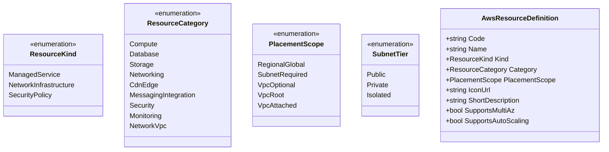
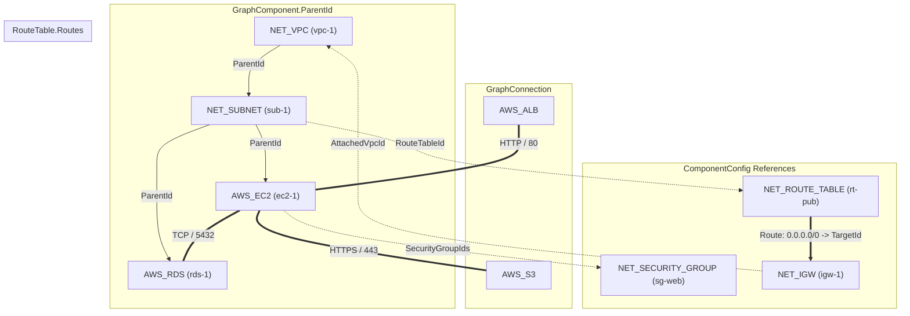
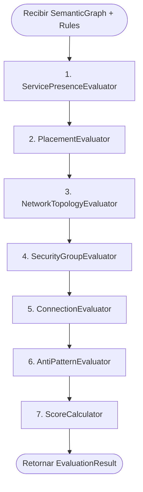
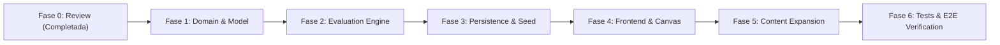

# Plan: Expansión del Modelo AWS y Network Infrastructure

> **Documento de Especificación y Plan de Arquitectura**  
> **Estado:** Aprobado tras Architecture Review  
> **Versión:** 2.0 (Unificado y Validado)  
> **Fuente Única de Verdad**

---

## 1. Estado Actual del Sistema

### 1.1 Modelo de Dominio y Persistencia
Actualmente, el sistema modela los componentes arquitectónicos de forma plana bajo una única entidad y abstracción:
* **Entidad `AwsService`** ([`AwsService.cs`](file:///c:/workspace/aws/aws-game/apps/api/src/AwsQuest.Domain/Entities/AwsService.cs)): Representa cualquier elemento disponible en el juego con campos básicos: `Id`, `Code` (ej. `AWS_EC2`, `AWS_RDS`), `Name`, `Category` (`Compute`, `Database`, `Storage`, `Networking`), `ShortDescription`, `IconUrl` e `IsActive`.
* **Catálogo Inicial**: Solo contempla 6 servicios: `AWS_ALB`, `AWS_EC2`, `AWS_RDS`, `AWS_S3`, `AWS_CLOUDFRONT`, `AWS_DYNAMODB` en [`aws-services.json`](file:///c:/workspace/aws/aws-game/content/services/aws-services.json).
* **Entidad `ChallengeService`** ([`ChallengeService.cs`](file:///c:/workspace/aws/aws-game/apps/api/src/AwsQuest.Domain/Entities/ChallengeService.cs)): Tabla intermedia que asocia un `AwsService` a un `Challenge`, definiendo `MaxInstances` y el flag booleano `IsDistractor`.

### 1.2 Grafo Semántico y Conexiones
El grafo arquitectónico se representa mediante clases centrales en el namespace `AwsQuest.Domain.Engine.Models`:
* **`GraphComponent`** ([`GraphComponent.cs`](file:///c:/workspace/aws/aws-game/apps/api/src/AwsQuest.Domain/Engine/Models/GraphComponent.cs)): Contiene `Id`, `ServiceCode`, `Label` y `Config` ([`ComponentConfig.cs`](file:///c:/workspace/aws/aws-game/apps/api/src/AwsQuest.Domain/Engine/Models/ComponentConfig.cs)). El `ComponentConfig` contiene propiedades genéricas como `IsMultiAz`, `AutoScaling`, `InstanceCount`, `IsPublic`, `SubnetType` y `StorageClass`.
* **`GraphConnection`** ([`GraphConnection.cs`](file:///c:/workspace/aws/aws-game/apps/api/src/AwsQuest.Domain/Engine/Models/GraphConnection.cs)): Conexión dirigida plana entre dos componentes `FromComponentId` y `ToComponentId` con un `ConnectionType` (`HTTP_HTTPS`, `DATABASE`, `ASYNC_QUEUE`, `INTERNAL_VPC`, `STORAGE`, `SECURITY_GROUP`).
* **`SemanticGraph`** ([`SemanticGraph.cs`](file:///c:/workspace/aws/aws-game/apps/api/src/AwsQuest.Domain/Engine/Models/SemanticGraph.cs)): Agrupa listas de `Components` y `Connections`.

### 1.3 Motor de Evaluación Existente
El motor (`EvaluationEngine.cs`) ejecuta secuencialmente 3 evaluadores (`IEvaluatorStep`):
1. **`ServicePresenceEvaluator`**: Valida presencia de `RequiredServices`, ausencia de `ForbiddenServices`, y límites numéricos `MinInstances` y `MaxInstances`.
2. **`ConnectionEvaluator`**: Valida existencia de conexiones directas `FromServiceCode -> ToServiceCode` en `RequiredConnections` y detecta conexiones prohibidas en `ForbiddenConnections`. También alerta sobre nodos aislados.
3. **`AntiPatternEvaluator`**: Evalúa heurísticas predeterminadas como `SinglePointOfFailure` (EC2 sin ASG o RDS sin Multi-AZ), `PublicDatabaseExposure` (RDS con flag `isPublic = true` o `subnetType == "Public"`), `MissingMultiAz`, `DirectInternetToCompute` (EC2 presente sin ALB) y `MissingAutoScaling`.
4. **`ScoreCalculator`**: Suma penalizaciones de errores y pistas, calcula el puntaje final `clamp(100 - penalizaciones, 0, 100)` y evalúa el umbral `PassingScoreThreshold` (típicamente 70 pts).

### 1.4 Frontend y Canvas
* **React Flow**: Se utiliza `@xyflow/react` en [`ArchitectureCanvas.tsx`](file:///c:/workspace/aws/aws-game/apps/web/src/features/challenge/components/ArchitectureCanvas.tsx).
* **Nodos**: Solo existe un único tipo de nodo visual: `AwsServiceNode` ([`AwsServiceNode.tsx`](file:///c:/workspace/aws/aws-game/apps/web/src/features/canvas/components/nodes/AwsServiceNode.tsx)). No existen nodos contenedores (VPC, subnets) ni representaciones visuales de tablas de ruteo o grupos de seguridad.
* **Paleta**: `ServicePalette.tsx` agrupa los servicios autorizados por la cadena `category` que viene de la API.
* **Store**: `useCanvasStore.ts` maneja el estado de nodos y aristas y la serialización/deserialización hacia/desde `SemanticGraphDto`.

---

## 2. Problemas y Limitaciones Detectados

1. **Ambigüedad en el Modelado de Subredes**:
   * Modelar subredes como códigos separados (`NET_SUBNET_PUBLIC` y `NET_SUBNET_PRIVATE`) genera duplicación innecesaria en base de datos, DTOs y canvas. En AWS una subred es un recurso único `AWS::EC2::Subnet` cuyo tier (`Public`, `Private`, `Isolated`) se determina por su configuración y tabla de ruteo asociada.
2. **Sobrecarga Conceptual de `ParentId`**:
   * Intentar usar `ParentId` para todo genera confusión entre:
     - **Contención jerárquica** (`Subnet ∈ VPC`, `EC2 ∈ Subnet`),
     - **Asociación de seguridad** (`EC2 ↔ SecurityGroup`),
     - **Ruteo de red** (`Subnet ↔ RouteTable ↔ Gateway`),
     - **Flujo de tráfico** (`ALB ──HTTP──> EC2 ──SQL──> RDS`).
3. **Topología Plana sin Jerarquía de Red**:
   * El grafo actual solo admite conexiones dirigidas planas. No hay soporte para anidación visual ni semántica en contenedores.
4. **Incapacidad del Motor para Validar Topología de Red y Firewalls**:
   * El motor actual no puede evaluar si una subred privada carece de ruta directa a Internet, si sale vía NAT Gateway, ni si un Security Group restringe correctamente el puerto de base de datos (ej. TCP 5432/3306).
5. **UI Mononodo**:
   * React Flow renderiza todos los elementos como tarjetas fijas de 170-230px, sin soporte para cajas contenedoras redimensionables de VPC y Subnet.

---

## 3. Arquitectura Propuesta y Decisiones de Diseño

### 3.1 Separación Conceptual: Managed Services vs Network Infrastructure vs Security



#### A. Modelo Unificado de Subnet (`NET_SUBNET` + `SubnetTier`)
Se define un único código de recurso de infraestructura:
* **Código**: `NET_SUBNET`
* **Nombre**: Subnet (Subred)
* **Tier Configurable**: `SubnetTier` en `ComponentConfig` (`Public`, `Private`, `Isolated`).
* **Comportamiento en UI**: La paleta permite arrastrar "Public Subnet" o "Private Subnet" como presets visuales que instancian `NET_SUBNET` con su respectivo `config.subnetTier`.

#### B. Semántica de `PlacementScope`
Representa la capacidad y restricción de despliegue de un recurso:
* `RegionalGlobal`: Servicios Serverless o Globales que NO residen en una VPC/Subnet (`AWS_S3`, `AWS_DYNAMODB`, `AWS_CLOUDFRONT`, `AWS_ROUTE53`, `AWS_IAM`, `AWS_SQS`, `AWS_SNS`, `AWS_EVENTBRIDGE`, `AWS_WAF`, `AWS_KMS`, `AWS_CLOUDWATCH`).
* `SubnetRequired`: Recursos que DEBEN ubicarse obligatoriamente dentro de una `NET_SUBNET` (`AWS_EC2`, `AWS_RDS`, `AWS_ELASTICACHE`, `AWS_ALB`, `NET_NAT_GATEWAY`).
* `VpcOptional`: Recursos que pueden ser Globales/Regionales o asociarse a una VPC Subnet (`AWS_LAMBDA`, `AWS_APIGATEWAY`).
* `VpcRoot`: El contenedor raíz de red (`NET_VPC`).
* `VpcAttached`: Recursos asociados directamente a la VPC (`NET_SUBNET`, `NET_IGW`, `NET_ROUTE_TABLE`, `NET_SECURITY_GROUP`, `NET_NACL`).

### 3.2 Desacoplamiento de Relaciones del Grafo: 4 Conceptos Ortogonales

Para evitar sobrecargar `ParentId`, se establecen 4 mecanismos explícitos:



1. **Contención Jerárquica (`ParentId`)**:
   * Usado exclusivamente para la anidación física/visual: `Subnet.ParentId = vpc-1`; `EC2.ParentId = sub-1`.
   * Mapea directamente a la propiedad nativa `node.parentId` de React Flow.
2. **Asociaciones Estructurales (`ComponentConfig`)**:
   * `SecurityGroupIds: string[]`: Lista de IDs de Security Groups vinculados al componente.
   * `RouteTableId: string?`: ID de la tabla de ruteo asociada a la subred.
   * `AttachedVpcId: string?`: VPC a la que está vinculado un IGW.
3. **Ruteo de Red (`RouteTable.Routes` / Topología)**:
   * Representa rutas de destino (ej. `0.0.0.0/0 -> TargetGatewayId`).
4. **Flujo de Tráfico Lógico (`GraphConnection`)**:
   * Representa comunicación activa entre servicios (`FromComponentId`, `ToComponentId`, `ConnectionType`, `Port`, `Protocol`).

---

## 4. Nuevo Catálogo de Recursos

El catálogo unificado comprende **20 componentes estándar** (13 Servicios Gestionados y 7 Recursos de Infraestructura):

```json
[
  // ─── COMPUTE ───
  { "code": "AWS_EC2", "name": "Amazon EC2", "category": "Compute", "kind": "ManagedService", "placementScope": "SubnetRequired", "iconUrl": "/icons/aws/ec2.svg" },
  { "code": "AWS_LAMBDA", "name": "AWS Lambda", "category": "Compute", "kind": "ManagedService", "placementScope": "VpcOptional", "iconUrl": "/icons/aws/lambda.svg" },

  // ─── DATABASE ───
  { "code": "AWS_RDS", "name": "Amazon RDS", "category": "Database", "kind": "ManagedService", "placementScope": "SubnetRequired", "iconUrl": "/icons/aws/rds.svg" },
  { "code": "AWS_DYNAMODB", "name": "Amazon DynamoDB", "category": "Database", "kind": "ManagedService", "placementScope": "RegionalGlobal", "iconUrl": "/icons/aws/dynamodb.svg" },
  { "code": "AWS_ELASTICACHE", "name": "Amazon ElastiCache", "category": "Database", "kind": "ManagedService", "placementScope": "SubnetRequired", "iconUrl": "/icons/aws/elasticache.svg" },

  // ─── STORAGE ───
  { "code": "AWS_S3", "name": "Amazon S3", "category": "Storage", "kind": "ManagedService", "placementScope": "RegionalGlobal", "iconUrl": "/icons/aws/s3.svg" },

  // ─── NETWORKING MANAGED ───
  { "code": "AWS_ALB", "name": "Application Load Balancer", "category": "Networking", "kind": "ManagedService", "placementScope": "SubnetRequired", "iconUrl": "/icons/aws/alb.svg" },
  { "code": "AWS_APIGATEWAY", "name": "Amazon API Gateway", "category": "Networking", "kind": "ManagedService", "placementScope": "VpcOptional", "iconUrl": "/icons/aws/apigateway.svg" },
  { "code": "AWS_ROUTE53", "name": "Amazon Route 53", "category": "Networking", "kind": "ManagedService", "placementScope": "RegionalGlobal", "iconUrl": "/icons/aws/route53.svg" },

  // ─── CDN / EDGE ───
  { "code": "AWS_CLOUDFRONT", "name": "Amazon CloudFront", "category": "CdnEdge", "kind": "ManagedService", "placementScope": "RegionalGlobal", "iconUrl": "/icons/aws/cloudfront.svg" },

  // ─── MESSAGING / INTEGRATION ───
  { "code": "AWS_SQS", "name": "Amazon SQS", "category": "MessagingIntegration", "kind": "ManagedService", "placementScope": "RegionalGlobal", "iconUrl": "/icons/aws/sqs.svg" },
  { "code": "AWS_SNS", "name": "Amazon SNS", "category": "MessagingIntegration", "kind": "ManagedService", "placementScope": "RegionalGlobal", "iconUrl": "/icons/aws/sns.svg" },
  { "code": "AWS_EVENTBRIDGE", "name": "Amazon EventBridge", "category": "MessagingIntegration", "kind": "ManagedService", "placementScope": "RegionalGlobal", "iconUrl": "/icons/aws/eventbridge.svg" },

  // ─── SECURITY ───
  { "code": "AWS_IAM", "name": "AWS IAM", "category": "Security", "kind": "ManagedService", "placementScope": "RegionalGlobal", "iconUrl": "/icons/aws/iam.svg" },
  { "code": "AWS_WAF", "name": "AWS WAF", "category": "Security", "kind": "ManagedService", "placementScope": "RegionalGlobal", "iconUrl": "/icons/aws/waf.svg" },
  { "code": "AWS_KMS", "name": "AWS KMS", "category": "Security", "kind": "ManagedService", "placementScope": "RegionalGlobal", "iconUrl": "/icons/aws/kms.svg" },

  // ─── MONITORING ───
  { "code": "AWS_CLOUDWATCH", "name": "Amazon CloudWatch", "category": "Monitoring", "kind": "ManagedService", "placementScope": "RegionalGlobal", "iconUrl": "/icons/aws/cloudwatch.svg" },

  // ─── NETWORK INFRASTRUCTURE ───
  { "code": "NET_VPC", "name": "Virtual Private Cloud (VPC)", "category": "NetworkVpc", "kind": "NetworkInfrastructure", "placementScope": "VpcRoot", "iconUrl": "/icons/aws/vpc.svg" },
  { "code": "NET_SUBNET", "name": "Subnet", "category": "NetworkVpc", "kind": "NetworkInfrastructure", "placementScope": "VpcAttached", "iconUrl": "/icons/aws/subnet.svg" },
  { "code": "NET_IGW", "name": "Internet Gateway", "category": "NetworkVpc", "kind": "NetworkInfrastructure", "placementScope": "VpcAttached", "iconUrl": "/icons/aws/igw.svg" },
  { "code": "NET_NAT_GATEWAY", "name": "NAT Gateway", "category": "NetworkVpc", "kind": "NetworkInfrastructure", "placementScope": "SubnetRequired", "iconUrl": "/icons/aws/natgw.svg" },
  { "code": "NET_ROUTE_TABLE", "name": "Route Table", "category": "NetworkVpc", "kind": "NetworkInfrastructure", "placementScope": "VpcAttached", "iconUrl": "/icons/aws/routetable.svg" },
  { "code": "NET_SECURITY_GROUP", "name": "Security Group", "category": "Security", "kind": "SecurityPolicy", "placementScope": "VpcAttached", "iconUrl": "/icons/aws/securitygroup.svg" },
  { "code": "NET_NACL", "name": "Network ACL", "category": "Security", "kind": "SecurityPolicy", "placementScope": "VpcAttached", "iconUrl": "/icons/aws/nacl.svg" }
]
```

---

## 5. Arquitectura del Motor de Evaluación (Evaluation Engine)

### 5.1 Pipeline de Evaluación Secuencial Desacoplado

El motor ejecuta 7 pasos evaluadores especializados con responsabilidad única:



1. **`ServicePresenceEvaluator`**: Valida presencia de `RequiredServices`, ausencia de `ForbiddenServices` y límites `MinInstances` / `MaxInstances`.
2. **`PlacementEvaluator`**: Valida contención jerárquica:
   * Recursos `SubnetRequired` están dentro de un `NET_SUBNET`.
   * Los `NET_SUBNET` están dentro de un `NET_VPC`.
   * El `subnetTier` coincide con el exigido por `PlacementRule` (ej. RDS debe residir en `SubnetTier.Private`).
3. **`NetworkTopologyEvaluator`**: Valida enrutamiento y accesibilidad:
   * Subnets públicas tienen ruta a `NET_IGW`.
   * Subnets privadas no tienen ruta directa a `NET_IGW` y disponen de ruta a `NET_NAT_GATEWAY` para salida a Internet si se requiere.
4. **`SecurityGroupEvaluator`**: Valida firewalls virtuales:
   * Asociación de Security Groups a componentes clave.
   * Reglas de Ingress autorizadas (ej. RDS SG solo permite TCP :5432 desde EC2 SG).
5. **`ConnectionEvaluator`**: Valida conexiones de flujo lógico de datos (`RequiredConnections`, `ForbiddenConnections`) y alerta sobre nodos huérfanos.
6. **`AntiPatternEvaluator`**: Detección de patrones defectuosos (SPOF, base de datos pública, falta de redundancia Multi-AZ, falta de Auto Scaling).
7. **`ScoreCalculator`**: Suma penalizaciones de fallos y deducciones por pistas desbloqueadas, calcula puntaje final `clamp(100 - penalizaciones, 0, 100)` y genera el resumen pedagógico.

### 5.2 Estructura de Reglas de Evaluación (`ChallengeEvaluationRules`)

```csharp
public class ChallengeEvaluationRules
{
    // ─── Reglas Existentes (Compatibilidad 100%) ───
    public List<string> RequiredServices { get; set; } = [];
    public List<string> ForbiddenServices { get; set; } = [];
    public Dictionary<string, int> MinInstances { get; set; } = new(StringComparer.OrdinalIgnoreCase);
    public Dictionary<string, int> MaxInstances { get; set; } = new(StringComparer.OrdinalIgnoreCase);
    public List<RequiredConnectionRule> RequiredConnections { get; set; } = [];
    public List<ForbiddenConnectionRule> ForbiddenConnections { get; set; } = [];
    public List<AntiPatternRule> AntiPatterns { get; set; } = [];
    public int PassingScoreThreshold { get; set; } = 70;

    // ─── Nuevas Reglas de Topología e Infraestructura ───
    public List<PlacementRule> PlacementRules { get; set; } = [];
    public List<RoutingRule> RoutingRules { get; set; } = [];
    public List<SecurityGroupRuleModel> SecurityGroupRules { get; set; } = [];
}
```

#### Ejemplos de Reglas Declarativas:

* **PlacementRule**:
```json
{
  "serviceCode": "AWS_RDS",
  "requiredContainerCode": "NET_SUBNET",
  "requiredSubnetTier": "Private",
  "penaltyIfViolated": 25,
  "description": "Amazon RDS debe residir obligatoriamente en una subred privada."
}
```

* **RoutingRule**:
```json
{
  "subnetTier": "Public",
  "requiresRouteTo": "NET_IGW",
  "penaltyIfMissing": 20,
  "description": "Las subredes públicas deben tener una tabla de ruteo conectada al Internet Gateway."
}
```

* **SecurityGroupRuleModel**:
```json
{
  "targetServiceCode": "AWS_RDS",
  "allowedSourceServiceCode": "AWS_EC2",
  "protocol": "TCP",
  "port": 5432,
  "penaltyIfViolated": 15,
  "description": "El Security Group de RDS debe autorizar tráfico entrante en el puerto 5432 únicamente desde el Security Group de EC2."
}
```

---

## 6. Compatibilidad hacia Atrás (Backward Compatibility)

### 6.1 Desafíos Existentes (Unidades 1 a 4)

| Desafío | Título | Estado Actual | Impacto | Estrategia de Compatibilidad |
| :--- | :--- | :--- | :--- | :--- |
| **101** | *Servidor Web Básico en EC2* | Builder (EC2). Sin subnets. | Ninguno. `PlacementRules` está vacío `[]`. | **Intacto**. Sigue pasando con 100/100 con solo 1 nodo EC2. |
| **102** | *Activos Estáticos en S3* | Builder (EC2, S3). | Ninguno. S3 es `RegionalGlobal`. | **Intacto**. Solución actual válida con 100/100. |
| **201** | *Web 3 Capas Resiliente* | Builder (ALB, EC2, RDS). | Ninguno. `PlacementRules` vacío. | **Intacto**. Si el usuario añade subnets opcionalmente, el motor las acepta sin penalizar. |
| **202** | *Reparación de Monolito* | Fix (EC2 + RDS legacy). | Ninguno. Deserializa `ParentId = null`. | **Intacto**. |
| **301** | *RDS con Acceso Aislado* | Builder (EC2, RDS). | Ninguno. `PUBLIC_RDS` verifica `isPublic == false` o `subnetTier == Private`. | **Intacto**. Compatible con ambas formas de aislamiento. |
| **302** | *Reparación de BD Pública* | Fix (RDS vulnerable). | Ninguno. | **Intacto**. |
| **401** | *E-Commerce Alta Demanda* | Builder (ALB, EC2, RDS, S3). | Ninguno. | **Intacto**. |
| **402** | *Auditoría Empresarial* | Fix (Conexión indebida ALB->RDS). | Ninguno. | **Intacto**. |

### 6.2 Regla de Oro de Compatibilidad del Motor
Si un desafío no define `PlacementRules`, `RoutingRules` o `SecurityGroupRules`, los nuevos evaluadores se ejecutan de forma no restrictiva (No-Op), garantizando que las pruebas de integración existentes ([`MvpChallengesGoldSolutionTests.cs`](file:///c:/workspace/aws/aws-game/apps/api/tests/AwsQuest.IntegrationTests/Content/MvpChallengesGoldSolutionTests.cs)) sigan pasando al 100% sin modificar una sola línea de aserción.

---

## 7. Fases de Implementación Corregidas y Detalladas



---

### Fase 1: Domain Models, Enums y Reglas Declarativas
* **Objetivo**: Establecer los tipos de dominio, enums, modelos de reglas y estructuras del grafo semántico en `AwsQuest.Domain`.
* **Archivos Afectados**:
  * [NEW] `ResourceKind.cs`, `ResourceCategory.cs`, `PlacementScope.cs`, `SubnetTier.cs`, `RuleDirection.cs` en `AwsQuest.Domain/Enums/`.
  * [NEW] `PlacementRule.cs`, `RoutingRule.cs`, `SecurityGroupRuleModel.cs`, `SecurityGroupRule.cs`, `RouteEntry.cs` en `AwsQuest.Domain/Engine/Models/`.
  * [MODIFY] `ComponentConfig.cs`: Incorporar `SubnetTier`, `CidrBlock`, `SecurityGroupIds`, `RouteTableId`, `SecurityGroupRules`, `Routes`.
  * [MODIFY] `GraphComponent.cs`: Incorporar `ParentId`, `ResourceKind`, `Category`.
  * [MODIFY] `SemanticGraph.cs`: Incorporar métodos de consulta topológica (`GetParent`, `GetChildren`, `GetComponentSubnet`, `GetComponentVpc`, `IsLocatedInPublicSubnet`, `IsLocatedInPrivateSubnet`, `HasRouteToInternet`).
  * [MODIFY] `ChallengeEvaluationRules.cs`: Incorporar listas `PlacementRules`, `RoutingRules`, `SecurityGroupRules`.
* **Dependencias**: Ninguna.
* **Riesgos**: Ninguno (solo adición de tipos de dominio).
* **Criterios de Aceptación**: `AwsQuest.Domain` compila sin errores ni advertencias. Modelos serializables a JSON y viceversa.
* **Tests Esperados**: `AwsQuest.UnitTests/Engine/DomainModelsTests.cs`.

---

### Fase 2: Motor de Evaluación Topológico (Evaluation Engine)
* **Objetivo**: Implementar los evaluadores de ubicación, ruteo y seguridad en `AwsQuest.Domain.Engine` con soporte total de retrocompatibilidad.
* **Archivos Afectados**:
  * [NEW] `PlacementEvaluator.cs`, `NetworkTopologyEvaluator.cs`, `SecurityGroupEvaluator.cs` en `AwsQuest.Domain/Engine/Evaluators/`.
  * [MODIFY] `AntiPatternEvaluator.cs`: Enriquecer detección de `PublicDatabaseExposure` y `DirectInternetToCompute` para soportar topología de red además de flags.
  * [MODIFY] `EvaluationEngine.cs`: Registrar pipeline completo de 7 pasos.
  * [NEW] `PlacementEvaluatorTests.cs`, `NetworkTopologyEvaluatorTests.cs`, `SecurityGroupEvaluatorTests.cs` en `AwsQuest.UnitTests`.
* **Dependencias**: Fase 1.
* **Riesgos**: Posible impacto en tiempos de evaluación; debe mantenerse $< 50$ms para grafos medianos.
* **Criterios de Aceptación**: Los nuevos evaluadores detectan correctamente violaciones y aciertos. Los tests de los 8 desafíos MVP continúan dando 100/100.
* **Tests Esperados**: Cobertura de tests unitarios $\ge 95\%$ en evaluadores.

---

### Fase 3: Persistencia, Migraciones EF Core, DTOs y Seeder
* **Objetivo**: Actualizar la base de datos PostgreSQL, la capa de aplicación y el seeder declarativo.
* **Archivos Afectados**:
  * [MODIFY] `AwsService.cs` (Domain Entity): Agregar `Kind`, `PlacementScope`, `DefaultConfigJson`.
  * [MODIFY] `AwsServiceConfiguration.cs` (Infrastructure Persistence): Mapeo EF Core con valores por defecto.
  * [NEW] Migración EF Core: `AddNetworkInfrastructureAndPlacementScope`.
  * [MODIFY] `MasterServicesDtos.cs`, `ChallengeDtos.cs`, `SeedingDtos.cs` en `AwsQuest.Application`.
  * [MODIFY] `EvaluateArchitectureRequestDtoValidator.cs`: Validar integridad de referencias en el grafo.
  * [MODIFY] `ChallengeSeeder.cs`, `JsonChallengeContentReader.cs`: Sincronizar catálogo ampliado.
* **Dependencias**: Fase 1, Fase 2.
* **Riesgos**: Bloqueo de base de datos en ejecución; mitigado con transacciones idempotentes.
* **Criterios de Aceptación**: La migración se aplica limpiamente. El seeder carga los 20 componentes de `aws-services.json` sin errores.
* **Tests Esperados**: `ChallengeSeederTests.cs`, `ServicesControllerIntegrationTests.cs`.

---

### Fase 4: Frontend Canvas, React Flow Containers y Paleta
* **Objetivo**: Permitir diagramación jerárquica visual en React Flow con cajas contenedoras para VPC y Subnets y paleta categorizada.
* **Archivos Afectados**:
  * [MODIFY] `canvas.types.ts`: Tipos TypeScript sincronizados con backend (`SubnetTier`, `ParentId`, `PlacementScope`).
  * [NEW] `VpcContainerNode.tsx`: Nodo contenedor para VPC (estilo borde azul punteado con drop zone).
  * [NEW] `SubnetContainerNode.tsx`: Nodo contenedor para Subnets (diferenciación visual verde para Public y azul oscuro para Private).
  * [NEW] `GatewayNode.tsx`, `SecurityGroupNode.tsx`: Nodos compactos de infraestructura.
  * [MODIFY] `canvasElementTypes.ts`: Registro de los nuevos tipos de nodo.
  * [MODIFY] `ServicePalette.tsx`, `ServicePaletteItemCard.tsx`: Agrupación por tabs (Servicios AWS vs Infraestructura de Red).
  * [MODIFY] `useCanvasStore.ts`: Gestión de drag & drop con `parentId` nativo de React Flow, coordenadas relativas y auto-layout por capas.
* **Dependencias**: Fase 1, Fase 3.
* **Riesgos**: Manejo de coordenadas relativas al mover contenedores en React Flow; mitigado con `extent: 'parent'`.
* **Criterios de Aceptación**: El usuario puede arrastrar una VPC, colocar Subnets dentro de ella, y ubicar instancias EC2/RDS dentro de las Subnets con movimiento coordinado.
* **Tests Esperados**: Vitest en `useCanvasStore.test.ts`, `VpcContainerNode.test.tsx`, `SubnetContainerNode.test.tsx`.

---

### Fase 5: Expansión de Contenido y Nuevos Desafíos de Red
* **Objetivo**: Actualizar el catálogo `content/services/aws-services.json` y crear desafíos dedicados de infraestructura de red.
* **Archivos Afectados**:
  * [MODIFY] `content/services/aws-services.json`: Lista completa de los 20 componentes.
  * [NEW] `content/challenges/unit-1/challenge-103.json`: *"Despliegue de Servidor Web en VPC Pública con Internet Gateway"*.
  * [NEW] `content/challenges/unit-2/challenge-203.json`: *"Arquitectura Segura de 2 Capas con Subredes Públicas y Privadas"*.
* **Dependencias**: Fase 3, Fase 4.
* **Riesgos**: Desajuste en penalizaciones; calibrar para que sumen 100 pts exactos en soluciones correctas.
* **Criterios de Aceptación**: Los nuevos desafíos son cargados por el seeder y pueden completarse y evaluarse end-to-end.
* **Tests Esperados**: Tests de solución Gold para los nuevos desafíos en `AwsQuest.IntegrationTests`.

---

### Fase 6: Testing Automatizado, Integración E2E y Verificación
* **Objetivo**: Ejecución de todas las suites de prueba en backend y frontend para garantizar cero regresiones.
* **Archivos Afectados**:
  * [MODIFY] `MvpChallengesGoldSolutionTests.cs`: Verificación de desafíos MVP + nuevos desafíos.
  * [NEW] `NetworkTopologyGoldSolutionTests.cs`: Tests de arquitecturas complejas con VPC, Subnets y Gateways.
* **Dependencias**: Todas las fases anteriores.
* **Riesgos**: Regresiones en tests antiguos; mitigado por el diseño de reglas opcionales.
* **Criterios de Aceptación**: 100% de tests unitarios de .NET y Vitest pasando. 100% de pruebas de integración de base de datos pasando.

---

## 8. Resumen Ejecutivo de Fases

| Fase | Objetivo Principal | Módulos / Proyectos | Dependencias | Complejidad |
| :--- | :--- | :--- | :--- | :--- |
| **Fase 0** | Architecture Review & Diseño | Documentación (`docs/14-*`) | Ninguna | Baja |
| **Fase 1** | Modelo de Dominio, Enums y Reglas | `AwsQuest.Domain` | Fase 0 | Media |
| **Fase 2** | Motor de Evaluación Topológico | `AwsQuest.Domain.Engine`, `AwsQuest.UnitTests` | Fase 1 | Alta |
| **Fase 3** | Persistencia, EF Core, DTOs y Seeder | `AwsQuest.Infrastructure`, `AwsQuest.Application`, `AwsQuest.Api` | Fase 1, Fase 2 | Media |
| **Fase 4** | Frontend Canvas, Contenedores y Paleta | `apps/web` (React Flow, Zustand, Tailwind) | Fase 1, Fase 3 | Alta |
| **Fase 5** | Expansión de Contenido y Desafíos | `content/services/`, `content/challenges/` | Fase 3, Fase 4 | Baja |
| **Fase 6** | Tests Automatizados y Verificación Global | `AwsQuest.IntegrationTests`, Vitest E2E | Todas | Media |
