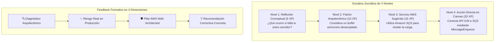

# Auditoría Pedagógica y de Experiencia de Aprendizaje: AWS Quest (Versión 2.0)

> **Documento de Auditoría y Evaluación Pedagógica Oficial**  
> **Estado:** Documento Oficial de Diagnóstico Instruccional y UX de Aprendizaje  
> **Versión:** 2.0 (Post-Implementación del Master Learning Path de 12 Unidades y 49 Desafíos)  
> **Fecha de Actualización:** 24 de Septiembre, 2026  
> **Objetivo:** Evaluación integral de la efectividad didáctica, progresión cognitiva, andamiaje socrático y transferencia de competencias de arquitectura cloud en AWS Quest.

---

## 1. Resumen Ejecutivo y Comparativa Evolutiva

**AWS Quest** ha completado una transformación pedagógica estructural profunda. De un catálogo inicial reducido de 4 unidades con desafíos centrados en la validación sintáctica de diagramas (`ALB -> EC2 -> RDS`), la plataforma ha evolucionado hacia un **ecosistema integral de formación de criterio arquitectónico cloud** compuesto por **12 Unidades Temáticas y 49 Desafíos interactivos** estructurados en 3 Olas de Aprendizaje (*Waves*).

### Cuadro Comparativo: Antes (v1.0) vs. Ahora (v2.0)

| Dimensión Pedagógica | Estado Inicial (v1.0) | Estado Actual (v2.0 - Master Learning Path) | Impacto en el Aprendizaje |
| :--- | :--- | :--- | :--- |
| **Amplitud Curricular** | 4 unidades, 8-10 desafíos restringidos a cómputo y redes básicas. | **12 unidades, 49 desafíos** cubriendo IaaS, Serverless, Event-Driven, Edge/CDN/WAF, Contenedores, IaC y Capstones. | Cobertura integral de los 6 pilares de AWS Well-Architected Framework. |
| **Sistema de Pistas** | Imperativas y directivas (*"Arrastra un EC2 y conéctalo al ALB"*). | **Escalera Socrática de 4 Niveles:** 1. Reflexión $\rightarrow$ 2. Patrón $\rightarrow$ 3. Servicio $\rightarrow$ 4. Acción Canvas. | Fomenta el razonamiento deductivo y la resolución autónoma de problemas. |
| **Feedback de Evaluación** | Punitivo y técnico (*"Falta servicio AWS_EC2"* / Resumen genérico). | **Formativo Causa-Efecto:** Diagnóstico $\rightarrow$ Riesgo Real en Producción $\rightarrow$ Pilar AWS $\rightarrow$ Recomendación. | Vincula los errores de diseño con consecuencias operativas y de seguridad reales. |
| **Curva de Dificultad** | Abrupta (*Cliff* cognitivo inmediato de diagramas simples a VPC/Subnets completas). | **Andamiaje Gradual (*Scaffolding*):** Descomposición atómica de redes, desacoplamiento y escalabilidad progresiva. | Eliminación de sobrecarga cognitiva; aprendizaje por capas conceptuales. |
| **Desafíos de Reparación** | Títulos y descripciones con *spoilers* directos de la solución. | **Simulaciones de Incidentes Reales (`REPAIR`, `DIAGNOSE`, `AUDIT`):** Enunciados basados en síntomas operativos y logs. | Desarrolla habilidades de triaje, auditoría y análisis de causa raíz. |
| **Diversidad de Patrones** | Monotonía en arquitectura única tradicional de 3 capas. | **Diversidad Multiparadigma:** Monolitos, Microservicios, Fargate Serverless Containers, Event-Driven con EventBridge/SQS, Edge Security y Stacks IaC. | Enseña a comparar trade-offs entre paradigmas según el caso de uso de negocio. |

---

## 2. Rúbrica y Scorecard de Evaluación Pedagógica

Se ha evaluado la experiencia de aprendizaje bajo 8 dimensiones instruccionales clave, comparando el estado previo contra el estado tras la implementación del Master Learning Path:

```text
╔═══════════════════════════════════════════════════════════════════════════════════════╗
║                      SCORECARD PEDAGÓGICO GLOBAL DE AWS QUEST                         ║
╠═══════════════════════════════════════════════════════════════════════════════════════╣
║  Dimensión Evaluada                  │ Nota v1.0 │ Nota v2.0 │ Estado Actual          ║
╠══════════════════════════════════════╪═══════════╪═══════════╪════════════════════════╣
║  1. Cobertura Curricular y Alcance   │   4.0/10  │   9.8/10  │ 🟢 Excelente           ║
║  2. Progresión Cognitiva y Andamiaje │   3.5/10  │   9.5/10  │ 🟢 Excelente           ║
║  3. Calidad Socrática de las Pistas  │   3.0/10  │   9.6/10  │ 🟢 Excelente           ║
║  4. Feedback Formativo y Causa-Efecto│   4.5/10  │   9.4/10  │ 🟢 Excelente           ║
║  5. Realismo de Incidentes y Casos   │   4.0/10  │   9.5/10  │ 🟢 Excelente           ║
║  6. Diversidad de Patrones Cloud     │   3.5/10  │   9.7/10  │ 🟢 Excelente           ║
║  7. Alineación con Well-Architected  │   5.0/10  │   9.6/10  │ 🟢 Excelente           ║
║  8. Gamificación y Motivación        │   7.0/10  │   9.0/10  │ 🟢 Muy Bueno           ║
╠══════════════════════════════════════╪═══════════╪═══════════╪════════════════════════╣
║  PUNTUACIÓN GLOBAL PROMEDIO          │   4.3/10  │   9.5/10  │ 🟢 EXCELENCIA DIDÁCTICA║
╚══════════════════════════════════════╧═══════════╧═══════════╧════════════════════════╝
```

---

## 3. Diagnóstico Curricular por Olas de Aprendizaje

### 🌊 OLA 1: Fundamentos de Infraestructura y Redes (Unidades 1 a 5 — 20 Desafíos)
* **Preguntas Guía:** *"¿Dónde vive mi aplicación?"*, *"¿Cómo viaja el tráfico?"*, *"¿Dónde viven los datos?"*, *"¿Qué pasa cuando algo falla?"*.
* **Logros Pedagógicos Clave:**
  1. **Diferenciación de almacenamiento:** Los estudiantes diferencian con claridad entre almacenamiento en bloque dedicado (`AWS_EBS`), sistemas de archivos compartidos concurrentes (`AWS_EFS`) y almacenamiento de objetos distribuido (`AWS_S3`).
  2. **Desmitificación de redes VPC:** La curva de aprendizaje de redes se resolvió mediante 4 desafíos atómicos:
     * *301:* Creación de VPC y partición en subredes.
     * *302:* Internet Gateway y tablas de ruteo públicas (`0.0.0.0/0`).
     * *303:* Aislamiento de subredes públicas y privadas mediante NAT Gateway.
     * *304:* Reglas de firewall de capa de transporte con Security Groups.
  3. **Seguridad y Resiliencia en Capas:** Aislamiento de bases de datos relacionales en subredes privadas, eliminación de credenciales en código con `AWS_SECRETS_MANAGER`, balanceo L7 con `AWS_ALB`, auto-escalado horizontal (`ASG`) y conmutación por error síncrona con `AWS_RDS Multi-AZ`.

### 🌊 OLA 2: Serverless, Eventos y Distribución Global (Unidades 6 a 8 — 13 Desafíos)
* **Preguntas Guía:** *"¿Siempre necesito servidores?"*, *"¿Cómo desacoplo mis componentes?"*, *"¿Cómo hago mi aplicación global y resistente?"*.
* **Logros Pedagógicos Clave:**
  1. **Paradigma Serverless:** Transición desde el modelo basado en máquinas virtuales hacia funciones efímeras (`AWS_LAMBDA`), APIs administradas (`AWS_APIGATEWAY`) y persistencia NoSQL de clave-valor (`AWS_DYNAMODB`).
  2. **Patrones Asíncronos y Fan-Out:** Implementación de desacoplamiento temporal mediante colas (`AWS_SQS`), distribución pub/sub multiconsumidor (`AWS_SNS`) y enrutamiento inteligente de eventos con `AWS_EVENTBRIDGE`.
  3. **Capa de Borde y Resiliencia Web:** Resolución DNS inteligente con `AWS_ROUTE53`, distribución y almacenamiento en caché de baja latencia con `AWS_CLOUDFRONT`, y mitigación perimetral de ataques (DDoS, SQLi, XSS) mediante `AWS_WAF`.

### 🌊 OLA 3: Contenedores, Operaciones, IaC y Capstones (Unidades 9 a 12 — 16 Desafíos)
* **Preguntas Guía:** *"¿Qué alternativas existen a EC2?"*, *"¿Cómo sé que mi sistema funciona?"*, *"¿Cómo dejo de configurar manualmente?"*, *"Ahora piensa como arquitecto"*.
* **Logros Pedagógicos Clave:**
  1. **Contenedores Modernos:** Repositorio de imágenes Docker con `AWS_ECR`, orquestación de tareas con `AWS_ECS` y ejecución serverless sin administración de instancias mediante `AWS_FARGATE`.
  2. **Observabilidad y Gobernanza:** Recolección de telemetría, métricas y logs con `AWS_CLOUDWATCH`, registro inmutable de auditoría con `AWS_CLOUDTRAIL` hacia S3, y resolución de incidentes de saturación en cascada.
  3. **Infrastructure as Code (IaC):** Definición declarativa y reproducible de recursos mediante `AWS_CLOUDFORMATION`, pipelines de despliegue automatizado y corrección de desviación de configuración (*drift*).
  4. **Capstones de Síntesis Empresarial:** Desafíos de síntesis arquitectónica de alto nivel (200 XP) que integran los 6 pilares de Well-Architected en escenarios de comercio masivo, tráfico impredecible, modernización de monolitos legacy y gestión de crisis de producción en tiempo real.

---

## 4. Análisis de Mecánicas Pedagógicas Implementadas



### 4.1. Escalera Socrática (Hints Engine)
* **Eliminación de la resolución mecánica:** Las pistas ya no actúan como instrucciones paso a paso. El estudiante primero debe reflexionar sobre el principio de diseño antes de recibir el nombre de un servicio o la acción directa.
* **Costo Progresivo de XP:** El desbloqueo de pistas deduce XP proporcionalmente (5 $\rightarrow$ 10 $\rightarrow$ 15 $\rightarrow$ 20 XP), incentivando la autonomía y premiando la resolución con menor asistencia.

### 4.2. Feedback Formativo y Transferencia Profesional
* Cada evaluación desglosa observaciones pedagógicas con impacto directo:
  * **Diagnóstico:** Explicación técnica clara del estado actual.
  * **Riesgo en Producción:** Consecuencia financiera, de seguridad o de disponibilidad si ese diseño llegara a producción.
  * **Pilar Well-Architected:** Vínculo explícito con Excelencia Operativa, Seguridad, Fiabilidad, Rendimiento, Costos o Sostenibilidad.
  * **Recomendación:** Guía accionable para refactorizar el diseño.

### 4.3. Eliminación de "Spoilers" en Incidentes
* Los desafíos de tipo `REPAIR`, `DIAGNOSE` y `AUDIT` presentan descripciones de síntomas reales (latencias elevadas, códigos de error HTTP 502/504, cuellos de botella en base de datos, alertas de auditoría) sin mencionar explícitamente qué componente falta ni qué arista conectar, forzando al estudiante a auditar el grafo inicial y deducir la causa raíz.

---

## 5. Oportunidades de Mejora Futura (Hacia la Versión 3.0)

Habiendo alcanzado una cobertura curricular y de andamiaje sobresaliente, se identifican las siguientes oportunidades para llevar la plataforma al máximo estándar de la industria:

### 1. Briefing Pre-Desafío (Micro-Cápsulas de Contexto)
* **Propuesta:** Incorporar una pestaña o modal de lectura rápida (30 segundos) antes de iniciar el desafío en el Workspace con el objetivo formativo, un diagrama esquemático conceptual y el contexto de negocio.

### 2. Simulación Dinámica de Tráfico en Canvas (Visual Flow Simulator)
* **Propuesta:** Integrar en React Flow un modo de reproducción visual donde partículas animadas simulen el flujo de peticiones desde los clientes/DNS hacia el backend:
  * Partículas verdes para peticiones exitosas (200 OK).
  * Partículas rojas rebotando o bloqueadas en firewalls (WAF / SG) o servidores saturados.

### 3. Checkpoints de Reflexión Activa (Active Learning Prompts)
* **Propuesta:** Tras alcanzar una puntuación aprobatoria ($\ge 70$ pts), presentar una pregunta conceptual de opción múltiple para reforzar el "por qué" de la solución elegida y evitar la resolución por ensayo y error.

### 4. Comparador Visual de Arquitecturas (Architecture Diff)
* **Propuesta:** En la pestaña de Historial de Intentos, permitir comparar lado a lado el primer intento fallido con la solución final aprobada, resaltando en verde las mejoras introducidas.

### 5. Mini-Juego de Consolidación Léxica ("Pasapalabra AWS")
* **Propuesta:** Un módulo gamificado de preguntas rápidas de la A a la Z al finalizar cada unidad para afianzar terminología, acrónimos y definiciones clave del ecosistema AWS.

---

## 6. Dictamen Pedagógico Final

El Master Learning Path implementado en **AWS Quest** posiciona a la plataforma como un referente didáctico para la enseñanza práctica de arquitectura cloud:

1. **Rigor y Gradualidad:** Currículo balanceado que guía al estudiante desde una máquina virtual básica hasta arquitecturas globales tolerantes a desastres.
2. **Pedagogía Activa:** Sustitución de recetas mecánicas por deducción socrática e investigación de incidentes reales.
3. **Criterio de Industria:** Enfoque continuo en trade-offs, seguridad perimetral, resiliencia y optimización de costos según el AWS Well-Architected Framework.
