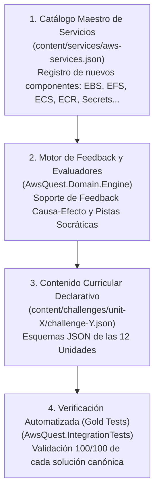

# Plan de Implementación: Master Learning Path (12 Unidades)

> **Documento Oficial de Planificación y Ejecución Curricular**  
> **Estado:** Aprobado para Ejecución  
> **Versión:** 2.0 (Alineado con el Master Learning Path de 12 Unidades)  
> **Especificación Curricular:** [`specs/master-learning-path-curriculum-spec.md`](file:///c:/workspace/aws/aws-game/specs/master-learning-path-curriculum-spec.md)  
> **Auditoría Pedagógica:** [`docs/15-pedagogical-learning-experience-audit.md`](file:///c:/workspace/aws/aws-game/docs/15-pedagogical-learning-experience-audit.md)  
> **Objetivo:** Hoja de ruta técnica para implementar el currículo de 12 unidades y 50 desafíos en AWS Quest, estructurado en 3 Olas consecutivas con feedback formativo y pistas socráticas nativas.

---

## 1. Resumen Ejecutivo y Estrategia de Migración

El proyecto evoluciona desde un MVP inicial de 4 unidades monolíticas hacia el **Master Learning Path de 12 Unidades**. 

En lugar de parchar desafíos obsoletos con dependencias circulares, la estrategia de implementación consiste en **construir la nueva estructura curricular directamente bajo los nuevos estándares pedagógicos**, organizada en **3 Olas de Despliegue**:

```text
┌────────────────────────────────────────────────────────────────────────────────────────┐
│                   ESTRATEGIA DE IMPLEMENTACIÓN POR OLAS CURRICULARES                  │
├────────────────────────────────────────────────────────────────────────────────────────┤
│ OLA 1: Fundamentos y Resiliencia IaaS (Unidades 1 a 5 — 20 Desafíos)                   │
│ • Cómputo (EC2), Almacenamiento (EBS, EFS, S3), Redes (VPC, Subnets, IGW, SG),        │
│   Datos (RDS, Aislamiento, Secrets) y Disponibilidad (ALB, ASG, Multi-AZ, Incidente).  │
│                                                                                        │
│ OLA 2: Modern Cloud, Eventos y Edge (Unidades 6 a 8 — 13 Desafíos)                     │
│ • Serverless (API GW, Lambda, DynamoDB), Eventos (SQS, SNS, EventBridge)               │
│   y Edge Global (Route 53, CloudFront, WAF).                                           │
│                                                                                        │
│ OLA 3: Contenedores, Operaciones y Capstones (Unidades 9 a 12 — 17 Desafíos)           │
│ • Contenedores (ECS, ECR, Fargate), Observabilidad (CloudWatch, CloudTrail),           │
│   IaC (CloudFormation) y Grandes Desafíos Integradores de Arquitectura.                │
└────────────────────────────────────────────────────────────────────────────────────────┘
```

---

## 2. Arquitectura de Implementación: ¿Cómo se construye la nueva ruta?

La implementación de la nueva ruta de aprendizaje impacta 4 capas del sistema:



1. **Capa de Catálogo Maestro:** Actualización de `aws-services.json` con metadatos de servicios, categorías, scopes de despliegue e iconos.
2. **Capa del Motor y Dominio:** Extensión de `FeedbackItem` para emitir `ProductionRisk`, `WellArchitectedPillar` y `Recommendation`, y soporte para modalidades `BUILDER`, `REPAIR`, `DIAGNOSE` y `AUDIT`.
3. **Capa de Contenido Declarativo:** Estructuración de los 50 archivos JSON con sus reglas topológicas, anti-patrones y pistas socráticas de 4 niveles.
4. **Capa de Verificación y Seeding:** El seeder declarativo (`ChallengeSeeder.cs`) puebla la base de datos PostgreSQL y la suite xUnit verifica que cada desafío apruebe con solución canónica.

---

## 3. Fases de Implementación del Plan

---

### 📍 Fase 0: Habilitación de Infraestructura y Catálogo de Servicios
* **Objetivo:** Proveer todos los servicios de AWS necesarios para las 12 unidades en el catálogo maestro y preparar el motor de backend.
* **Tareas:**
  1. **Actualización del Catálogo Maestro (`content/services/aws-services.json`):**
     * Registrar: `AWS_EBS`, `AWS_EFS`, `AWS_SECRETS_MANAGER`, `AWS_ECS`, `AWS_ECR`, `AWS_FARGATE`, `AWS_CLOUDTRAIL`, `AWS_CLOUDFORMATION`.
  2. **Enriquecimiento del Modelo de Feedback en Backend:**
     * Agregar a `FeedbackItem.cs` y `FeedbackItemDto.cs`: `ProductionRisk`, `WellArchitectedPillar` y `Recommendation`.
  3. **Frontend - Soporte de Consolidación:**
     * Habilitar pestaña de "Conceptos Consolidados" en `EvaluationModal.tsx` al aprobar con $\ge 70$ puntos.
* **Archivos Afectados:**
  * `content/services/aws-services.json`
  * `apps/api/src/AwsQuest.Domain/Engine/Models/FeedbackItem.cs`
  * `apps/api/src/AwsQuest.Application/DTOs/ChallengeDtos.cs`
  * `apps/web/src/features/evaluation/components/EvaluationModal.tsx`
  * `apps/web/src/features/evaluation/components/FeedbackList.tsx`
* **Dependencias:** Ninguna.
* **Complejidad:** Media.

---

### 📍 Fase 1: Implementación de la OLA 1 (Fundamentos IaaS — Unidades 1 a 5)
* **Objetivo:** Construir e integrar los 20 desafíos de las Unidades 1 a 5 con narrativa de incidentes y pistas socráticas.
* **Unidades y Desafíos a Crear:**
  * **Unidad 1: Computación y Almacenamiento** (`unit-1/`):
    * `challenge-101.json`: Mi primer servidor con EC2 (`BUILDER` / Fácil).
    * `challenge-102.json`: Persistencia: EBS (`BUILDER` / Fácil).
    * `challenge-103.json`: Archivos compartidos con EFS (`BUILDER` / Fácil-Med).
    * `challenge-104.json`: Almacenamiento de objetos con S3 (`BUILDER` / Fácil).
  * **Unidad 2: Construir una Aplicación Web** (`unit-2/`):
    * `challenge-201.json`: Aplicación Web Básica (`BUILDER` / Fácil).
    * `challenge-202.json`: Separando Frontend y Backend con S3 + EC2 (`BUILDER` / Fácil-Med).
    * `challenge-203.json`: Contenido Global con CloudFront + S3 (`BUILDER` / Intermedio).
  * **Unidad 3: Redes: Construir el Camino** (`unit-3/`):
    * `challenge-301.json`: Crear una VPC y sus Subnets (`BUILDER` / Fácil-Med).
    * `challenge-302.json`: Conectar la VPC a Internet (`BUILDER` / Intermedio).
    * `challenge-303.json`: Subnets Públicas y Privadas con NAT (`BUILDER` / Intermedio).
    * `challenge-304.json`: Controlar el tráfico con Security Groups (`BUILDER` / Intermedio).
  * **Unidad 4: Datos y Seguridad** (`unit-4/`):
    * `challenge-401.json`: Base de Datos con RDS (`BUILDER` / Intermedio).
    * `challenge-402.json`: Aplicación + RDS en Arquitectura de Capas (`BUILDER` / Intermedio).
    * `challenge-403.json`: Aislar una Base de Datos (`REPAIR` / Intermedio - sin spoilers).
    * `challenge-404.json`: Gestión de secretos con Secrets Manager (`BUILDER` / Intermedio).
  * **Unidad 5: Disponibilidad y Escalabilidad** (`unit-5/`):
    * `challenge-501.json`: Eliminar un Single Point of Failure (`REPAIR` / Intermedio).
    * `challenge-502.json`: Distribuir tráfico con ALB (`BUILDER` / Intermedio).
    * `challenge-503.json`: Escalabilidad automática con Auto Scaling (`BUILDER` / Intermedio).
    * `challenge-504.json`: Base de Datos Multi-AZ (`BUILDER` / Intermedio).
    * `challenge-505.json`: Incidente SRE: Servidor Saturado (`DIAGNOSE` / `REPAIR` / Intermedio).
* **Archivos Afectados:**
  * `content/challenges/unit-1/` a `content/challenges/unit-5/`
* **Dependencias:** Fase 0.
* **Complejidad:** Media.

---

### 📍 Fase 2: Implementación de la OLA 2 (Modern Cloud, Eventos y Edge — Unidades 6 a 8)
* **Objetivo:** Construir e integrar los 13 desafíos de Serverless, Eventos y Distribución Edge.
* **Unidades y Desafíos a Crear:**
  * **Unidad 6: Arquitecturas Serverless** (`unit-6/`):
    * `challenge-601.json`: Ejecutar código con Lambda (`BUILDER`).
    * `challenge-602.json`: API Serverless con API Gateway + Lambda (`BUILDER`).
    * `challenge-603.json`: Persistencia Serverless con DynamoDB (`BUILDER`).
    * `challenge-604.json`: Arquitectura Serverless completa (`BUILDER`).
    * `challenge-605.json`: Diagnóstico: ¿Por qué falla esta arquitectura? (`DIAGNOSE`).
  * **Unidad 7: Comunicación y Eventos** (`unit-7/`):
    * `challenge-701.json`: Colas con SQS (`BUILDER`).
    * `challenge-702.json`: Publicación de eventos con SNS (`BUILDER`).
    * `challenge-703.json`: Arquitectura Event-Driven con EventBridge (`BUILDER`).
    * `challenge-704.json`: Reparación de un sistema acoplado (`REPAIR`).
  * **Unidad 8: Edge, DNS y Seguridad Web** (`unit-8/`):
    * `challenge-801.json`: DNS con Route 53 (`BUILDER`).
    * `challenge-802.json`: CDN con CloudFront (`BUILDER`).
    * `challenge-803.json`: Protección Web con WAF (`BUILDER`).
    * `challenge-804.json`: Arquitectura Web Global Resiliente (`BUILDER` / Difícil).
* **Archivos Afectados:**
  * `content/challenges/unit-6/` a `content/challenges/unit-8/`
* **Dependencias:** Fase 1.
* **Complejidad:** Media.

---

### 📍 Fase 3: Implementación de la OLA 3 (Contenedores, Operaciones y Capstones — Unidades 9 a 12)
* **Objetivo:** Construir e integrar los 17 desafíos avanzados de Contenedores, Observabilidad, IaC y Capstones empresariales.
* **Unidades y Desafíos a Crear:**
  * **Unidad 9: Contenedores y Computación Moderna** (`unit-9/`):
    * `challenge-901.json`: Contenedores con ECS + ECR (`BUILDER`).
    * `challenge-902.json`: Ejecución Serverless con Fargate (`BUILDER`).
    * `challenge-903.json`: Migración EC2 $\rightarrow$ Contenedores (`REPAIR` / Difícil).
  * **Unidad 10: Observabilidad y Operación** (`unit-10/`):
    * `challenge-1001.json`: Métricas y Logs con CloudWatch (`BUILDER`).
    * `challenge-1002.json`: Detectar una falla mediante métricas (`DIAGNOSE`).
    * `challenge-1003.json`: Auditoría de actividad con CloudTrail (`BUILDER`).
    * `challenge-1004.json`: Arquitectura bajo incidente (`DIAGNOSE` / Difícil).
  * **Unidad 11: Automatización e Infraestructura** (`unit-11/`):
    * `challenge-1101.json`: Infraestructura como código con CloudFormation (`BUILDER`).
    * `challenge-1102.json`: Despliegue automatizado (`BUILDER` / Difícil).
    * `challenge-1103.json`: Reparar infraestructura inconsistente (`REPAIR` / Difícil).
  * **Unidad 12: Desafíos de Arquitectura (Capstones)** (`unit-12/`):
    * `challenge-1201.json`: Diseña una plataforma E-Commerce (`BUILDER` / Difícil).
    * `challenge-1202.json`: Arquitectura para tráfico impredecible (`BUILDER` / Difícil).
    * `challenge-1203.json`: Modernización de aplicación monolítica (`REPAIR` / Difícil).
    * `challenge-1204.json`: Diseña una arquitectura Serverless (`BUILDER` / Difícil).
    * `challenge-1205.json`: Auditoría Well-Architected (`AUDIT` / Difícil).
    * `challenge-1206.json`: Incidente crítico de producción (`DIAGNOSE` / Difícil).
* **Archivos Afectados:**
  * `content/challenges/unit-9/` a `content/challenges/unit-12/`
* **Dependencias:** Fase 2.
* **Complejidad:** Alta.

---

### 📍 Fase 4: Verificación Integral, Tests de Solución Gold y Documentación
* **Objetivo:** Verificar con tests automatizados que cada uno de los 50 desafíos cuente con una solución canónica verificable que obtiene exactamente 100/100 puntos.
* **Tareas:**
  1. **Actualización de Suite Gold Solutions (`AwsQuest.IntegrationTests`):**
     * Pruebas de integración para las 50 soluciones canónicas de las Unidades 1 a 12.
  2. **Validación de Seeding y Carga Declarativa:**
     * Verificación de `ChallengeSeederTests.cs` en base de datos PostgreSQL.
  3. **Actualización de Estado Documental:**
     * Sincronizar [`docs/13-implementation-status.md`](file:///c:/workspace/aws/aws-game/docs/13-implementation-status.md).
* **Archivos Afectados:**
  * `apps/api/tests/AwsQuest.IntegrationTests/Content/MvpChallengesGoldSolutionTests.cs`
  * `apps/api/tests/AwsQuest.IntegrationTests/Content/MasterLearningPathGoldSolutionTests.cs`
  * `docs/13-implementation-status.md`
* **Dependencias:** Fases 1 a 3.
* **Complejidad:** Media.

---

## 4. Estado de Implementación por Fases (Tracker de Progreso)

> **Última Actualización:** 24 de Septiembre, 2026  
> **Progreso Global del Plan:** 100% (Fases 0, 1, 2, 3 y 4 completadas con éxito — 12 Unidades y 49 Desafíos verificados)

### 4.1. Tabla Resumen de Estado

| Fase | Alcance Curricular | Estado | Desafíos / Tareas | Progreso (%) | Bloqueantes / Notas |
| :---: | :--- | :---: | :---: | :---: | :--- |
| **Fase 0** | Habilitación de Infraestructura & Catálogo | 🟢 Completada | 3 / 3 tareas | 100% | Catálogo maestro (32 servicios), feedback formativo y UI de consolidación implementados. |
| **Fase 1** | **OLA 1:** Unidades 1 a 5 (IaaS Foundations) | 🟢 Completada | 20 / 20 desafíos | 100% | Documentada en `specs/phase-1-wave-1-iaas-foundations-spec.md`. 20 desafíos implementados y verificados con Gold Solution tests. |
| **Fase 2** | **OLA 2:** Unidades 6 a 8 (Serverless & Edge) | 🟢 Completada | 13 / 13 desafíos | 100% | Documentada en `specs/phase-2-wave-2-serverless-events-edge-spec.md`. 13 desafíos implementados y verificados con Gold Solution tests. |
| **Fase 3** | **OLA 3:** Unidades 9 a 12 (Ops & Capstones) | 🟢 Completada | 16 / 16 desafíos | 100% | Documentada en `specs/phase-3-wave-3-ops-containers-capstones-spec.md`. Unidades 9 a 12 implementadas y verificadas con Gold Solution tests. |
| **Fase 4** | Verificación Integral & Gold Tests | 🟢 Completada | 3 / 3 tareas | 100% | 100% tests superados: 218 en backend (.NET 10) y 219 en frontend (Vitest). |

---

### 4.2. Checklist Detallado de Tareas

#### 📍 Fase 0: Habilitación de Infraestructura y Catálogo de Servicios
- [x] **Tarea 0.1:** Registrar en `content/services/aws-services.json`: `AWS_EBS`, `AWS_EFS`, `AWS_SECRETS_MANAGER`, `AWS_ECS`, `AWS_ECR`, `AWS_FARGATE`, `AWS_CLOUDTRAIL`, `AWS_CLOUDFORMATION`.
- [x] **Tarea 0.2:** Enriquecer `FeedbackItem.cs` y `FeedbackItemDto.cs` con `ProductionRisk`, `WellArchitectedPillar` y `Recommendation`.
- [x] **Tarea 0.3:** Habilitar vista de Consolidación y Trade-offs en `EvaluationModal.tsx` y `FeedbackList.tsx`.

#### 📍 Fase 1: OLA 1 — Unidades 1 a 5 (20 Desafíos)
- [x] **Unidad 1 (Computación y Almacenamiento):** Desafíos 101, 102, 103, 104.
- [x] **Unidad 2 (Construir una Aplicación Web):** Desafíos 201, 202, 203.
- [x] **Unidad 3 (Redes: Construir el Camino):** Desafíos 301, 302, 303, 304.
- [x] **Unidad 4 (Datos y Seguridad):** Desafíos 401, 402, 403, 404.
- [x] **Unidad 5 (Disponibilidad y Escalabilidad):** Desafíos 501, 502, 503, 504, 505.

#### 📍 Fase 2: OLA 2 — Unidades 6 a 8 (13 Desafíos)
- [x] **Unidad 6 (Arquitecturas Serverless):** Desafíos 601, 602, 603, 604, 605.
- [x] **Unidad 7 (Comunicación y Eventos):** Desafíos 701, 702, 703, 704.
- [x] **Unidad 8 (Edge, DNS y Seguridad Web):** Desafíos 801, 802, 803, 804.

#### 📍 Fase 3: OLA 3 — Unidades 9 a 12 (16 Desafíos)
- [x] **Unidad 9 (Contenedores y Computación Moderna):** Desafíos 901, 902, 903.
- [x] **Unidad 10 (Observabilidad y Operación):** Desafíos 1001, 1002, 1003, 1004.
- [x] **Unidad 11 (Automatización e Infraestructura):** Desafíos 1101, 1102, 1103.
- [x] **Unidad 12 (Desafíos de Arquitectura - Capstones):** Desafíos 1201, 1202, 1203, 1204, 1205, 1206.

#### 📍 Fase 4: Verificación Integral y Tests Gold Solution
- [x] **Tarea 4.1:** Crear y ejecutar tests de solución canónica para los desafíos de la Ola 3 en `Wave3ChallengesGoldSolutionIntegrationTests.cs`.
- [x] **Tarea 4.2:** Validar persistencia y seeding limpio en `ChallengeSeederTests.cs` y `JsonChallengeContentReaderTests.cs`.
- [x] **Tarea 4.3:** Actualizar documentación técnica y matrices curriculares en `specs/`.
