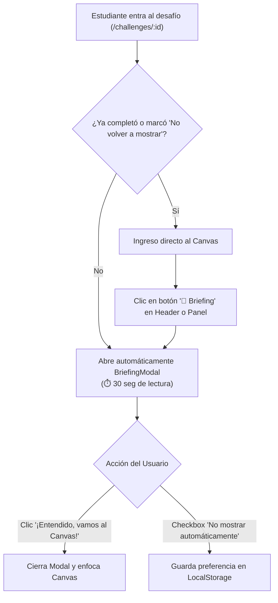
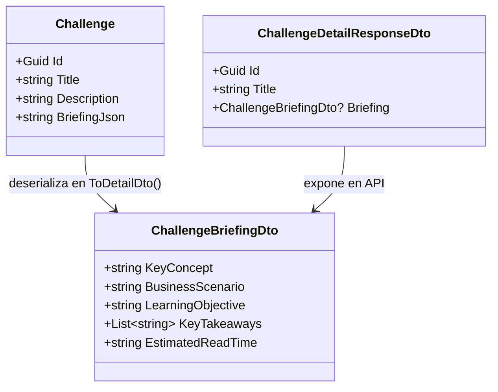

# Plan de Implementación: Briefing Pre-Desafío (Micro-Cápsulas de Contexto)

> **Documento de Diseño Técnico e Instruccional**  
> **Estado:** Completado & Verificado (100% Tests Aprobados)  
> **Referencia Pedagógica:** Oportunidad 1 en [`docs/15-pedagogical-learning-experience-audit.md`](file:///c:/workspace/aws/aws-game/docs/15-pedagogical-learning-experience-audit.md)  
> **Fecha:** 24 de Septiembre, 2026  

---

## 1. Descripción del Objetivo

El **Briefing Pre-Desafío (Micro-Cápsulas de Contexto)** introduce un puente cognitivo antes de que el estudiante comience a diagramar en el canvas. Su propósito es erradicar el comportamiento de "adivinar conexiones por ensayo y error", proporcionando una lectura rápida de **30 a 45 segundos** orientada a:
1. **El Escenario de Negocio (*Business Context*):** La situación o dolor operativo de una empresa real (ej. *plataforma de comercio con lentitud al cargar fotos*).
2. **El Principio o Concepto Cloud (*Key Concept*):** El fundamento teórico detrás de la solución (ej. *arquitectura stateless y desacoplamiento en almacenamiento de objetos*).
3. **La Meta de Aprendizaje (*Learning Objective*):** Qué competencia arquitectónica desarrollará el estudiante.
4. **Puntos Clave / Reglas de Oro (*Key Takeaways*):** Mejores prácticas del AWS Well-Architected Framework aplicables.

El briefing se presentará como una ventana modal interactiva al ingresar por primera vez a un desafío y estará disponible en todo momento desde el `WorkspaceHeader` y el `ProblemContextPanel`.

---

## 2. Decisiones de Diseño y Experiencia de Usuario (UX)



### Componentes Clave de UX:
1. **Modal de Briefing (`BriefingModal.tsx`):**
   - Encabezado con badge temático y tiempo estimado: `⏱️ 30 seg de lectura`.
   - 4 secciones visualmente jerarquizadas con tarjetas de colores sutiles adaptadas a Dark/Light Mode.
   - Checkbox: *"No volver a mostrar automáticamente al iniciar este desafío"*.
   - Botón principal de acción: *"¡Entendido, vamos a diseñar! 🚀"*.
2. **Acceso Permanente:**
   - Botón `"📖 Briefing"` en el `WorkspaceHeader`.
   - Botón/Pestaña de acceso rápido en el `ProblemContextPanel`.
3. **Soporte Anti-Cheat y Rendimiento:**
   - La información del Briefing es puramente formativa (no contiene spoilers de conexiones exactas ni reglas sintácticas internas), por lo que se envía de forma transparente en el payload `GET /api/v1/challenges/{id}`.

---

## 3. Cambios Propuestos por Capa

### 3.1. Capa de Datos y Backend (.NET 10)



#### [MODIFY] [`apps/api/src/AwsQuest.Domain/Entities/Challenge.cs`](file:///c:/workspace/aws/aws-game/apps/api/src/AwsQuest.Domain/Entities/Challenge.cs)
* Agregar propiedad `public string? BriefingJson { get; set; }`.

#### [NEW] [`apps/api/src/AwsQuest.Domain/Engine/Models/ChallengeBriefing.cs`](file:///c:/workspace/aws/aws-game/apps/api/src/AwsQuest.Domain/Engine/Models/ChallengeBriefing.cs)
* Definición del modelo de dominio:
  ```csharp
  namespace AwsQuest.Domain.Engine.Models;

  public class ChallengeBriefing
  {
      public string KeyConcept { get; set; } = string.Empty;
      public string BusinessScenario { get; set; } = string.Empty;
      public string LearningObjective { get; set; } = string.Empty;
      public List<string> KeyTakeaways { get; set; } = [];
      public string EstimatedReadTime { get; set; } = "30 seg";
  }
  ```

#### [MODIFY] [`apps/api/src/AwsQuest.Application/Dtos/Challenge/ChallengeDtos.cs`](file:///c:/workspace/aws/aws-game/apps/api/src/AwsQuest.Application/Dtos/Challenge/ChallengeDtos.cs)
* Agregar `ChallengeBriefingDto` y la propiedad `public ChallengeBriefingDto? Briefing { get; init; }` a `ChallengeDetailResponseDto`.

#### [MODIFY] [`apps/api/src/AwsQuest.Application/Common/Models/Seeding/SeedingDtos.cs`](file:///c:/workspace/aws/aws-game/apps/api/src/AwsQuest.Application/Common/Models/Seeding/SeedingDtos.cs)
* Agregar `public ChallengeBriefing? Briefing { get; set; }` a `ChallengeSeedDto`.

#### [MODIFY] [`apps/api/src/AwsQuest.Application/Mappings/CatalogMappingExtensions.cs`](file:///c:/workspace/aws/aws-game/apps/api/src/AwsQuest.Application/Mappings/CatalogMappingExtensions.cs)
* Mapear `challenge.BriefingJson` a `ChallengeBriefingDto` en `ToDetailDto()`.

#### [MODIFY] [`apps/api/src/AwsQuest.Infrastructure/Persistence/Seeding/ChallengeSeeder.cs`](file:///c:/workspace/aws/aws-game/apps/api/src/AwsQuest.Infrastructure/Persistence/Seeding/ChallengeSeeder.cs)
* Persistir `BriefingJson = JsonSerializer.Serialize(cDto.Briefing, JsonOptions)` al insertar o actualizar desafíos.

---

### 3.2. Capa de Contenido Declarativo (`content/challenges/`)

Incorporar el bloque `"briefing"` enriquecido en los desafíos JSON de las 12 Unidades:

```json
{
  "title": "Almacenamiento de objetos con S3",
  "briefing": {
    "keyConcept": "Arquitectura Stateless y Desacoplamiento de Almacenamiento",
    "businessScenario": "Una plataforma de comercio electrónico almacena las imágenes de productos en el disco local de sus servidores web, saturando el almacenamiento y bloqueando la escalabilidad horizontal.",
    "learningObjective": "Aprender a desacoplar activos estáticos multimedia hacia un servicio de almacenamiento de objetos altamente duradero y accesible globalmente.",
    "keyTakeaways": [
      "Los servidores web deben ser efímeros y no almacenar estado en disco local.",
      "Amazon S3 ofrece durabilidad del 99.999999999% (11 9s) y escalabilidad ilimitada.",
      "Desacoplar medios en S3 permite agregar o destruir instancias EC2 dinámicamente sin perder archivos."
    ],
    "estimatedReadTime": "35 seg"
  }
}
```

---

### 3.3. Capa de Frontend (React + TypeScript + Tailwind)

#### [MODIFY] [`apps/web/src/features/challenge/types/challenge.types.ts`](file:///c:/workspace/aws/aws-game/apps/web/src/features/challenge/types/challenge.types.ts)
* Agregar interfaces `ChallengeBriefingDto` y `ChallengeBriefing`.

#### [NEW] [`apps/web/src/features/challenge/components/BriefingModal.tsx`](file:///c:/workspace/aws/aws-game/apps/web/src/features/challenge/components/BriefingModal.tsx)
* Modal accesible con `useFocusTrap`, soporte para Dark/Light mode y estructura de 4 secciones con iconos Lucide (`Clock`, `Target`, `Building2`, `Lightbulb`, `CheckCircle2`).

#### [MODIFY] [`apps/web/src/features/challenge/components/WorkspaceHeader.tsx`](file:///c:/workspace/aws/aws-game/apps/web/src/features/challenge/components/WorkspaceHeader.tsx)
* Agregar botón `"📖 Briefing"` junto a las pistas en la cabecera superior.

#### [MODIFY] [`apps/web/src/features/challenge/components/ProblemContextPanel.tsx`](file:///c:/workspace/aws/aws-game/apps/web/src/features/challenge/components/ProblemContextPanel.tsx)
* Agregar acceso directo al Briefing desde la pestaña de Contexto/Requisitos.

#### [MODIFY] [`apps/web/src/features/challenge/pages/ChallengePage.tsx`](file:///c:/workspace/aws/aws-game/apps/web/src/features/challenge/pages/ChallengePage.tsx)
* Control de apertura inicial automática del modal y persistencia de preferencias de usuario en `localStorage` (`awsquest_auto_briefing_${challengeId}`).

---

## 4. Plan de Verificación y Pruebas

### 4.1. Pruebas Automatizadas Backend (.NET 10)
```powershell
# 1. Pruebas unitarias de serialización y lectura de contenido
dotnet test apps/api/tests/AwsQuest.UnitTests/ --filter "FullyQualifiedName~JsonChallengeContentReaderTests|FullyQualifiedName~CatalogMappingExtensionsTests"

# 2. Pruebas de integración de seeding y detalle de desafío
dotnet test apps/api/tests/AwsQuest.IntegrationTests/ --filter "FullyQualifiedName~ChallengeSeederTests|FullyQualifiedName~ChallengesControllerIntegrationTests"
```

### 4.2. Pruebas Automatizadas Frontend (Vitest)
```powershell
# Pruebas unitarias de componentes y hooks de desafío
npm run test -- --run apps/web/src/features/challenge/components/__tests__/BriefingModal.test.tsx
npm run test -- --run apps/web/src/features/challenge/components/__tests__/WorkspaceHeader.test.tsx
npm run test -- --run
```
