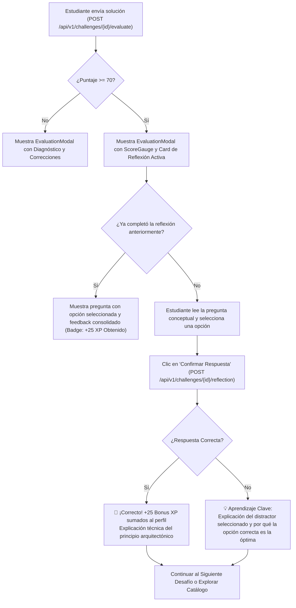
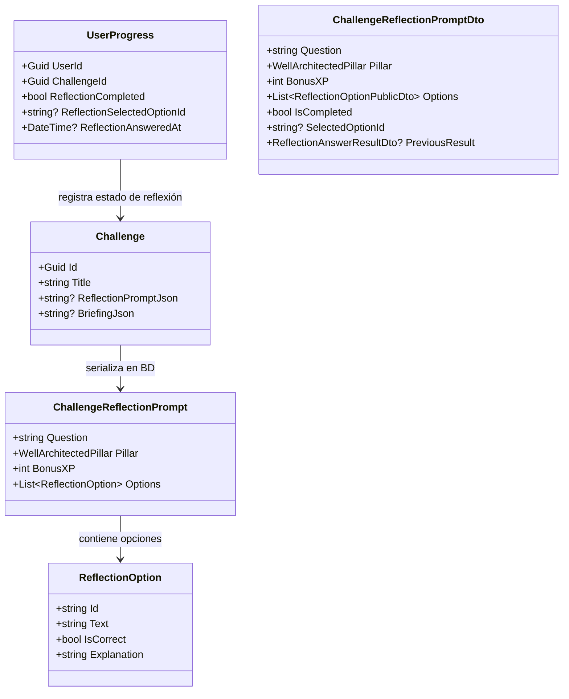
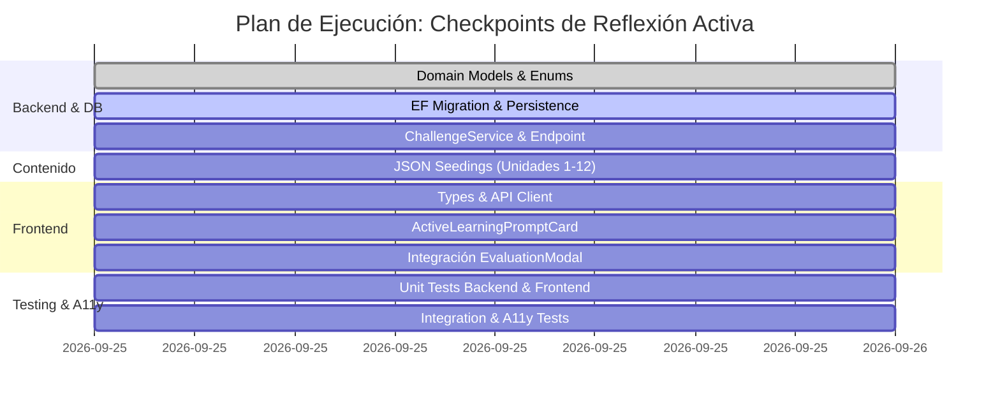

# Plan de Implementación: Checkpoints de Reflexión Activa (Active Learning Prompts)

> **Documento de Diseño Técnico e Instruccional**  
> **Estado:** Completado & Verificado (100% Tests Aprobados)  
> **Referencia Pedagógica:** Oportunidad 3 en [`docs/15-pedagogical-learning-experience-audit.md`](file:///c:/workspace/aws/aws-game/docs/15-pedagogical-learning-experience-audit.md)  
> **Fecha:** 25 de Septiembre, 2026  

---

## 1. Justificación Pedagógica y Objetivos

### 1.1 El Problema: "La Ilusión de Competencia por Ensayo y Error"
En simuladores de arquitectura basados en grafos, existe el riesgo latente de que los estudiantes alcancen una solución aprobatoria ($\ge 70$ pts o 100 pts) mediante permutaciones mecánicas (conectar nodos hasta ver checks verdes) sin haber consolidado el **"por qué"** de su diseño ni los trade-offs involucrados bajo el *AWS Well-Architected Framework*.

### 1.2 La Solución: Checkpoints de Reflexión Activa
El **Checkpoint de Reflexión Activa** es una evaluación formativa post-éxito integrada directamente en el flujo de evaluación (`EvaluationModal`):
1. **Momento Clave:** Se desbloquea automáticamente en cuanto el estudiante logra una puntuación aprobatoria ($\ge 70\%$).
2. **Desafío Conceptual:** Presenta una pregunta de razonamiento arquitectónico (3 o 4 opciones) contextualizada al escenario que acaba de resolver (ej. justificación de desacoplamiento, límites de concurrencia, selección de storage class o diseño de subredes).
3. **Incentivo y Gamificación:** Respondiendo correctamente en el primer intento otorga un **Bonus de +25 XP**.
4. **Cultura de Aprendizaje Sin Castigo:** Si el estudiante falla, no se descuenta XP ni se invalida la aprobación del laboratorio; en su lugar, se despliega una explicación constructiva y detallada de cada distractor para disipar conceptos erróneos comunes.

---

## 2. Diagrama de Flujo y Experiencia de Usuario (UX)



---

## 3. Arquitectura del Modelo de Datos y Seguridad Anti-Cheat

Para evitar que los estudiantes inspeccionen el DOM o las respuestas JSON para obtener la respuesta correcta, la validación se realiza **100% en el servidor**:



---

## 4. Especificación Técnica por Capa

### 4.1 Capa de Dominio (`AwsQuest.Domain`)

#### [NEW] [`apps/api/src/AwsQuest.Domain/Engine/Models/ChallengeReflectionPrompt.cs`](file:///c:/workspace/aws/aws-game/apps/api/src/AwsQuest.Domain/Engine/Models/ChallengeReflectionPrompt.cs)
```csharp
namespace AwsQuest.Domain.Engine.Models;

using AwsQuest.Domain.Enums;

public class ChallengeReflectionPrompt
{
    public string Question { get; set; } = string.Empty;
    public WellArchitectedPillar Pillar { get; set; } = WellArchitectedPillar.Reliability;
    public int BonusXP { get; set; } = 25;
    public List<ReflectionOption> Options { get; set; } = [];
}

public class ReflectionOption
{
    public string Id { get; set; } = string.Empty;
    public string Text { get; set; } = string.Empty;
    public bool IsCorrect { get; set; }
    public string Explanation { get; set; } = string.Empty;
}
```

#### [NEW] [`apps/api/src/AwsQuest.Domain/Enums/WellArchitectedPillar.cs`](file:///c:/workspace/aws/aws-game/apps/api/src/AwsQuest.Domain/Enums/WellArchitectedPillar.cs)
```csharp
namespace AwsQuest.Domain.Enums;

public enum WellArchitectedPillar
{
    OperationalExcellence,
    Security,
    Reliability,
    PerformanceEfficiency,
    CostOptimization,
    Sustainability
}
```

#### [MODIFY] [`apps/api/src/AwsQuest.Domain/Entities/Challenge.cs`](file:///c:/workspace/aws/aws-game/apps/api/src/AwsQuest.Domain/Entities/Challenge.cs)
* Añadir propiedad `public string? ReflectionPromptJson { get; set; }`.

#### [MODIFY] [`apps/api/src/AwsQuest.Domain/Entities/UserProgress.cs`](file:///c:/workspace/aws/aws-game/apps/api/src/AwsQuest.Domain/Entities/UserProgress.cs)
* Añadir `public bool ReflectionCompleted { get; set; }`.
* Añadir `public string? ReflectionSelectedOptionId { get; set; }`.
* Añadir `public DateTime? ReflectionAnsweredAt { get; set; }`.

---

### 4.2 Capa de Aplicación (`AwsQuest.Application`)

#### [MODIFY] [`apps/api/src/AwsQuest.Application/Dtos/Challenge/ChallengeDtos.cs`](file:///c:/workspace/aws/aws-game/apps/api/src/AwsQuest.Application/Dtos/Challenge/ChallengeDtos.cs)
```csharp
public class ChallengeReflectionPromptDto
{
    public string Question { get; init; } = string.Empty;
    public WellArchitectedPillar Pillar { get; init; }
    public int BonusXP { get; init; } = 25;
    public List<ReflectionOptionPublicDto> Options { get; init; } = [];
    public bool IsCompleted { get; init; }
    public string? SelectedOptionId { get; init; }
    public ReflectionAnswerResultDto? PreviousResult { get; init; }
}

public class ReflectionOptionPublicDto
{
    public string Id { get; init; } = string.Empty;
    public string Text { get; init; } = string.Empty;
}

public class SubmitReflectionAnswerRequestDto
{
    public string SelectedOptionId { get; init; } = string.Empty;
}

public class SubmitReflectionAnswerResponseDto
{
    public bool IsCorrect { get; init; }
    public int BonusXpEarned { get; init; }
    public string Explanation { get; init; } = string.Empty;
    public string CorrectOptionId { get; init; } = string.Empty;
    public int CurrentUserXP { get; init; }
    public int CurrentUserLevel { get; init; }
    public List<ReflectionOptionExplanationDto> AllExplanations { get; init; } = [];
}

public class ReflectionOptionExplanationDto
{
    public string Id { get; init; } = string.Empty;
    public bool IsCorrect { get; init; }
    public string Explanation { get; init; } = string.Empty;
}
```

#### [MODIFY] [`apps/api/src/AwsQuest.Application/Common/Interfaces/IChallengeService.cs`](file:///c:/workspace/aws/aws-game/apps/api/src/AwsQuest.Application/Common/Interfaces/IChallengeService.cs)
* Añadir método:
  ```csharp
  Task<SubmitReflectionAnswerResponseDto> SubmitReflectionAnswerAsync(
      Guid challengeId, 
      Guid userId, 
      SubmitReflectionAnswerRequestDto request, 
      CancellationToken cancellationToken = default);
  ```

#### [MODIFY] [`apps/api/src/AwsQuest.Application/Common/Models/Seeding/SeedingDtos.cs`](file:///c:/workspace/aws/aws-game/apps/api/src/AwsQuest.Application/Common/Models/Seeding/SeedingDtos.cs)
* Añadir `public ChallengeReflectionPrompt? ReflectionPrompt { get; set; }` en `ChallengeSeedDto`.

---

### 4.3 Capa de Infraestructura y API (`AwsQuest.Infrastructure` & `AwsQuest.Api`)

#### [MODIFY] [`apps/api/src/AwsQuest.Infrastructure/Services/ChallengeService.cs`](file:///c:/workspace/aws/aws-game/apps/api/src/AwsQuest.Infrastructure/Services/ChallengeService.cs)
* Implementar `SubmitReflectionAnswerAsync`:
  1. Validar existencia del desafío y presencia de `ReflectionPromptJson`.
  2. Verificar si el usuario ya aprobó el desafío (Score $\ge 70$ o `UserProgress.Status == Completed`).
  3. Deserializar `ChallengeReflectionPrompt` y validar `SelectedOptionId`.
  4. Si es la primera vez que responde correctamente y no había sido completado previamente, otorgar `BonusXP` a `user.TotalXP`, actualizar nivel y marcar `progress.ReflectionCompleted = true`.
  5. Registrar `ReflectionSelectedOptionId` y `ReflectionAnsweredAt`.
  6. Retornar DTO con `IsCorrect`, `BonusXpEarned`, `Explanation` y desglose de todas las opciones.

#### [NEW MIGRATION] `AddChallengeReflectionCheckpoint`
* Generar migración de EF Core agregando `ReflectionPromptJson` en `Challenges` y campos de reflexión en `UserProgresses`.

#### [MODIFY] [`apps/api/src/AwsQuest.Api/Controllers/ChallengeController.cs`](file:///c:/workspace/aws/aws-game/apps/api/src/AwsQuest.Api/Controllers/ChallengeController.cs)
* Exponer:
  ```csharp
  [HttpPost("{id:guid}/reflection")]
  public async Task<ActionResult<ApiResponse<SubmitReflectionAnswerResponseDto>>> SubmitReflection(
      Guid id, 
      [FromBody] SubmitReflectionAnswerRequestDto request, 
      CancellationToken cancellationToken)
  ```

---

### 4.4 Capa de Contenido Declarativo (`content/challenges/`)

Agregar el bloque `"reflectionPrompt"` en los desafíos JSON de las 12 Unidades. Ejemplo para **Desafío 104 (S3)**:

```json
{
  "title": "Almacenamiento de objetos con S3",
  "reflectionPrompt": {
    "question": "¿Por qué es una mejor práctica arquitectónica desacoplar las imágenes de usuario hacia Amazon S3 en lugar de almacenarlas en el disco local EBS de las instancias EC2?",
    "pillar": "Reliability",
    "bonusXP": 25,
    "options": [
      {
        "id": "opt-a",
        "text": "Porque EBS no permite almacenar archivos multimedia mayores a 1 MB.",
        "isCorrect": false,
        "explanation": "Incorrecto. EBS soporta volúmenes de hasta 64 TB y no restringe tipos ni tamaños individuales de archivos."
      },
      {
        "id": "opt-b",
        "text": "Porque permite mantener los servidores web stateless, facilitando el auto-scaling horizontal y garantizando una durabilidad de 11 nueves (99.999999999%).",
        "isCorrect": true,
        "explanation": "¡Exacto! El almacenamiento stateless evita que la terminación de una instancia destruya archivos de usuario y permite escalar instancias elásticamente."
      },
      {
        "id": "opt-c",
        "text": "Porque S3 ejecuta automáticamente scripts de PHP y Node.js en las imágenes cargadas.",
        "isCorrect": false,
        "explanation": "Incorrecto. S3 es un almacenamiento de objetos puro; no es un entorno de ejecución de código de servidor."
      }
    ]
  }
}
```

---

### 4.5 Capa de Frontend (React + TypeScript + Tailwind)

#### [MODIFY] [`apps/web/src/features/challenge/types/challenge.types.ts`](file:///c:/workspace/aws/aws-game/apps/web/src/features/challenge/types/challenge.types.ts)
* Declarar tipos e interfaces:
  - `WellArchitectedPillar`
  - `ChallengeReflectionPromptDto`
  - `ReflectionOptionPublicDto`
  - `SubmitReflectionAnswerRequestDto`
  - `SubmitReflectionAnswerResponseDto`

#### [MODIFY] [`apps/web/src/features/challenge/api/challengeApi.ts`](file:///c:/workspace/aws/aws-game/apps/web/src/features/challenge/api/challengeApi.ts)
* Agregar función `submitReflectionAnswer(challengeId: string, selectedOptionId: string)`.

#### [NEW] [`apps/web/src/features/challenge/components/ActiveLearningPromptCard.tsx`](file:///c:/workspace/aws/aws-game/apps/web/src/features/challenge/components/ActiveLearningPromptCard.tsx)
* Componente interactivo con:
  - Badge temático del pilar de Well-Architected (`Seguridad`, `Fiabilidad`, `Rendimiento`, etc.).
  - Badge de recompensa: `+25 Bonus XP`.
  - Radio inputs estilizados accesibles por teclado (flechas / Enter / espacio).
  - Estados:
    - *Selección activa*: Botones radio interactivos + botón "Confirmar Reflexión".
    - *Enviando*: Estado de carga con indicador visual.
    - *Retroalimentación Revelada*: Opciones coloreadas (verde para correcta, rojo suave para incorrecta elegida) y tarjeta explicativa formativa.

#### [MODIFY] [`apps/web/src/features/evaluation/components/EvaluationModal.tsx`](file:///c:/workspace/aws/aws-game/apps/web/src/features/evaluation/components/EvaluationModal.tsx)
* Incorporar `ActiveLearningPromptCard` cuando `result.passed` es `true` y el desafío tiene un prompt de reflexión.
* Conectar con el store de autenticación/gamificación para actualizar XP del usuario en tiempo real cuando se obtenga el bonus.

---

## 5. Fases de Implementación y Plan de Trabajo



### Detalle de Fases:

1. **Fase 1: Capa de Dominio y Base de Datos**
   - Crear `ChallengeReflectionPrompt.cs`, `ReflectionOption.cs`, `WellArchitectedPillar.cs`.
   - Modificar `Challenge.cs` y `UserProgress.cs`.
   - Ejecutar `dotnet ef migrations add AddChallengeReflectionCheckpoint`.

2. **Fase 2: Capa de Aplicación y Endpoints**
   - Implementar DTOs y validadores en `AwsQuest.Application`.
   - Implementar lógica anti-cheat y entrega de XP en `ChallengeService.cs`.
   - Exponer endpoint `POST /api/v1/challenges/{id}/reflection`.
   - Actualizar `ChallengeSeeder.cs` para serializar `ReflectionPromptJson`.

3. **Fase 3: Curaduría de Preguntas Pedagógicas en Contenido JSON**
   - Incorporar preguntas de reflexión socráticas y formativas en desafíos clave de todas las unidades (Cómputo, Almacenamiento, Redes, Serverless, Desacoplamiento, Alta Disponibilidad).

4. **Fase 4: Frontend y Componentes Interactivos**
   - Crear `ActiveLearningPromptCard.tsx` con soporte completo Dark/Light y accesibilidad WCAG.
   - Conectar endpoint en `challengeApi.ts` y hook `useSubmitReflectionAnswer`.
   - Integrar la tarjeta de reflexión en `EvaluationModal.tsx`.

5. **Fase 5: Pruebas y Validación Integral**
   - Tests Unitarios: Validación de respuestas, cálculo de XP bonus una sola vez, protección contra re-envíos.
   - Tests de Integración: Flujo completo de evaluación + envío de checkpoint contra PostgreSQL.
   - Tests de Frontend: Vitest en `ActiveLearningPromptCard.test.tsx` y `EvaluationModal.test.tsx`.

---

## 6. Criterios de Aceptación y Definición de Terminado (DoD)

1. [ ] **Anti-Cheat Garantizado:** La respuesta correcta y las explicaciones completas no viajan en el payload del catálogo o detalle inicial del desafío; solo se entregan tras enviar la respuesta al endpoint.
2. [ ] **Idempotencia de XP:** El bonus de +25 XP solo se suma una única vez por desafío completado en el perfil del usuario.
3. [ ] **Feedback Formativo:** Toda respuesta (correcta o incorrecta) muestra explicaciones detalladas que refuercen los pilares del AWS Well-Architected Framework.
4. [ ] **Soporte Dark/Light Mode y A11y:** Navegación 100% operable por teclado con contraste adecuado (WCAG 2.1 AA).
5. [ ] **100% Tests Pasados:** Suite de backend (`dotnet test`) y suite de frontend (`npm run test`) ejecutándose en verde sin regresiones.
