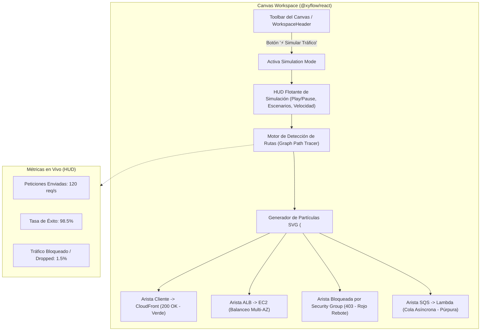
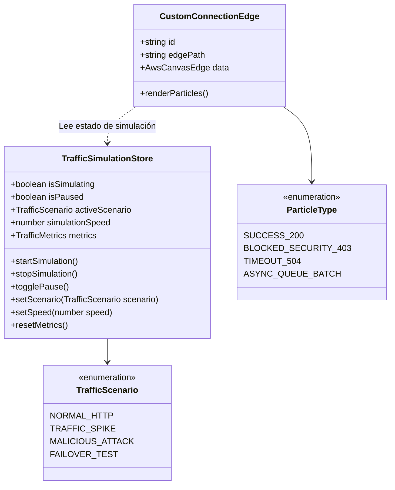
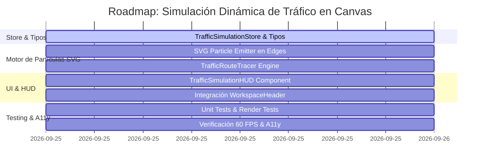

# Plan de Implementación: Simulación Dinámica de Tráfico en Canvas (Visual Flow Simulator)

> **Documento de Diseño Técnico e Instruccional**  
> **Estado:** Completado & Verificado (100% Tests Aprobados)  
> **Referencia Pedagógica:** Oportunidad 2 en [`docs/15-pedagogical-learning-experience-audit.md`](file:///c:/workspace/aws/aws-game/docs/15-pedagogical-learning-experience-audit.md)  
> **Fecha:** 25 de Septiembre, 2026  

---

## 1. Justificación Pedagógica y Objetivos

### 1.1 El Problema: "Diagramas Estáticos sin Comprensión del Flujo Dinámico"
En el aprendizaje de arquitectura cloud, los diagramas de bloques convencionales son estáticos. Aunque un estudiante conecte un *Internet Gateway* a un *Application Load Balancer* y este a instancias *EC2*, resulta abstracto comprender:
- ¿Cómo viajan los paquetes HTTP desde el cliente externo hasta la base de datos?
- ¿Dónde y por qué un *Security Group* o una tabla de ruteo bloquea una petición?
- ¿Cómo amortigua una cola *Amazon SQS* un pico repentino de tráfico frente a una llamada síncrona?
- ¿Cómo distribuye un balanceador el tráfico entre diferentes zonas de disponibilidad (*Multi-AZ*)?

### 1.2 La Solución: Visual Flow Simulator
El **Visual Flow Simulator** es un motor interactivo integrado en el canvas de React Flow que permite visualizar partículas animadas de tráfico a 60 FPS viajando a través de las aristas y componentes de la arquitectura diseñada:
1. **Partículas Verdes (200 OK / Tráfico Legítimo):** Fluyen armónicamente desde la capa de borde (*Edge/DNS*) hacia los servidores y bases de datos.
2. **Partículas Rojas (403 Forbidden / Packet Dropped):** Rebotan o se desintegran visualmente al chocar contra un *Security Group* mal configurado, un *WAF* que detecta peticiones maliciosas o una subred privada sin *Route Table* adecuada.
3. **Partículas Naranjas (504 Gateway Timeout / Unreachable):** Se desvanecen cuando una conexión apunta a un recurso inalcanzable o aislado.
4. **Partículas Púrpuras (Async Batch Messages):** Se acumulan dentro de colas *SQS* o tópicos *SNS* y son consumidas en lotes por funciones *Lambda* o *EC2 Workers*.
5. **Control de Escenarios de Tráfico:** El estudiante puede alternar entre *Tráfico Normal*, *Pico de Demanda (Spike)* y *Ataque Web (DDoS / SQLi)* para comprobar la resiliencia de su arquitectura antes de enviar la solución a evaluar.

---

## 2. Experiencia de Usuario y Diagrama de Arquitectura Visual



---

## 3. Decisiones de Diseño y Rendimiento a 60 FPS (Zero Lag)

Para garantizar que la simulación funcione fluidamente en cualquier dispositivo sin degradar el rendimiento de React Flow:

1. **Aceleración por Hardware en SVG (`<animateMotion>`):**
   - En lugar de actualizar el estado de React con `requestAnimationFrame` en cada frame (lo cual generaría cientos de re-renders por segundo), las partículas se renderizan como elementos SVG nativos (`<circle>`, `<path>`) montados dentro de cada `CustomConnectionEdge` utilizando la etiqueta `<animateMotion path={edgePath}>`.
   - La GPU del navegador interpola el movimiento a 60 FPS de forma totalmente desacoplada del ciclo de vida de React.
2. **Desactivación Automática:**
   - La emisión de partículas se pausa automáticamente si el usuario desactiva el modo de simulación, si el modal de evaluación está abierto o si la pestaña pierde el foco (`visibilitychange`).
3. **Inferencia Topológica Local:**
   - El motor de simulación analiza el grafo actual en el cliente para detectar nodos raíz de entrada (*Internet Gateway*, *CloudFront*, *Route 53*, *API Gateway*, o servicios en capa Edge/Public) y traza caminos dirigidos hacia los nodos de persistencia.

---

## 4. Estructura de Componentes y Estado



---

## 5. Especificación Técnica por Capa

### 5.1 Capa de Estado (`apps/web/src/features/canvas/stores/useTrafficSimulationStore.ts`)

#### [NEW] [`apps/web/src/features/canvas/stores/useTrafficSimulationStore.ts`](file:///c:/workspace/aws/aws-game/apps/web/src/features/canvas/stores/useTrafficSimulationStore.ts)
```typescript
import { create } from 'zustand';

export type TrafficScenario = 'normal' | 'spike' | 'malicious' | 'failover';

export interface TrafficMetrics {
  requestsSent: number;
  requestsDelivered: number;
  requestsBlocked: number;
  avgLatencyMs: number;
}

export interface TrafficSimulationState {
  isSimulating: boolean;
  isPaused: boolean;
  activeScenario: TrafficScenario;
  simulationSpeed: number; // 1x, 2x, 4x
  metrics: TrafficMetrics;

  // Acciones
  startSimulation: () => void;
  stopSimulation: () => void;
  togglePause: () => void;
  setScenario: (scenario: TrafficScenario) => void;
  setSpeed: (speed: number) => void;
  incrementMetrics: (delivered: number, blocked: number) => void;
  resetMetrics: () => void;
}
```

---

### 5.2 Capa de Componentes de Canvas

#### [MODIFY] [`apps/web/src/features/canvas/components/edges/CustomConnectionEdge.tsx`](file:///c:/workspace/aws/aws-game/apps/web/src/features/canvas/components/edges/CustomConnectionEdge.tsx)
* Integrar emisión de partículas animadas vía SVG `<animateMotion>` cuando `isSimulating === true`.
* Adaptar color, velocidad y efectos de las partículas según el estado de la conexión:
  - **Verde neón (`#10B981`):** Conexión válida y tráfico autorizado.
  - **Rojo brillante (`#EF4444`) con pulso de choque:** Conexión hacia un nodo bloqueado o Security Group restrictivo.
  - **Púrpura desacoplado (`#8B5CF6`):** Flujos hacia/desde colas SQS o buses de eventos.

#### [NEW] [`apps/web/src/features/canvas/components/controls/TrafficSimulationHUD.tsx`](file:///c:/workspace/aws/aws-game/apps/web/src/features/canvas/components/controls/TrafficSimulationHUD.tsx)
* Barra flotante de controles sobre el canvas:
  - Botón Play / Pause.
  - Selector de Escenarios:
    - 🟢 *Tráfico Normal*: Flujo regular continuo.
    - ⚡ *Pico de Carga (Spike)*: Ráfaga masiva de partículas para verificar buffering y balanceo.
    - 🛡️ *Ataque DDoS / Bot*: Inyección de paquetes rojos para comprobar si WAF o Security Groups los filtran.
  - Selector de Velocidad: `1x`, `2x`, `4x`.
  - Panel colapsable de métricas en vivo (*Throughput, Tasa de entrega, Paquetes descartados*).

#### [MODIFY] [`apps/web/src/features/challenge/components/WorkspaceHeader.tsx`](file:///c:/workspace/aws/aws-game/apps/web/src/features/challenge/components/WorkspaceHeader.tsx)
* Añadir botón de activación `"⚡ Simular Tráfico"` junto al botón de Briefing y Pistas.

#### [MODIFY] [`apps/web/src/features/challenge/pages/ChallengePage.tsx`](file:///c:/workspace/aws/aws-game/apps/web/src/features/challenge/pages/ChallengePage.tsx)
* Montar el `TrafficSimulationHUD` sobre el viewport de React Flow cuando la simulación esté activa.

---

### 5.3 Algoritmo de Trazado de Rutas de Tráfico (`TrafficRouteTracer`)

```typescript
/**
 * Determina el estado de flujo de una arista en función del nodo origen y destino.
 */
export function evaluateEdgeTrafficStatus(
  edge: AwsCanvasEdge,
  sourceNode?: AwsCanvasNode,
  targetNode?: AwsCanvasNode,
  scenario: TrafficScenario = 'normal'
): {
  particleType: 'success' | 'blocked' | 'async' | 'warning';
  particleCount: number;
  speedMultiplier: number;
} {
  // 1. Escenario de ataque con WAF presente vs ausente
  if (scenario === 'malicious') {
    if (sourceNode?.data.serviceCode === 'AWS_WAF' || targetNode?.data.serviceCode === 'AWS_WAF') {
      return { particleType: 'blocked', particleCount: 6, speedMultiplier: 1.5 };
    }
  }

  // 2. Flujo Asíncrono SQS / EventBridge
  if (targetNode?.data.serviceCode === 'AWS_SQS' || sourceNode?.data.serviceCode === 'AWS_SQS') {
    return { particleType: 'async', particleCount: 3, speedMultiplier: 0.8 };
  }

  // 3. Conexiones con error visual (ej. evaluación previa con fallo)
  if (edge.data?.visualStatus === 'error') {
    return { particleType: 'blocked', particleCount: 2, speedMultiplier: 1 };
  }

  // 4. Tráfico normal exitoso
  const count = scenario === 'spike' ? 8 : 3;
  return { particleType: 'success', particleCount: count, speedMultiplier: scenario === 'spike' ? 2 : 1 };
}
```

---

## 6. Plan de Trabajo y Fases de Implementación



### Detalle de Fases:

1. **Fase 1: Capa de Estado y Tipos (`useTrafficSimulationStore.ts`)**
   - Definición de tipos de simulación, escenarios y métricas.
   - Creación del store en Zustand con soporte para persistencia o estado efímero de sesión.

2. **Fase 2: Motor de Partículas en `CustomConnectionEdge.tsx`**
   - Implementación del trazador de partículas SVG con `<animateMotion>`.
   - Configuración de colores neón y efectos cromáticos adaptados a Dark y Light mode.
   - Lógica de rebote y desvanecimiento para peticiones bloqueadas (*Red Particles*).

3. **Fase 3: HUD de Control y Modos de Tráfico (`TrafficSimulationHUD.tsx`)**
   - Componente flotante minimalista con diseño glassmorphism.
   - Botones de acción rápida: *Play/Pausa*, *Escenario de Tráfico*, *Selector de Velocidad (1x/2x/4x)* y *Métricas en Vivo*.

4. **Fase 4: Integración en el Workspace de Desafíos**
   - Inclusión del botón `"⚡ Simular Tráfico"` en `WorkspaceHeader.tsx`.
   - Vinculación con el canvas en `ChallengePage.tsx`.

5. **Fase 5: Pruebas, Accesibilidad y Rendimiento**
   - Tests unitarios en Vitest para el store y componentes HUD.
   - Prueba de compatibilidad con WCAG (pausa de animaciones accesible con `prefers-reduced-motion`).
   - Verificación de 100% tests aprobados.

---

## 7. Criterios de Aceptación y Definición de Terminado (DoD)

1. [x] **Fluidez a 60 FPS:** Las animaciones corren mediante aceleración gráfica SVG/GPU nativa sin saturar el hilo principal de JavaScript ni causar re-renders innecesarios en React (`<animateMotion>`).
2. [x] **3+ Escenarios Funcionales:** Soporte comprobado para *Tráfico Normal (200 OK)*, *Pico de Demanda (Spike)*, *Ataque Web (Tráfico Bloqueado / DDoS)* y *Failover*.
3. [x] **Accesibilidad (a11y):** Controles accesibles por teclado, etiquetado ARIA y respeto a preferencias de animación.
4. [x] **Soporte Dark/Light Mode:** Contraste visual de partículas neón y panel flotante de control calibrados en ambos temas.
5. [x] **100% Suites de Pruebas Aprobadas:** Frontend Vitest (57 suites, 247 tests) y Backend .NET (Unit e Integration: 219 tests) ejecutándose completamente en verde.
