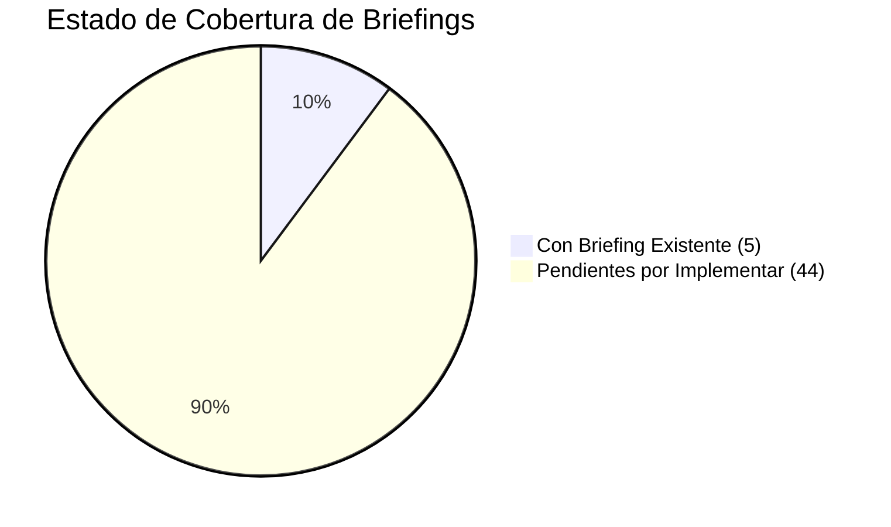
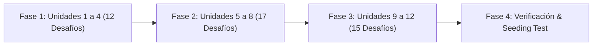

# Plan de Implementación: Cobertura Total de Briefings Pedagógicos (44 Desafíos Pendientes)

> **Documento de Diseño Curricular y Planificación Técnica**  
> **Estado:** Completado & Verificado (100% Cobertura y Tests Aprobados)  
> **Referencia Pedagógica:** Oportunidad 1 en [`docs/15-pedagogical-learning-experience-audit.md`](file:///c:/workspace/aws/aws-game/docs/15-pedagogical-learning-experience-audit.md)  
> **Fecha:** 25 de Septiembre, 2026  
> **Total de Desafíos en Catálogo:** 49  
> **Desafíos con Briefing:** 49 (100%)  
> **Desafíos Pendientes de Briefing:** 0 (0%)  

---

## 1. Diagnóstico y Estado Actual del Catálogo

Durante la auditoría del catálogo de desafíos (`content/challenges/unit-1` a `unit-12`), se constató que actualmente solo **5 de los 49 desafíos** disponen de la propiedad `briefing`:
- ✅ `challenge-101.json` (Mi primer servidor con EC2)
- ✅ `challenge-104.json` (Almacenamiento de objetos con S3)
- ✅ `challenge-301.json` (Crear una VPC y sus Subnets)
- ✅ `challenge-601.json` (Ejecutar código con Lambda)
- ✅ `challenge-1201.json` (Diseña una plataforma E-Commerce)

Los **44 desafíos restantes** inician directamente en el lienzo interactivo sin proporcionar la micro-cápsula contextual que establece el escenario de negocio, el objetivo didáctico y los conceptos clave recomendados por las mejores prácticas del *AWS Well-Architected Framework*.

---

## 2. Estructura Estándar de la Micro-Cápsula (`briefing`)

Cada micro-cápsula de contexto se integra directamente en el archivo JSON del desafío con el siguiente esquema validado por el backend (.NET 10) y el frontend (React):

```json
"briefing": {
  "keyConcept": "string (Concepto Clave Central del Desafío)",
  "businessScenario": "string (Escenario de Negocio del Mundo Real)",
  "learningObjective": "string (Objetivo Didáctico Específico)",
  "keyTakeaways": [
    "string (Pilar o Principio Clave 1)",
    "string (Pilar o Principio Clave 2)",
    "string (Pilar o Principio Clave 3)"
  ],
  "estimatedReadTime": "string ('30 seg' | '45 seg' | '1 min')"
}
```

---

## 3. Matriz Curricular de Briefings por Unidad (44 Desafíos)



---

### Unidad 1: Computación y Almacenamiento (2 Pendientes)

| Archivo | Desafío | Concepto Clave | Escenario de Negocio |
| :--- | :--- | :--- | :--- |
| `challenge-102.json` | **Persistencia: EBS** | Almacenamiento en Bloque Persistente | Una base de datos transaccional en EC2 requiere retener sus datos tras reinicios y apagados. |
| `challenge-103.json` | **Archivos compartidos con EFS** | Sistema de Archivos Compartido Multi-AZ | Un clúster web necesita acceso concurrente de lectura/escritura a un directorio compartido de assets. |

---

### Unidad 2: Construir una Aplicación Web (3 Pendientes)

| Archivo | Desafío | Concepto Clave | Escenario de Negocio |
| :--- | :--- | :--- | :--- |
| `challenge-201.json` | **Aplicación Web Básica** | Arquitectura Web Monolítica Inicial | Una pyme publica su primera página web dinámica en una instancia EC2 accesible desde Internet. |
| `challenge-202.json` | **Separando Frontend y Backend** | Desacoplamiento de Capa Estática y Dinámica | Una web de alto tráfico descarga a su servidor EC2 alojando el frontend estático en S3. |
| `challenge-203.json` | **Contenido Global con CloudFront + S3** | Aceleración Perimetral con CDN | Usuarios globales experimentan alta latencia al descargar assets directamente desde S3. |

---

### Unidad 3: Redes: Construir el Camino (3 Pendientes)

| Archivo | Desafío | Concepto Clave | Escenario de Negocio |
| :--- | :--- | :--- | :--- |
| `challenge-302.json` | **Conectar la VPC a Internet** | Internet Gateway (IGW) y Ruteo Público | Instancias en una VPC nueva no pueden recibir tráfico web externo por falta de puerta de enlace. |
| `challenge-303.json` | **Subnets Públicas y Privadas con NAT** | Aislamiento Seguro y Salida con NAT Gateway | Servidores backend en subredes privadas necesitan descargar parches sin exponerse a Internet. |
| `challenge-304.json` | **Controlar tráfico con Security Groups** | Firewalls Virtuales con Estado (Stateful) | Auditoría de seguridad detecta puertos abiertos sin restricción hacia el exterior. |

---

### Unidad 4: Datos y Seguridad (4 Pendientes)

| Archivo | Desafío | Concepto Clave | Escenario de Negocio |
| :--- | :--- | :--- | :--- |
| `challenge-401.json` | **Base de Datos con RDS** | RDBMS Administrado | Una empresa reemplaza bases de datos autogestionadas en VMs para automatizar backups y parches. |
| `challenge-402.json` | **Aplicación + RDS en 2 Capas** | Arquitectura Segura de 2 Capas | Aplicación web conecta a RDS en subred privada restringiendo el puerto 3306/5432 solo a EC2. |
| `challenge-403.json` | **Incidente: BD Expuesta** | Remediación de Brechas de Red | Base de datos productiva se encuentra expuesta públicamente con `0.0.0.0/0` en subred pública. |
| `challenge-404.json` | **Gestión de Secretos** | Almacenamiento Centralizado de Credenciales | Se deben eliminar contraseñas y API keys embebidas en texto plano dentro del código fuente. |

---

### Unidad 5: Disponibilidad y Escalabilidad (5 Pendientes)

| Archivo | Desafío | Concepto Clave | Escenario de Negocio |
| :--- | :--- | :--- | :--- |
| `challenge-501.json` | **Eliminar Single Point of Failure** | Resiliencia Multi-AZ y Eliminación de SPOF | Una caída en un datacenter detiene el negocio por tener todos los servidores en una sola AZ. |
| `challenge-502.json` | **Distribuir tráfico con ALB** | Balanceo de Carga Capa 7 (HTTP/HTTPS) | Servidores reciben tráfico desigual y colapsan sin comprobaciones de salud (Health Checks). |
| `challenge-503.json` | **Escalabilidad con Auto Scaling** | Auto Scaling Groups (ASG) Elásticos | El tráfico fluctúa drásticamente entre el día y la noche generando sobrecostos o caídas. |
| `challenge-504.json` | **Base de Datos Multi-AZ** | Replicación Síncrona y Failover Automático | La base de datos requiere tolerancia a desastres con recuperación automática sin pérdida de datos. |
| `challenge-505.json` | **Incidente SRE: Servidor Saturado** | Mitigación de Saturación y Escalamiento | Alerta de producción reporta errores HTTP 503 por exceso de carga en una única instancia. |

---

### Unidad 6: Arquitecturas Serverless (4 Pendientes)

| Archivo | Desafío | Concepto Clave | Escenario de Negocio |
| :--- | :--- | :--- | :--- |
| `challenge-602.json` | **API Serverless con API GW + Lambda** | Exposición REST Serverless | Backend para app móvil requiere APIs REST sin aprovisionar ni administrar servidores Linux. |
| `challenge-603.json` | **Persistencia Serverless con DynamoDB** | Base de Datos NoSQL Totalmente Administrada | Aplicación requiere lectura/escritura ultrarrápida con escalabilidad automática a millones de peticiones. |
| `challenge-604.json` | **Arquitectura Serverless Completa** | Stack Serverless de 3 Capas (S3/APIGW/Dynamo) | Fintech construye plataforma sin costos de servidores ociosos con alta disponibilidad nativa. |
| `challenge-605.json` | **Incidente: Monolito Ineficiente** | Descomposición de Lambdaliths | Una función Lambda gigantesca maneja todas las rutas causando timeouts y sobrecostos. |

---

### Unidad 7: Comunicación y Eventos (4 Pendientes)

| Archivo | Desafío | Concepto Clave | Escenario de Negocio |
| :--- | :--- | :--- | :--- |
| `challenge-701.json` | **Colas con SQS** | Desacoplamiento Asíncrono con Colas | Tareas pesadas de procesamiento de video congelan la interfaz de usuario de forma síncrona. |
| `challenge-702.json` | **Publicación de Eventos con SNS** | Patrón Fan-Out (Pub/Sub) | Una orden completada debe notificar en paralelo a facturación, bodega y envío de emails. |
| `challenge-703.json` | **Arquitectura EventBridge** | Bus de Eventos y Enrutamiento Basado en Reglas | Múltiples microservicios necesitan reaccionar a cambios de estado mediante filtrado de eventos. |
| `challenge-704.json` | **Reparación de Sistema Acoplado** | Resiliencia ante Caídas en Cascada | La indisponibilidad del servicio de facturación derriba toda la pasarela de pagos. |

---

### Unidad 8: Edge, DNS y Seguridad Web (4 Pendientes)

| Archivo | Desafío | Concepto Clave | Escenario de Negocio |
| :--- | :--- | :--- | :--- |
| `challenge-801.json` | **DNS con Route 53** | Gestión de Nombres de Dominio y Ruteo Anycast | Se debe enrutar el dominio público corporativo hacia recursos cloud con 100% de disponibilidad. |
| `challenge-802.json` | **CDN Global con CloudFront + ALB** | Aceleración de APIs Dinámicas y Caching de Borde | Usuarios internacionales sufren latencia al interactuar con el balanceador de carga regional. |
| `challenge-803.json` | **Protección Web con WAF** | Inspección de Seguridad en Capa de Aplicación | Ataques recurrentes de SQL Injection y bots maliciosos amenazan la aplicación web. |
| `challenge-804.json` | **Arquitectura Web Global Resiliente** | Defensa en Profundidad de Borde a Backend | Empresa bancaria requiere arquitectura de máxima protección y distribución global. |

---

### Unidad 9: Contenedores y Computación Moderna (3 Pendientes)

| Archivo | Desafío | Concepto Clave | Escenario de Negocio |
| :--- | :--- | :--- | :--- |
| `challenge-901.json` | **Contenedores con ECS + ECR** | Orquestación Docker y Repositorio Privado | Equipo de desarrollo migra a contenedores Docker empaquetando imágenes en ECR y tareas en ECS. |
| `challenge-902.json` | **Ejecución Serverless con Fargate** | Contenedores Serverless sin Gestión de VMs | Se desea eliminar el mantenimiento del sistema operativo de los nodos del clúster de contenedores. |
| `challenge-903.json` | **Migración de EC2 a Fargate** | Modernización y Contenerización de Workloads | Aplicación monolítica en EC2 se transforma en microservicios en contenedores Fargate. |

---

### Unidad 10: Observabilidad y Operación (4 Pendientes)

| Archivo | Desafío | Concepto Clave | Escenario de Negocio |
| :--- | :--- | :--- | :--- |
| `challenge-1001.json` | **Métricas y Logs con CloudWatch** | Telemetría y Monitoreo Centralizado | No existe visibilidad del uso de memoria, errores 5xx ni logs centralizados de los servidores. |
| `challenge-1002.json` | **Detectar una falla mediante métricas** | Diagnóstico Operacional Basado en Alarmas | Clientes experimentan lentitud y se debe identificar el componente degradado antes del colapso. |
| `challenge-1003.json` | **Auditoría con CloudTrail** | Trazabilidad y Gobernanza de Acciones de API | Modificación no autorizada en un Security Group requiere identificar el usuario y la IP de origen. |
| `challenge-1004.json` | **Incidente de Saturación Crítica** | Respuesta SRE y Aislamiento de Cuello de Botella | Peticiones concurrentes desbordan la memoria del servidor generando fallos en cadena. |

---

### Unidad 11: Automatización e Infraestructura (3 Pendientes)

| Archivo | Desafío | Concepto Clave | Escenario de Negocio |
| :--- | :--- | :--- | :--- |
| `challenge-1101.json` | **IaC con CloudFormation** | Infraestructura Declarativa Versionable | Errores manuales en la consola generan diferencias entre desarrollo, staging y producción. |
| `challenge-1102.json` | **Despliegue Automatizado** | Stacks Parametrizados y Salidas Interoperables | Se requiere desplegar entornos idénticos en múltiples regiones con un solo clic automatizado. |
| `challenge-1103.json` | **Reparar Infraestructura Inconsistente** | Detección y Sincronización de Drift | Cambios manuales provocaron desviaciones que impiden actualizar la infraestructura con IaC. |

---

### Unidad 12: Desafíos de Arquitectura - Capstones (5 Pendientes)

| Archivo | Desafío | Concepto Clave | Escenario de Negocio |
| :--- | :--- | :--- | :--- |
| `challenge-1202.json` | **Arquitectura para Tráfico Impredecible** | Resiliencia Extrema y Buffering Elástico | Venta relámpago pasa de 10 a 500,000 peticiones por segundo en cuestión de segundos. |
| `challenge-1203.json` | **Modernización de Monolito** | Patrón Strangler Fig para Migración Progresiva | Monolito legacy frágil se descompone en microservicios contenerizados y serverless. |
| `challenge-1204.json` | **Serverless Global Multi-Región** | Arquitectura Activo-Activo de Baja Latencia | Red social global requiere respuestas sub-100ms en 3 continentes con réplica multi-región. |
| `challenge-1205.json` | **Auditoría Well-Architected Integral** | Evaluación de los 6 Pilares de AWS | Auditoría completa identifica vulnerabilidades, cuellos de botella y costos excesivos. |
| `challenge-1206.json` | **Incidente Crítico: Caída Total** | Recuperación ante Desastres (Disaster Recovery) | Fallo en cascada deja fuera de servicio toda la plataforma en hora pico de negocio. |

---

## 4. Fases de Ejecución



1. **Fase 1: Cómputo Básico, Web, Redes y Datos (Unidades 1 a 4 — 12 desafíos)**
   - Inserción de briefings en `unit-1`, `unit-2`, `unit-3` y `unit-4`.
2. **Fase 2: Escalabilidad, Serverless, Eventos y Edge (Unidades 5 a 8 — 17 desafíos)**
   - Inserción de briefings en `unit-5`, `unit-6`, `unit-7` y `unit-8`.
3. **Fase 3: Contenedores, Observabilidad, IaC y Capstones (Unidades 9 a 12 — 15 desafíos)**
   - Inserción de briefings en `unit-9`, `unit-10`, `unit-11` y `unit-12`.
4. **Fase 4: Verificación de Seeding y Pruebas Unitarias**
   - Ejecución del test de seeding (`ChallengeSeederPostgresTests`, `ChallengeSeederTests`).
   - Ejecución completa de la suite de pruebas del frontend y backend.

---

## 5. Criterios de Aceptación y Definición de Terminado (DoD)

1. [x] **Cobertura 100%:** Los 49 desafíos del catálogo cuentan con su objeto `briefing` completo y sintácticamente válido.
2. [x] **Coherencia con Well-Architected:** Cada briefing refuerza al menos uno de los 6 pilares de arquitectura AWS.
3. [x] **Tiempo de Lectura Óptimo:** Micro-cápsulas breves (entre 30 seg y 1 min de lectura) para no generar fatiga cognitiva.
4. [x] **Seeding Exitoso:** El `ChallengeSeeder` del backend procesa todos los archivos JSON sin errores de deserialización.
5. [x] **100% Tests en Verde:** Vitest (57 suites, 247 tests) y .NET (158 unitarios, 61 integración) pasando todas las pruebas.
