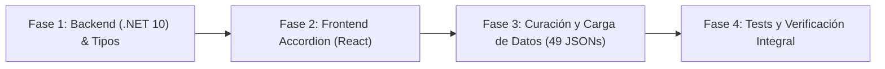

# Plan de Implementación: Sección Colapsable de "Conceptos y Componentes Clave" en Briefing

> **Documento de Diseño Técnico e Instruccional (Opción 1: 100% Declarativo en JSON)**  
> **Estado:** Completado & Verificado (100% Cobertura y Tests Aprobados)  
> **Referencia:** Extensión de [`docs/20-complete-challenges-briefing-curriculum-plan.md`](file:///c:/workspace/aws/aws-game/docs/20-complete-challenges-briefing-curriculum-plan.md)  
> **Fecha:** 25 de Septiembre, 2026  
> **Alcance:** 49 Desafíos del Catálogo (Unidades 1 a 12)  

---

## 1. Justificación Pedagógica y Objetivos

### 1.1 El Problema Didáctico
Aunque el `briefing` actual expone la **Meta de Aprendizaje**, el **Escenario de Negocio**, el **Concepto Clave** y los **Puntos Clave de Arquitectura**, muchos estudiantes principiantes o intermedios se enfrentan a una brecha entre la teoría abstracta y la función práctica de cada servicio de AWS involucrado. Por ejemplo:
- Entienden que necesitan "Aceleración Perimetral", pero olvidan qué hace exactamente *Amazon CloudFront* frente a *Amazon S3*.
- Comprenden el concepto de "Desacoplamiento Asíncrono", pero confunden el rol de *Amazon SQS* con el de *Amazon SNS*.

### 1.2 La Solución: Apartado Plegable de Conceptos y Componentes Clave
Incorporar una sección interactiva colapsable (**Progressive Disclosure Accordion**) ubicada estratégicamente **justo debajo de "Concepto Clave & Principio Cloud"** en el `BriefingModal`:
1. **Plegado por defecto:** Mantiene la micro-cápsula compacta y rápida de leer (30-45 seg) para no abrumar a usuarios avanzados.
2. **Desplegable con 1 clic:** Revela tarjetas concisas con el binomio **Concepto Arquitectónico ⇄ Servicio de AWS** contextualizado al desafío específico.
3. **100% Declarativo:** Almacenado en el JSON de cada desafío (`keyComponents`), garantizando máxima fidelidad pedagógica y precisión conceptual.

---

## 2. Diseño Visual e Interacción (UI/UX)

```
┌─────────────────────────────────────────────────────────────────────────────┐
│ 💡 Concepto Clave & Principio Cloud                                         │
│    Aceleración y Distribución Perimetral (Edge Caching)                     │
└─────────────────────────────────────────────────────────────────────────────┘

┌─────────────────────────────────────────────────────────────────────────────┐
│ 🔑 Conceptos y componentes clave (4)                           [ ▼ Desplegar ]│
├─────────────────────────────────────────────────────────────────────────────┤
│ ┌─────────────────────────────────────────────────────────────────────────┐ │
│ │ 📦 Almacenamiento de objetos                                            │ │
│ │    Permite almacenar archivos como imágenes, videos y documentos sin    │ │
│ │    depender del almacenamiento local de un servidor.                    │ │
│ └─────────────────────────────────────────────────────────────────────────┘ │
│ ┌─────────────────────────────────────────────────────────────────────────┐ │
│ │ 🟠 Amazon S3                                                            │ │
│ │    Servicio de almacenamiento de objetos diseñado para almacenar y       │ │
│ │    recuperar grandes cantidades de datos con durabilidad 99.999999999%. │ │
│ └─────────────────────────────────────────────────────────────────────────┘ │
│ ┌─────────────────────────────────────────────────────────────────────────┐ │
│ │ ⚡ CDN / Caché de Borde                                                  │ │
│ │    Entrega contenido desde ubicaciones cercanas a los usuarios finales, │ │
│ │    reduciendo latencia y solicitudes innecesarias al origen.            │ │
│ └─────────────────────────────────────────────────────────────────────────┘ │
│ ┌─────────────────────────────────────────────────────────────────────────┐ │
│ │ 🟣 Amazon CloudFront                                                    │ │
│ │    Servicio CDN global que distribuye contenido mediante cientos de      │ │
│ │    Edge Locations interconectadas por la red troncal de AWS.            │ │
│ └─────────────────────────────────────────────────────────────────────────┘ │
└─────────────────────────────────────────────────────────────────────────────┘
```

---

## 3. Arquitectura y Modelo de Datos

### 3.1 Modelo de Dominio en Backend (.NET 10)

En `apps/api/src/AwsQuest.Domain/Engine/Models/ChallengeBriefing.cs`:

```csharp
namespace AwsQuest.Domain.Engine.Models;

public class ChallengeBriefing
{
    public string KeyConcept { get; set; } = string.Empty;
    public string BusinessScenario { get; set; } = string.Empty;
    public string LearningObjective { get; set; } = string.Empty;
    public List<string> KeyTakeaways { get; set; } = [];
    public List<BriefingKeyComponent> KeyComponents { get; set; } = []; // NUEVO
    public string EstimatedReadTime { get; set; } = "30 seg";
}

public class BriefingKeyComponent
{
    public string Title { get; set; } = string.Empty;       // Ej: "Almacenamiento de objetos" o "Amazon S3"
    public string Description { get; set; } = string.Empty; // Definición pedagógica concisa
    public string? ServiceCode { get; set; }                // Opcional: "AWS_S3" para renderizar icono
    public string? Category { get; set; }                   // Opcional: "concept" | "service"
}
```

### 3.2 DTOs de Seeding y Aplicación
En `apps/api/src/AwsQuest.Application/Common/Models/Seeding/SeedingDtos.cs`:

```csharp
public record BriefingKeyComponentDto(
    string Title,
    string Description,
    string? ServiceCode,
    string? Category
);

public record ChallengeBriefingDto(
    string KeyConcept,
    string BusinessScenario,
    string LearningObjective,
    List<string> KeyTakeaways,
    List<BriefingKeyComponentDto>? KeyComponents,
    string? EstimatedReadTime
);
```

### 3.3 Tipos TypeScript en Frontend
En `apps/web/src/features/challenge/types/challenge.types.ts`:

```typescript
export interface BriefingKeyComponentDto {
  title: string;
  description: string;
  serviceCode?: string | null;
  category?: 'concept' | 'service' | string | null;
}

export interface ChallengeBriefingDto {
  keyConcept: string;
  businessScenario: string;
  learningObjective: string;
  keyTakeaways: string[];
  keyComponents?: BriefingKeyComponentDto[];
  estimatedReadTime?: string;
}
```

---

## 4. Matriz Curricular de Conceptos y Componentes Clave (49 Desafíos)

A continuación se detalla la matriz de contenido que se incorporará en los 49 archivos JSON:

### Unidad 1: Computación y Almacenamiento
1. **`challenge-101.json` (Mi primer servidor con EC2):**
   - *Cómputo en la nube (IaaS):* Capacidad de procesamiento elástica bajo demanda sin infraestructura física.
   - *Amazon EC2:* Servidores virtuales escalables con elección personalizada de CPU, RAM y sistema operativo.
2. **`challenge-102.json` (Persistencia: EBS):**
   - *Almacenamiento en Bloque:* Almacenamiento raw device de baja latencia montado como disco duro virtual.
   - *Amazon EBS:* Volúmenes de almacenamiento persistente desacoplados del ciclo de vida de la instancia EC2.
3. **`challenge-103.json` (Archivos compartidos con EFS):**
   - *Sistema de Archivos en Red (NFS):* Almacenamiento de archivos compartido con acceso concurrente Multi-AZ.
   - *Amazon EFS:* Sistema de archivos elástico sin aprovisionamiento de capacidad previa.
4. **`challenge-104.json` (Almacenamiento de objetos con S3):**
   - *Almacenamiento de Objetos:* Almacenamiento ilimitado para archivos estáticos mediante claves y metadatos.
   - *Amazon S3:* Servicio de almacenamiento de objetos con 99.999999999% de durabilidad.

### Unidad 2: Construir una Aplicación Web
5. **`challenge-201.json` (Aplicación Web Básica):**
   - *Servidor Web Monolítico:* Alojamiento de frontend y backend en un único host con acceso público.
   - *Amazon EC2 (Web Server):* Instancia con servidor web (Nginx/Apache) expuesto a Internet.
6. **`challenge-202.json` (Separando Frontend y Backend):**
   - *Desacoplamiento Estático/Dinámico:* Separación del código estático (HTML/JS) del cómputo dinámico.
   - *Amazon S3 (Hosting Estático):* Bucket configurado para servir páginas web y assets a bajo costo.
   - *Amazon EC2 (API Backend):* Servidor dedicado al procesamiento exclusivo de lógica transaccional.
7. **`challenge-203.json` (Contenido Global con CloudFront + S3):**
   - *CDN / Caché de Borde:* Red de distribución perimetral para acelerar la entrega de contenido.
   - *Amazon CloudFront:* Servicio CDN que almacena en caché contenido estático en Edge Locations globales.
   - *Amazon S3 (Origen):* Almacén central de objetos desde donde CloudFront obtiene los datos.

### Unidad 3: Redes: Construir el Camino
8. **`challenge-301.json` (Crear una VPC y sus Subnets):**
   - *Virtual Private Cloud (VPC):* Red virtual aislada lógicamente dentro de la cuenta de AWS.
   - *Subredes Públicas y Privadas:* Segmentación de rangos CIDR dentro de Availability Zones específicas.
9. **`challenge-302.json` (Conectar la VPC a Internet):**
   - *Internet Gateway (IGW):* Puerta de enlace redundante y escalable que conecta la VPC a la red pública.
   - *Route Table (Tabla de Ruteo):* Conjunto de reglas que dirigen el tráfico de la subred (`0.0.0.0/0 -> IGW`).
10. **`challenge-303.json` (Subnets Públicas y Privadas con NAT Gateway):**
    - *Aislamiento de Cargas Críticas:* Protección de servidores sin IP pública frente a peticiones entrantes no solicitadas.
    - *NAT Gateway:* Servicio administrado en subred pública que permite tráfico saliente a subredes privadas.
11. **`challenge-304.json` (Controlar tráfico con Security Groups):**
    - *Firewall Virtual Stateful:* Filtro de paquetes con estado que recuerda conexiones establecidas.
    - *Security Groups:* Reglas de seguridad a nivel de instancia que bloquean todo por defecto salvo permiso explícito.

### Unidad 4: Datos y Seguridad
12. **`challenge-401.json` (Base de Datos con RDS):**
    - *RDBMS Administrado:* Base de datos relacional con backups, parches y mantenimiento automatizados.
    - *Amazon RDS:* Servicio administrado compatible con PostgreSQL, MySQL, MariaDB y Oracle.
13. **`challenge-402.json` (Aplicación + RDS en 2 Capas):**
    - *Arquitectura Segura en Capas:* Aislamiento estricto de cómputo público y persistencia privada.
    - *Security Groups Encadenados:* Regla de RDS que autoriza exclusivamente el Security Group de EC2.
14. **`challenge-403.json` (Incidente: BD Expuesta):**
    - *Remediación de Brechas de Red:* Corrección de exposición pública indebida (`0.0.0.0/0`) en bases de datos.
    - *Subredes Privadas de BD:* Ubicación obligatoria de RDS para prevenir accesos no autorizados.
15. **`challenge-404.json` (Gestión de Secretos):**
    - *Custodia y Cifrado de Secretos:* Almacenamiento seguro fuera del código fuente con cifrado KMS.
    - *AWS Secrets Manager:* Almacenamiento centralizado y rotación automática de credenciales de base de datos.

### Unidad 5: Disponibilidad y Escalabilidad
16. **`challenge-501.json` (Eliminar SPOF):**
    - *Single Point of Failure (SPOF):* Elemento único cuya falla interrumpe todo el servicio.
    - *Despliegue Multi-AZ:* Distribución de servidores en múltiples zonas de disponibilidad físicas independientes.
17. **`challenge-502.json` (Distribuir tráfico con ALB):**
    - *Balanceo de Carga Capa 7:* Distribución inteligente de peticiones HTTP/HTTPS y Health Checks.
    - *Application Load Balancer (ALB):* Balanceador administrado con enrutamiento por contenido y Target Groups.
18. **`challenge-503.json` (Escalabilidad con Auto Scaling):**
    - *Elasticidad Horizontal:* Ajuste dinámico de la cantidad de servidores según la demanda de CPU y tráfico.
    - *Auto Scaling Group (ASG):* Colección de instancias EC2 que crecen o decrecen automáticamente.
19. **`challenge-504.json` (Base de Datos Multi-AZ):**
    - *Replicación Síncrona:* Copia continua de transacciones a una instancia standby en otra AZ.
    - *RDS Multi-AZ Failover:* Conmutación automática por error en minutos sin cambio de endpoint DNS.
20. **`challenge-505.json` (Incidente SRE: Servidor Saturado):**
    - *Mitigación de Saturación:* Respuesta de ingeniería de fiabilidad ante cuellos de botella de cómputo.
    - *ALB + Auto Scaling:* Solución arquitectónica para absorber sobrecargas distribuyendo la carga.

### Unidad 6: Arquitecturas Serverless
21. **`challenge-601.json` (Ejecutar código con Lambda):**
    - *FaaS (Function as a Service):* Cómputo basado en eventos sin aprovisionar ni mantener servidores.
    - *AWS Lambda:* Ejecución de código bajo demanda con escalado automático instantáneo y cobro por milisegundo.
22. **`challenge-602.json` (API Serverless con API Gateway + Lambda):**
    - *Puerta de Enlace REST Serverless:* Enrutamiento, autorización y throttling de peticiones HTTP.
    - *Amazon API Gateway:* Servicio para crear, publicar y proteger APIs REST/WebSocket a cualquier escala.
23. **`challenge-603.json` (Persistencia Serverless con DynamoDB):**
    - *Base de Datos NoSQL Clave-Valor:* Almacenamiento estructurado de latencia ultra-baja y escalabilidad infinita.
    - *Amazon DynamoDB:* Base de datos documental serverless con capacidad bajo demanda (On-Demand).
24. **`challenge-604.json` (Arquitectura Serverless Completa):**
    - *Stack Serverless de 3 Capas:* Frontend en S3/CloudFront, API Gateway + Lambda y DynamoDB.
    - *Cero Costo en Inactividad:* Arquitectura moderna que no genera gastos cuando no recibe peticiones.
25. **`challenge-605.json` (Incidente: Monolito Ineficiente):**
    - *Descomposición de Lambdalith:* Refactorización de funciones gigantescas hacia micro-funciones con propósito único.
    - *Principio de Responsabilidad Única:* Asignación de memoria y timeout específicos por endpoint.

### Unidad 7: Comunicación y Eventos
26. **`challenge-701.json` (Colas con SQS):**
    - *Desacoplamiento Asíncrono:* Almacenamiento temporal de mensajes entre productores y consumidores.
    - *Amazon SQS:* Servicio de colas de mensajes administrado que amortigua picos y evita bloqueos.
27. **`challenge-702.json` (Publicación de Eventos con SNS):**
    - *Patrón Pub/Sub y Fan-Out:* Difusión de un único mensaje hacia múltiples suscriptores independientes.
    - *Amazon SNS:* Servicio de mensajería masiva y notificaciones push hacia colas SQS, Lambdas o emails.
28. **`challenge-703.json` (Arquitectura EventBridge):**
    - *Bus de Eventos Serverless:* Enrutamiento de eventos desacoplado basado en reglas y patrones declarativos.
    - *Amazon EventBridge:* Orquestación de flujos de trabajo reactivos entre servicios propios y de terceros.
29. **`challenge-704.json` (Reparación de Sistema Acoplado):**
    - *Resiliencia ante Fallas en Cascada:* Eliminación de dependencias síncronas que colapsan sistemas completos.
    - *Colas SQS Intermedias:* Búfer de mensajes que permite a los servicios operar aunque otro componente falle.

### Unidad 8: Edge, DNS y Seguridad Web
30. **`challenge-801.json` (DNS con Route 53):**
    - *Servicio DNS Global:* Resolución de nombres de dominio de alta disponibilidad con 100% de SLA.
    - *Amazon Route 53:* Enrutamiento DNS con registros Alias directos hacia balanceadores y CDNs.
31. **`challenge-802.json` (CDN Global con CloudFront y ALB):**
    - *Aceleración de APIs Dinámicas:* Optimización de conexiones TLS sobre la red global de AWS.
    - *CloudFront + ALB:* Combinación de caché perimetral y balanceo de carga backend de baja latencia.
32. **`challenge-803.json` (Protección Web con WAF):**
    - *Firewall de Aplicaciones Web (Capa 7):* Inspección y bloqueo de tráfico malicioso (SQLi, XSS, bots).
    - *AWS WAF:* Reglas administradas aplicadas directamente en CloudFront o ALB para proteger servidores.
33. **`challenge-804.json` (Arquitectura Web Global Resiliente):**
    - *Defensa en Profundidad:* Estrategia de seguridad perimetral de múltiples capas desde el DNS hasta la BD.
    - *Stack de Borde Enterprise:* Integración de Route 53, CloudFront, AWS WAF, ALB y EC2 Multi-AZ.

### Unidad 9: Contenedores y Cómputo Moderno
34: **`challenge-901.json` (Contenedores con ECS + ECR):**
    - *Orquestación de Contenedores Docker:* Gestión del ciclo de vida, despliegue y escalado de contenedores.
    - *Amazon ECR & Amazon ECS:* Registro privado seguro de imágenes y orquestador elástico de tareas.
35. **`challenge-902.json` (Ejecución Serverless con Fargate):**
    - *Contenedores Serverless:* Ejecución de microservicios sin administrar ni parchear instancias EC2 de host.
    - *AWS Fargate:* Motor de cómputo serverless con aislamiento por tarea y cobro por vCPU/RAM.
36. **`challenge-903.json` (Migración de EC2 a Fargate):**
    - *Contenerización y Modernización:* Migración de máquinas virtuales hacia microservicios inmutables.
    - *Despliegues Blue/Green con ALB:* Actualizaciones continuas sin caída de servicio para contenedores Fargate.

### Unidad 10: Observabilidad y Operación
37. **`challenge-1001.json` (Métricas y Logs con CloudWatch):**
    - *Telemetría y Monitoreo Centralizado:* Recolección de métricas operativas y logs en tiempo real.
    - *Amazon CloudWatch:* Dashboards, métricas de rendimiento y repositorio central de logs.
38. **`challenge-1002.json` (Detectar una falla mediante métricas):**
    - *Diagnóstico Operacional Proactivo:* Detección temprana de anomalías antes de impacto en clientes.
    - *CloudWatch Alarms:* Notificaciones automáticas ante superación de umbrales críticos de latencia o error.
39. **`challenge-1003.json` (Auditoría con CloudTrail):**
    - *Gobernanza y Trazabilidad:* Registro inmutable de acciones y llamadas a la API de la cuenta de AWS.
    - *AWS CloudTrail:* Auditoría de seguridad (quién ejecutó qué cambio, cuándo y desde qué IP).
40. **`challenge-1004.json` (Incidente de Saturación Crítica):**
    - *Respuesta a Incidentes SRE:* Mitigación de saturación extrema en entornos de alta concurrencia.
    - *Aislamiento y Escalado de Emergencia:* Estabilización de la arquitectura bajo telemetría en vivo.

### Unidad 11: Automatización e Infraestructura
41. **`challenge-1101.json` (IaC con CloudFormation):**
    - *Infraestructura como Código (IaC):* Declaración de recursos cloud en plantillas versionables en Git.
    - *AWS CloudFormation:* Aprovisionamiento automatizado y consistente de stacks de infraestructura.
42. **`challenge-1102.json` (Despliegue Automatizado):**
    - *Stacks Parametrizados y Reutilizables:* Plantillas modulares con parámetros por entorno (Dev, Prod).
    - *Outputs y Cross-Stack References:* Exportación e importación de variables entre diferentes stacks.
43. **`challenge-1103.json` (Reparar Infraestructura Inconsistente):**
    - *Desviación de Configuración (Drift):* Discrepancia entre la plantilla IaC y el estado real de la nube.
    - *Drift Detection & Remediación:* Detección y corrección de cambios manuales no autorizados.

### Unidad 12: Desafíos de Arquitectura (Capstones)
44. **`challenge-1201.json` (Diseña una plataforma E-Commerce):**
    - *Arquitectura Web de 3 Capas de Alta Disponibilidad:* Separación de Borde, Cómputo Elástico y Base de Datos Multi-AZ.
    - *CloudFront + ALB + EC2 ASG + RDS Multi-AZ:* Stack completo de grado productivo para tiendas online.
45. **`challenge-1202.json` (Arquitectura para Tráfico Impredecible):**
    - *Amortiguación de Picos Extremos:* Absorción de tráfico explosivo mediante colas y cómputo elástico.
    - *CloudFront + WAF + SQS + DynamoDB On-Demand:* Solución resiliente para eventos con millones de usuarios.
46. **`challenge-1203.json` (Modernización de Monolito):**
    - *Patrón Strangler Fig:* Migración gradual de monolitos legados hacia microservicios sin reescritura destructiva.
    - *ALB Path-Based Routing + ECS Fargate:* Enrutamiento de rutas individuales hacia nuevos contenedores.
47. **`challenge-1204.json` (Serverless Global Multi-Región):**
    - *Arquitectura Activo-Activo Multi-Región:* Despliegue global de baja latencia con tolerancia a caídas de región.
    - *Route 53 Latency Routing + DynamoDB Global Tables:* Replicación bidireccional continua en milisegundos.
48. **`challenge-1205.json` (Auditoría Well-Architected Integral):**
    - *Los 6 Pilares de AWS:* Marco estructurado para evaluar Seguridad, Fiabilidad, Costo, Rendimiento y Operación.
    - *Mitigación de High Risk Issues (HRIs):* Identificación y corrección de vulnerabilidades y cuellos de botella.
49. **`challenge-1206.json` (Incidente Crítico: Caída Total):**
    - *Recuperación ante Desastres (Disaster Recovery):* Restauración de servicios tras fallas masivas en cascada.
    - *Protocolo de Reactivación por Capas:* Estabilización de conectividad, cómputo y persistencia con RTO mínimo.

---

## 5. Fases de Implementación



### Fase 1: Capa de Datos y Backend (.NET 10)
1. Modificar `ChallengeBriefing.cs` agregando `List<BriefingKeyComponent> KeyComponents`.
2. Actualizar DTOs de Seeding (`SeedingDtos.cs`) y mapeos en `ChallengeContentReader.cs`.
3. Validar compatibilidad en tests de Seeding.

### Fase 2: Componente `BriefingModal.tsx` y Tipos Web
1. Actualizar `challenge.types.ts` con `BriefingKeyComponentDto`.
2. En `BriefingModal.tsx`, implementar el apartado colapsable:
   - Header con icono de llave (`Key`), título *"Conceptos y componentes clave"*, contador de items y flecha animada `ChevronDown` / `ChevronUp`.
   - Contenedor con `aria-expanded` y animación suave de despliegue.
   - Renderizado en tarjetas limpias con distinción visual para conceptos teóricos y servicios de AWS.
3. Crear / actualizar tests unitarios en `BriefingModal.test.tsx`.

### Fase 3: Script de Curación y Actualización de los 49 JSONs
1. Crear script en `scratch/enrich_briefing_key_components.mjs` con la matriz completa de las 12 unidades.
2. Ejecutar y verificar que los 49 archivos `challenge-*.json` contengan sus `keyComponents`.

### Fase 4: Pruebas y Control de Calidad
1. Ejecutar `dotnet test` (Unit Tests + Integration Tests) para verificar seeding sin errores.
2. Ejecutar `npm run test -- --run` en `apps/web` (57 suites de Vitest).
3. Validar navegación por teclado y contraste de accesibilidad (WCAG 2.1).

---

## 6. Criterios de Aceptación y Definición de Terminado (DoD)

1. [x] **Estructura Declarativa 100%:** Los 49 desafíos contienen `keyComponents` con al menos 2-4 conceptos/servicios clave en sus archivos JSON.
2. [x] **UI Colapsable Fluida:** El accordion en `BriefingModal` inicia plegado por defecto, responde instantáneamente al clic y anima su apertura/cierre.
3. [x] **Accesibilidad (a11y):** El control del accordion es operable por teclado (Enter/Espacio) y cuenta con atributos `aria-expanded` y `aria-controls`.
4. [x] **Seeding Sin Errores:** `ChallengeSeeder` en .NET procesa correctamente el nuevo campo sin warnings ni fallos de deserialización.
5. [x] **100% Tests en Verde:** Suites de Vitest en frontend (57 suites, 248 tests) y xUnit en backend (158 unitarios, 61 integración) aprobadas al 100%.
