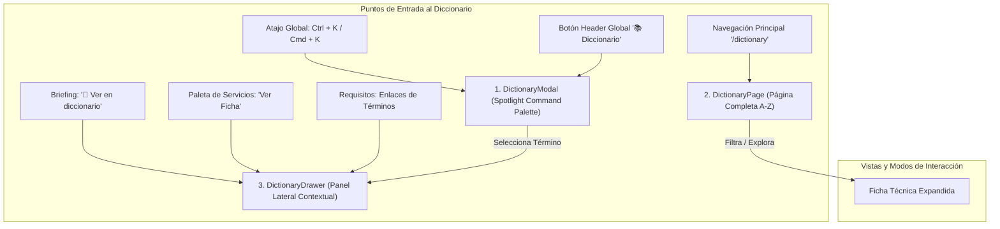
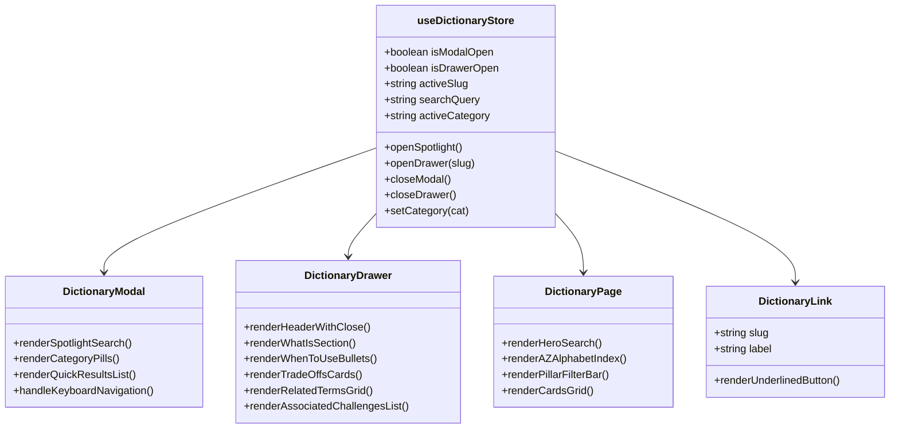
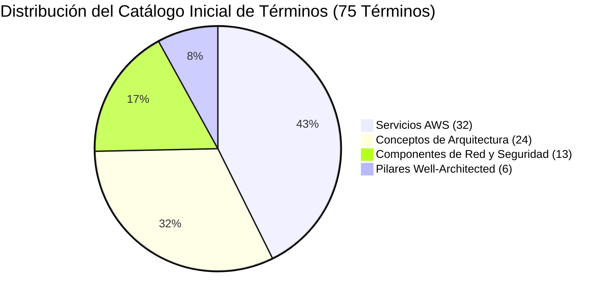
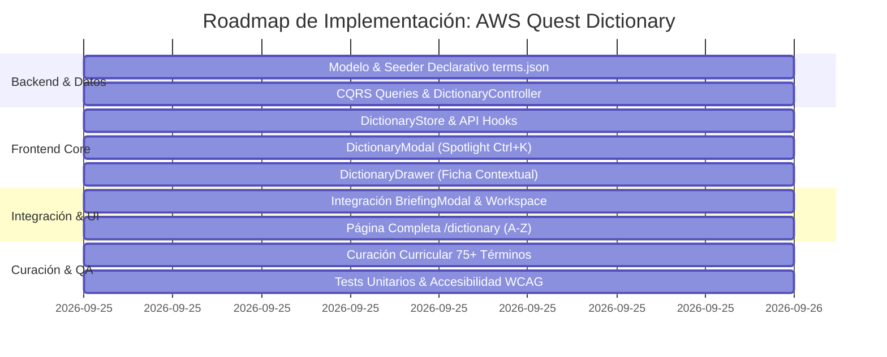

# Plan de Implementación: AWS Quest Dictionary (Base de Conocimiento y Glosario Arquitectónico)

> **Documento de Diseño Técnico e Instruccional**  
> **Estado:** Aprobado / Listo para Implementación  
> **Referencia:** Evolución Pedagógica 3.0 de [`docs/15-pedagogical-learning-experience-audit.md`](file:///c:/workspace/aws/aws-game/docs/15-pedagogical-learning-experience-audit.md)  
> **Fecha:** 25 de Septiembre, 2026  
> **Alcance:** Catálogo Completo de Términos, Conceptos, Servicios AWS y Componentes de Red  

---

## 1. Justificación Pedagógica y Objetivos del Sistema

### 1.1 El Problema: Fragmentación y Ambigüedad Conceptual
Al diseñar arquitecturas en la nube, los estudiantes frecuentemente experimentan dificultades para:
- **Diferenciar conceptos abstractos de implementaciones de AWS:** Entender la diferencia entre *"Almacenamiento de Bloques"* (concepto general) y *"Amazon EBS"* (servicio gestionado).
- **Consultar terminología en tiempo real sin salir del lienzo:** Interrumpir el flujo de resolución de un desafío para buscar definiciones en Google genera pérdida de concentración y fatiga cognitiva.
- **Visualizar el impacto arquitectónico (Trade-offs):** Conocer no solo la definición de un servicio, sino *cuándo usarlo*, *sus pros y contras*, y *con qué otros servicios se complementa*.

### 1.2 La Solución: AWS Quest Dictionary (Grafo de Conocimiento Interactivo)
Un sistema de conocimiento arquitectónico integral con **interacción tri-modal**:
1. **Spotlight / Command Palette (`Ctrl + K` / `Cmd + K`):** Búsqueda ultrarrápida con autocompletado y filtros en cualquier pantalla de la aplicación.
2. **Drawer Lateral Contextual ("Deep Dive Drawer"):** Ficha técnica detallada que se abre al hacer clic en enlaces contextuales dentro del `BriefingModal` (`📖 Ver en diccionario`), en los requisitos del desafío o en la paleta de servicios, sin tapar el canvas.
3. **Página Completa del Diccionario (`/dictionary`):** Centro de estudio con índice alfabético A-Z, agrupación por los **6 Pilares del AWS Well-Architected Framework** y enlaces directos a los desafíos donde se aplica cada término.

---

## 2. Arquitectura de la Experiencia de Usuario (UI/UX)



---

## 3. Modelo de Dominio y Esquema de Datos

### 3.1 Entidad de Dominio (`DictionaryTerm.cs`)

En `apps/api/src/AwsQuest.Domain/Entities/DictionaryTerm.cs` (o `Domain/Engine/Models/DictionaryTerm.cs`):

```csharp
namespace AwsQuest.Domain.Entities;

using AwsQuest.Domain.Enums;

public class DictionaryTerm
{
    public string Slug { get; set; } = string.Empty;              // Identificador único (ej. "amazon-ec2", "escalabilidad-horizontal")
    public string Title { get; set; } = string.Empty;             // Nombre visible (ej. "Amazon EC2", "Subnet Pública")
    public string Category { get; set; } = string.Empty;          // "service" | "concept" | "infrastructure" | "well-architected"
    public string? ServiceCode { get; set; }                      // Ej. "AWS_EC2" (si aplica)
    public WellArchitectedPillar? Pillar { get; set; }            // Pilar del WAF asociado
    public string ShortDefinition { get; set; } = string.Empty;   // Resumen de 1-2 oraciones para el Spotlight
    public string WhatIs { get; set; } = string.Empty;            // Explicación técnica profunda
    public List<string> WhenToUse { get; set; } = [];             // Casos de uso prácticos
    public DictionaryTradeOffs TradeOffs { get; set; } = new();   // Pros y Contras / Consideraciones
    public List<string> RelatedTermSlugs { get; set; } = [];      // Relaciones cruzadas (Grafo de conocimiento)
    public List<string> AssociatedChallengeIds { get; set; } = [];// Desafíos donde se aplica
    public DateTime CreatedAt { get; set; } = DateTime.UtcNow;
}

public class DictionaryTradeOffs
{
    public string Pros { get; set; } = string.Empty;
    public string Cons { get; set; } = string.Empty;
}
```

### 3.2 DTOs de API y Contratos de Entrada/Salida

En `apps/api/src/AwsQuest.Application/Dtos/Dictionary/DictionaryDtos.cs`:

```csharp
namespace AwsQuest.Application.Dtos.Dictionary;

using AwsQuest.Domain.Enums;

public record DictionaryTermSummaryDto(
    string Slug,
    string Title,
    string Category,
    string? ServiceCode,
    WellArchitectedPillar? Pillar,
    string ShortDefinition,
    int AssociatedChallengesCount
);

public record DictionaryTermDetailDto(
    string Slug,
    string Title,
    string Category,
    string? ServiceCode,
    WellArchitectedPillar? Pillar,
    string ShortDefinition,
    string WhatIs,
    List<string> WhenToUse,
    DictionaryTradeOffsDto TradeOffs,
    List<DictionaryRelatedTermDto> RelatedTerms,
    List<DictionaryAssociatedChallengeDto> AssociatedChallenges
);

public record DictionaryTradeOffsDto(string Pros, string Cons);

public record DictionaryRelatedTermDto(string Slug, string Title, string Category);

public record DictionaryAssociatedChallengeDto(string Id, string Title, DifficultyLevel Difficulty, int BaseXP);
```

---

## 4. Endpoints de la API Backend (.NET 10)

| Verbo | Ruta | Descripción | Parámetros Query |
| :--- | :--- | :--- | :--- |
| `GET` | `/api/dictionary` | Listado y búsqueda para el Spotlight y página A-Z | `search`, `category`, `pillar`, `limit` |
| `GET` | `/api/dictionary/{slug}` | Ficha técnica completa de un término con grafo de relaciones | `slug` en ruta |
| `GET` | `/api/dictionary/categories` | Métricas y conteos por categoría | Ninguno |

---

## 5. Diseño de Componentes en el Frontend (React / TypeScript / Tailwind)



### Componentes Clave:
1. **`useDictionaryStore.ts` (Zustand):** Control centralizado del estado del modal, drawer, término seleccionado y filtros de búsqueda.
2. **`DictionaryModal.tsx` (Command Palette):**
   - Atajo global `Ctrl+K` / `Cmd+K`.
   - Búsqueda en tiempo real con resaltado de términos coincidentes.
   - Píldoras de filtro: `[Todos]` `[Servicios AWS]` `[Conceptos]` `[Redes y Seguridad]` `[Well-Architected]`.
   - Navegación por teclado accesible (`Tab`, `Flechas ↑/↓`, `Enter`, `Escape`).
3. **`DictionaryDrawer.tsx` (Ficha Lateral Contextual):**
   - Panel desplegable con `useFocusTrap` y animación `slide-in-from-right`.
   - Tarjetas de ventajas y desventajas (*Pros / Cons*).
   - Enlaces directos a términos relacionados y desafíos donde se practica.
4. **`DictionaryLink.tsx`:** Componente reutilizable para incrustar términos clicables en `BriefingModal`, `ProblemContextPanel` y requisitos.
5. **`DictionaryPage.tsx`:** Ruta `/dictionary` en React Router con barra de búsqueda, índice alfabético (A-Z) y explorador por pilares WAF.

---

## 6. Catálogo Curricular Inicial (~75 Términos)

El dataset inicial se organizará en `content/dictionary/terms.json`:



### Ejemplos Representativos por Categoría:

#### 1. Servicios AWS (`service`):
- `amazon-ec2`, `amazon-s3`, `amazon-ebs`, `amazon-efs`, `amazon-rds`, `amazon-dynamodb`
- `amazon-vpc`, `amazon-cloudfront`, `amazon-route-53`, `application-load-balancer`, `auto-scaling-group`
- `aws-lambda`, `amazon-api-gateway`, `amazon-sqs`, `amazon-sns`, `amazon-eventbridge`
- `amazon-ecs`, `aws-fargate`, `aws-waf`, `aws-secrets-manager`, `amazon-cloudwatch`, `aws-cloudtrail`, `aws-cloudformation`

#### 2. Conceptos de Arquitectura (`concept`):
- `alta-disponibilidad`, `escalabilidad-horizontal`, `escalabilidad-vertical`, `single-point-of-failure`
- `desacoplamiento-asincrono`, `patron-fan-out`, `stateless-vs-stateful`, `caching-perimetral`
- `disaster-recovery-rpo-rto`, `patron-strangler-fig`, `idempotencia`, `multi-az-replication`

#### 3. Componentes de Red y Seguridad (`infrastructure`):
- `subnet-publica`, `subnet-privada`, `internet-gateway`, `nat-gateway`
- `security-group`, `route-table`, `bastion-host`, `cidr-block`, `target-group-health-checks`

#### 4. Pilares Well-Architected (`well-architected`):
- `excelencia-operativa`, `seguridad-cloud`, `fiabilidad`, `eficiencia-rendimiento`, `optimizacion-costos`, `sostenibilidad`

---

## 7. Plan de Fases de Implementación



### Detalle de Fases:

- **Fase 1: Capa de Datos y Backend (.NET 10)**
  - Creación de entidad `DictionaryTerm` y configuración en EF Core.
  - Creación de `content/dictionary/terms.json` con la estructura inicial.
  - Creación de queries CQRS (`GetDictionaryTermsQuery`, `GetDictionaryTermBySlugQuery`) y `DictionaryController`.
  - Tests unitarios y de integración en backend.

- **Fase 2: Capa de Estado y Modal Spotlight (`DictionaryModal`)**
  - Implementación de `useDictionaryStore.ts` con Zustand.
  - Listener global de teclado (`Ctrl+K` / `Cmd+K` / `D`).
  - `DictionaryModal.tsx` con input de búsqueda reactivo, píldoras de filtrado y navegación accesible por teclado.

- **Fase 3: Drawer Lateral Contextual (`DictionaryDrawer`) e Integraciones**
  - `DictionaryDrawer.tsx` con diseño glassmorphic y desglose de ficha técnica.
  - Inserción de botones `📖 Ver en diccionario` en `BriefingModal.tsx` para cada concepto/componente clave.
  - Integración en `ProblemContextPanel.tsx` y `ServicePalette.tsx`.

- **Fase 4: Página Completa del Diccionario (`/dictionary`)**
  - Creación de ruta y componente `DictionaryPage.tsx`.
  - Índice alfabético interactivo (A-Z), buscador con resaltado y filtrado por pilares Well-Architected.
  - Botón de acceso directo en el header global (`RootLayout.tsx`).

- **Fase 5: Curación Curricular Exhaustiva**
  - Redacción y validación pedagógica de los **75+ términos** con definiciones, casos de uso, pros/cons y desafíos vinculados.

- **Fase 6: Pruebas, Accesibilidad y Control de Calidad**
  - Tests en Vitest (`DictionaryModal.test.tsx`, `DictionaryDrawer.test.tsx`, `DictionaryPage.test.tsx`).
  - Verificación de contraste de color (WCAG AAA) y foco de teclado accesible (`useFocusTrap`).
  - Verificación de 100% tests aprobados en todo el repositorio.

---

## 8. Criterios de Aceptación y Definición de Terminado (DoD)

1. [ ] **Interacción Tri-Modal Completa:** Disponibles el Spotlight (`Ctrl+K`), el Drawer lateral contextual y la página completa `/dictionary`.
2. [ ] **Catálogo Curricular Enriquecido:** Mínimo 75 términos curados y relacionados entre sí y con los 49 desafíos de AWS Quest.
3. [ ] **Enlaces Contextuales Funcionales:** Botones `📖 Ver en diccionario` integrados en el `BriefingModal` abriendo directamente el término en el drawer lateral.
4. [ ] **Accesibilidad (a11y):** Operable 100% por teclado con atajos globales, trap focus en modales y atributos ARIA estándar.
5. [ ] **100% Suites de Pruebas Aprobadas:** Frontend Vitest y Backend .NET con cobertura completa y ejecución limpia en verde.
