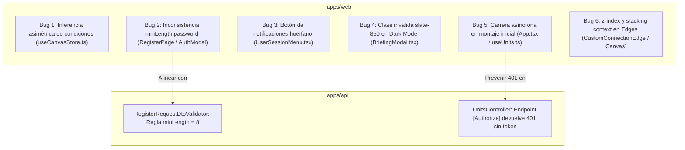

# Plan de Corrección de Errores - Previo a Producción (AWS Quest)

> **Documento:** `docs/23-error-correction-pre-production-plan.md`  
> **Estado:** En ejecución (Fase 1 iniciada)  
> **Ámbito:** `apps/web` (React / Tailwind / React Flow / TanStack Query) y `apps/api` (.NET 10 / ASP.NET Core / EF Core)

---

## 1. Resumen Ejecutivo y Diagnóstico de Errores

A continuación se presenta el diagnóstico técnico exhaustivo de los 6 errores identificados tras la inspección de la arquitectura, modelos de dominio, validadores y componentes visuales.

---

## 2. Diagnóstico Detallado y Causa Raíz por Error

### Error 1: Conexión EC2 (Auto Scaling) a RDS queda como "HTTP/HTTPS" en lugar de "Database"
* **Causa Raíz:**  
  En `useCanvasStore.ts`, la función `inferConnectionType(sourceNode, targetNode)` evalúa de forma asimétrica el tipo de conexión únicamente inspeccionando el nodo destino (`targetNode`). Si el usuario inicia el trazado desde el nodo RDS hacia EC2, o si las referencias de conexión cambian de sentido, `targetCategory` es `compute` y `targetCode` es `AWS_EC2`, omitiendo la regla de `database` y cayendo al retorno por defecto `'HTTP_HTTPS'`.
* **Archivos Afectados:**
  - `apps/web/src/features/canvas/stores/useCanvasStore.ts`
  - `apps/web/src/features/canvas/stores/__tests__/useCanvasStore.test.ts`
* **Solución Propuesta:**  
  Hacer que `inferConnectionType` sea simétrica e inteligente: si cualquiera de los dos extremos (`sourceNode` o `targetNode`) es una base de datos (`AWS_RDS`, `AWS_DYNAMODB`, `AWS_ELASTICACHE` o categoría `database`) y se conecta con una capa de cómputo/servicios, el tipo inferido debe ser `DATABASE`.

---

### Error 2: Formulario de registro indica "Mínimo 6 caracteres" cuando el backend requiere 8
* **Causa Raíz:**  
  - En backend: `RegisterRequestDtoValidator.cs` exige `MinimumLength(8)` con mayúscula, minúscula y número/símbolo.
  - En frontend: `RegisterPage.tsx` y `AuthModal.tsx` tienen `minLength={6}` y `placeholder="Mínimo 6 caracteres"`.
* **Archivos Afectados:**
  - `apps/web/src/features/auth/pages/RegisterPage.tsx`
  - `apps/web/src/features/auth/components/AuthModal.tsx`
* **Solución Propuesta:**  
  Actualizar `minLength={8}` y placeholder a `"Mínimo 8 caracteres"` en ambos componentes de formulario, asegurando concordancia completa con los mensajes de error del backend.

---

### Error 3: Icono de notificaciones no tiene funcionalidad
* **Causa Raíz:**  
  En `UserSessionMenu.tsx` existe un botón decorativo con el icono `<Bell />` y un punto rojo de notificación estático sin handlers ni panel de destino.
* **Archivos Afectados:**
  - `apps/web/src/features/auth/components/UserSessionMenu.tsx`
  - `apps/web/src/features/auth/components/__tests__/UserSessionMenu.test.tsx`
* **Solución Propuesta:**  
  Eliminar el botón de notificaciones y la importación del icono `Bell`, manteniendo limpios los controles de sesión de usuario y actualizando los tests que referencien dicho elemento.

---

### Error 4: Briefing "Conceptos y componentes claves" - texto no visible en Dark Theme al hacer hover
* **Causa Raíz:**  
  En `BriefingModal.tsx`, el botón colapsable tiene la clase `dark:hover:bg-slate-850/50`. Al no existir la tonalidad `850` en la paleta oficial de Tailwind CSS, el estilo de fondo queda desconfigurado y compite con la transición de texto en temas oscuros, provocando pérdida de contraste e invisibilidad del texto.
* **Archivos Afectados:**
  - `apps/web/src/features/challenge/components/BriefingModal.tsx`
* **Solución Propuesta:**  
  Sustituir `dark:hover:bg-slate-850/50` por tokens válidos y con alto contraste (`dark:hover:bg-slate-800/70`, `text-slate-900 dark:text-slate-100 dark:hover:text-white`), garantizando contraste WCAG 2.1 AA en estados normal y hover.

---

### Error 5: Error 401 ("Error al conectar con la arena") al entrar por primera vez con cada usuario
* **Causa Raíz:**  
  - En `App.tsx`, `useGuestSession()` se ejecuta de forma asíncrona dentro de un `useEffect` mientras `<RouterProvider />` monta inmediatamente `<CatalogPage />`.
  - En `CatalogPage.tsx`, la query `useUnits()` lanza la petición HTTP a `/api/v1/units` de forma inmediata.
  - Dado que la sesión de invitado aún no ha retornado el token en la primera renderización, `httpClient` envía la petición sin encabezado `Authorization`.
  - El backend (`UnitsController.cs`) está protegido con `[Authorize]`, respondiendo inmediatamente con `401 Unauthorized`.
  - El interceptor de Axios limpia el estado y TanStack Query entra en estado de error mostrando `CatalogErrorState`. Al pulsar "Reintentar", la promesa de `useGuestSession` ya finalizó y el token ya existe en el store, por lo que funciona correctamente.
* **Archivos Afectados:**
  - `apps/web/src/app/App.tsx`
  - `apps/web/src/features/catalog/hooks/useUnits.ts`
  - `apps/web/src/features/catalog/hooks/useSystemConfig.ts`
  - `apps/web/src/features/auth/hooks/useGuestSession.ts`
* **Solución Propuesta:**  
  1. Condicionar la ejecución de queries protegidas (`useUnits`, `useSystemConfig`) con `enabled: isInitialized && Boolean(accessToken)`.
  2. En `App.tsx` o `AppContent`, mantener una pantalla de carga/esqueleto (`CatalogSkeleton`) hasta que la sesión de invitado o usuario haya finalizado su ciclo de inicialización (`isInitialized === true`).

---

### Error 6: Las relaciones del Canvas quedan por debajo de componentes padres y no se pueden eliminar
* **Causa Raíz:**  
  - En React Flow, las aristas (`.react-flow__edges`) y los nodos contenedores (`VpcContainerNode`, `SubnetContainerNode`, `SecurityGroupNode`) comparten el viewport.
  - Cuando los nodos padres son seleccionados o redimensionados, su capa DOM asciende y su área transparente captura los eventos de clic del puntero.
  - En `CustomConnectionEdge.tsx`, el contenedor dentro de `<EdgeLabelRenderer>` carece de `zIndex: 1000` explícito en su estilo en línea.
  - En `ArchitectureCanvas.tsx`, falta la propiedad `elevateEdgesOnSelect={true}`.
* **Archivos Afectados:**
  - `apps/web/src/features/canvas/components/edges/CustomConnectionEdge.tsx`
  - `apps/web/src/features/challenge/components/ArchitectureCanvas.tsx`
  - `apps/web/src/features/canvas/components/nodes/VpcContainerNode.tsx`
  - `apps/web/src/features/canvas/components/nodes/SubnetContainerNode.tsx`
* **Solución Propuesta:**  
  1. Configurar `zIndex: 1000` y `pointerEvents: 'all'` en el badge de `EdgeLabelRenderer` de `CustomConnectionEdge`.
  2. Activar `elevateEdgesOnSelect={true}` en `<ReactFlow />`.
  3. Asegurar que las áreas interiores de `VpcContainerNode` y `SubnetContainerNode` tengan `pointer-events-none` fuera de sus cabeceras para que nunca capturen ni bloqueen los clics dirigidos a las conexiones y sus botones de eliminación.

---

## 3. Plan de Implementación por Fases

### Fase 1: Módulo de Conexiones e Inferencia en Canvas (Error 1 y Error 6)
1. **Paso 1.1:** Modificar `inferConnectionType` en `useCanvasStore.ts` para que la detección de `DATABASE`, `STORAGE`, `ASYNC_QUEUE` e `INTERNAL_VPC` sea bidireccional y soporte EC2/Auto Scaling conectado a RDS en cualquier sentido.
2. **Paso 1.2:** En `CustomConnectionEdge.tsx`, agregar `zIndex: 1000` a la etiqueta y botón de eliminación dentro de `EdgeLabelRenderer`.
3. **Paso 1.3:** En `ArchitectureCanvas.tsx`, agregar `elevateEdgesOnSelect={true}` en la instancia de `ReactFlow`.
4. **Paso 1.4:** Ejecutar pruebas unitarias de `useCanvasStore.test.ts` y `CustomConnectionEdge.test.tsx`.

### Fase 2: Autenticación y Carga Inicial de Sesión (Error 2 y Error 5)
1. **Paso 2.1:** Actualizar `RegisterPage.tsx` y `AuthModal.tsx` con `minLength={8}` y textos descriptivos de "Mínimo 8 caracteres".
2. **Paso 2.2:** En `App.tsx`, controlar el renderizado de la aplicación verificando el estado `isInitialized` de `useGuestSession()` antes de montar las vistas que requieren autenticación inmediata, mostrando `CatalogSkeleton` durante el bootstrapping inicial.
3. **Paso 2.3:** En `useUnits.ts` y `useSystemConfig.ts`, agregar la bandera `enabled: isInitialized && Boolean(accessToken)` para evitar peticiones sin credenciales.
4. **Paso 2.4:** Ejecutar pruebas de `useGuestSession.test.ts`, `useAuthStore.test.ts` y `CatalogPage.test.tsx`.

### Fase 3: Limpieza de UI y Accesibilidad de Tema Oscuro (Error 3 y Error 4)
1. **Paso 3.1:** Quitar el botón de notificaciones (`<Bell />`) en `UserSessionMenu.tsx` y ajustar `UserSessionMenu.test.tsx`.
2. **Paso 3.2:** Corregir las clases de hover en `BriefingModal.tsx`, reemplazando `dark:hover:bg-slate-850/50` por `dark:hover:bg-slate-800/70` y asegurando la visibilidad del texto en hover sobre "Conceptos y componentes clave".
3. **Paso 3.3:** Ejecutar pruebas de accesibilidad y componentes con `BriefingModal.test.tsx`.

---

## 4. Matriz de Verificación y Criterios de Aceptación

| Error | Criterio de Aceptación | Método de Verificación |
| :--- | :--- | :--- |
| **Error 1** | Al conectar EC2 (con o sin Auto Scaling) y RDS en cualquier dirección, la arista se clasifica como `DATABASE` y muestra "Database" en el badge. | Test unitario en `useCanvasStore.test.ts` simulando conexión EC2 -> RDS y RDS -> EC2. |
| **Error 2** | Los formularios de registro en modal y página indican "Mínimo 8 caracteres" y no permiten enviar menos de 8 caracteres. | Verificación visual y pruebas en `RegisterPage.test.tsx` y `AuthModal.test.tsx`. |
| **Error 3** | El icono de campana de notificaciones no aparece en la barra superior. | Pruebas de renderizado en `UserSessionMenu.test.tsx`. |
| **Error 4** | Al pasar el cursor sobre "Conceptos y componentes clave" en tema oscuro, el texto permanece 100% legible con contraste suficiente. | Inspección visual en dark mode y validación de clases CSS con Vitest. |
| **Error 5** | Un usuario nuevo que entra por primera vez carga el catálogo directamente sin mostrar alerta de 401 ni banner de error. | Prueba de integración de sesión inicial con TanStack Query y mock de storage vacío. |
| **Error 6** | Las líneas de conexión y los botones 'X' de borrado siempre están encima de VPCs/Subredes y responden al clic para ser eliminadas. | Prueba interactiva en `CustomConnectionEdge.test.tsx` y verificación de `zIndex: 1000`. |
