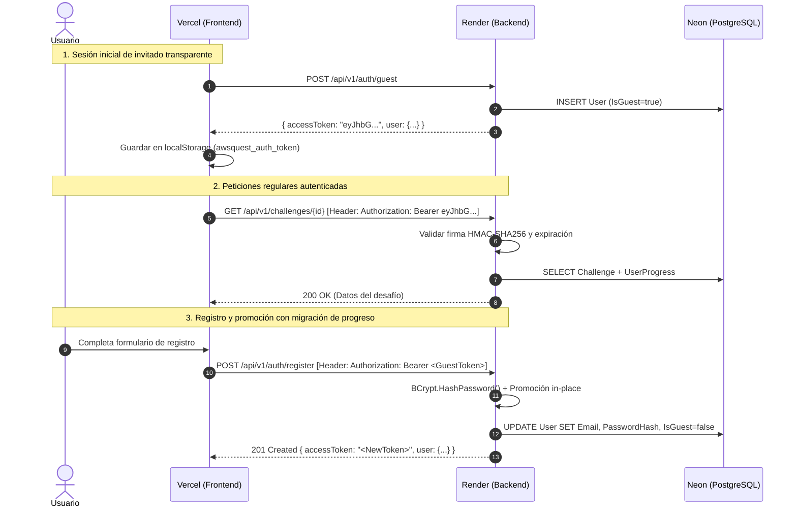
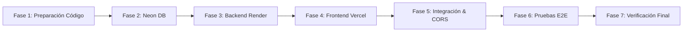

# 🚀 Auditoría y Plan de Implementación para Producción

**Proyecto:** AWS Architecture Quest (Monorepo: Frontend React 19 + Backend ASP.NET Core .NET 10 + PostgreSQL)  
**Infraestructura Objetivo:** Vercel (Frontend) | Render (Backend Docker) | Neon (PostgreSQL Serverless)  
**Fecha de Elaboración:** Septiembre 2026  
**Diagnóstico de Madurez:** **Parcialmente preparado** (Requiere ajustes específicos de configuración, proxy headers, CORS y enrutamiento SPA antes del despliegue).

---

## 1. Auditoría del Proyecto Actual

Se ha realizado una inspección exhaustiva de todo el repositorio (`apps/api`, `apps/web`, `content`, configuraciones de Docker, scripts y suites de pruebas automatizadas). A continuación se detallan los hallazgos técnicos clasificados por nivel de riesgo e impacto en producción:

```text
                                  MAPA DE RIESGOS DETECTADOS
   ┌───────────────────────────────────────────────────────────────────────────────────────┐
   │ 🔴 CRÍTICO / BLOQUEANTE                                                               │
   │ 1. Rate Limiter sin ForwardedHeaders en Render (IP colapsa en la del reverse proxy).    │
   │ 2. CORS en Producción configurado únicamente para localhost.                          │
   │ 3. Ausencia de vercel.json (404 en recarga de rutas de React Router SPA).             │
   │ 4. Dockerfile requerido para .NET 10 en Render (no soportado en runtime nativo).      │
   ├───────────────────────────────────────────────────────────────────────────────────────┤
   │ 🟠 IMPORTANTE                                                                          │
   │ 5. JwtSettings:Secret ausente en appsettings.Production.json (falla si falta env var). │
   │ 6. Parámetros de SSL y Pooling para Neon PostgreSQL.                                  │
   │ 7. Inyección de VITE_API_BASE_URL en tiempo de compilación (Build time) en Vercel.    │
   ├───────────────────────────────────────────────────────────────────────────────────────┤
   │ 🟡 RECOMENDADO                                                                        │
   │ 8. Configuración explícita de Root Directory en Vercel para arquitectura monorepo.    │
   │ 9. Configuración de Health Check timeout adaptada al cold start de Neon Serverless.   │
   └───────────────────────────────────────────────────────────────────────────────────────┘
```

### Detalle Técnico de Hallazgos

#### 1.1. Rate Limiting y Reverse Proxy en ASP.NET Core (Bloqueante)
* **Ubicación:** `apps/api/src/AwsQuest.Api/Program.cs` (Líneas 64–78)
* **Problema:** La partición del `PartitionedRateLimiter` utiliza `httpContext.Connection.RemoteIpAddress?.ToString()`. Al desplegarse en Render detrás del reverse proxy / balanceador de carga TLS, todas las peticiones entrantes llegan con la misma dirección IP interna de la infraestructura de Render, ya que no se ha registrado ni configurado el middleware de `ForwardedHeaders`.
* **Impacto en Producción:** Todas las solicitudes de todos los usuarios concurrentes a nivel mundial compartirán la misma cuota de 150 req/min. Con tráfico real, la aplicación responderá masivamente con errores `HTTP 429 Too Many Requests` a usuarios legítimos.
* **Solución:** Configurar `ForwardedHeadersOptions` con `ForwardedHeaders.XForwardedFor | ForwardedHeaders.XForwardedProto` y llamar a `app.UseForwardedHeaders()` al inicio del pipeline antes de `app.UseRateLimiter()`.

#### 1.2. Configuración de CORS para Producción (Bloqueante)
* **Ubicación:** `apps/api/src/AwsQuest.Api/appsettings.Production.json` (Líneas 22–29) y `Program.cs` (Líneas 28–40)
* **Problema:** En `appsettings.Production.json`, los orígenes permitidos están limitados a `http://localhost:3000`, `http://localhost:80`, `http://127.0.0.1:3000` y `http://localhost:5173`.
* **Impacto en Producción:** Cuando el frontend se cargue desde el dominio público de Vercel (ej. `https://aws-game.vercel.app`), los navegadores bloquearán todas las peticiones Fetch/XHR por violación de Cross-Origin Resource Sharing.
* **Solución:** Sobrescribir `CorsSettings__AllowedOrigins__0` en las variables de entorno de Render con el dominio final de Vercel.

#### 1.3. Enrutamiento SPA en Vercel (Bloqueante)
* **Ubicación:** `apps/web/`
* **Problema:** No existe un archivo `vercel.json` con la directiva de reescritura (`rewrites`) para redirigir todas las rutas hacia `/index.html`.
* **Impacto en Producción:** Las rutas cliente de React Router 7 (`/catalog`, `/challenges/:id`, `/dictionary`, `/login`) funcionarán durante la navegación interna, pero cualquier recarga del navegador (F5) o acceso directo mediante enlace URL profundo devolverá un error HTTP 404 (Not Found) emitido por el CDN de Vercel.
* **Solución:** Crear `apps/web/vercel.json` con la regla de fallback hacia `/index.html`.

#### 1.4. Secrets y Cadena de Conexión en Repositorio
* **Ubicación:** `appsettings.json`, `appsettings.Development.json`, `.env.example`
* **Problema:** Existen credenciales de desarrollo hardcodeadas. En `appsettings.Production.json`, `JwtSettings:Secret` no está definido, lo que provocará una excepción `InvalidOperationException` si no se provee por variable de entorno al iniciar.
* **Impacto en Producción:** Vulnerabilidad de seguridad si se reutilizan claves de prueba en producción, o fallo al inicio de la aplicación (`startup crash`).
* **Solución:** Generar una clave criptográfica aleatoria de 64 caracteres de alta entropía para `JwtSettings__Secret` y suministrar la cadena de conexión SSL de Neon mediante `ConnectionStrings__DefaultConnection` en Render.

---

## 2. Arquitectura de Producción

### Diagrama de Flujo del Sistema

```mermaid
flowchart TD
    subgraph Client["Cliente / Navegador Web"]
        Browser["Browser (SPA React 19)"]
        LocalStorage["LocalStorage (JWT Bearer Token)"]
    end

    subgraph VercelCDN["Vercel Global Edge Network"]
        VercelEdge["Vercel CDN / Edge (Static SPA Assets)"]
        SPAConfig["vercel.json (SPA Routing Fallback)"]
    end

    subgraph RenderPlatform["Render Cloud Infrastructure"]
        RenderLB["Render TLS Reverse Proxy / Load Balancer"]
        subgraph DockerContainer["Docker Web Service (.NET 10 API)"]
            FwdHeaders["Forwarded Headers Middleware"]
            RateLimit["Rate Limiter (Per Client IP)"]
            ApiEngine["ASP.NET Core REST API"]
            EFCore["EF Core 10 / Npgsql"]
            Seeder["Declarative Content Seeder (Catalog/Units/Dict)"]
        end
    end

    subgraph NeonCloud["Neon Serverless PostgreSQL"]
        NeonDirect["Neon Compute Endpoint (Direct / SSL)"]
        PostgresDB[("PostgreSQL 15+ (pgcrypto, uuid-ossp)")]
    end

    Browser -->|1. HTTPS GET /catalog| VercelEdge
    VercelEdge -->|2. Retorna index.html + JS/CSS Assets| Browser
    Browser -->|3. API REST Fetch (HTTPS + Bearer JWT)| RenderLB
    RenderLB -->|4. Forwarded Headers (X-Forwarded-For)| FwdHeaders
    FwdHeaders --> RateLimit --> ApiEngine
    ApiEngine -->|5. PostgreSQL Protocol (SSL Required)| NeonDirect
    NeonDirect --> PostgresDB
```

### Roles y Responsabilidades de la Infraestructura

| Componente | Plataforma | Tipo de Carga | Consideraciones Técnicas |
| :--- | :--- | :--- | :--- |
| **Frontend** | Vercel | SPA Estática | Despliegue optimizado sobre Edge CDN. La variable `VITE_API_BASE_URL` se embebe estáticamente durante el build. Requiere `vercel.json` para SPA history fallback. |
| **Backend API** | Render | Docker Web Service | Ejecuta contenedor Linux con ASP.NET Core .NET 10 en puerto 8080. Maneja terminación TLS externa, reintento de conexión a DB, seeder de catálogo y health check en `/health`. |
| **Base de Datos** | Neon | PostgreSQL Serverless | Base de datos relacional con extensiones `pgcrypto` y `uuid-ossp`. Exige conexión cifrada obligatoria (`SslMode=Require`). Compatible con la política de reintentos transitorios de EF Core. |

---

## 3. Matriz de Variables de Entorno

| Variable | Servicio / Plataforma | Obligatoria | Sensible | Ámbito | Descripción |
| :--- | :--- | :---: | :---: | :---: | :--- |
| `VITE_API_BASE_URL` | **Frontend (Vercel)** | **Sí** | No | Build | URL pública de la API en Render (ej. `https://aws-game-api.onrender.com/api/v1`). |
| `ASPNETCORE_ENVIRONMENT` | **Backend (Render)** | **Sí** | No | Runtime | `Production`. Carga `appsettings.Production.json`. |
| `ASPNETCORE_URLS` | **Backend (Render)** | **Sí** | No | Runtime | `http://+:8080` (puerto interno del contenedor). |
| `ConnectionStrings__DefaultConnection` | **Backend (Render)** | **Sí** | **Sí** | Runtime | Connection string de Neon con `SslMode=Require;Trust Server Certificate=true;Include Error Detail=false`. |
| `JwtSettings__Secret` | **Backend (Render)** | **Sí** | **Sí** | Runtime | Clave secreta HMAC-SHA256 (mínimo 32 caracteres, recomendados 64 aleatorios). |
| `JwtSettings__Issuer` | **Backend (Render)** | **Sí** | No | Runtime | Emisor del token JWT (`AwsQuestApi`). |
| `JwtSettings__Audience` | **Backend (Render)** | **Sí** | No | Runtime | Audiencia del token JWT (`AwsQuestClient`). |
| `JwtSettings__ExpirationHours` | **Backend (Render)** | **Sí** | No | Runtime | Expiración para usuarios registrados (`24`). |
| `JwtSettings__GuestExpirationDays` | **Backend (Render)** | **Sí** | No | Runtime | Retención para cuentas de invitado (`30`). |
| `CorsSettings__AllowedOrigins__0` | **Backend (Render)** | **Sí** | No | Runtime | Dominio exacto de Vercel (ej. `https://aws-game.vercel.app`). |
| `DatabaseSettings__AutoMigrateOnStartup` | **Backend (Render)** | No | No | Runtime | `true` (aplica migraciones EF Core al iniciar). |
| `SwaggerSettings__EnableInProduction` | **Backend (Render)** | No | No | Runtime | `false` (Swagger deshabilitado en producción). |

> [!CAUTION]
> **Aislamiento de Seguridad:** Ningún secret de base de datos ni clave JWT debe configurarse en el panel de Vercel con el prefijo `VITE_`. Únicamente `VITE_API_BASE_URL` es pública.

---

## 4. Base de Datos — Neon

### Configuración de Conectividad y Resiliencia
1. **Conexión SSL Obligatoria:** Neon requiere TLS. En Npgsql / EF Core se debe usar:
   ```text
   Host=ep-xyz.us-east-2.aws.neon.tech;Port=5432;Database=neondb;Username=neondb_owner;Password=***;SslMode=Require;Trust Server Certificate=true;Include Error Detail=false;
   ```
2. **Direct Endpoint vs Pooled Endpoint:**
   * Para migraciones automáticas (`Database.MigrateAsync()`), utilizar el **Direct Endpoint** de Neon para soportar bloqueos DDL transaccionales.
3. **Resiliencia ante Cold Starts:** El proyecto ya implementa `EnableRetryOnFailure(maxRetryCount: 5, maxRetryDelay: TimeSpan.FromSeconds(30))` en `DependencyInjection.cs`, garantizando reconexión automática si el cómputo de Neon está reactivándose desde reposo.
4. **Seeding Idempotente:** El `ChallengeSeeder` sincroniza automáticamente los 49 desafíos, servicios AWS, configuración del sistema y glosario arquitectónico sin sobrescribir ni eliminar los registros de progreso de los usuarios.

---

## 5. Backend — Render

### Justificación Técnica de Despliegue
* **Runtime:** Docker (Render no cuenta con runtime nativo para .NET 10).
* **Configuración del Servicio en Render:**
  * **Service Type:** Web Service
  * **Environment:** Docker
  * **Dockerfile Path:** `apps/api/Dockerfile`
  * **Docker Context:** `.` (raíz del repositorio, para permitir empaquetar `content/` y `apps/api/`)
  * **Health Check Path:** `/health`
  * **Port:** `8080`

### Cambios Requeridos en Código (`Program.cs`)
```csharp
// Configuración de Forwarded Headers para Reverse Proxy
builder.Services.Configure<ForwardedHeadersOptions>(options =>
{
    options.ForwardedHeaders = ForwardedHeaders.XForwardedFor | ForwardedHeaders.XForwardedProto;
    options.KnownNetworks.Clear();
    options.KnownProxies.Clear();
});

// En el pipeline HTTP (al principio):
app.UseForwardedHeaders();
```

---

## 6. Frontend — Vercel

### Configuración del Proyecto en Vercel
* **Framework Preset:** Vite
* **Root Directory:** `apps/web`
* **Build Command:** `npm run build`
* **Output Directory:** `dist`
* **Install Command:** `npm install` o `npm ci`

### Archivo de Configuración SPA (`apps/web/vercel.json`)
```json
{
  "rewrites": [
    {
      "source": "/(.*)",
      "destination": "/index.html"
    }
  ],
  "headers": [
    {
      "source": "/assets/(.*)",
      "headers": [
        {
          "key": "Cache-Control",
          "value": "public, max-age=31536000, immutable"
        }
      ]
    }
  ]
}
```

---

## 7. Autenticación y Seguridad Cross-Domain



### Conclusiones de Seguridad
1. **Independencia de Cookies Cross-Domain:** La autenticación utiliza exclusivamente tokens JWT transmitidos vía el header `Authorization: Bearer <token>`. No se emplean cookies de sesión, evitando bloqueos por políticas `SameSite` o restricciones de cookies de terceros entre dominios (`vercel.app` y `onrender.com`).
2. **Sanitización de Errores:** `ApiExceptionMiddleware` captura cualquier excepción no controlada y responde con un código genérico `INTERNAL_SERVER_ERROR` sin filtrar trazas de ejecución (stack traces) a los clientes.
3. **Password Hashing:** Utiliza `BCrypt.Net-Next` con factor de coste seguro.

---

## 8. Datos y Contenido de Producción

| Contenido | Ubicación | Tratamiento en Producción |
| :--- | :--- | :--- |
| **Currículum y Desafíos** | `content/challenges/*.json` | Empaquetado en la imagen Docker (`COPY content/ /app/content/`). Sincronizado por `ChallengeSeeder`. |
| **Catálogo de Servicios** | `content/services/*.json` | Sincronizado automáticamente en la base de datos de Neon al boot. |
| **Glosario Arquitectónico** | `content/dictionary/terms.json` | Sincronizado automáticamente por `DictionaryContentReader`. |
| **Configuración Global** | `content/system-config.json` | Sincronizado con `AccessMode` activo. |
| **Usuarios de Prueba** | Ninguno | No existen usuarios mock sembrados; los usuarios se crean orgánicamente. |
| **Mocks de Tests** | `apps/web/src/**/*.test.ts(x)` | Excluidos del bundle final compilado por Vite. |

---

## 9. Dependencias y Testing

* **Frontend:** 348 pruebas unitarias y de accesibilidad pasando al 100% con Vitest (`npm run test:web`). Cero errores de TypeScript.
* **Backend:** 201 pruebas unitarias pasando al 100% con xUnit (`dotnet test`).

---

## 10. Observabilidad y Mantenimiento

1. **Endpoint de Salud (`/health`):** Retorna `200 OK` con estado de la base de datos PostgreSQL. Utilizado por Render para orquestación de health checks.
2. **Error Boundary en Frontend:** `RootErrorBoundary.tsx` provee degradación elegante y pantalla de recuperación ante errores imprevistos en la interfaz de usuario.
3. **Monitoreo Externo:** Se recomienda configurar un monitor de uptime (ej. UptimeRobot / BetterStack) apuntando a `https://<render-backend-url>/health` cada 5 minutos.

---

## 11. Plan de Implementación Paso a Paso



### Fase 1 — Preparación del Código
1. Crear `apps/web/vercel.json` con las reglas de rewrite para SPA.
2. Agregar `UseForwardedHeaders` en `apps/api/src/AwsQuest.Api/Program.cs`.
3. Validar suites completas de pruebas (`npm run test:web` y `npm run test:unit:backend`).

### Fase 2 — Base de Datos (Neon)
1. Crear el proyecto PostgreSQL en la consola de Neon.
2. Obtener la cadena de conexión en modo directo con SSL.
3. Formatear la cadena de conexión para Npgsql con `SslMode=Require;Trust Server Certificate=true;Include Error Detail=false`.

### Fase 3 — Backend (Render)
1. Crear nuevo **Web Service Docker** en Render conectado al repositorio.
2. Establecer Dockerfile en `apps/api/Dockerfile`, Context en `.`, y Health Check en `/health`.
3. Inyectar variables de entorno en Render (`ASPNETCORE_ENVIRONMENT`, `ConnectionStrings__DefaultConnection`, `JwtSettings__Secret`, etc.).
4. Desplegar y validar en los logs la ejecución de migraciones y seeder.

### Fase 4 — Frontend (Vercel)
1. Importar el proyecto en Vercel con **Root Directory** `apps/web`.
2. Configurar variable de entorno `VITE_API_BASE_URL=https://<render-url>/api/v1`.
3. Ejecutar build y despliegue inicial.

### Fase 5 — Integración y Ajuste de CORS
1. Actualizar `CorsSettings__AllowedOrigins__0` en Render con la URL definitiva asignada por Vercel.
2. Reiniciar el servicio en Render para aplicar la nueva política CORS.

### Fase 6 — Pruebas E2E y Verificación
1. Validar flujo completo: Sesión de invitado → Visualización de catálogo → Diseño en lienzo → Evaluación de arquitectura → Registro con migración de XP.
2. Probar recarga directa de URL profunda (ej. `/catalog`, `/challenges/s3-static-hosting`) para confirmar enrutamiento SPA.

---

## 12. Tabla de Tareas

| ID | Tarea | Área | Prioridad | Dependencia | Riesgo | Estado |
| :-: | :--- | :---: | :---: | :---: | :---: | :---: |
| **T-01** | Crear archivo `apps/web/vercel.json` para SPA fallback | Frontend | 🔴 Bloqueante | Ninguna | Medio | Pendiente |
| **T-02** | Añadir `UseForwardedHeaders` en `Program.cs` del API | Backend | 🔴 Bloqueante | Ninguna | Alto | Pendiente |
| **T-03** | Crear base de datos PostgreSQL en Neon y obtener Connection String | Base de Datos | 🔴 Bloqueante | Ninguna | Bajo | Pendiente |
| **T-04** | Generar clave criptográfica segura de 64 caracteres para JWT Secret | Seguridad | 🔴 Bloqueante | Ninguna | Alto | Pendiente |
| **T-05** | Configurar Web Service Docker en Render con variables de entorno | Backend | 🔴 Bloqueante | T-02, T-03, T-04 | Medio | Pendiente |
| **T-06** | Desplegar frontend en Vercel con `VITE_API_BASE_URL` apuntando a Render | Frontend | 🔴 Bloqueante | T-01, T-05 | Medio | Pendiente |
| **T-07** | Vincular URL final de Vercel en `CorsSettings__AllowedOrigins__0` en Render | Backend / CORS | 🔴 Bloqueante | T-06 | Alto | Pendiente |
| **T-08** | Validar flujo E2E: Invitado → Lienzo → Evaluación → Registro con migración | QA / E2E | 🔴 Bloqueante | T-07 | Medio | Pendiente |
| **T-09** | Validar recarga directa en rutas anidadas en Vercel (evitar 404) | Frontend | 🟠 Importante | T-06 | Bajo | Pendiente |
| **T-10** | Configurar monitor de Uptime externo para `/health` de Render | Operaciones | 🟡 Recomendado | T-05 | Bajo | Pendiente |

*Leyenda:*  
🔴 Bloqueante — debe resolverse antes de producción  
🟠 Importante — debería resolverse antes de producción  
🟡 Recomendado — mejora importante pero no bloqueante  
🟢 Futuro — posterior al lanzamiento  

---

## 13. Checklist Final de Salida a Producción

```markdown
[ ] Código preparado para producción (UseForwardedHeaders activo en Program.cs)
[ ] vercel.json creado con reglas de rewrite para SPA
[ ] Variables de entorno de producción preparadas en inventario
[ ] Secrets (JWT Key, DB credentials) fuera del repositorio de código
[ ] Base de datos Neon PostgreSQL aprovisionada con SSL requerido
[ ] Migraciones EF Core ejecutadas exitosamente en Neon
[ ] Catálogo y datos declarativos de desafíos sembrados mediante ChallengeSeeder
[ ] Backend desplegado como Docker Web Service en Render
[ ] Frontend desplegado en Vercel con Root Directory apps/web
[ ] CORS configurado en Render con el dominio exacto de Vercel
[ ] Conexiones HTTPS activas en Frontend y Backend
[ ] Autenticación de Invitado y Usuario permanente funcionando
[ ] Migración de progreso de invitado a permanente validada
[ ] Comunicación Vercel → Render → Neon funcionando sin bloqueos de red
[ ] Manejo global de excepciones activo (sin fuga de stack traces)
[ ] Logs de producción limpios y sin credenciales expuestas
[ ] Health check (/health) respondiendo 200 OK
[ ] Tests unitarios (201 backend, 348 frontend) ejecutados y pasando al 100%
[ ] No existen URLs localhost activas en el entorno de producción
[ ] No existen datos mock de desarrollo contaminando la base de datos
```

---

## Conclusión y Diagnóstico Final

El proyecto **AWS Architecture Quest** se encuentra:

### 👉 **PARCIALMENTE PREPARADO**

**Justificación técnica:**  
El núcleo del código tiene una calidad arquitectónica sobresaliente: cuenta con más de **540 pruebas automatizadas pasando**, una separación limpia en capas (Clean Architecture en .NET y módulos funcionales en React 19), manejo global de excepciones sanitizado y persistencia idempotente.

No obstante, **no debe desplegarse directamente sin antes realizar las 3 correcciones de configuración detectadas en la auditoría**:
1. Incorporar el soporte de `ForwardedHeaders` en ASP.NET Core para evitar el colapso del Rate Limiter en Render.
2. Añadir `vercel.json` para garantizar el enrutamiento SPA en Vercel.
3. Inyectar las variables de entorno de producción (CORS, JWT Secret y Cadena de Conexión de Neon).
