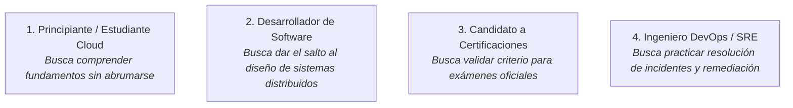
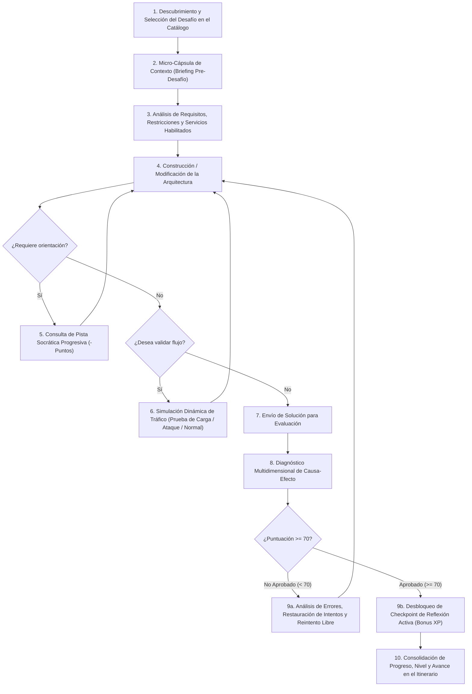
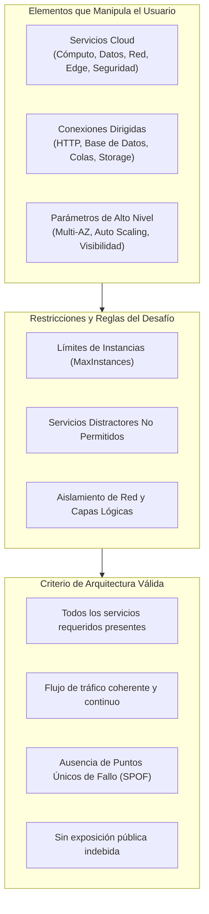
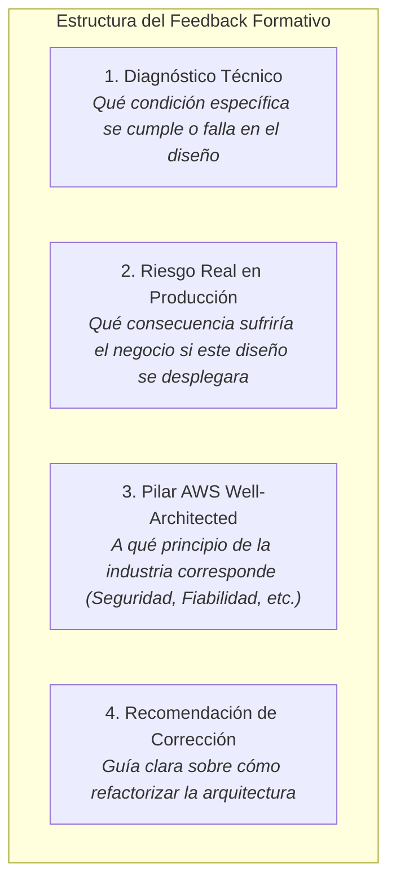
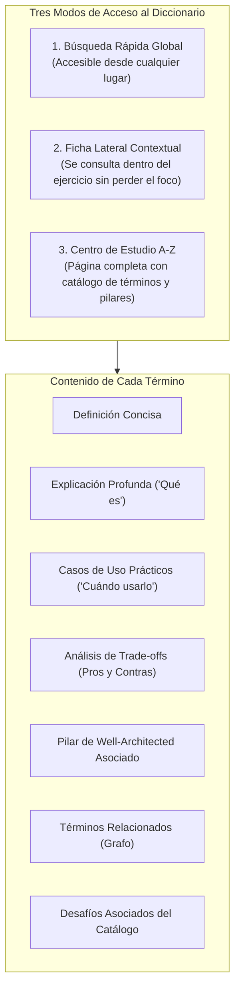
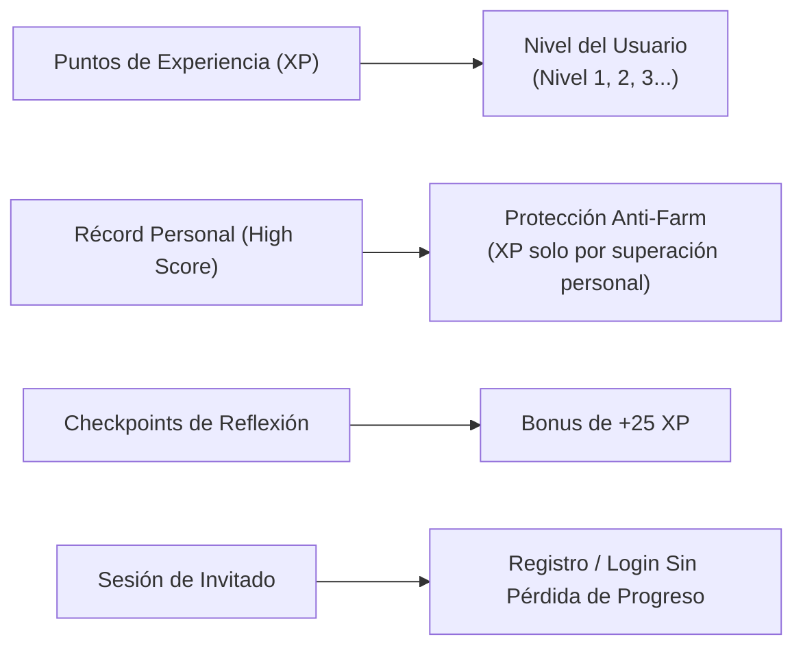
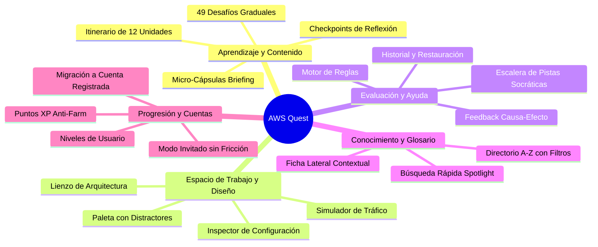

# Documento de Definición de Producto y Experiencia de Usuario: AWS Quest

> **Propósito del documento:** Este documento describe qué es la plataforma, qué problemas resuelve, quién la utiliza, qué capacidades ofrece y qué experiencias de usuario soporta actualmente. Está redactado desde una perspectiva pura de **producto y diseño instruccional**, de forma completamente agnóstica a la tecnología, al código o al diseño visual existente, sirviendo como especificación funcional y contextual para un equipo de diseño UI/UX que creará la experiencia e interfaz desde cero.

---

## 1. Identidad del Producto

### Nombre del Producto
**AWS Quest** *(AWS Architecture Quest)*

### Qué tipo de producto es
AWS Quest es una **plataforma interactiva y gamificada de aprendizaje práctico y simulación de arquitectura cloud** en Amazon Web Services (AWS). Transforma el estudio de la computación en la nube —tradicionalmente abstracto y teórico— en una experiencia activa de resolución de problemas reales de ingeniería y negocio.

### Problema que busca resolver
Aprender arquitectura cloud suele ser un proceso árido, desarticulado y dominado por la memorización mecánica de servicios y características técnicas para aprobar exámenes. La documentación oficial explica exhaustivamente qué hace cada servicio por separado, pero no enseña a:
* Tomar decisiones de diseño fundamentadas cuando existen múltiples alternativas.
* Evaluar compensaciones (*trade-offs*) de costo, disponibilidad, seguridad y rendimiento.
* Comprender cómo interactúan dinámicamente las distintas capas de un sistema distribuido.
* Diagnosticar y remediar arquitecturas defectuosas o con fallos de seguridad en un entorno realista y seguro.

### Propuesta de valor
> **"Aprender arquitectura cloud pensando y actuando como un arquitecto de soluciones real."**

La plataforma no examina al usuario con preguntas teóricas aisladas; le presenta situaciones de negocio reales, le proporciona un espacio para diseñar o corregir sistemas distribuidos, le permite simular el comportamiento dinámico de su solución y le ofrece diagnósticos pedagógicos de causa-efecto basados en el *AWS Well-Architected Framework*.

### Diferencia frente a una documentación tradicional de AWS
* **Documentación tradicional:** Es un manual de referencia estático que define servicios aislados (*"¿Qué es Amazon S3?"*).
* **AWS Quest:** Es un entorno de toma de decisiones contextuales (*"¿Qué combinación de servicios y topología de red necesito para que una plataforma de comercio electrónico soporte un pico de tráfico sin caídas y protegiendo los datos de pago?"*).

### Qué debería sentir y entender el usuario al utilizarlo
* **Empoderamiento y autonomía:** Sentir que tiene el control del diseño y que sus decisiones tienen consecuencias lógicas.
* **Seguridad psicológica:** Comprender que equivocarse es la base del aprendizaje. No hay penalizaciones irreversibles, bloqueos temporales ni costos destructivos por fallar.
* **Claridad y criterio:** Pasar de conocer nombres de servicios a entender los principios arquitectónicos y los impactos reales de cada decisión en un entorno productivo.

---

## 2. Público Objetivo

### 1. Principiante o Estudiante de Cloud Computing
* **Quién es:** Estudiante universitario, autodidacta o profesional de otra área tecnológica que se inicia en el ecosistema de la nube.
* **Nivel de conocimiento:** Básico en informática; nulo o introductorio en servicios cloud y redes.
* **Qué busca conseguir:** Comprender los fundamentos de servidores, almacenamiento, bases de datos y redes sin abrumarse por la complejidad técnica de las consolas de nube reales.
* **Dificultades:** Sobrecarga de términos técnicos nuevos, dificultad para visualizar cómo viajan los datos y confusión al diferenciar conceptos teóricos de servicios específicos.
* **Qué necesita de la plataforma:** Andamiaje gradual, explicaciones conceptuales accesibles, pistas socráticas que guíen su razonamiento y un glosario de términos integrado sin salir del ejercicio.

### 2. Desarrollador de Software (Transición a Cloud)
* **Quién es:** Programador frontend, backend o full-stack que sabe escribir código pero necesita aprender a desplegar, escalar y asegurar aplicaciones en la nube.
* **Nivel de conocimiento:** Intermedio en programación y conceptos web (HTTP, APIs, bases de datos); básico a intermedio en arquitectura cloud.
* **Qué busca conseguir:** Aprender a diseñar entornos escalables, desacoplar arquitecturas con colas/eventos, utilizar arquitecturas sin servidor (*Serverless*) y contenedores.
* **Dificultades:** Tendencia a diseñar monolitos no escalables, desconocimiento de patrones de aislamiento de red y dificultades al elegir entre bases de datos relacionales y NoSQL.
* **Qué necesita de la plataforma:** Escenarios aplicados a patrones de software (microservicios, APIs, colas, caching) y feedback que conecte el diseño con el comportamiento de la aplicación.

### 3. Candidato a Certificaciones Oficiales de AWS
* **Quién es:** Profesional preparando exámenes como *AWS Certified Cloud Practitioner* o *AWS Certified Solutions Architect - Associate*.
* **Nivel de conocimiento:** Intermedio; domina gran parte de la teoría de catálogo pero necesita consolidar la aplicación práctica.
* **Qué busca conseguir:** Poner a prueba su criterio arquitectónico ante preguntas de escenario complejas, reforzar los 6 pilares de Well-Architected y afianzar los límites y casos de uso de cada servicio.
* **Dificultades:** Las preguntas de certificación suelen plantear escenarios ambiguos donde múltiples opciones parecen viables y la diferencia radica en la mejor práctica arquitectónica.
* **Qué necesita de la plataforma:** Casos de estudio alineados a los pilares oficiales, análisis de trade-offs (pros y contras) y preguntas de reflexión conceptual que evalúen el porqué de cada solución.

### 4. Profesional Técnico / Ingeniero DevOps / SRE
* **Quién es:** Administrador de sistemas, ingeniero DevOps o especialista en confiabilidad de sitios (SRE) que busca perfeccionar sus habilidades de auditoría y respuesta a incidentes.
* **Nivel de conocimiento:** Avanzado en infraestructura; busca desafíos complejos de resiliencia y modernización.
* **Qué busca conseguir:** Practicar diagnóstico de incidentes críticos, auditoría de seguridad, eliminación de cuellos de botella y diseño de arquitecturas tolerantes a desastres (*Disaster Recovery*).
* **Dificultades:** Encontrar entornos de práctica realistas donde reparar fallos sin el riesgo de afectar producción.
* **Qué necesita de la plataforma:** Desafíos de resolución de problemas e incidentes a partir de síntomas y alertas operacionales, y escenarios integradores de alta complejidad.

---

## 3. Objetivos del Usuario

Dentro de la plataforma, un usuario persigue y alcanza los siguientes objetivos:

1. **Aprender conceptos y servicios de arquitectura cloud de forma aplicada:** Entender el propósito y funcionamiento de los servicios fundamentales y avanzados de AWS.
2. **Desarrollar criterio para seleccionar el servicio adecuado:** Diferenciar cuándo usar un servicio u otro evaluando costo, escala, latencia y complejidad operativa.
3. **Diseñar sistemas completos a partir de requisitos de negocio:** Traducir un enunciado con necesidades de disponibilidad, seguridad y presupuesto en una topología funcional.
4. **Diagnosticar y reparar arquitecturas defectuosas:** Analizar sistemas existentes con errores de configuración, brechas de seguridad o puntos únicos de fallo y refactorizarlos exitosamente.
5. **Comprender el flujo dinámico de la información:** Visualizar cómo viaja el tráfico de red legítimo, dónde se descartan las peticiones no autorizadas y cómo reaccionan los componentes ante sobrecargas.
6. **Aprender de los errores mediante feedback formativo:** Conocer exactamente qué principio técnico se violó y cuál habría sido el impacto negativo en un entorno productivo real.
7. **Consultar conocimiento técnico sin interrumpir la actividad:** Acceder a definiciones, casos de uso y comparativas conceptuales en el momento preciso de la duda.
8. **Monitorear y consolidar su progreso personal:** Medir su crecimiento a través de experiencia acumulada, niveles de maestría, desafíos completados y un historial completo de intentos.

---

## 4. Experiencia Principal de Aprendizaje (Core Learning Loop)

El flujo conceptual continuo que experimenta el usuario desde que selecciona una actividad hasta que la completa se describe a continuación:

### Desglose paso a paso del flujo

1. **Descubrimiento y Selección:** El usuario explora el itinerario formativo, identificando unidades temáticas y desafíos disponibles según su estado (no iniciado, en progreso o completado).
2. **Micro-Cápsula de Contexto (*Briefing*):** Antes de comenzar a construir, el usuario recibe una lectura introductoria breve (30 a 60 segundos) que establece:
   * El concepto arquitectónico central que se trabajará.
   * La situación de negocio del mundo real que da origen a la necesidad.
   * El objetivo pedagógico concreto.
   * Los principios clave de diseño que debe tener en mente.
   * Enlaces directos al diccionario conceptual para consultar términos clave.
3. **Análisis del Problema:** Ya en el espacio de trabajo, el usuario examina:
   * El enunciado del problema y los requisitos técnicos obligatorios.
   * El catálogo de servicios disponibles para este desafío (que incluye servicios necesarios y servicios distractores).
   * Restricciones de capacidad (ej. límites máximos de instancias para evitar sobredimensionamiento).
4. **Construcción o Modificación:**
   * En desafíos de diseño: El usuario coloca servicios, los organiza en capas lógicas, ajusta configuraciones clave (como alta disponibilidad o escalado) y establece conexiones dirigidas entre ellos.
   * En desafíos de reparación: El usuario audita un sistema preexistente que contiene fallos, identifica los componentes problemáticos, elimina conexiones o recursos incorrectos y añade los elementos faltantes.
5. **Asistencia Formativa (Pistas Socráticas):** Si el usuario se bloquea, puede solicitar pistas que se revelan secuencialmente. Cada pista incrementa su nivel de especificidad a cambio de una deducción deliberada de puntuación.
6. **Simulación Dinámica de Tráfico (Opcional antes de evaluar):** El usuario puede poner a prueba su arquitectura activando un simulador que emite peticiones y paquetes a través de las conexiones para observar si el tráfico fluye adecuadamente, si se distribuye entre zonas, si es bloqueado por reglas de seguridad o si se generan tiempos de espera.
7. **Envío y Evaluación:** Con su solución lista, el usuario solicita la evaluación. Un motor de reglas analiza en segundos la topología completa del sistema.
8. **Diagnóstico Multidimensional:** La plataforma entrega un desglose detallado que no se limita a un aprobado/reprobado, sino que explica la causa técnica, el riesgo real en producción y el pilar de arquitectura correspondiente.
9. **Bifurcación según resultado:**
   * **Si no aprueba (< 70 pts):** El usuario no es penalizado; consulta las explicaciones, puede restaurar cualquier intento previo de su historial o reiniciar el diseño, y reintenta libremente.
   * **Si aprueba ($\ge 70$ pts):** Obtiene experiencia (XP) para su perfil y desbloquea el **Checkpoint de Reflexión Activa**, una pregunta conceptual de razonamiento para asegurar que entendió el porqué de la solución y ganar experiencia adicional.
10. **Avance y Perfeccionamiento:** El usuario puede decidir reintentar el desafío para alcanzar la puntuación perfecta (100 puntos) o continuar con el siguiente tema del itinerario.

---

## 5. Sistema de Aprendizaje y Estructura Curricular

El currículum educativo está estructurado en una progresión pedagógica integral dividida en **12 Unidades Temáticas** que agrupan **49 Desafíos Prácticos**, organizados en **3 Olas de Aprendizaje (*Waves*)**:

```mermaid
flowchart LR
    subgraph Wave1 ["OLA 1: Fundamentos e Infraestructura (Unidades 1 a 5)"]
        U1["U1: Cómputo y Almacenamiento"]
        U2["U2: Aplicaciones Web"]
        U3["U3: Redes y Aislamiento VPC"]
        U4["U4: Persistencia y Seguridad"]
        U5["U5: Escalabilidad y Alta Disponibilidad"]
    end

    subgraph Wave2 ["OLA 2: Serverless, Eventos y Edge (Unidades 6 a 8)"]
        U6["U6: Arquitecturas Serverless"]
        U7["U7: Comunicación Asíncrona y Eventos"]
        U8["U8: Borde, CDN, DNS y Seguridad Web"]
    end

    subgraph Wave3 ["OLA 3: Modernización, Operaciones y Capstones (Unidades 9 a 12)"]
        U9["U9: Contenedores y Cómputo Moderno"]
        U10["U10: Observabilidad, Logs y Auditoría"]
        U11["U11: Infraestructura como Código (IaC)"]
        U12["U12: Desafíos Integradores (Capstones)"]
    end

    Wave1 --> Wave2 --> Wave3
```

### Relación conceptual entre elementos educativos

* **Unidades Temáticas:** Bloques curriculares coherentes con un orden de progresión lógica (desde máquinas virtuales y almacenamiento básico hasta arquitecturas distribuidas multi-región).
* **Desafíos:** Casos de estudio prácticos individuales que forman parte de una unidad. Cada uno otorga una cantidad base de experiencia (Base XP) según su complejidad.
* **Niveles de Dificultad:**
  * **Fácil:** Introducción a servicios individuales y configuraciones atómicas (100 XP base).
  * **Intermedio:** Combinación de 2 a 4 servicios, desacoplamiento y balanceo básico (200 XP base).
  * **Difícil:** Aislamiento de redes, seguridad estricta, alta disponibilidad y escenarios de reparación (300 XP base).
  * **Integrador (*Capstone*):** Sistemas empresariales completos de múltiples capas que abarcan los 6 pilares de arquitectura (400 XP base).
* **Pilares de Arquitectura (AWS Well-Architected Framework):** Todo el contenido, feedback, diccionario y reflexiones está clasificado bajo los 6 pilares de la industria:
  1. *Excelencia Operativa*
  2. *Seguridad*
  3. *Fiabilidad*
  4. *Eficiencia de Rendimiento*
  5. *Optimización de Costos*
  6. *Sostenibilidad*
* **Micro-Cápsulas de Contexto (*Briefings*):** Textos introductorios que contextualizan el problema antes de entrar al área de trabajo.
* **Sistema de Pistas Socráticas:** Asistencia en 4 niveles progresivos que promueve la deducción guiada en lugar de dar la solución de inmediato.
* **Checkpoints de Reflexión Activa:** Preguntas formativas posteriores a la aprobación que refuerzan la retención conceptual y evitan el aprendizaje por simple ensayo y error mecánico.

---

## 6. Desafíos y Tipos de Ejercicios

La plataforma soporta dos grandes modalidades de interacción práctica en sus 49 desafíos:

### Modalidad 1: Diseño y Construcción desde Cero (*Architecture Builder*)
* **Objetivo:** Diseñar una solución arquitectónica completa que resuelva un problema de negocio a partir de un espacio de trabajo vacío.
* **Contexto:** Se describe una empresa con necesidades concretas (por ejemplo: *"Una fintech necesita publicar una API pública capaz de procesar pagos con alta concurrencia y persistencia sin servidores"*).
* **Acción del usuario:** Selecciona los servicios apropiados del catálogo autorizado, los dispone en el espacio de trabajo, configura sus parámetros clave y conecta los componentes respetando el flujo de datos esperado.
* **Decisiones críticas:** Seleccionar únicamente los servicios necesarios (evitando servicios distractores), respetar las cuotas máximas de componentes, estructurar la topología en capas correctas y activar configuraciones de resiliencia requeridas.
* **Aprendizaje reforzado:** Capacidad de síntesis, diseño sistemático y traducción de requisitos a componentes tecnológicos.

### Modalidad 2: Diagnóstico y Reparación de Incidentes (*Fix the Architecture / Incident Response*)
* **Objetivo:** Auditar una arquitectura preexistente que se encuentra en un estado degradado, inseguro o incompleto, y refactorizarla hasta cumplir con los estándares de producción.
* **Contexto:** Se presenta un escenario de incidente operativo real basado en síntomas y alertas (por ejemplo: *"Una auditoría de seguridad detectó que una base de datos productiva está expuesta directamente a Internet y los servidores web colapsan en horas pico"*).
* **Acción del usuario:** Inspecciona el sistema recibido, diagnostica la causa raíz del fallo, elimina componentes o enlaces inseguros, añade los servicios de protección o escalabilidad necesarios y reconfigura las relaciones.
* **Decisiones críticas:** Identificar antipatrones ocultos, no romper componentes que ya funcionan correctamente y corregir la topología sin sobredimensionar costos.
* **Aprendizaje reforzado:** Pensamiento analítico, auditoría técnica, triaje de incidentes y comprensión profunda de anti-patrones y brechas de seguridad.

---

## 7. Experiencia con las Arquitecturas AWS

### Qué representa una arquitectura
Una arquitectura es un modelo semántico y funcional de un sistema en la nube. No es un simple dibujo estático; es un grafo interactivo donde cada nodo representa un recurso con capacidades y responsabilidades técnicas, y cada conexión representa un flujo de comunicación real.

### Qué elementos puede manipular el usuario
1. **Componentes / Servicios:** Servidores virtuales, almacenamiento de objetos, sistemas de archivos, bases de datos relacionales y NoSQL, funciones sin servidor, balanceadores de carga, puertas de enlace de APIs, colas de mensajes, tópicos pub/sub, distribución perimetral (CDN), enrutadores DNS, firewalls web, contenedores y herramientas de observabilidad.
2. **Conexiones Lógicas y Tipos de Tráfico:** Enlaces dirigidos que indican cómo se comunican los componentes:
   * Tráfico web / HTTP / HTTPS.
   * Conexiones a bases de datos (consultas SQL/NoSQL).
   * Encolado y consumo de mensajes asíncronos.
   * Comunicación de red interna en red privada.
   * Montaje de almacenamiento en red.
   * Reglas de firewall e inspección perimetral.
3. **Parámetros y Configuraciones de Alto Nivel:**
   * Habilitación de redundancia geográfica (*Multi-AZ*).
   * Grupos de escalado automático (*Auto Scaling*).
   * Visibilidad de red (pública hacia Internet o privada aislada).
   * Replicación de datos.

### Qué significa que una arquitectura sea correcta o incorrecta
* **Es correcta cuando:**
  * Cumple todos los requisitos funcionales del problema.
  * Utiliza únicamente los servicios idóneos sin incurrir en componentes innecesarios.
  * Mantiene una topología de comunicación coherente (los datos fluyen en el orden correcto).
  * No presenta antipatrones de diseño (no tiene puntos únicos de fallo, no expone datos sensibles a redes públicas, desacopla procesos síncronos críticos).
* **Es incorrecta cuando:**
  * Omite componentes esenciales para la solución.
  * Incluye servicios distractores que encarecen o complejizan el sistema innecesariamente.
  * Contiene componentes desconectados o rutas de tráfico rotas.
  * Presenta vulnerabilidades graves (ej. base de datos directamente accesible desde Internet sin capa de cómputo intermedia).
  * Es frágil ante caídas (un solo servidor sin réplicas ni balanceo en un caso de alta disponibilidad).

---

## 8. Feedback y Evaluación

El sistema de evaluación proporciona información diagnóstica rica y formativa para transformar cada fallo en un aprendizaje comprensible:

### Información que recibe el usuario tras la evaluación

1. **Puntuación Numérica Global (Escala 0 a 100):**
   * Puntuación obtenida en el intento actual.
   * Umbral de aprobación claramente definido (70 puntos).
   * Distinción visual entre estado **Aprobado** ($\ge 70$) y **No Aprobado** ($< 70$).
2. **Puntos de Experiencia (XP):**
   * Notificación de la XP ganada.
   * Indicador del progreso hacia el siguiente nivel.
   * Bonificación adicional (+25 XP) si supera el Checkpoint de Reflexión Activa.
3. **Desglose Formativo de Causa-Efecto por Regla Evaluada:**
   * **Aciertos (Pass):** Confirmación de las buenas prácticas implementadas correctamente.
   * **Errores (Fail):** Explicación del fallo con sus 4 dimensiones:
     1. *Diagnóstico:* Qué componente o enlace causó el problema.
     2. *Riesgo en producción:* Caída del servicio, pérdida de datos, brecha de seguridad o sobrecosto económico.
     3. *Pilar asociado:* Identificación del pilar de *Well-Architected* vulnerado.
     4. *Recomendación:* Pistas conceptuales sobre cómo solventar la deficiencia.
   * **Advertencias (Warning) y Notas Informativas (Info):** Sugerencias de optimización que no impiden la aprobación pero mejoran la calidad del diseño.
4. **Resaltado de Componentes en la Arquitectura:** La plataforma asocia los errores directamente a los nodos y conexiones específicos que requieren atención para facilitar la localización visual del fallo.
5. **Transparencia en Deducciones:** Desglose del impacto que tuvieron las pistas utilizadas sobre la calificación máxima alcanzable en ese intento.

---

## 9. Diccionario y Conocimiento de Referencia

La plataforma cuenta con un **sistema integral de consulta y base de conocimiento arquitectónico** estructurado como un grafo de conceptos interconectados.

### Qué información puede consultar el usuario
Cada ficha técnica del diccionario contiene:
* **Título y categoría:** Clasificado como *Servicio*, *Concepto Teórico*, *Infraestructura de Red* o *Principio de Arquitectura*.
* **Definición corta:** Resumen claro de una a dos oraciones.
* **Explicación técnica profunda (*What is*):** Descripción detallada de su funcionamiento.
* **Casos de uso recomendados (*When to use*):** Lista de escenarios donde este servicio o concepto es la elección ideal.
* **Análisis de compensaciones (*Trade-offs*):**
  * *Ventajas (Pros):* Beneficios que aporta a la arquitectura.
  * *Desventajas / Consideraciones (Cons):* Costos, limitaciones, complejidad de gestión o cuellos de botella potenciales.
* **Pilar de AWS Well-Architected:** Relación con los pilares oficiales.
* **Términos relacionados:** Enlaces a otros conceptos vinculados conceptualmente.
* **Desafíos asociados:** Lista de ejercicios del catálogo donde se pone en práctica el concepto.

### Modos de experiencia de consulta
1. **Búsqueda Rápida Global:** Permite buscar instantáneamente cualquier término mediante un comando o acceso directo en cualquier pantalla.
2. **Ficha Lateral Contextual (en el espacio de trabajo):** Al hacer clic en un término dentro del enunciado, en la micro-cápsula (*briefing*) o en la paleta de servicios, se abre un panel lateral con la ficha completa, permitiendo al usuario consultar la documentación **sin perder de vista ni interrumpir su diseño**.
3. **Página de Estudio Integral:** Un explorador alfabético completo con filtros por categoría y por pilar de arquitectura para el estudio sistemático.

---

## 10. Navegación y Descubrimiento del Contenido

El usuario necesita descubrir, explorar y transitar entre los diferentes elementos formativos del producto con claridad y fluidez:

### Contenidos que el usuario debe poder descubrir

1. **Itinerario de Unidades de Aprendizaje:**
   * Lista ordenada de las 12 unidades temáticas.
   * Información de cada unidad: título, descripción pedagógica, número de desafíos y porcentaje de progreso completado.
2. **Desafíos dentro de cada Unidad:**
   * Título y descripción del caso.
   * Modalidad del ejercicio (Construcción desde cero o Reparación de incidentes).
   * Nivel de dificultad (Fácil, Intermedio, Difícil, Integrador).
   * Recompensa de experiencia (Base XP).
   * Estado del usuario en el desafío:
     * *No iniciado.*
     * *En progreso.*
     * *Completado (con su puntuación récord guardada).*
     * *Bloqueado (si aplica política progresiva y faltan requisitos).*
3. **Modos de Acceso al Catálogo:**
   * **Modo Libre (*Open Access*):** Permite explorar y realizar cualquier desafío en cualquier orden, ideal para aprendizaje no lineal o repaso puntual.
   * **Modo Progresivo:** Bloquea los desafíos avanzados hasta haber aprobado los desafíos previos o acumulado el nivel de experiencia requerido.
4. **Base de Conocimiento y Diccionario:** Acceso al explorador temático y búsqueda por términos o servicios.
5. **Historial de Intentos Previos (dentro de cada desafío):**
   * Lista cronológica de todos los envíos realizados en ese desafío.
   * Calificación obtenida, fecha y estado de aprobación de cada intento.
   * Capacidad de **cargar y restaurar en el área de trabajo cualquier diseño anterior** para continuar iterando desde esa versión.

---

## 11. Progreso, Motivación y Gamificación

El sistema de motivación está diseñado para premiar el aprendizaje real y la excelencia técnica sin recurrir a mecánicas punitivas:

### Mecánicas de progresión existentes

* **Puntuación y Récord Personal (*High Score*):**
  * La plataforma registra la nota máxima histórica obtenida por el usuario en cada desafío (0 a 100).
  * Reintentar un desafío y sacar una nota inferior no penaliza ni sobrescribe el récord más alto previo.
* **Puntos de Experiencia (XP) con Prevención de Repetición (*Anti-Farm*):**
  * Para evitar la acumulación infinita de experiencia repitiendo desafíos ya resueltos, la XP se otorga **exclusivamente sobre la mejora del récord personal**.
  * Si un usuario aprueba un desafío con 80 puntos y luego lo repite obteniendo 100 puntos, solo gana la fracción proporcional de XP correspondiente a los 20 puntos de mejora.
* **Sistema de Niveles de Usuario:**
  * El nivel del usuario aumenta de manera continua y predecible a medida que acumula XP en toda la plataforma.
* **Bonificaciones por Comprensión Conceptual:**
  * Responder correctamente a la pregunta del *Checkpoint de Reflexión Activa* tras aprobar un desafío otorga un bono inmediato de +25 XP.
* **Persistencia Transparente para Invitados (*Guest Mode*):**
  * Los nuevos usuarios pueden comenzar a jugar y aprender inmediatamente sin necesidad de registrarse previamente.
  * Todo el progreso, XP acumulada, desafíos completados e historial de intentos generados en la sesión de invitado se **migran automáticamente y sin pérdidas** en cuanto el usuario decide crear o vincular una cuenta permanente.
* **Reintentos Ilimitados:** El usuario puede volver a cualquier desafío cuantas veces lo desee para refactorizar su arquitectura y buscar la solución óptima de 100 puntos.

---

## 12. Contenido y Casos de Uso Representativos

A continuación se resumen escenarios y situaciones representativas que el usuario experimenta en las 12 unidades de la plataforma:

| Unidad Temática | Desafíos Representativos | Situación y Aprendizaje Clave |
| :--- | :--- | :--- |
| **U1: Cómputo y Almacenamiento Base** | *Mi primer servidor EC2*, *Persistencia con EBS*, *Archivos compartidos EFS*, *Bucket S3* | Aprender a elegir el tipo de almacenamiento adecuado según la persistencia, concurrencia y estructura de archivos requerida. |
| **U2: Aplicaciones Web** | *Aplicación Web Básica*, *Separación Frontend/Backend*, *Contenido Global con CloudFront + S3* | Desacoplar la entrega de archivos estáticos en almacenamiento perimetral para reducir carga en servidores de cómputo. |
| **U3: Redes y Aislamiento VPC** | *Creación de VPC y Subnets*, *Internet Gateway y Ruteo Público*, *Subnets Privadas con NAT*, *Security Groups* | Construir una red aislada, configurar tablas de ruteo públicas/privadas, dar salida a Internet segura mediante NAT y aplicar reglas de firewall con estado. |
| **U4: Persistencia y Seguridad** | *Base de Datos RDS*, *Arquitectura 2 Capas Segura*, *Incidente: Base de Datos Expuesta*, *Gestión de Secretos* | Aislar bases de datos en subredes privadas no enrutables desde Internet, restringir puertos a la capa de cómputo y eliminar credenciales hardcodeadas con Secrets Manager. |
| **U5: Escalabilidad y Disponibilidad** | *Eliminación de SPOF*, *Distribución con ALB*, *Auto Scaling Groups*, *RDS Multi-AZ*, *Incidente: Servidor Saturado* | Diseñar sistemas redundantes en múltiples zonas de disponibilidad, distribuir tráfico HTTP con balanceadores L7 y absorber picos elásticamente. |
| **U6: Arquitecturas Serverless** | *Ejecutar código con Lambda*, *APIs con API Gateway*, *Persistencia NoSQL con DynamoDB*, *Incidente: Monolito Ineficiente* | Construir arquitecturas reactivas sin gestión de servidores, optimizar costos por ejecución y desacoplar funciones monolíticas pesadas. |
| **U7: Comunicación y Eventos** | *Colas SQS*, *Publicación Pub/Sub con SNS*, *Enrutamiento con EventBridge*, *Reparación de Sistema Acoplado* | Reemplazar llamadas HTTP síncronas bloqueantes por colas intermedias y arquitecturas guiadas por eventos para evitar caídas en cascada. |
| **U8: Borde, DNS y Seguridad Web** | *DNS con Route 53*, *CDN Global con ALB*, *Protección Web con WAF*, *Arquitectura Web Global Resiliente* | Enrutar dominios con alta disponibilidad, acelerar APIs dinámicas en el borde y filtrar ataques de inyección SQL y bots maliciosos con WAF. |
| **U9: Contenedores y Cómputo Moderno** | *Contenedores con ECS + ECR*, *Ejecución Serverless con Fargate*, *Migración de EC2 a Fargate* | Empaquetar aplicaciones en contenedores Docker y orquestarlos sin administrar máquinas virtuales subyacentes. |
| **U10: Observabilidad y Operaciones** | *Métricas y Alarmas con CloudWatch*, *Auditoría de API con CloudTrail*, *Incidente de Saturación Crítica* | Centralizar telemetría, auditar accesos administrativos y realizar triaje de cuellos de botella a partir de síntomas operacionales. |
| **U11: Infraestructura como Código** | *IaC con CloudFormation*, *Despliegue Automatizado*, *Reparación de Configuración Inconsistente (Drift)* | Garantizar reproducibilidad de entornos mediante plantillas declarativas y corregir desviaciones manuales no autorizadas. |
| **U12: Capstones de Arquitectura** | *E-Commerce de Alta Demanda*, *Tráfico Impredecible*, *Modernización de Monolito*, *Serverless Multi-Región*, *Incidente: Caída Total* | Diseñar y auditar sistemas empresariales complejos que integran alta disponibilidad, seguridad perimetral, escalabilidad elástica y recuperación ante desastres bajo los 6 pilares de Well-Architected. |

---

## 13. Inventario Estructurado de Funcionalidades Existentes

A continuación se presenta el catálogo de capacidades funcionales agrupadas por grandes áreas de producto:

### Área 1: Aprendizaje y Currículum
* **Itinerario Formativo Estructurado:** 12 unidades temáticas secuenciadas con niveles de dificultad (Fácil, Intermedio, Difícil, Integrador).
* **Micro-Cápsulas de Contexto (*Pre-Challenge Briefings*):** Lecturas breves previas al desafío con concepto central, escenario de negocio, objetivos didácticos y pilares asociados.
* **Checkpoints de Reflexión Activa:** Preguntas conceptuales posteriores a la aprobación para asegurar la retención de trade-offs de arquitectura.
* **Políticas de Acceso al Catálogo:** Conmutación entre modo de aprendizaje libre y modo progresivo con desbloqueo por requisitos.

### Área 2: Espacio de Trabajo y Construcción de Arquitecturas
* **Lienzo de Diseño de Sistemas:** Espacio interactivo donde colocar, mover, organizar y eliminar servicios y conexiones.
* **Catálogo Filtrado por Desafío:** Paleta de componentes específicos para el caso, que incluye límites máximos de instancias y servicios distractores intencionales.
* **Configuración de Parámetros de Nodo:** Posibilidad de ajustar propiedades técnicas de alto nivel en componentes seleccionados (Multi-AZ, Auto Scaling, visibilidad de red, etc.).
* **Conexiones Semánticas:** Trazado de enlaces dirigidos tipificados (HTTP, base de datos, colas, almacenamiento, seguridad).
* **Simulador Dinámico de Tráfico:** Visualización interactiva del flujo de paquetes en tiempo real con partículas animadas según el estado (tráfico exitoso, bloqueado por seguridad, tiempo de espera o encolado asíncrono) y selector de escenarios de prueba (Normal, Pico de Tráfico, Ataque Web).
* **Reinicio de Espacio de Trabajo:** Opción de restablecer el lienzo al estado inicial del desafío con confirmación de seguridad.

### Área 3: Evaluación, Diagnóstico y Asistencia
* **Motor de Evaluación de Reglas:** Análisis topológico del sistema evaluando presencia de servicios, conexiones requeridas/prohibidas y detección de antipatrones.
* **Reporte de Feedback Formativo:** Desglose de aciertos y errores explicando causa técnica, riesgo real en producción, pilar de Well-Architected y recomendación de refactorización.
* **Asociación Visual de Errores en la Arquitectura:** Resaltado cromático de nodos y enlaces con errores o advertencias tras la evaluación.
* **Sistema de Pistas Socráticas Progresivas:** Asistencia en 4 niveles (Reflexión $\rightarrow$ Patrón $\rightarrow$ Servicio $\rightarrow$ Acción directa) con confirmación previa y deducción de puntuación.
* **Historial de Intentos y Restauración:** Registro de intentos pasados con desglose de notas y posibilidad de cargar cualquier solución previa en el lienzo de trabajo.

### Área 4: Consulta de Conocimiento (Diccionario)
* **Glosario Arquitectónico:** Fichas técnicas completas con definiciones, explicaciones profundas, casos de uso, análisis de pros y contras (*trade-offs*) y pilares asociados.
* **Búsqueda Rápida Global (*Spotlight / Command Palette*):** Acceso instantáneo a la búsqueda de términos desde cualquier pantalla mediante atajos o botones.
* **Ficha Lateral Contextual (*Deep-Dive Drawer*):** Consulta de términos y servicios directamente dentro del ejercicio sin perder el estado del trabajo.
* **Página de Diccionario A-Z:** Explorador integral con filtros por categorías conceptuales y por los 6 pilares de AWS Well-Architected.

### Área 5: Progresión, Gamificación y Gestión de Usuarios
* **Experiencia (XP) y Sistema de Niveles:** Acumulación de puntos calculados contra el récord personal histórico (*anti-farming*) y progresión continua de nivel.
* **Récord Personal Histórico (*High Score*):** Conservación inmutable de la nota más alta lograda por el usuario en cada ejercicio.
* **Modo Invitado (*Guest Session*):** Acceso inmediato a todas las actividades sin registro previo.
* **Migración Atómica de Progreso:** Conversión de cuenta de invitado a cuenta registrada preservando todo el historial, XP y desafíos completados.
* **Personalización de Preferencias Visuales:** Soporte para modo visual claro y oscuro persistente.

---

## 14. Funcionalidades que NO Deben Darse por Existentes

Para evitar que el equipo de diseño asuma capacidades que la plataforma actualmente no contempla, se listan explícitamente las siguientes funcionalidades **fuera de alcance**:

* ❌ **Modo multijugador o colaboración en tiempo real:** No existe trabajo colaborativo simultáneo de varios usuarios sobre un mismo diseño.
* ❌ **Tablas de clasificación pública (*Leaderboards*) o rankings competitivos:** No hay comparación pública de puntuaciones entre usuarios.
* ❌ **Despliegue de infraestructura real en cuentas de AWS (*Cloud Sandbox*):** La plataforma evalúa modelos semánticos en un entorno seguro y simulado; no aprovisiona recursos reales en la consola de AWS ni genera costos en cuentas reales.
* ❌ **Terminal interactiva o editor de código fuente:** No se requiere escribir código de aplicaciones (Java, Python, etc.) ni ejecutar comandos en consolas CLI.
* ❌ **Generación procedural infinita de desafíos por IA en tiempo real:** Los 49 desafíos están cuidadosamente diseñados y calibrados de forma fija en el currículum.
* ❌ **Sistemas punitivos de vidas, energía o tiempos de espera forzados:** El usuario puede equivocarse y reintentar cuantas veces desee sin bloqueos de tiempo.
* ❌ **Tienda virtual o canje de recompensas cosméticas:** La XP y los niveles son indicadores de maestría y progresión pedagógica, no monedas de compra.
* ❌ **Foros comunitarios o mensajería interna entre estudiantes:** La experiencia es de práctica individual y no cuenta con red social ni mensajería interna.

---

## 15. Conclusión y Guía para el Diseñador UI/UX

Al concebir la nueva experiencia visual e interactiva de AWS Quest, el diseñador debe considerar la plataforma como un **estudio de arquitectura cloud interactivo y pedagógico**:

1. **El área de diseño y simulación es el corazón de la experiencia:** Debe ser intuitiva, permitir organizar visualmente sistemas complejos sin saturar, facilitar la creación y edición de flujos y permitir observar el comportamiento dinámico de los datos.
2. **El aprendizaje ocurre en el feedback y la consulta:** El diagnóstico tras evaluar no es una simple nota; es una lección estructurada. De igual forma, la consulta del diccionario debe ser fluida y no interrumpir el proceso creativo de resolución.
3. **El andamiaje respeta el ritmo del estudiante:** Desde el usuario novel que necesita micro-cápsulas explicativas y pistas socráticas, hasta el profesional que busca simular incidentes complejos en desafíos integradores, la plataforma debe acompañar con claridad, rigor técnico y un entorno seguro donde aprender de los errores sea una experiencia estimulante.
