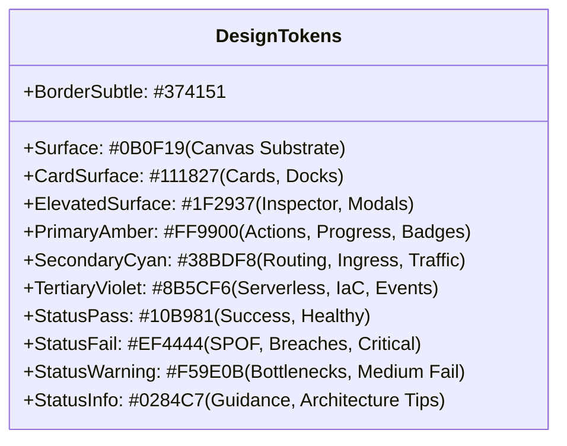
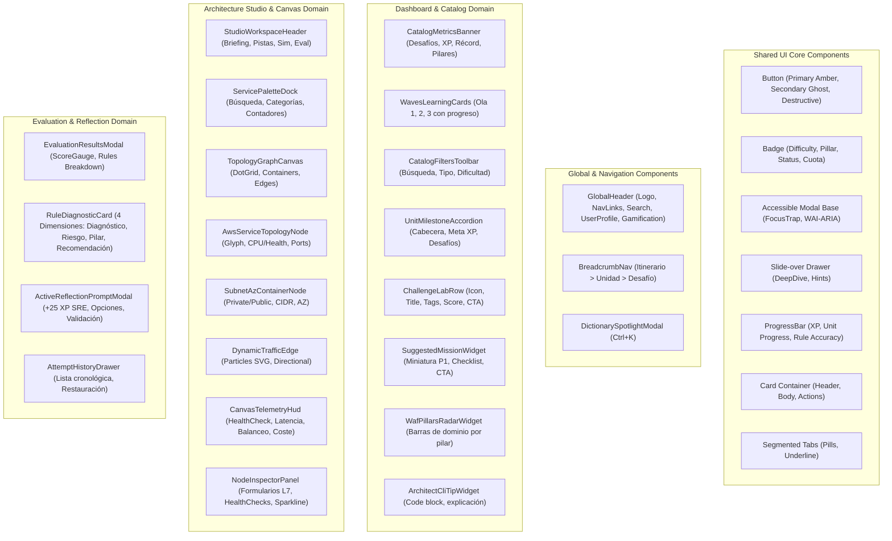
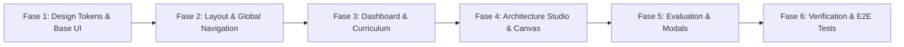

# Plan Maestro de Renovación UI/UX: AWS Quest Architecture Lab

> **Documento de Planificación y Especificación de Diseño**  
> **Estado:** Propuesta de Plan Integral (Listo para Revisión y Aprobación)  
> **Referencias:** Diseños de Google Stitch (Screenshots 1-5), `docs/design.md`, `docs/product-definition-ui-ux-context.md` y la base de código actual (`apps/web` y `apps/api`).  
> **Objetivo:** Transformar la experiencia visual, la jerarquía de información y los componentes de interfaz de la plataforma hacia el lenguaje visual de alta ingeniería de Google Stitch, preservando al 100% la lógica de negocio, los contratos de API, la integridad de datos y las funcionalidades existentes.

---

## 1. Auditoría de la Aplicación Actual y Flujos Existentes

### 1.1 Inventario de Páginas y Rutas Actuales
| Ruta | Vista / Página | Propósito y Capacidades Actuales |
| :--- | :--- | :--- |
| `/` | Redirección a `/catalog` | Entrada principal de la aplicación. |
| `/catalog` | `CatalogPage` | Dashboard e itinerario formativo: lista de 12 unidades, 49 desafíos, selector de política de acceso (`OpenAccess` vs `Progressive`), progreso global y por unidad, filtrado por estado y dificultad. |
| `/challenges/:id` | `ChallengePage` | Espacio de trabajo del desafío: micro-cápsula de briefing, paleta de servicios con límites y distractores, canvas interactivo (React Flow), inspector de configuración, simulador de tráfico dinámico, sistema de pistas socráticas (4 niveles), historial de intentos con restauración y botón de envío para evaluación. |
| `/dictionary` | `DictionaryPage` | Base de conocimiento A-Z: catálogo de términos arquitectónicos y servicios AWS, filtros por categorías y los 6 pilares de *AWS Well-Architected Framework*, buscador en tiempo real y fichas técnicas expandibles. |
| `/login` / `/register` | `LoginPage` / `RegisterPage` / `AuthModal` | Autenticación con JWT, sesión de invitado transparente (*Guest Mode*) y migración atómica de progreso a cuenta permanente sin pérdida de XP ni historial. |
| `*` | `NotFoundPage` / `RootErrorBoundary` | Manejo accesible de rutas no encontradas y captura global de errores de renderizado. |

### 1.2 Flujos Críticos de Negocio a Preservar Estrictamente

```mermaid
flowchart TD
    subgraph Flow1 ["Flujo 1: Sesión de Invitado y Progresión"]
        F1A["Acceso libre inicial (Guest)"] --> F1B["Resolución de desafíos + Acumulación XP"]
        F1B --> F1C["Registro/Login -> Migración atómica de progreso (RN-13)"]
    end

    subgraph Flow2 ["Flujo 2: Ciclo de Construcción y Evaluación"]
        F2A["Briefing táctico"] --> F2B["Construcción en Canvas + Configuración"]
        F2B --> F2C["Pistas Socráticas (Deducción escalonada -RN-06/07)"]
        F2C --> F2D["Simulación de tráfico en tiempo real (Partículas SVG)"]
        F2D --> F2E["Evaluación por motor de reglas (.NET backend)"]
        F2E --> F2F["Feedback formativo Causa-Efecto (4 dimensiones)"]
        F2F --> F2G["Checkpoint de Reflexión Activa (+25 XP SRE)"]
    end

    subgraph Flow3 ["Flujo 3: Historial y Resiliencia"]
        F3A["Auditoría de intentos anteriores"] --> F3B["Restauración segura en Canvas con confirmación"]
    end
```



1. **Flujo de Acceso e Identidad (Guest to Registered):**
   - El usuario puede operar de inmediato como invitado (`IsGuest: true`).
   - Toda acción (XP ganada, nivel alcanzado, desafíos aprobados, historial de intentos y pistas desbloqueadas) se almacena en base de datos asociada a su sesión.
   - Al registrarse o iniciar sesión, el progreso de invitado se fusiona atómicamente con la cuenta permanente (**RN-13**).
2. **Flujo de Pistas Socráticas Progresivas:**
   - Desbloqueo estrictamente secuencial: Nivel 1 (Reflexión) $\rightarrow$ Nivel 2 (Patrón) $\rightarrow$ Nivel 3 (Servicio) $\rightarrow$ Nivel 4 (Acción en Canvas).
   - Modal de advertencia antes de desbloquear confirmando la deducción de puntos (-5, -10, -15, -20 pts) (**RN-06, RN-07**).
   - Persistencia de pistas ya desbloqueadas en reintentos.
3. **Flujo de Evaluación y Diagnóstico:**
   - Serialización semántica agnóstica de coordenadas hacia el motor de reglas en backend.
   - Evaluación en memoria ($< 100$ ms) retornando calificación $[0, 100]$, estado de aprobación ($\ge 70$ pts), desglose de aciertos/errores en 4 dimensiones (Diagnóstico, Riesgo en Producción, Pilar WAF, Recomendación) y coloreado cromático de nodos afectados en el canvas (**RN-08, RN-12**).
   - Cálculo de XP anti-farmeo basado exclusivamente en la superación del récord personal histórico (**RN-10**).
4. **Flujo de Checkpoints de Reflexión Activa:**
   - Tras aprobar ($\ge 70$ pts), se desbloquea una pregunta conceptual con opciones múltiples.
   - Validación segura en servidor: respuesta correcta otorga un bono de +25 XP; respuesta errónea despliega explicación pedagógica sin restar puntos.
5. **Flujo de Simulación Dinámica de Tráfico:**
   - Motor de partículas SVG a 60 FPS sin alterar el grafo de React Flow.
   - Modos de escenario: Normal HTTP (200 OK - verde), Pico de Demanda, Ataque Malicioso (403 Forbidden - rojo) y Fallos de Tiempo de Espera (504 - naranja).
6. **Flujo de Historial y Restauración:**
   - Consulta cronológica de intentos anteriores y restauración en el lienzo previa confirmación del usuario para no perder el trabajo actual.

---

## 2. Mapa de Equivalencia: Plataforma Actual vs. Nuevo Diseño Stitch

| Experiencia / Capacidad Actual | Nueva Experiencia Visual Stitch | Mejoras Clave de UX y Jerarquía |
| :--- | :--- | :--- |
| **Cabecera Global (`RootLayout`)** | **Top Command Bar & Console Header** | Brand oficial *AWS Quest Architecture Lab* con versionado `v2.4 Pro`, barra de búsqueda global `Ctrl+K` integrada, widget de nivel y XP (`Nv. 4 Solutions Architect`), notificaciones y perfil de usuario unificado. |
| **Dashboard de Catálogo (`CatalogPage`)** | **Itinerario de Arquitectura Cloud (Command Center)** | Banner de métricas tácticas (Progreso, XP con multiplicador, Récord Promedio, Pilares WAF dominados), selector de Olas de Aprendizaje (Waves 1-3) con progreso visual y layout en 2 columnas con panel lateral de misiones sugeridas P1 y radar de pilares. |
| **Selector de Modo de Acceso** | **Toggle Táctico `Modo Libre` vs `Modo Progresivo` + Badge Anti-Farm** | Selector segmentado de alta precisión en la cabecera del itinerario con indicador en vivo del estado del motor de evaluación. |
| **Acordeón de Unidades (`UnitAccordion`)** | **Unit Milestone Cards & Status Banners** | Tarjetas de unidad con badges de estado (`Mastered`, `En Curso`, `En Foco`), barras de progreso relativas, promedios de calificación y metadata de puntos en juego (+1,080 XP). |
| **Tarjeta de Desafío (`ChallengeCard`)** | **Tactical Lab Challenge Rows** | Fila estructurada con icono de estado, título, subtítulo con detalles de arquitectura, badges de dificultad y modalidad, notas récord guardadas, XP ganada y botones de acción diferenciados (`Iniciar Lab`, `Continuar Desafío`, `Repasar Lab`). |
| **Sidebar Lateral del Dashboard** | **Panel de Misión Sugerida P1, Radar WAF & CLI Tips** | Misión prioritaria contextual con miniatura temática, checklist de requisitos técnicos, visualizador de radar de los 6 pilares de Well-Architected y tips de consola CLI. |
| **Workspace del Desafío (`ChallengePage`)** | **Architecture Studio (Split-Screen 3 Columnas)** | Header compacto con breadcrumbs jerárquicos, acciones tácticas (`Briefing`, `Pistas`, `Carga/Simulación`, `Intentos`, `Evaluar Arquitectura`). |
| **Paleta de Servicios (`ServicePalette`)** | **Dock de Componentes Cloud Categorizados** | Agrupación en Cómputo, Red & Conectividad, Bases de Datos & Storage y Seguridad, con indicadores de cuota de instancias (`2/4 en uso`), servicios ya colocados y badges informativos para distractores. |
| **Lienzo de Arquitectura (`Canvas`)** | **Lienzo de Topología con Áreas Lógicas y HUD** | Fondo dot-grid oscuro (`#0B0F19`), contenedores de VPC/Región y Subredes por Zonas de Disponibilidad (AZ-1a, AZ-1b), nodos con telemetría en vivo (CPU %, estado Healthy), conexiones dinámicas con flujo animado, HUD de latencia/balanceo y barra inferior de coste estimado mensual. |
| **Inspector de Propiedades (`NodeInspectorPanel`)** | **Inspector de Capa 7 / Recursos & Validación** | Panel lateral derecho con tabs (`Propiedades Componente`, `Validación Desafío`), formulario técnico de configuración (esquemas de red, listeners, health checks, target groups, sparklines de distribución de tráfico) y enlace a código declarativo. |
| **Modal de Evaluación (`EvaluationModal`)** | **Evaluation & Diagnostic Split Sheet** | Encabezado de puntuación con barra de precisión (`62/100`), lista de reglas con badges de severidad (`FAIL • Crítica`, `FAIL • Media`, `PASS`), diagnóstico del entorno, riesgo real en producción, pilar WAF y recomendaciones accionables. |
| **Checkpoint de Reflexión (`ActiveReflectionPrompt`)** | **Active Learning Modal Card** | Tarjeta flotante superpuesta de reflexión táctica (+25 XP SRE) con selector de opciones de razonamiento técnico y botón de validación inmediata. |
| **Diccionario / Glosario (`DictionaryPage`)** | **Knowledge Graph & Deep-Dive Drawers** | Modal Spotlight de búsqueda rápida (`Ctrl+K`), panel lateral deslizable durante el diseño (`DeepDiveDrawer`) y página completa A-Z organizada por los 6 pilares de Well-Architected. |

---

## 3. Principios de Adaptación: Integridad Funcional y No-Regresión

Para cumplir estrictamente con el principio de que **Stitch es una referencia visual y no una especificación funcional restrictiva**, se establecen las siguientes reglas de implementación:

1. **Cero Mocks y Cero Datos Hardcodeados:**
   - La interfaz consumirá exclusivamente los datos reales provistos por el backend .NET y el seeder GitOps (49 desafíos, 12 unidades, servicios de catálogo, intentos históricos, progreso y reflexiones).
   - Si Stitch muestra un dato calculado que no existe como campo directo (ej. *Récord Promedio* o *Pilares Dominados*), se computará dinámicamente en el frontend a partir de las consultas existentes de `useUnits`, `useChallengeAttempts` y `useDictionary`.
2. **Preservación Total de la Lógica de Dominio:**
   - No se alterarán los enums ni modelos de evaluación (`SemanticGraph`, `EvaluationResult`, `FeedbackItem`, `AccessMode`, `ChallengeMode`).
   - Los contratos REST y DTOs actuales se mantendrán intactos.
3. **Consistencia de Estado Global:**
   - Se preservarán y potenciarán los stores existentes en Zustand: `useAuthStore` (usuario, sesión de invitado, nivel, XP), `useCanvasStore` (nodos, conexiones, selección, historial de undo/redo), `useTrafficSimulationStore` (escenarios, velocidad, métricas) y `useDictionaryStore` (spotlight, drawer contextual, filtros).

---

## 4. Sistema Visual y Tokens de Diseño (`docs/design.md`)



### 4.1 Paleta Cromática y Tokens Semánticos
* **Fondos y Superficies:**
  * `bg-surface-canvas`: `#0B0F19` (Lienzo principal, dot-matrix).
  * `bg-surface-card`: `#111827` (Tarjetas de desafío, paleta de servicios, docks inactivos).
  * `bg-surface-elevated`: `#1F2937` (Paneles de inspección, modales flotantes, toolbars activas).
  * `bg-surface-highlight`: `#262A35` / `#313540` (Hover en filas, inputs activos).
* **Bordes y Divisores:**
  * `border-subtle`: `#374151` (Bordes estructurales de 1px).
  * `border-active`: `#FF9900` (Nodos seleccionados, foco de teclado).
  * `border-cyan`: `#38BDF8` (Líneas de enrutamiento y puertos activos).
* **Acentos de Marca y Telemetría:**
  * `text-primary-amber` / `bg-primary-amber`: `#FF9900` (Acciones primarias, botones de evaluación, badges de nivel).
  * `text-secondary-cyan`: `#38BDF8` (Rutas de red, balanceadores ALB, VPC endpoints).
  * `text-tertiary-violet`: `#8B5CF6` (Capstones, Serverless, bonus SRE).
* **Estados Diagnósticos:**
  * `status-pass`: `#10B981` (Reglas aprobadas, nodos saludables).
  * `status-fail`: `#EF4444` (Reglas falladas críticas, puertos vulnerables, caídas).
  * `status-warning`: `#F59E0B` (Advertencias, fallos medios, desbalance de carga).
  * `status-info`: `#0284C7` (Notas informativas, consejos de arquitectura).

### 4.2 Tipografía y Jerarquía (Inter Font Family)
* **Títulos Principales (`headline-xl` / `headline-lg`):** Inter 700/600, 36px/28px, tracking -0.02em, color `#DFE2F1`.
* **Subtítulos y Secciones (`headline-md` / `headline-sm`):** Inter 600, 22px/18px, color `#DFE2F1`.
* **Cuerpo de Texto (`body-md` / `body-sm`):** Inter 400, 14px/12px, line-height 20px/16px, color `#9CA3AF` / `#D1D5DB`.
* **Labels y Metadatos (`label-sm` / `label-md`):** Inter 600/500, 11px/12px, uppercase tracking +0.05em.
* **Cadenas Técnicas e Identificadores (`code-md`):** Inter/JetBrains Mono 500, 13px, color `#7BD0FF` / `#FFC082`.

### 4.3 Geometría, Radios y Elevaciones
* **Radio Base (4px / `rounded-sm`):** Botones de acción, inputs, chips de estado, puertos de conexión de nodos.
* **Radio Medio (8px / `rounded-md`):** Nodos del canvas, tarjetas de desafío, paneles de inspector, banners de alerta.
* **Radio Grande (12px / `rounded-xl`):** Modales flotantes, tarjetas de micro-briefing, contenedores de unidades.
* **Píldoras Circulares (`rounded-full`):** Badges de nivel de XP, chips de pilares WAF y badges de dificultad.
* **Elevaciones:**
  * Capa 0 (0dp): Substrato `#0B0F19` con dot grid `rgba(55,65,81,0.35)`.
  * Capa 1 (1dp): Cards `#111827` con borde 1px `#374151`.
  * Capa 2 (2dp): Modales y Drawers `#1F2937` con sombra `0 4px 20px rgba(0,0,0,0.6)`.

---

## 5. Arquitectura y Catálogo de Componentes Reutilizables



---

## 6. Especificación Detallada por Pantalla y Experiencia

### 6.1 Dashboard / Itinerario de Arquitectura Cloud (`/catalog`)

```text
┌──────────────────────────────────────────────────────────────────────────────────────────────────────────┐
│ [Logo AWS Quest Lab] [v2.4]  Itinerario  Architecture Builder  Triaje Incidentes  Diccionario  [🔍 ⌘K] [Nv.4 XP] [🔔] [Avatar] │
├──────────────────────────────────────────────────────────────────────────────────────────────────────────┤
│ • ITINERARIO OFICIAL • 3 Olas • 12 Unidades • 49 Desafíos                    [ Modo Libre | Modo Progresivo ] │
│ ITINERARIO DE ARQUITECTURA CLOUD                                            [• Estado Motor: Anti-Farm Activo]│
│ Entrenamiento táctico basado en incidentes de producción reales y patrones del AWS Well-Architected Framework.      │
│                                                                                                          │
│ ┌──────────────────────┐ ┌──────────────────────┐ ┌──────────────────────┐ ┌───────────────────────────┐ │
│ │ Progreso Desafíos    │ │ Puntos Experiencia   │ │ Récord Promedio      │ │ Pilares Dominados         │ │
│ │ 18/49 (37%)          │ │ 1,450 XP (x1.25 hoy) │ │ 89.4 / 100           │ │ 4 / 6 WAF                 │ │
│ └──────────────────────┘ └──────────────────────┘ └──────────────────────┘ └───────────────────────────┘ │
│                                                                                                          │
│ OLAS DE APRENDIZAJE TÉCNICO                                                                              │
│ ┌──────────────────────────┐ ┌──────────────────────────┐ ┌──────────────────────────┐                   │
│ │ OLA 01 • FUNDAMENTOS     │ │ OLA 02 • DESACOPLADO     │ │ OLA 03 • EMPRESA         │                   │
│ │ Infraestructura y Redes  │ │ Serverless, Eventos, Edge│ │ Modernización & Capstones│                   │
│ │ 15/20 Superados (75%)  → │ │ 3/15 Superados (20%)   → │ │ 0/14 Superados (Abierto)→│                   │
│ └──────────────────────────┘ └──────────────────────────┘ └──────────────────────────┘                   │
│                                                                                                          │
│ [ 🔍 Buscar por servicio... ]  TIPO: [ Todos (49) | Builder (32) | • Fix (17) ]  DIFICULTAD: [ Fácil | Medio... ]│
│                                                                                                          │
│ ┌── COLUMNA PRINCIPAL (Currículum) ──────────────────────────┐ ┌── COLUMNA LATERAL (Widgets Tácticos) ──┐ │
│ │ [✓] UNIDAD 01: Cómputo y Almacenamiento Base (4/4 - 100%) ▾│ │ ┌────────────────────────────────────┐ │ │
│ │ [✓] UNIDAD 02: Aplicaciones Web (3/4 - 75%)               ▾│ │ │ MISIÓN SUGERIDA DE HOY • P1        │ │ │
│ │ ┌────────────────────────────────────────────────────────┐ │ │ │ [ Imagen / Terminal Alert ]        │ │ │
│ │ │ UNIDAD 05 • EN FOCO • 2/4 Completados (+1,080 XP)      │ │ │ │ Incidente: Base de Datos Saturada  │ │ │
│ │ │ Escalabilidad y Alta Disponibilidad                    │ │ │ │ [✓ Subnets] [✓ Binlog] [⊘ Read]    │ │ │
│ │ │ ┌────────────────────────────────────────────────────┐ │ │ │ │ [ ⚡ Resolver Incidente (+300 XP) ] │ │ │
│ │ │ │ Distribución L7 con ALB [Intermedio] [Builder]     │ │ │ │ └────────────────────────────────────┘ │ │
│ │ │ │ Récord: 95/100 • +200 XP Ganados     [ Repasar Lab ]│ │ │ ┌────────────────────────────────────┐ │ │
│ │ │ ├────────────────────────────────────────────────────┤ │ │ │ RADAR DE PILARES WAF                 │ │ │
│ │ │ │ Elasticidad con Auto Scaling [Intermedio]          │ │ │ │ Seguridad: 92%   Fiabilidad: 68%     │ │ │
│ │ │ │ Récord: 88/100 • +200 XP Ganados     [ Repasar Lab ]│ │ │ │ Rendimiento: 72% Excelencia: 88%     │ │ │
│ │ │ ├────────────────────────────────────────────────────┤ │ │ └────────────────────────────────────┘ │ │
│ │ │ │ ⚠ Incidente: BD RDS saturada [Difícil] [Fix Arch]  │ │ │ ┌────────────────────────────────────┐ │ │
│ │ │ │ Último Intento: 65/100 (Revisar)  [ Continuar Des.]│ │ │ │ TIP DEL ARQUITECTO (CLI Sandbox)    │ │ │
│ │ │ └────────────────────────────────────────────────────┘ │ │ │ aws rds create-db-instance...        │ │ │
│ │ └────────────────────────────────────────────────────────┘ │ │ └────────────────────────────────────┘ │ │
│ └────────────────────────────────────────────────────────────┘ └────────────────────────────────────────┘ │
└──────────────────────────────────────────────────────────────────────────────────────────────────────────┘
```

* **Cálculo reactivo de métricas de usuario:**
  * Desafíos completados / total.
  * XP acumulada y nivel actual (`useAuthStore`).
  * Nota media sobre desafíos completados.
  * Pilares evaluados con éxito basados en las reglas superadas.
* **Misión Sugerida Prioritaria (P1):** Identifica automáticamente el desafío más relevante para el usuario (el último reprobado con $< 70$ puntos o el siguiente desafío no iniciado de la unidad en foco).

---

### 6.2 Architecture Studio & Canvas Workspace (`/challenges/:id`)

```text
┌──────────────────────────────────────────────────────────────────────────────────────────────────────────┐
│ [Logo AWS Quest]  Itinerario > Unidad 5: Escalabilidad > Desafío 1                  [🔍 ⌘K] [Nv.4 XP] [Avatar]   │
├──────────────────────────────────────────────────────────────────────────────────────────────────────────┤
│ Distribución L7 con Application Load Balancer y Cómputo Multi-AZ  [Builder] [200 XP] [• Fiabilidad]      │
│ [ 📖 Briefing ] [ 💡 Pistas: 1/4 (-10p) ] [ ⚡ Carga: Normal ▾ ▶ ↺ ] [ 🕒 Intentos: 2 ]  [ ⚡ Evaluar Solución ] │
├───────────────────┬──────────────────────────────────────────────────────┬───────────────────────────────┤
│ PALETA SERVICIOS  │ LIENZO DE TOPOLOGÍA (Canvas React Flow)              │ INSPECTOR / VALIDACIÓN        │
│ [🔍 Filtrar AWS..]│ [ 🔍 100% ⛶ ▦ ] [ Enrutamiento HTTP/HTTPS ]          │ [ Propiedades ALB ] [ Valid.] │
│                   │                                                      │ ┌───────────────────────────┐ │
│ ▼ CÓMPUTO (1/2)   │ ┌── AWS Region: us-east-1 (vpc-0a88ef) ────────────┐ │ │ ALB-Public-01 (ARN)        │ │
│ • EC2 (2/4)       │ │ ┌── Subnet Privada AZ-1a (10.0.1.0/24) ────────┐ │ │ Esquema: Internet-facing   │ │
│ • ASG (0/1)       │ │ │ [ EC2-App-Server-01 ] Healthy (CPU: 24%)     │ │ │ Protocolo: IPv4 Solamente   │ │
│ • Lambda (0/2)    │ │ └──────────────────────────────────────────────┘ │ │ AZs Mapeadas: [✓ 1a] [✓ 1b]  │ │
│ ▼ RED & CONEXIÓN  │ │ ┌── Subnet Privada AZ-1b (10.0.2.0/24) ────────┐ │ │ Health Check: GET /health    │ │
│ • ALB [✓ Usado]   │ │ │ [ EC2-App-Server-02 ] Healthy (CPU: 26%)     │ │ │ Targets: 2/2 Sanas          │ │
│ • IGW (1/1)       │ │ └──────────────────────────────────────────────┘ │ │ Tráfico: 1,024 req/s (Chart) │ │
│ • Subnet (2/4)    │ │      ▲                   ▲                     │ │ └───────────────────────────┘ │
│ ▼ STORAGE / DB    │ │      └─────[ ALB-Public-01 ] (Dual-AZ / L7)────┘ │ │ [Ver Terraform] [Guardar]   │ │
│ • RDS (0/1)       │ └──────────────────────────────────────────────────┘ │                               │
│ • S3 [Distractor] │ ┌── TELEMETRÍA EN VIVO (HUD) ──────────────────────┐ │                               │
│ ▼ SEGURIDAD       │ │ HealthCheck: 2/2 OK | Latencia: 14.2ms | Bal: 50%│ │                               │
│ • SecGroup (+Add) │ └──────────────────────────────────────────────────┘ │                               │
│                   │ Coste Est. Mensual: $38.40 USD                       │                               │
└───────────────────┴──────────────────────────────────────────────────────┴───────────────────────────────┘
```

* **Lienzo Enriquecido y Jerarquía de Contenedores:**
  * Soporte visual para agrupar nodos dentro de nodos contenedores de tipo `Region/VPC` y `Subnet AZ`.
  * Representación de estado de salud (Healthy/Unhealthy) y carga simulada en cada nodo.
  * Partículas animadas SVG de flujo HTTP/HTTPS, bases de datos y colas asíncronas conectando los puertos.
* **Dock Inspector de Propiedades:**
  * Edición reactiva de configuraciones técnicas del nodo seleccionado conectada directamente a `useCanvasStore.updateNodeData`.

---

### 6.3 Modal de Evaluación, Diagnóstico y Checkpoint de Reflexión

```text
┌────────────────────────────────────────────────────────────────────────────────────────┐
│                                                                                        │
│     ┌── CARD FLOTANTE: CHECKPOINT DE REFLEXIÓN ACTIVA (+25 XP SRE) ────────────────┐   │
│     │ PREGUNTA TÉCNICA DE ARQUITECTURA                                             │   │
│     │ ¿Por qué una base de datos en una subred privada nunca debe contar con ruta  │   │
│     │ directa a un Internet Gateway (IGW)?                                         │   │
│     │                                                                              │   │
│     │ 🔘 Opción A: Porque un IGW es bidireccional por diseño...                    │   │
│     │ ⚪ Opción B: Porque los motores PostgreSQL no soportan conexión externa...    │   │
│     │ ⚪ Opción C: Por razones exclusivas de facturación y costos de transferencia..│   │
│     │                                                                              │   │
│     │ [ Validar Razonamiento ]                                                     │   │
│     └──────────────────────────────────────────────────────────────────────────────┘   │
│                                                                                        │
│ ┌── RESULTADOS DE EVALUACIÓN (Diagnóstico Formativo) ────────────────────────────────┐ │
│ │ PUNTUACIÓN: 62 / 100 (Umbral Requerido: 70 pts)         • 3 / 5 Reglas Aprobadas   │ │
│ ├────────────────────────────────────────────────────────────────────────────────────┤ │
│ │ ⊗ REGLA 1: AISLAMIENTO DE RED DE BASE DE DATOS                   [ FAIL • Crítica ]│ │
│ │   🔍 1. DIAGNÓSTICO: RDS reside en subred pública con IPv4 pública directa.        │ │
│ │   ⚠ 2. RIESGO EN PRODUCCIÓN: Exfiltración inminente de credenciales maestras.      │ │
│ │   • Pilar: Seguridad (SEC-05: Protección de Datos y Aislamiento)                   │ │
│ │   💡 4. RECOMENDACIÓN: Migrar a private-subnet-db y autorizar solo sg-ec2-monolith.│ │
│ ├────────────────────────────────────────────────────────────────────────────────────┤ │
│ │ ⚠ REGLA 2: RESILIENCIA & REDUNDANCIA ZONAL                         [ FAIL • Media ]│ │
│ │   🔍 1. DIAGNÓSTICO: Ausencia de Multi-AZ; clúster opera en Single-AZ us-east-1a.  │ │
│ │   ⚠ 2. RIESGO EN PRODUCCIÓN: Caída total de servicio con RTO > 4 horas.            │ │
│ │   • Pilar: Fiabilidad (REL-03: Tolerancia a Fallos Zonales)                        │ │
│ │   💡 4. RECOMENDACIÓN: Habilitar Multi-AZ Deployment en el configurador.          │ │
│ ├────────────────────────────────────────────────────────────────────────────────────┤ │
│ │ ✓ REGLA 3: EGRESS ESPECÍFICO DESDE SERVIDOR WEB                           [ PASS ] │ │
│ │   Security Group de EC2 restringe tráfico de salida únicamente al puerto 5432.     │ │
│ └────────────────────────────────────────────────────────────────────────────────────┘ │
└────────────────────────────────────────────────────────────────────────────────────────┘
```

---

## 7. Estrategia de Responsive Design y Accesibilidad (WCAG 2.1 AA)

| Dispositivo / Formato | Ancho de Pantalla | Comportamiento del Dashboard | Comportamiento del Architecture Studio |
| :--- | :--- | :--- | :--- |
| **Desktop Ultra/Wide** | $\ge 1440\text{px}$ | Layout 12 columnas completo (Dashboard + Sidebar widgets 400px). | Layout 3 columnas (Paleta 280px + Canvas fluido + Inspector 440px). |
| **Laptop / Desktop** | $1024\text{px} - 1439\text{px}$ | 12 columnas; widgets laterales se acomodan bajo métricas o en columna compacta. | Paleta lateral colapsable (dock iconográfico) e Inspector como panel lateral derecho deslizable. |
| **Tablet** | $768\text{px} - 1023\text{px}$ | Grid de métricas en 2x2; unidades en ancho completo; widgets en pestañas o acordeón inferior. | Canvas maximizado; Paleta e Inspector operan como drawers flotantes accesibles mediante botones de toolbar. |
| **Móvil** | $< 768\text{px}$ | Layout de 1 columna vertical; navegación mediante menú inferior/hamburguesa; tarjetas compactas. | Modo inspección / visualización guiada del canvas con controles táctiles de zoom y paneles modales a pantalla completa. |

### Medidas de Accesibilidad Estricta (a11y)
* **Contraste de Color:** Ratios $\ge 4.5:1$ en todos los textos sobre fondos `#0B0F19`, `#111827` y `#1F2937` verificados con Vitest y axe-core.
* **Navegación por Teclado:** Atrapamiento de foco accesible (`useFocusTrap`) en todos los modales y drawers, atajo global `Ctrl+K` / `Cmd+K` para el diccionario, y tecla `Escape` para descartar diálogos.
* **Soporte `prefers-reduced-motion`:** Desactivación de animaciones en partículas SVG y transiciones en usuarios con sensibilidad de movimiento.

---

## 8. Plan de Implementación Progresiva por Fases



### Fase 1: Tokens de Diseño, Estilos Globales y Componentes Base
1. Actualizar `tailwind.config.js` y `globals.css` con los nuevos tokens de color (`surface-canvas`, `surface-card`, `surface-elevated`, `primary-amber`, `secondary-cyan`, `tertiary-violet`, `border-subtle`).
2. Actualizar la suite de componentes compartidos (`Button`, `Badge`, `Card`, `ProgressBar`, `Tabs`, `ModalBase`, `DrawerBase`).
3. Verificar compatibilidad con tests unitarios existentes de componentes y accesibilidad (`npm run test:unit:frontend`).

### Fase 2: Layout Global, Barra de Navegación y Spotlight Modal
1. Rediseñar `RootLayout.tsx` con la nueva barra superior de consola técnica (*AWS Quest Architecture Lab*, version pill, búsqueda rápida, widget de nivel/XP y avatar).
2. Integrar el modal Spotlight del diccionario activable globalmente mediante `Ctrl+K` o botón en header.
3. Actualizar `UserSessionMenu` y `AuthModal` con el nuevo estilo visual.

### Fase 3: Dashboard de Catálogo e Itinerario de Aprendizaje
1. Rediseñar `CatalogPage.tsx` implementando el banner de métricas superiores (desafíos, XP multiplicador, récord medio, pilares WAF).
2. Crear el componente de selector de Olas de Aprendizaje (`WavesLearningCards.tsx`) con barras de progreso relativas.
3. Actualizar la barra de filtros y búsqueda (`CatalogFiltersToolbar.tsx`).
4. Rediseñar `UnitAccordion.tsx` y `ChallengeCard.tsx` bajo el estilo de filas tácticas (*Mastered*, *En Curso*, *En Foco*, estados de nota récord y botones de acción).
5. Crear los widgets laterales: `SuggestedMissionWidget.tsx`, `WafPillarsRadarWidget.tsx` y `ArchitectCliTipWidget.tsx`.

### Fase 4: Architecture Studio Workspace y Canvas Visual
1. Rediseñar `WorkspaceHeader.tsx` con el nuevo estilo de subheader táctico (breadcrumbs, briefing trigger, pistas con nivel/costo, selector de escenario de carga y botón de evaluar).
2. Rediseñar la paleta lateral `ServicePalette.tsx` con agrupación por categorías, indicadores de cuotas (`2/4 en uso`) y distintivos para servicios distractores.
3. Actualizar los nodos de React Flow (`AwsServiceNode.tsx`) y añadir soporte para nodos de contenedores lógicos (`SubnetAzContainerNode.tsx`).
4. Actualizar `DynamicTrafficEdge.tsx` y `CanvasTelemetryHud.tsx` con la nueva estética de telemetría en tiempo real.
5. Rediseñar el panel de inspección `NodeInspectorPanel.tsx` con pestañas de propiedades, targets de health check y gráficas sparkline de tráfico.

### Fase 5: Modal de Evaluación, Diagnóstico y Checkpoints de Reflexión
1. Rediseñar `EvaluationModal.tsx` con la cabecera de score gauge de alta densidad (`62/100`), barra de precisión de reglas y desglose formativo de 4 partes (`RuleDiagnosticCard.tsx`).
2. Rediseñar `ActiveReflectionPrompt.tsx` como tarjeta modal superpuesta de reflexión táctica (+25 XP SRE).
3. Actualizar `AttemptHistoryList.tsx`, `AttemptHistoryCard.tsx` y `RestoreAttemptModal.tsx` bajo el nuevo lenguaje visual.
4. Rediseñar `DictionaryPage.tsx` y `DictionaryDrawer.tsx` con la nueva estética.

### Fase 6: Pruebas de Regresión, Verificación E2E y Release
1. Ejecutar la suite completa de pruebas unitarias de frontend con Vitest (100% verde).
2. Ejecutar la suite de pruebas unitarias y de integración de backend con .NET y PostgreSQL (100% verde).
3. Ejecutar la suite de pruebas End-to-End con Playwright (POM) cubriendo todos los flujos de usuario.
4. Ejecutar auditoría automatizada de accesibilidad con `@axe-core/playwright` (0 violaciones WCAG 2.1 AA).

---

## 9. Criterios de Aceptación y Definición de Terminado (DoD)

- [ ] **Fidelidad Visual:** La interfaz refleja fielmente la dirección estética de ingeniería de misión crítica de Google Stitch.
- [ ] **Funcionalidad 100% Preservada:** Todos los 49 desafíos, 12 unidades, simulación de tráfico, pistas socráticas, reflexiones activas y migración de invitados funcionan sin alteraciones.
- [ ] **Cero Mocks:** Toda la información proviene del backend y los hooks existentes de TanStack Query / Zustand.
- [ ] **Responsive:** Operable y visualmente coherente en resoluciones Desktop ($\ge 1440$px), Laptop ($1024$px), Tablet ($768$px) y Móvil ($< 768$px).
- [ ] **Accesibilidad WCAG 2.1 AA:** Contraste tipográfico $\ge 4.5:1$, navegación completa por teclado y soporte para lectores de pantalla.
- [ ] **100% Tests en Verde:** Suite completa de pruebas unitarias, de integración y E2E Playwright aprobadas sin regresiones.
