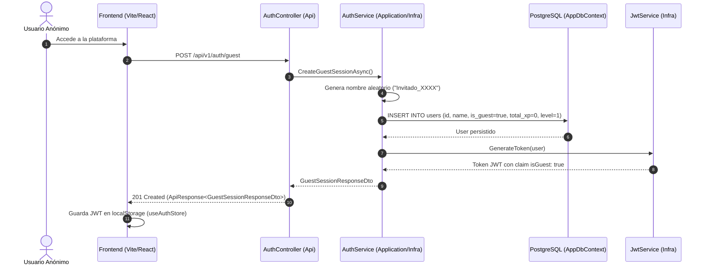
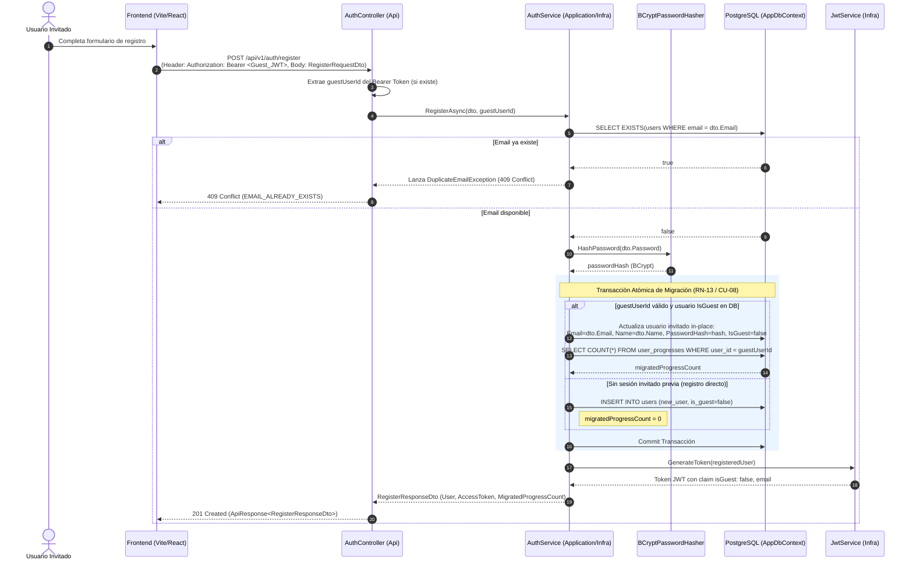
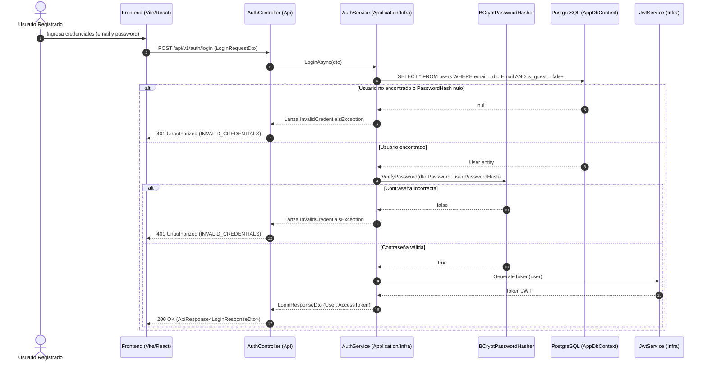
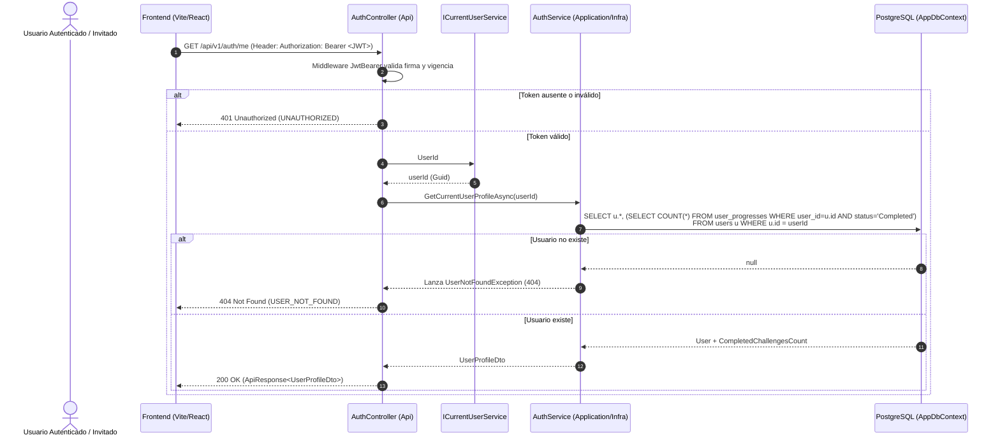

# Especificación Técnica: Módulo de Autenticación y Modo Invitado (Fase 3 - Hito 3.2)

## 1. Introducción y Objetivos

Esta especificación técnica define la arquitectura, diseño de interfaces, lógica de casos de uso, servicios de infraestructura, endpoints REST y estrategia de pruebas para el **Módulo de Autenticación y Modo Invitado**, correspondiente a la **Tarea 3.2** de la **Fase 3** del plan de implementación ([`docs/12-implementation-plan.md`](file:///c:/workspace/aws/aws-game/docs/12-implementation-plan.md)), en estricto cumplimiento con el contrato de API REST ([`docs/08-api-spec.md`](file:///c:/workspace/aws/aws-game/docs/08-api-spec.md)), el modelo de datos ([`docs/07-data-model.md`](file:///c:/workspace/aws/aws-game/docs/07-data-model.md)) y los casos de uso ([`docs/05-use-cases.md`](file:///c:/workspace/aws/aws-game/docs/05-use-cases.md)).

### Objetivos Clave:
1. **Adopción Inmediata y sin Fricción (Modo Invitado):** Permitir a los usuarios ingresar a la plataforma y resolver desafíos inmediatamente sin registrarse previamente, aprovisionando una identidad persistente (`IsGuest = true`) y un token JWT con vigencia extendida.
2. **Migración Atómica de Progreso (RN-13 / CU-08):** Cuando un usuario invitado decide crear una cuenta formal permanente (`POST /auth/register`), transferir de forma transaccional y atómica todo su progreso acumulado (`UserProgress`), historial de envíos (`ChallengeAttempt`), puntos de experiencia (`TotalXP`) y nivel alcanzado (`Level`), garantizando cero pérdida de datos.
3. **Autenticación Segura y Estándar JWT:** Implementar emisión y validación de tokens JWT (HMAC-SHA256) con claims estandarizados (`sub`, `name`, `email`, `isGuest`, `role`, `jti`), expiración configurable y hashing seguro de contraseñas mediante **BCrypt**.
4. **Desacoplamiento Estricto (Clean Architecture):** Definir abstracciones puras en `AwsQuest.Application` (`IAuthService`, `IJwtService`, `IPasswordHasher`, `ICurrentUserService`) desacopladas de las implementaciones concretas en `AwsQuest.Infrastructure` y `AwsQuest.Api`.
5. **Manejo Estandarizado de Errores y Respuestas:** Exponer endpoints REST en `AuthController` que devuelvan respuestas encapsuladas en `ApiResponse<T>` y `ApiErrorResponse` con códigos canónicos de error (`UNAUTHORIZED`, `FORBIDDEN`, `EMAIL_ALREADY_EXISTS`, `INVALID_CREDENTIALS`).

```text
┌─────────────────────────────────────────────────────────────────────────────┐
│                       ARQUITECTURA DEL MÓDULO DE AUTENTICACIÓN              │
├─────────────────────────────────────────────────────────────────────────────┤
│                                                                             │
│   [Cliente Web (React)]                                                     │
│            │                                                                │
│            │ HTTP Requests + Bearer Token (JWT)                             │
│            ▼                                                                │
│   ┌──────────────────────────────────────────────────────────────────────┐  │
│   │ AwsQuest.Api                                                         │  │
│   │ ├── Controllers/AuthController.cs                                    │  │
│   │ └── Extensions/AuthenticationExtensions.cs (JwtBearer + Handlers)    │  │
│   └──────────────────────┬───────────────────────────────────────────────┘  │
│                          │                                                  │
│                          ▼                                                  │
│   ┌──────────────────────────────────────────────────────────────────────┐  │
│   │ AwsQuest.Application                                                 │  │
│   │ ├── Common/Interfaces/ (IAuthService, IJwtService, IPasswordHasher)  │  │
│   │ ├── Dtos/Auth/ (AuthDtos.cs)                                         │  │
│   │ ├── Validators/ (RegisterRequestDtoValidator, LoginDtoValidator)     │  │
│   │ └── Exceptions/ (AuthException, DuplicateEmailException, etc.)       │  │
│   └──────────────────────┬───────────────────────────────────────────────┘  │
│                          │                                                  │
│                          ▼                                                  │
│   ┌──────────────────────────────────────────────────────────────────────┐  │
│   │ AwsQuest.Infrastructure                                              │  │
│   │ ├── Authentication/ (JwtService, BCryptPasswordHasher)               │  │
│   │ ├── Services/ (AuthService, CurrentUserService)                      │  │
│   │ └── Persistence/AppDbContext.cs (PostgreSQL + JSONB + Migraciones)   │  │
│   └──────────────────────────────────────────────────────────────────────┘  │
│                                                                             │
└─────────────────────────────────────────────────────────────────────────────┘
```

---

## 2. Requerimientos y Reglas de Negocio Vinculadas

| Requisito / Regla | Concepto | Aplicación en el Módulo de Autenticación |
| :--- | :--- | :--- |
| **RF-20** | Modo Invitado y Registro sin Fricción | Aprovisionamiento de usuario anónimo en `POST /auth/guest` y conversión fluida a usuario permanente. |
| **RN-13** | Migración Atómica de Progreso | Al registrarse con token de invitado, transferir de manera indivisible récords, intentos y XP a la cuenta permanente. |
| **RNF-12** | Seguridad y Criptografía | Hash de contraseña con salt dinámico (`BCrypt`), firmas HMAC-SHA256 en JWT y lectura segura de secretos. |
| **RNF-13** | Integridad y Resiliencia | Ejecución de transacciones de base de datos con aislamiento ACID durante la promoción/migración de cuenta. |
| **CU-08** | Registrarse / Iniciar Sesión con Migración | Soporte para header opcional `Authorization: Bearer <Guest_JWT>` en el endpoint `POST /auth/register`. |
| **08-api-spec** | Contrato de API de Autenticación | Rutas `/api/v1/auth/guest`, `/api/v1/auth/register`, `/api/v1/auth/login`, `/api/v1/auth/me`. |

---

## 3. Diagramas de Secuencia y Flujos de Interacción

### 3.1. Flujo de Sesión Invitado (`POST /api/v1/auth/guest`)



---

### 3.2. Flujo de Registro con Migración Atómica (`POST /api/v1/auth/register`)



---

### 3.3. Flujo de Inicio de Sesión (`POST /api/v1/auth/login`)



---

### 3.4. Flujo de Consulta de Perfil de Usuario (`GET /api/v1/auth/me`)



---

## 4. Diseño Detallado de Contratos e Interfaces (`AwsQuest.Application`)

### 4.1. Contrato `IAuthService`

Ubicación: `apps/api/src/AwsQuest.Application/Common/Interfaces/IAuthService.cs`

```csharp
namespace AwsQuest.Application.Common.Interfaces;

using AwsQuest.Application.Dtos.Auth;

public interface IAuthService
{
    /// <summary>
    /// Crea una sesión anónima en Modo Invitado con identidad persistida y emite su JWT.
    /// </summary>
    Task<GuestSessionResponseDto> CreateGuestSessionAsync(CancellationToken cancellationToken = default);

    /// <summary>
    /// Registra un nuevo usuario permanente. Si se provee un guestUserId válido,
    /// migra atómicamente su progreso, intentos y XP acumulados a la cuenta registrada (RN-13 / CU-08).
    /// </summary>
    Task<RegisterResponseDto> RegisterAsync(RegisterRequestDto request, Guid? guestUserId = null, CancellationToken cancellationToken = default);

    /// <summary>
    /// Valida credenciales e inicia sesión para un usuario registrado.
    /// </summary>
    Task<LoginResponseDto> LoginAsync(LoginRequestDto request, CancellationToken cancellationToken = default);

    /// <summary>
    /// Obtiene el perfil consolidado del usuario actual incluyendo conteo de desafíos completados.
    /// </summary>
    Task<UserProfileDto> GetCurrentUserProfileAsync(Guid userId, CancellationToken cancellationToken = default);
}
```

---

### 4.2. Contrato `IJwtService`

Ubicación: `apps/api/src/AwsQuest.Application/Common/Interfaces/IJwtService.cs`

```csharp
namespace AwsQuest.Application.Common.Interfaces;

using System.Security.Claims;
using AwsQuest.Domain.Entities;

public interface IJwtService
{
    /// <summary>
    /// Genera un token JWT firmado para el usuario dado (sea invitado o registrado).
    /// </summary>
    string GenerateToken(User user);

    /// <summary>
    /// Valida un token JWT y extrae su ClaimsPrincipal. Retorna null si el token es inválido o expiró.
    /// </summary>
    ClaimsPrincipal? GetPrincipalFromToken(string token);

    /// <summary>
    /// Extrae de forma segura el identificador de usuario (Guid) desde un token JWT string, o null si falla.
    /// </summary>
    Guid? ExtractUserIdFromToken(string? token);
}
```

---

### 4.3. Contrato `IPasswordHasher`

Ubicación: `apps/api/src/AwsQuest.Application/Common/Interfaces/IPasswordHasher.cs`

```csharp
namespace AwsQuest.Application.Common.Interfaces;

public interface IPasswordHasher
{
    /// <summary>
    /// Genera un hash seguro de la contraseña usando BCrypt con salt dinámico.
    /// </summary>
    string HashPassword(string password);

    /// <summary>
    /// Verifica si una contraseña en texto plano coincide con el hash almacenado.
    /// </summary>
    bool VerifyPassword(string password, string passwordHash);
}
```

---

### 4.4. Contrato `ICurrentUserService`

Ubicación: `apps/api/src/AwsQuest.Application/Common/Interfaces/ICurrentUserService.cs`

```csharp
namespace AwsQuest.Application.Common.Interfaces;

public interface ICurrentUserService
{
    /// <summary>
    /// Obtiene el identificador único del usuario autenticado en la petición actual.
    /// </summary>
    Guid? UserId { get; }

    /// <summary>
    /// Indica si la petición actual cuenta con un usuario autenticado.
    /// </summary>
    bool IsAuthenticated { get; }

    /// <summary>
    /// Indica si el usuario autenticado está en Modo Invitado.
    /// </summary>
    bool IsGuest { get; }

    /// <summary>
    /// Correo electrónico del usuario (null en usuarios invitados).
    /// </summary>
    string? Email { get; }
}
```

---

### 4.5. Excepciones de Dominio y Aplicación para Autenticación

Ubicación: `apps/api/src/AwsQuest.Application/Common/Exceptions/AuthExceptions.cs`

```csharp
namespace AwsQuest.Application.Common.Exceptions;

public class DuplicateEmailException : Exception
{
    public DuplicateEmailException(string email) 
        : base($"El correo electrónico '{email}' ya se encuentra registrado.")
    {
    }
}

public class InvalidCredentialsException : Exception
{
    public InvalidCredentialsException() 
        : base("Las credenciales proporcionadas son incorrectas.")
    {
    }
}

public class UserNotFoundException : Exception
{
    public UserNotFoundException(Guid userId) 
        : base($"No se encontró el usuario con identificador '{userId}'.")
    {
    }
}
```

---

### 4.6. Extensiones de Mapeo de Autenticación

Ubicación: `apps/api/src/AwsQuest.Application/Mappings/AuthMappingExtensions.cs`

```csharp
namespace AwsQuest.Application.Mappings;

using AwsQuest.Application.Dtos.Auth;
using AwsQuest.Domain.Entities;

public static class AuthMappingExtensions
{
    public static UserDto ToDto(this User user)
    {
        return new UserDto
        {
            Id = user.Id,
            Name = user.Name,
            Email = user.Email,
            IsGuest = user.IsGuest,
            TotalXP = user.TotalXP,
            Level = user.Level
        };
    }

    public static UserProfileDto ToProfileDto(this User user, int completedChallengesCount)
    {
        return new UserProfileDto
        {
            Id = user.Id,
            Name = user.Name,
            Email = user.Email,
            IsGuest = user.IsGuest,
            TotalXP = user.TotalXP,
            Level = user.Level,
            CompletedChallengesCount = completedChallengesCount,
            CreatedAt = user.CreatedAt
        };
    }
}
```

---

## 5. Especificación de Implementaciones en Infraestructura (`AwsQuest.Infrastructure`)

### 5.1. Configuración de Opciones JWT (`JwtSettings`)

Ubicación: `apps/api/src/AwsQuest.Infrastructure/Authentication/JwtSettings.cs`

```csharp
namespace AwsQuest.Infrastructure.Authentication;

public class JwtSettings
{
    public const string SectionName = "JwtSettings";

    public string Secret { get; set; } = string.Empty;
    public string Issuer { get; set; } = string.Empty;
    public string Audience { get; set; } = string.Empty;
    public int ExpirationHours { get; set; } = 24;
    public int GuestExpirationDays { get; set; } = 30;
}
```

---

### 5.2. Implementación de `BCryptPasswordHasher`

Ubicación: `apps/api/src/AwsQuest.Infrastructure/Authentication/BCryptPasswordHasher.cs`

* Utiliza `BCrypt.Net-Next` con un factor de trabajo (*work factor*) de 11 (equilibrio óptimo entre resistencia a ataques de fuerza bruta y latencia $< 100$ ms).

```csharp
namespace AwsQuest.Infrastructure.Authentication;

using AwsQuest.Application.Common.Interfaces;
using BCrypt.Net;

public class BCryptPasswordHasher : IPasswordHasher
{
    private const int WorkFactor = 11;

    public string HashPassword(string password)
    {
        ArgumentException.ThrowIfNullOrWhiteSpace(password);
        return BCrypt.EnhancedHashPassword(password, WorkFactor, HashType.SHA384);
    }

    public bool VerifyPassword(string password, string passwordHash)
    {
        if (string.IsNullOrWhiteSpace(password) || string.IsNullOrWhiteSpace(passwordHash))
        {
            return false;
        }

        try
        {
            return BCrypt.EnhancedVerify(password, passwordHash, HashType.SHA384);
        }
        catch
        {
            return false;
        }
    }
}
```

---

### 5.3. Implementación de `JwtService`

Ubicación: `apps/api/src/AwsQuest.Infrastructure/Authentication/JwtService.cs`

* **Claims Estándar:**
  * `ClaimTypes.NameIdentifier` (`sub`): ID del usuario (`Guid.ToString()`).
  * `ClaimTypes.Name` (`name`): Nombre del usuario.
  * `ClaimTypes.Email` (`email`): Correo del usuario (sólo si no es invitado).
  * `isGuest`: Booleano `"true"` o `"false"`.
  * `ClaimTypes.Role` (`role`): `"Learner"`.
  * `JwtRegisteredClaimNames.Jti`: GUID único por token.
* **Expiración Diferenciada:**
  * Usuarios registrados: `ExpirationHours` (24 horas).
  * Usuarios invitados: `GuestExpirationDays` (30 días para evitar pérdida de sesión durante el aprendizaje).

```csharp
namespace AwsQuest.Infrastructure.Authentication;

using System.IdentityModel.Tokens.Jwt;
using System.Security.Claims;
using System.Text;
using Microsoft.Extensions.Options;
using Microsoft.IdentityModel.Tokens;
using AwsQuest.Application.Common.Interfaces;
using AwsQuest.Domain.Entities;

public class JwtService : IJwtService
{
    private readonly JwtSettings _settings;
    private readonly SymmetricSecurityKey _key;

    public JwtService(IOptions<JwtSettings> settings)
    {
        _settings = settings.Value;
        if (string.IsNullOrWhiteSpace(_settings.Secret) || _settings.Secret.Length < 32)
        {
            throw new InvalidOperationException("JwtSettings:Secret debe tener al menos 32 caracteres.");
        }

        _key = new SymmetricSecurityKey(Encoding.UTF8.GetBytes(_settings.Secret));
    }

    public string GenerateToken(User user)
    {
        var claims = new List<Claim>
        {
            new(ClaimTypes.NameIdentifier, user.Id.ToString()),
            new(ClaimTypes.Name, user.Name),
            new("isGuest", user.IsGuest.ToString().ToLowerInvariant()),
            new(ClaimTypes.Role, "Learner"),
            new(JwtRegisteredClaimNames.Jti, Guid.NewGuid().ToString())
        };

        if (!user.IsGuest && !string.IsNullOrWhiteSpace(user.Email))
        {
            claims.Add(new Claim(ClaimTypes.Email, user.Email));
        }

        var expires = user.IsGuest
            ? DateTime.UtcNow.AddDays(_settings.GuestExpirationDays)
            : DateTime.UtcNow.AddHours(_settings.ExpirationHours);

        var tokenDescriptor = new SecurityTokenDescriptor
        {
            Subject = new ClaimsIdentity(claims),
            Expires = expires,
            Issuer = _settings.Issuer,
            Audience = _settings.Audience,
            SigningCredentials = new SigningCredentials(_key, SecurityAlgorithms.HmacSha256Signature)
        };

        var tokenHandler = new JwtSecurityTokenHandler();
        var token = tokenHandler.CreateToken(tokenDescriptor);
        return tokenHandler.WriteToken(token);
    }

    public ClaimsPrincipal? GetPrincipalFromToken(string token)
    {
        if (string.IsNullOrWhiteSpace(token)) return null;

        var tokenHandler = new JwtSecurityTokenHandler();
        var validationParameters = new TokenValidationParameters
        {
            ValidateIssuerSigningKey = true,
            IssuerSigningKey = _key,
            ValidateIssuer = !string.IsNullOrEmpty(_settings.Issuer),
            ValidIssuer = _settings.Issuer,
            ValidateAudience = !string.IsNullOrEmpty(_settings.Audience),
            ValidAudience = _settings.Audience,
            ValidateLifetime = true,
            ClockSkew = TimeSpan.FromMinutes(1)
        };

        try
        {
            return tokenHandler.ValidateToken(token, validationParameters, out _);
        }
        catch
        {
            return null;
        }
    }

    public Guid? ExtractUserIdFromToken(string? token)
    {
        if (string.IsNullOrWhiteSpace(token)) return null;

        // Limpiar prefijo "Bearer " si estuviese presente
        if (token.StartsWith("Bearer ", StringComparison.OrdinalIgnoreCase))
        {
            token = token["Bearer ".Length..].Trim();
        }

        var principal = GetPrincipalFromToken(token);
        if (principal == null) return null;

        var subClaim = principal.FindFirst(ClaimTypes.NameIdentifier)?.Value;
        return Guid.TryParse(subClaim, out var userId) ? userId : null;
    }
}
```

---

### 5.4. Implementación del Servicio de Autenticación (`AuthService`)

Ubicación: `apps/api/src/AwsQuest.Infrastructure/Services/AuthService.cs`

#### Estrategia de Migración Atómica In-Place (RN-13 / CU-08):
1. **Verificación de Unicidad de Email:** Se consulta si el correo ingresado ya existe en la base de datos para usuarios permanentes (`!IsGuest`) o invitados. Si existe, se aborta inmediatamente con `DuplicateEmailException`.
2. **Promoción In-Place Transaccional:**
   * Si `guestUserId` fue provisto y corresponde a un registro existente con `IsGuest = true`:
     * Se actualizan directamente los campos del registro existente: `Email = request.Email`, `PasswordHash = hash`, `Name = request.Name`, `IsGuest = false`, `UpdatedAt = UtcNow`.
     * **Beneficio Arquitectónico:** Todas las relaciones de `UserProgress` y `ChallengeAttempt` asociadas a `guestUserId` quedan automáticamente preservadas sin requerir mutaciones masivas de Foreign Keys ni operaciones complejas de DELETE/INSERT.
     * Se cuantifica el número de desafíos con progreso migrado (`user.Progress.Count`).
   * Si no se proporcionó `guestUserId` o el ID no corresponde a un invitado existente:
     * Se crea una nueva entidad `User` (`IsGuest = false`, `Email = request.Email`, `PasswordHash = hash`, `Name = request.Name`).
     * `migratedProgressCount = 0`.
3. **Persistencia y Emisión:** Se ejecuta `SaveChangesAsync` y se emite el nuevo token JWT permanente.

```csharp
namespace AwsQuest.Infrastructure.Services;

using Microsoft.EntityFrameworkCore;
using AwsQuest.Application.Common.Exceptions;
using AwsQuest.Application.Common.Interfaces;
using AwsQuest.Application.Dtos.Auth;
using AwsQuest.Application.Mappings;
using AwsQuest.Domain.Entities;
using AwsQuest.Domain.Enums;

public class AuthService : IAuthService
{
    private readonly IAppDbContext _dbContext;
    private readonly IJwtService _jwtService;
    private readonly IPasswordHasher _passwordHasher;

    public AuthService(
        IAppDbContext dbContext,
        IJwtService jwtService,
        IPasswordHasher passwordHasher)
    {
        _dbContext = dbContext;
        _jwtService = jwtService;
        _passwordHasher = passwordHasher;
    }

    public async Task<GuestSessionResponseDto> CreateGuestSessionAsync(CancellationToken cancellationToken = default)
    {
        var randomSuffix = Random.Shared.Next(1000, 9999);
        var guestUser = new User
        {
            Id = Guid.NewGuid(),
            Name = $"Invitado_{randomSuffix}",
            Email = null,
            PasswordHash = null,
            IsGuest = true,
            TotalXP = 0,
            Level = 1,
            CreatedAt = DateTime.UtcNow,
            UpdatedAt = DateTime.UtcNow
        };

        _dbContext.Users.Add(guestUser);
        await _dbContext.SaveChangesAsync(cancellationToken);

        var token = _jwtService.GenerateToken(guestUser);

        return new GuestSessionResponseDto
        {
            AccessToken = token,
            User = guestUser.ToDto()
        };
    }

    public async Task<RegisterResponseDto> RegisterAsync(
        RegisterRequestDto request, 
        Guid? guestUserId = null, 
        CancellationToken cancellationToken = default)
    {
        var emailExists = await _dbContext.Users
            .AnyAsync(u => u.Email == request.Email, cancellationToken);

        if (emailExists)
        {
            throw new DuplicateEmailException(request.Email);
        }

        var passwordHash = _passwordHasher.HashPassword(request.Password);
        User userToPersist;
        int migratedProgressCount = 0;

        if (guestUserId.HasValue)
        {
            var guestUser = await _dbContext.Users
                .Include(u => u.Progress)
                .FirstOrDefaultAsync(u => u.Id == guestUserId.Value && u.IsGuest, cancellationToken);

            if (guestUser != null)
            {
                // Promoción In-Place: Convierte el invitado existente en usuario permanente
                guestUser.Email = request.Email;
                guestUser.PasswordHash = passwordHash;
                guestUser.Name = request.Name;
                guestUser.IsGuest = false;
                guestUser.UpdatedAt = DateTime.UtcNow;

                migratedProgressCount = guestUser.Progress.Count;
                userToPersist = guestUser;
            }
            else
            {
                userToPersist = CreateNewPermanentUser(request, passwordHash);
                _dbContext.Users.Add(userToPersist);
            }
        }
        else
        {
            userToPersist = CreateNewPermanentUser(request, passwordHash);
            _dbContext.Users.Add(userToPersist);
        }

        await _dbContext.SaveChangesAsync(cancellationToken);

        var token = _jwtService.GenerateToken(userToPersist);

        return new RegisterResponseDto
        {
            AccessToken = token,
            User = userToPersist.ToDto(),
            MigratedProgressCount = migratedProgressCount
        };
    }

    public async Task<LoginResponseDto> LoginAsync(LoginRequestDto request, CancellationToken cancellationToken = default)
    {
        var user = await _dbContext.Users
            .FirstOrDefaultAsync(u => u.Email == request.Email && !u.IsGuest, cancellationToken);

        if (user == null || string.IsNullOrEmpty(user.PasswordHash))
        {
            throw new InvalidCredentialsException();
        }

        var isPasswordValid = _passwordHasher.VerifyPassword(request.Password, user.PasswordHash);
        if (!isPasswordValid)
        {
            throw new InvalidCredentialsException();
        }

        var token = _jwtService.GenerateToken(user);

        return new LoginResponseDto
        {
            AccessToken = token,
            User = user.ToDto()
        };
    }

    public async Task<UserProfileDto> GetCurrentUserProfileAsync(Guid userId, CancellationToken cancellationToken = default)
    {
        var user = await _dbContext.Users
            .AsNoTracking()
            .FirstOrDefaultAsync(u => u.Id == userId, cancellationToken);

        if (user == null)
        {
            throw new UserNotFoundException(userId);
        }

        var completedChallengesCount = await _dbContext.UserProgresses
            .AsNoTracking()
            .CountAsync(p => p.UserId == userId && p.Status == ProgressStatus.Completed, cancellationToken);

        return user.ToProfileDto(completedChallengesCount);
    }

    private static User CreateNewPermanentUser(RegisterRequestDto request, string passwordHash)
    {
        return new User
        {
            Id = Guid.NewGuid(),
            Email = request.Email,
            PasswordHash = passwordHash,
            Name = request.Name,
            IsGuest = false,
            TotalXP = 0,
            Level = 1,
            CreatedAt = DateTime.UtcNow,
            UpdatedAt = DateTime.UtcNow
        };
    }
}
```

---

### 5.5. Implementación de `CurrentUserService`

Ubicación: `apps/api/src/AwsQuest.Infrastructure/Services/CurrentUserService.cs`

```csharp
namespace AwsQuest.Infrastructure.Services;

using System.Security.Claims;
using Microsoft.AspNetCore.Http;
using AwsQuest.Application.Common.Interfaces;

public class CurrentUserService : ICurrentUserService
{
    private readonly IHttpContextAccessor _httpContextAccessor;

    public CurrentUserService(IHttpContextAccessor httpContextAccessor)
    {
        _httpContextAccessor = httpContextAccessor;
    }

    private ClaimsPrincipal? User => _httpContextAccessor.HttpContext?.User;

    public Guid? UserId
    {
        get
        {
            var sub = User?.FindFirstValue(ClaimTypes.NameIdentifier);
            return Guid.TryParse(sub, out var id) ? id : null;
        }
    }

    public bool IsAuthenticated => User?.Identity?.IsAuthenticated ?? false;

    public bool IsGuest
    {
        get
        {
            var claim = User?.FindFirst("isGuest")?.Value;
            return bool.TryParse(claim, out var isGuest) && isGuest;
        }
    }

    public string? Email => User?.FindFirstValue(ClaimTypes.Email);
}
```

---

## 6. Especificación de Endpoints y Controlador REST (`AwsQuest.Api`)

### 6.1. Controlador `AuthController`

Ubicación: `apps/api/src/AwsQuest.Api/Controllers/AuthController.cs`

```csharp
namespace AwsQuest.Api.Controllers;

using Microsoft.AspNetCore.Authorization;
using Microsoft.AspNetCore.Mvc;
using AwsQuest.Application.Common.Interfaces;
using AwsQuest.Application.Common.Models;
using AwsQuest.Application.Dtos.Auth;

[ApiController]
[Route("api/v1/auth")]
[Produces("application/json")]
public class AuthController : ControllerBase
{
    private readonly IAuthService _authService;
    private readonly IJwtService _jwtService;
    private readonly ICurrentUserService _currentUserService;

    public AuthController(
        IAuthService _authService,
        IJwtService jwtService,
        ICurrentUserService currentUserService)
    {
        this._authService = _authService;
        _jwtService = jwtService;
        _currentUserService = currentUserService;
    }

    /// <summary>
    /// Genera una nueva sesión anónima en Modo Invitado.
    /// </summary>
    [HttpPost("guest")]
    [AllowAnonymous]
    [ProducesResponseType(typeof(ApiResponse<GuestSessionResponseDto>), StatusCodes.Status201Created)]
    public async Task<IActionResult> CreateGuestSession(CancellationToken cancellationToken)
    {
        var result = await _authService.CreateGuestSessionAsync(cancellationToken);
        return StatusCode(StatusCodes.Status201Created, ApiResponse<GuestSessionResponseDto>.Ok(result));
    }

    /// <summary>
    /// Registra un usuario permanente y migra el progreso del invitado si se adjunta su token Bearer.
    /// </summary>
    [HttpPost("register")]
    [AllowAnonymous]
    [ProducesResponseType(typeof(ApiResponse<RegisterResponseDto>), StatusCodes.Status201Created)]
    [ProducesResponseType(typeof(ApiErrorResponse), StatusCodes.Status400BadRequest)]
    [ProducesResponseType(typeof(ApiErrorResponse), StatusCodes.Status409Conflict)]
    public async Task<IActionResult> Register(
        [FromBody] RegisterRequestDto request, 
        CancellationToken cancellationToken)
    {
        // Extraer token de invitado del header si existe
        Guid? guestUserId = null;
        if (Request.Headers.TryGetValue("Authorization", out var authHeader))
        {
            guestUserId = _jwtService.ExtractUserIdFromToken(authHeader.ToString());
        }

        var result = await _authService.RegisterAsync(request, guestUserId, cancellationToken);
        return StatusCode(StatusCodes.Status201Created, ApiResponse<RegisterResponseDto>.Ok(result));
    }

    /// <summary>
    /// Inicia sesión con credenciales registradas.
    /// </summary>
    [HttpPost("login")]
    [AllowAnonymous]
    [ProducesResponseType(typeof(ApiResponse<LoginResponseDto>), StatusCodes.Status200OK)]
    [ProducesResponseType(typeof(ApiErrorResponse), StatusCodes.Status400BadRequest)]
    [ProducesResponseType(typeof(ApiErrorResponse), StatusCodes.Status401Unauthorized)]
    public async Task<IActionResult> Login(
        [FromBody] LoginRequestDto request, 
        CancellationToken cancellationToken)
    {
        var result = await _authService.LoginAsync(request, cancellationToken);
        return Ok(ApiResponse<LoginResponseDto>.Ok(result));
    }

    /// <summary>
    /// Obtiene el perfil y estado de progreso del usuario actual (autenticado o invitado).
    /// </summary>
    [HttpGet("me")]
    [Authorize]
    [ProducesResponseType(typeof(ApiResponse<UserProfileDto>), StatusCodes.Status200OK)]
    [ProducesResponseType(typeof(ApiErrorResponse), StatusCodes.Status401Unauthorized)]
    [ProducesResponseType(typeof(ApiErrorResponse), StatusCodes.Status404NotFound)]
    public async Task<IActionResult> GetProfile(CancellationToken cancellationToken)
    {
        var userId = _currentUserService.UserId;
        if (!userId.HasValue)
        {
            return Unauthorized(new ApiErrorResponse
            {
                Error = new ApiErrorDetails
                {
                    Code = ErrorCodes.Unauthorized,
                    Message = "Usuario no autenticado o token inválido."
                }
            });
        }

        var profile = await _authService.GetCurrentUserProfileAsync(userId.Value, cancellationToken);
        return Ok(ApiResponse<UserProfileDto>.Ok(profile));
    }
}
```

---

### 6.2. Configuración del Middleware de Autenticación JWT (`AuthenticationExtensions.cs`)

Ubicación: `apps/api/src/AwsQuest.Api/Extensions/AuthenticationExtensions.cs`

* Configura el middleware `JwtBearer` con serialización consistente de respuestas de error 401 (`UNAUTHORIZED`) y 403 (`FORBIDDEN`) en formato `ApiErrorResponse`.

```csharp
namespace AwsQuest.Api.Extensions;

using System.Text;
using System.Text.Json;
using Microsoft.AspNetCore.Authentication.JwtBearer;
using Microsoft.IdentityModel.Tokens;
using AwsQuest.Application.Common.Models;
using AwsQuest.Infrastructure.Authentication;

public static class AuthenticationExtensions
{
    public static IServiceCollection AddJwtAuthentication(
        this IServiceCollection services, 
        IConfiguration configuration)
    {
        var jwtSettingsSection = configuration.GetSection(JwtSettings.SectionName);
        services.Configure<JwtSettings>(jwtSettingsSection);

        var jwtSettings = jwtSettingsSection.Get<JwtSettings>() 
            ?? throw new InvalidOperationException("Sección 'JwtSettings' no encontrada en la configuración.");

        var key = Encoding.UTF8.GetBytes(jwtSettings.Secret);

        services.AddAuthentication(options =>
        {
            options.DefaultAuthenticateScheme = JwtBearerDefaults.AuthenticationScheme;
            options.DefaultChallengeScheme = JwtBearerDefaults.AuthenticationScheme;
        })
        .AddJwtBearer(options =>
        {
            options.RequireHttpsMetadata = false;
            options.SaveToken = true;
            options.TokenValidationParameters = new TokenValidationParameters
            {
                ValidateIssuerSigningKey = true,
                IssuerSigningKey = new SymmetricSecurityKey(key),
                ValidateIssuer = !string.IsNullOrEmpty(jwtSettings.Issuer),
                ValidIssuer = jwtSettings.Issuer,
                ValidateAudience = !string.IsNullOrEmpty(jwtSettings.Audience),
                ValidAudience = jwtSettings.Audience,
                ValidateLifetime = true,
                ClockSkew = TimeSpan.FromMinutes(1)
            };

            options.Events = new JwtBearerEvents
            {
                OnChallenge = async context =>
                {
                    context.HandleResponse();
                    context.Response.StatusCode = StatusCodes.Status401Unauthorized;
                    context.Response.ContentType = "application/json";

                    var errorResponse = new ApiErrorResponse
                    {
                        Error = new ApiErrorDetails
                        {
                            Code = ErrorCodes.Unauthorized,
                            Message = "Token de autenticación ausente, expirado o inválido."
                        }
                    };

                    var json = JsonSerializer.Serialize(errorResponse, new JsonSerializerOptions
                    {
                        PropertyNamingPolicy = JsonNamingPolicy.CamelCase
                    });

                    await context.Response.WriteAsync(json);
                },
                OnForbidden = async context =>
                {
                    context.Response.StatusCode = StatusCodes.Status403Forbidden;
                    context.Response.ContentType = "application/json";

                    var errorResponse = new ApiErrorResponse
                    {
                        Error = new ApiErrorDetails
                        {
                            Code = ErrorCodes.Forbidden,
                            Message = "No cuenta con los permisos necesarios para ejecutar esta acción."
                        }
                    };

                    var json = JsonSerializer.Serialize(errorResponse, new JsonSerializerOptions
                    {
                        PropertyNamingPolicy = JsonNamingPolicy.CamelCase
                    });

                    await context.Response.WriteAsync(json);
                }
            };
        });

        return services;
    }
}
```

---

## 7. Registro de Inyección de Dependencias

### 7.1. Actualización en `AwsQuest.Infrastructure/DependencyInjection.cs`

```csharp
// Registro de servicios de autenticación y seguridad
services.Configure<JwtSettings>(configuration.GetSection(JwtSettings.SectionName));
services.AddHttpContextAccessor();
services.AddSingleton<IPasswordHasher, BCryptPasswordHasher>();
services.AddSingleton<IJwtService, JwtService>();
services.AddScoped<IAuthService, AuthService>();
services.AddScoped<ICurrentUserService, CurrentUserService>();
```

### 7.2. Configuración en `AwsQuest.Api/Program.cs`

```csharp
// Configuración de autenticación y autorización
builder.Services.AddJwtAuthentication(builder.Configuration);
builder.Services.AddAuthorization();

// En el pipeline HTTP (después de UseHttpsRedirection)
app.UseAuthentication();
app.UseAuthorization();
```

---

## 8. Estrategia de Pruebas Unitarias e Integración (`AwsQuest.UnitTests`)

Se estructuran suites de pruebas independientes para garantizar 100% de cobertura en los componentes críticos de seguridad y casos de uso:

### 8.1. Suite `BCryptPasswordHasherTests.cs`
* **Test 1:** `HashPassword_WithValidPassword_ReturnsHashedStringAndVerifiesSuccessfully`.
* **Test 2:** `VerifyPassword_WithWrongPassword_ReturnsFalse`.
* **Test 3:** `VerifyPassword_WithEmptyOrNull_ReturnsFalse`.
* **Test 4:** `HashPassword_WithEmptyString_ThrowsArgumentException`.

### 8.2. Suite `JwtServiceTests.cs`
* **Test 1:** `GenerateToken_ForGuestUser_ContainsIsGuestClaimTrueAndNoEmail`.
* **Test 2:** `GenerateToken_ForRegisteredUser_ContainsIsGuestClaimFalseAndEmailClaim`.
* **Test 3:** `GetPrincipalFromToken_WithValidToken_ReturnsValidPrincipalWithSub`.
* **Test 4:** `GetPrincipalFromToken_WithTamperedToken_ReturnsNull`.
* **Test 5:** `ExtractUserIdFromToken_WithBearerPrefix_ExtractsGuidCorrectly`.

### 8.3. Suite `AuthServiceTests.cs`
* **Test 1:** `CreateGuestSessionAsync_CreatesUserInDbAndReturnsValidToken`.
* **Test 2:** `RegisterAsync_WithoutGuest_CreatesNewRegisteredUserAndReturnsToken`.
* **Test 3:** `RegisterAsync_WithValidGuest_PromotesGuestInPlaceAndMigratesProgressCount` (**RN-13 / CU-08**).
* **Test 4:** `RegisterAsync_WithExistingEmail_ThrowsDuplicateEmailException`.
* **Test 5:** `LoginAsync_WithValidCredentials_ReturnsLoginResponseDto`.
* **Test 6:** `LoginAsync_WithInvalidPassword_ThrowsInvalidCredentialsException`.
* **Test 7:** `LoginAsync_WithNonExistentEmail_ThrowsInvalidCredentialsException`.
* **Test 8:** `GetCurrentUserProfileAsync_WithValidUser_ReturnsProfileWithCompletedCount`.
* **Test 9:** `GetCurrentUserProfileAsync_WithNonExistentUser_ThrowsUserNotFoundException`.

---

## 9. Matriz de Verificación y Criterios de Aceptación

```text
┌─────────────────────────────────────────────────────────────────────────────┐
│                 CRITERIOS DE ACEPTACIÓN - HITO 3.2 AUTENTICACIÓN            │
├─────────────────────────────────────────────────────────────────────────────┤
│  [✓] POST /api/v1/auth/guest crea usuario anónimo y retorna token (201)     │
│  [✓] POST /api/v1/auth/register crea usuario con hash BCrypt (201)          │
│  [✓] Migración atómica in-place conserva récords y XP de sesión de invitado │
│  [✓] Correo duplicado es rechazado con 409 Conflict (EMAIL_ALREADY_EXISTS)  │
│  [✓] POST /api/v1/auth/login valida hash y emite token 24h (200)            │
│  [✓] Credenciales inválidas devuelven 401 (INVALID_CREDENTIALS)             │
│  [✓] GET /api/v1/auth/me calcula conteo real de desafíos completados (200)   │
│  [✓] 100% de las pruebas unitarias e integración de Auth superadas          │
└─────────────────────────────────────────────────────────────────────────────┘
```
