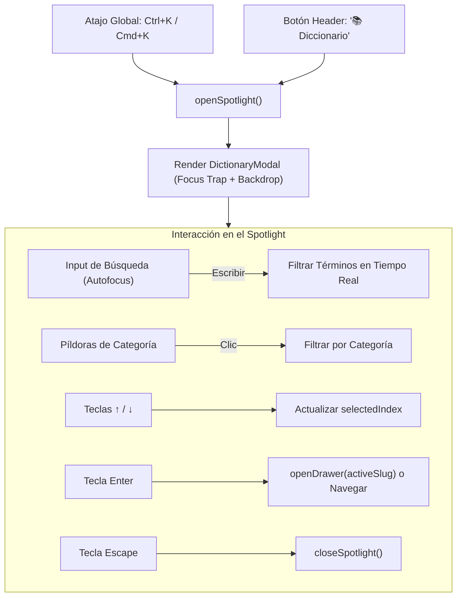

# Especificación Técnica: Fase 2 — Capa de Estado Frontend, API Client y Modal Spotlight (Command Palette)

> **Módulo:** AWS Quest Dictionary (Glosario & Grafo de Conocimiento Arquitectónico)  
> **Fase:** 2 (Frontend Core: Zustand Store, API Client, TanStack Query Hooks, Spotlight Modal & Atajos Globales de Teclado)  
> **Ubicación:** `specs/aws-quest-dictionary/phase-2-frontend-spotlight-modal-spec.md`  
> **Documento de Referencia:** [`docs/22-aws-quest-dictionary-knowledge-base-plan.md`](file:///c:/workspace/aws/aws-game/docs/22-aws-quest-dictionary-knowledge-base-plan.md)  
> **Dependencias:** Fase 1 completada (`specs/aws-quest-dictionary/phase-1-backend-domain-data-api-spec.md`)  
> **Framework:** React 19, TypeScript 5.8, Tailwind CSS, Zustand, TanStack Query (v5), Vitest, Testing Library  
> **Estado:** Listo para Implementación  

---

## 1. Introducción y Objetivos de la Fase 2

La **Fase 2** implementa la experiencia central de búsqueda y acceso inmediato al conocimiento arquitectónico mediante la interfaz **Spotlight / Command Palette** (`Ctrl + K` / `Cmd + K`), permitiendo a los estudiantes y arquitectos consultar cualquier término, servicio o concepto cloud en menos de 100ms sin perder su contexto de navegación o lienzo de trabajo.

### 1.1 Objetivos Clave:
1. **Tipado TypeScript y Cliente API:**
   - Definir los contratos de tipos de frontend en `dictionary.types.ts` acordes a los DTOs del backend.
   - Implementar las funciones de llamada HTTP en `dictionaryApi.ts` utilizando el cliente base autenticado `httpClient`.
2. **Hooks de TanStack Query (`useDictionary.ts`):**
   - Implementar `useDictionaryTerms`, `useDictionaryTermDetail` y `useDictionaryCategories` con configuración de caché inteligente (`staleTime: 5 mins`, `gcTime: 30 mins`).
3. **Gestión de Estado Centralizada (`useDictionaryStore.ts` con Zustand):**
   - Manejar visibilidad del Spotlight modal (`isModalOpen`), Drawer contextual (`isDrawerOpen`), término activo (`activeSlug`), término de búsqueda (`searchQuery`), categoría seleccionada (`selectedCategory`), pilar seleccionado (`selectedPillar`) e índice de navegación por teclado (`selectedIndex`).
4. **Listener Global de Atajos de Teclado:**
   - Detectar `Ctrl + K` y `Cmd + K` en cualquier parte de la aplicación (incluso dentro del Canvas o Modales) para abrir instantáneamente el Spotlight.
5. **Componente `DictionaryModal.tsx` (Command Palette):**
   - Interfaz flotante centrada con fondo desenfocado (backdrop blur) y diseño dark/light mode adaptable.
   - Barra de búsqueda reactiva con autofocus y botón de limpieza.
   - Selector de pestañas de categoría: `[Todos]` `[Servicios AWS]` `[Conceptos Cloud]` `[Redes & Seguridad]` `[Well-Architected]`.
   - Lista de resultados en tiempo real con indicador visual de selección activa, insignias temáticas por categoría/pilar y atajos visuales (`Enter` para abrir detalle, `↑/↓` para navegar, `Esc` para cerrar).
6. **Accesibilidad Integral (WCAG 2.1 AA):**
   - Integración con el hook `useFocusTrap` existente para atrapar el foco dentro del modal.
   - Soporte de roles ARIA (`role="dialog"`, `aria-modal="true"`, `aria-activedescendant`, `role="listbox"`, `role="option"`).
7. **Integración Global:**
   - Incorporar el botón de acceso directo `📚 Diccionario` y el atajo visual `Ctrl+K` en el Header principal de navegación (`RootLayout.tsx`).
8. **Cobertura de Pruebas Automatizadas:**
   - Tests unitarios y de interacción en Vitest para Store, API Client, Hooks y Componentes.

---

## 2. Mapa de Archivos y Arquitectura Frontend

```text
apps/web/src/
├── features/
│   └── dictionary/
│       ├── types/
│       │   └── dictionary.types.ts                         [NEW]
│       ├── api/
│       │   └── dictionaryApi.ts                            [NEW]
│       ├── hooks/
│       │   ├── useDictionary.ts                            [NEW]
│       │   └── __tests__/
│       │       └── useDictionary.test.tsx                  [NEW]
│       ├── stores/
│       │   ├── useDictionaryStore.ts                       [NEW]
│       │   └── __tests__/
│       │       └── useDictionaryStore.test.ts              [NEW]
│       └── components/
│           ├── DictionaryModal.tsx                         [NEW]
│           └── __tests__/
│               └── DictionaryModal.test.tsx                [NEW]
│
├── routes/
│   └── RootLayout.tsx                                      [MODIFY] (Integrar DictionaryModal y botón en Header)
```

---

## 3. Especificación de Tipos y Contratos de Datos

En `apps/web/src/features/dictionary/types/dictionary.types.ts`:

```typescript
export type DictionaryCategory = 'service' | 'concept' | 'infrastructure' | 'well-architected';

export type WellArchitectedPillar =
  | 'OperationalExcellence'
  | 'Security'
  | 'Reliability'
  | 'PerformanceEfficiency'
  | 'CostOptimization'
  | 'Sustainability';

export interface DictionaryTermSummary {
  slug: string;
  title: string;
  category: DictionaryCategory | string;
  serviceCode: string | null;
  pillar: WellArchitectedPillar | null;
  shortDefinition: string;
  associatedChallengesCount: number;
  relatedTermsCount: number;
  displayOrder: number;
}

export interface DictionaryTradeOffs {
  pros: string;
  cons: string;
}

export interface DictionaryRelatedTerm {
  slug: string;
  title: string;
  category: string;
  serviceCode: string | null;
}

export interface DictionaryAssociatedChallenge {
  id: string;
  title: string;
  difficulty: 'Easy' | 'Intermediate' | 'Hard' | 'Integrator';
  baseXP: number;
}

export interface DictionaryTermDetail {
  slug: string;
  title: string;
  category: string;
  serviceCode: string | null;
  pillar: WellArchitectedPillar | null;
  shortDefinition: string;
  whatIs: string;
  whenToUse: string[];
  tradeOffs: DictionaryTradeOffs;
  relatedTerms: DictionaryRelatedTerm[];
  associatedChallenges: DictionaryAssociatedChallenge[];
  displayOrder: number;
}

export interface DictionaryCategoryCount {
  category: string;
  count: number;
  label: string;
}

export interface DictionaryFilterParams {
  search?: string;
  category?: string;
  pillar?: WellArchitectedPillar;
  limit?: number;
  offset?: number;
}
```

---

## 4. Cliente API y Hooks de Consulta (TanStack Query)

### 4.1 Cliente HTTP (`dictionaryApi.ts`)

```typescript
import { httpClient } from '../../../shared/api/httpClient';
import { ApiResponse } from '../../../shared/types/api.types';
import {
  DictionaryCategoryCount,
  DictionaryFilterParams,
  DictionaryTermDetail,
  DictionaryTermSummary,
} from '../types/dictionary.types';

export const dictionaryApi = {
  async getTerms(params?: DictionaryFilterParams): Promise<DictionaryTermSummary[]> {
    const query = new URLSearchParams();
    if (params?.search) query.append('search', params.search);
    if (params?.category) query.append('category', params.category);
    if (params?.pillar) query.append('pillar', params.pillar);
    if (params?.limit) query.append('limit', params.limit.toString());
    if (params?.offset) query.append('offset', params.offset.toString());

    const url = `/api/v1/dictionary${query.toString() ? `?${query.toString()}` : ''}`;
    const response = await httpClient.get<ApiResponse<DictionaryTermSummary[]>>(url);
    return response.data.data;
  },

  async getTermBySlug(slug: string): Promise<DictionaryTermDetail> {
    const response = await httpClient.get<ApiResponse<DictionaryTermDetail>>(`/api/v1/dictionary/${slug}`);
    return response.data.data;
  },

  async getCategories(): Promise<DictionaryCategoryCount[]> {
    const response = await httpClient.get<ApiResponse<DictionaryCategoryCount[]>>('/api/v1/dictionary/categories');
    return response.data.data;
  },
};
```

### 4.2 Hooks de React Query (`useDictionary.ts`)

```typescript
import { useQuery } from '@tanstack/react-query';
import { dictionaryApi } from '../api/dictionaryApi';
import { DictionaryFilterParams } from '../types/dictionary.types';

export const DICTIONARY_QUERY_KEYS = {
  all: ['dictionary'] as const,
  terms: (filters?: DictionaryFilterParams) => ['dictionary', 'terms', filters] as const,
  detail: (slug: string) => ['dictionary', 'detail', slug] as const,
  categories: () => ['dictionary', 'categories'] as const,
};

export function useDictionaryTerms(filters?: DictionaryFilterParams) {
  return useQuery({
    queryKey: DICTIONARY_QUERY_KEYS.terms(filters),
    queryFn: () => dictionaryApi.getTerms(filters),
    staleTime: 1000 * 60 * 5, // 5 minutos de caché fresca
  });
}

export function useDictionaryTermDetail(slug: string | null) {
  return useQuery({
    queryKey: DICTIONARY_QUERY_KEYS.detail(slug ?? ''),
    queryFn: () => dictionaryApi.getTermBySlug(slug!),
    enabled: Boolean(slug),
    staleTime: 1000 * 60 * 10,
  });
}

export function useDictionaryCategories() {
  return useQuery({
    queryKey: DICTIONARY_QUERY_KEYS.categories(),
    queryFn: () => dictionaryApi.getCategories(),
    staleTime: 1000 * 60 * 15,
  });
}
```

---

## 5. Estado Global del Diccionario (`useDictionaryStore.ts`)

```typescript
import { create } from 'zustand';
import { WellArchitectedPillar } from '../types/dictionary.types';

interface DictionaryState {
  // Visibilidad de Vistas
  isModalOpen: boolean;
  isDrawerOpen: boolean;

  // Selección y Búsqueda
  activeSlug: string | null;
  searchQuery: string;
  selectedCategory: string | 'all';
  selectedPillar: WellArchitectedPillar | null;
  selectedIndex: number;

  // Acciones
  openSpotlight: (initialSearch?: string) => void;
  closeSpotlight: () => void;
  toggleSpotlight: () => void;
  
  openDrawer: (slug: string) => void;
  closeDrawer: () => void;

  setSearchQuery: (query: string) => void;
  setSelectedCategory: (category: string | 'all') => void;
  setSelectedPillar: (pillar: WellArchitectedPillar | null) => void;
  setSelectedIndex: (index: number) => void;
  selectNext: (totalItems: number) => void;
  selectPrev: (totalItems: number) => void;
  resetFilters: () => void;
}

export const useDictionaryStore = create<DictionaryState>((set) => ({
  isModalOpen: false,
  isDrawerOpen: false,
  activeSlug: null,
  searchQuery: '',
  selectedCategory: 'all',
  selectedPillar: null,
  selectedIndex: 0,

  openSpotlight: (initialSearch = '') =>
    set({
      isModalOpen: true,
      searchQuery: initialSearch,
      selectedIndex: 0,
    }),

  closeSpotlight: () =>
    set({
      isModalOpen: false,
      searchQuery: '',
      selectedIndex: 0,
    }),

  toggleSpotlight: () =>
    set((state) => ({
      isModalOpen: !state.isModalOpen,
      searchQuery: state.isModalOpen ? '' : state.searchQuery,
      selectedIndex: 0,
    })),

  openDrawer: (slug: string) =>
    set({
      isDrawerOpen: true,
      activeSlug: slug,
    }),

  closeDrawer: () =>
    set({
      isDrawerOpen: false,
      activeSlug: null,
    }),

  setSearchQuery: (searchQuery) =>
    set({
      searchQuery,
      selectedIndex: 0, // Reiniciar cursor de selección al escribir
    }),

  setSelectedCategory: (selectedCategory) =>
    set({
      selectedCategory,
      selectedIndex: 0,
    }),

  setSelectedPillar: (selectedPillar) =>
    set({
      selectedPillar,
      selectedIndex: 0,
    }),

  setSelectedIndex: (selectedIndex) => set({ selectedIndex }),

  selectNext: (totalItems) =>
    set((state) => ({
      selectedIndex: totalItems > 0 ? (state.selectedIndex + 1) % totalItems : 0,
    })),

  selectPrev: (totalItems) =>
    set((state) => ({
      selectedIndex: totalItems > 0 ? (state.selectedIndex - 1 + totalItems) % totalItems : 0,
    })),

  resetFilters: () =>
    set({
      searchQuery: '',
      selectedCategory: 'all',
      selectedPillar: null,
      selectedIndex: 0,
    }),
}));
```

---

## 6. Diseño e Interacción del Componente `DictionaryModal.tsx`



### 6.1 Especificaciones de UI/UX del Spotlight:
1. **Backdrop & Contenedor:**
   - Backdrop semi-transparente oscuro con `backdrop-blur-sm` y animación de entrada suave.
   - Contenedor flotante centrado con ancho `max-w-2xl` y esquinas redondeadas `rounded-2xl`.
   - Borde sutil `border border-slate-700/60 dark:border-slate-800` con sombra difusa `shadow-2xl`.
2. **Barra de Búsqueda:**
   - Icono de lupa `🔍` a la izquierda.
   - Input accesible con placeholder `"Busca un servicio, concepto o pilar... (ej. EC2, S3, SPOF, Fiabilidad)"`.
   - Botón `Limpiar` o `Esc` a la derecha.
3. **Píldoras de Filtro (Tabs Rápidas):**
   - `[✨ Todos]`
   - `[☁️ Servicios AWS]` (`category === 'service'`)
   - `[💡 Conceptos]` (`category === 'concept'`)
   - `[🛡️ Redes & Seguridad]` (`category === 'infrastructure'`)
   - `[📐 Well-Architected]` (`category === 'well-architected'`)
4. **Lista de Resultados & Navegación por Teclado:**
   - Máximo de visualización con scroll suave (`max-h-96 overflow-y-auto`).
   - Cada tarjeta de resultado muestra:
     - Icono temático según categoría o icono SVG del servicio.
     - Título del término con resaltado de coincidencias de texto.
     - Badge de categoría con colores semánticos (ej. Púrpura para Servicios, Azul para Conceptos, Esmeralda para Infraestructura, Ámbar para Well-Architected).
     - Breve resumen de 1 línea (`ShortDefinition`).
     - Badge de desafíos asociados si `associatedChallengesCount > 0`.
   - Cursor de navegación activo: Fondo destacado `bg-primary-500/10 border-l-4 border-primary-500`.
   - Auto-scroll para mantener el elemento seleccionado siempre visible en pantalla.
5. **Pie del Modal (Footer):**
   - Atajos visuales de ayuda: `<kbd>↑</kbd> <kbd>↓</kbd> Navegar` • `<kbd>↵</kbd> Seleccionar` • `<kbd>Esc</kbd> Cerrar`.

---

## 7. Plan de Pruebas Automatizadas (Vitest)

### 7.1 Matriz de Pruebas Frontend:

| Suite de Test | Archivo | Casos de Prueba |
| :--- | :--- | :--- |
| **Zustand Store** | `useDictionaryStore.test.ts` | - Apertura y cierre del modal (`openSpotlight`, `closeSpotlight`, `toggleSpotlight`).<br>- Manejo del término de búsqueda y reinicio automático de `selectedIndex`.<br>- Navegación cíclica con `selectNext` y `selectPrev`.<br>- Apertura y cierre del Drawer con asignación de `activeSlug`. |
| **API Client & Hooks** | `useDictionary.test.tsx` | - `useDictionaryTerms` ejecuta llamada HTTP con parámetros de búsqueda y categoría.<br>- `useDictionaryCategories` recupera la lista de categorías con caché correcta.<br>- `useDictionaryTermDetail` se habilita solo cuando `slug` es no-nulo. |
| **Componente Modal** | `DictionaryModal.test.tsx` | - No renderiza nada cuando `isModalOpen === false`.<br>- Renderiza input con autofocus y lista de términos cuando `isModalOpen === true`.<br>- Filtra la lista en vivo al cambiar el texto de búsqueda.<br>- Filtra por categoría al hacer clic en las píldoras.<br>- Navega con teclas `ArrowDown` y `ArrowUp`.<br>- Al presionar `Enter` en un término, abre el Drawer y cierra el Spotlight.<br>- Cierra el modal al presionar `Escape` o hacer clic en el backdrop. |

---

## 8. Criterios de Aceptación y Definición de Terminado (DoD)

1. [ ] **Tipos e Interfaces Declaradas:** Mapeo completo en `dictionary.types.ts`.
2. [ ] **Store Zustand Reactivo:** `useDictionaryStore.ts` funcional con navegación de teclado circular.
3. [ ] **Atajo Global Integrado:** `Ctrl+K` / `Cmd+K` abre el modal desde cualquier vista de la aplicación.
4. [ ] **Búsqueda Reactiva sin Lag:** Filtrado inmediato con debounce transparente o consulta rápida en memoria / React Query.
5. [ ] **Accesibilidad WCAG 2.1 AA:** Trampa de foco (`useFocusTrap`), atributos ARIA y navegación completa por teclado.
6. [ ] **100% Suites en Verde:** Todos los tests de Vitest (`npm test`) y .NET pasan limpiamente sin errores ni warnings.
