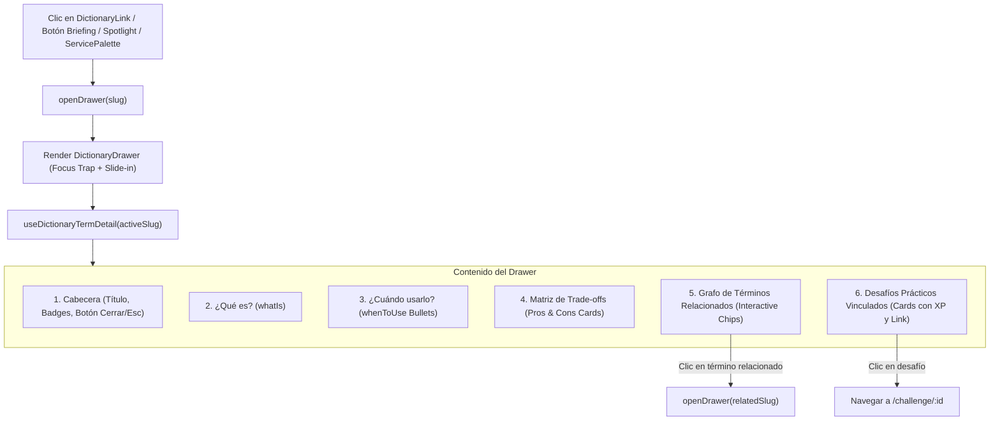

# Especificación Técnica: Fase 3 — Panel Lateral Contextual (DictionaryDrawer), Componente DictionaryLink e Integraciones UI

> **Módulo:** AWS Quest Dictionary (Glosario & Grafo de Conocimiento Arquitectónico)  
> **Fase:** 3 (Deep Dive Drawer, Inline Knowledge Links & Briefing / Workspace Integrations)  
> **Ubicación:** `specs/aws-quest-dictionary/phase-3-frontend-contextual-drawer-integrations-spec.md`  
> **Documento de Referencia:** [`docs/22-aws-quest-dictionary-knowledge-base-plan.md`](file:///c:/workspace/aws/aws-game/docs/22-aws-quest-dictionary-knowledge-base-plan.md)  
> **Dependencias:** Fase 1 (`phase-1-backend-domain-data-api-spec.md`) y Fase 2 (`phase-2-frontend-spotlight-modal-spec.md`) completadas  
> **Framework:** React 19, TypeScript 5.8, Tailwind CSS, TanStack Query (v5), Zustand, Vitest, Testing Library  
> **Estado:** Listo para Implementación  

---

## 1. Justificación y Objetivos de la Fase 3

La **Fase 3** introduce el **Panel Lateral Contextual ("Deep Dive Drawer")**, un componente de exploración técnica exhaustiva que permite al estudiante profundizar en las compensaciones (*Trade-offs*), casos de uso y relaciones topológicas de cualquier servicio o concepto cloud sin salir de su área de trabajo ni tapar el lienzo del canvas arquitectónico.

### 1.1 Objetivos Clave:
1. **Componente `DictionaryDrawer.tsx`:**
   - Panel deslizable desde la derecha (*slide-over*) con animación fluida, fondo difuminado y diseño *glassmorphic*.
   - Presentación estructurada de la ficha técnica:
     - **Cabecera:** Título, badge de categoría con color semántico, pilar Well-Architected y código del servicio.
     - **Sección "¿Qué es?":** Explicación pedagógica detallada (`whatIs`).
     - **Sección "¿Cuándo usarlo?":** Lista de viñetas con casos de uso arquitectónicos reales (`whenToUse`).
     - **Sección de Compensaciones (*Trade-Offs*):** Tarjetas visuales de *Ventajas / Pros* (verde esmeralda) y *Consideraciones y Desventajas / Cons* (ámbar/rosa).
     - **Grafo de Conocimiento (Términos Relacionados):** Chips interactivos de términos vinculados; hacer clic en uno actualiza el drawer con el nuevo término fluidamente.
     - **Desafíos Vinculados:** Tarjetas con dificultad, XP y botón de enlace directo al desafío para poner en práctica el concepto.
2. **Componente Reutilizable `DictionaryLink.tsx`:**
   - Botón/enlace accesible inline para incrustar términos clicables en textos explicativos, descripciones y briefings.
   - Al hacer clic, invoca `openDrawer(slug)` de forma no intrusiva.
3. **Integración en la Experiencia de Aprendizaje:**
   - **`BriefingModal.tsx`:** Botón `📖 Ver en glosario` en cada concepto y componente clave del acordeón.
   - **`ServicePalette.tsx`:** Botón de ayuda/información rápida (`ℹ️` o `Ver ficha`) en los ítems de la paleta de componentes.
   - **`RootLayout.tsx`:** Montaje global de `<DictionaryDrawer />` para disponibilidad universal en toda la aplicación.
4. **Accesibilidad Integral (WCAG 2.1 AA):**
   - Atrapado de foco accesible (`useFocusTrap`) cuando el drawer está activo.
   - Cierre inmediato mediante tecla `Escape` o clic en el backdrop.
   - Atributos ARIA: `role="dialog"`, `aria-modal="true"`, `aria-labelledby`.
5. **Pruebas Automatizadas (Vitest):**
   - Cobertura 100% en `DictionaryDrawer.test.tsx` y `DictionaryLink.test.tsx`.

---

## 2. Mapa de Archivos y Componentes

```text
apps/web/src/
├── features/
│   ├── dictionary/
│   │   ├── components/
│   │   │   ├── DictionaryDrawer.tsx                        [NEW]
│   │   │   ├── DictionaryLink.tsx                          [NEW]
│   │   │   └── __tests__/
│   │   │       ├── DictionaryDrawer.test.tsx               [NEW]
│   │   │       └── DictionaryLink.test.tsx                 [NEW]
│   │
│   ├── challenge/
│   │   └── components/
│   │       ├── BriefingModal.tsx                           [MODIFY] (Añadir botón '📖 Ver en glosario' por concepto/componente)
│   │       ├── ServicePalette.tsx                          [MODIFY] (Añadir botón 'Ver ficha' en items de paleta)
│   │       └── __tests__/
│   │           └── BriefingModal.test.tsx                  [MODIFY]
│   │
├── routes/
│   └── RootLayout.tsx                                      [MODIFY] (Montar <DictionaryDrawer /> globalmente)
```

---

## 3. Especificación Detallada del Componente `DictionaryDrawer.tsx`



### 3.1 Estructura Visual y Secciones del Drawer:
1. **Contenedor Deslizable (*Slide-Over*):**
   - Ubicación: Lateral derecho de la pantalla (`fixed inset-y-0 right-0 z-50`).
   - Ancho: Adaptable responsive (`w-full sm:max-w-xl md:max-w-2xl`).
   - Animación: `transition-transform duration-300 ease-out transform` (`translate-x-0` cuando está abierto, `translate-x-full` cuando está cerrado).
   - Fondo: `bg-white/95 dark:bg-slate-900/95 backdrop-blur-md` con borde izquierdo `border-l border-slate-200 dark:border-slate-800`.
   - Backdrop semi-transparente que permite cerrar al hacer clic fuera.

2. **Cabecera de la Ficha Técnica:**
   - Botón de cierre (`X` o `Esc`) a la derecha con foco accesible.
   - Título grande (`text-xl sm:text-2xl font-black text-slate-900 dark:text-white`).
   - Fila de insignias temáticas:
     - **Categoría:** Badge semántico (Púrpura para Servicios, Azul para Conceptos, Esmeralda para Infraestructura, Ámbar para Well-Architected).
     - **ServiceCode:** (ej. `AWS_EC2`, `NET_VPC`) en fuente monoespaciada.
     - **Pilar Well-Architected:** (ej. `CostOptimization`, `Reliability`).

3. **Cuerpo del Drawer (Scroll Vertical Suave):**
   - **¿Qué es? (`whatIs`):** Párrafos explicativos con tipografía legible y soporte de Markdown ligero.
   - **¿Cuándo usarlo? (`whenToUse`):** Lista con iconos de verificación (`✓`) destacando escenarios reales de arquitectura.
   - **Compensaciones de Diseño (*Trade-Offs*):**
     - Tarjeta de **Ventajas y Puntos Fuertes (Pros):** Fondo verde menta suave (`bg-emerald-50/70 dark:bg-emerald-950/30 border-emerald-200 dark:border-emerald-800/60`), icono `👍 Ventajas Clave`.
     - Tarjeta de **Consideraciones y Limitaciones (Cons):** Fondo ámbar/rosa suave (`bg-amber-50/70 dark:bg-amber-950/30 border-amber-200 dark:border-amber-800/60`), icono `⚠️ Consideraciones y Trade-Offs`.
   - **Grafo de Conocimiento (Términos Relacionados):**
     - Grid de botones o chips interactivos (`DictionaryRelatedTermDto`).
     - Cada chip muestra el icono de categoría y el título del término. Al hacer clic, navega fluidamente al nuevo término dentro del mismo drawer.
   - **Desafíos Prácticos Asociados:**
     - Tarjetas con el título del desafío, nivel de dificultad (`Easy`, `Intermediate`, `Hard`), recompensa de XP (`+100 XP`) y botón directo `Practicar este concepto →` (que redirige al desafío y cierra el drawer).

---

## 4. Especificación del Componente `DictionaryLink.tsx`

Componente ligero para incrustar referencias de glosario en cualquier parte del texto:

```typescript
interface DictionaryLinkProps {
  slug: string;
  label?: string;
  children?: React.ReactNode;
  className?: string;
  showIcon?: boolean;
}
```

- Renderiza un botón accesible inline con estilo de subrayado punteado sutil (`underline decoration-dashed decoration-primary-400 hover:decoration-solid hover:text-primary-600 dark:hover:text-primary-400`).
- Al hacer clic, dispara `openDrawer(slug)` en `useDictionaryStore`.
- Muestra opcionalmente un pequeño icono de libro/flecha `📖`.

---

## 5. Integraciones en la Experiencia de Usuario

### 5.1 `BriefingModal.tsx`
En el acordeón de "Conceptos y Componentes Clave":
- Al lado del título de cada concepto o servicio (ej. *Almacenamiento de objetos*, *Amazon S3*), añadir un botón secundario compacto:
  ```tsx
  <button
    type="button"
    onClick={() => openDrawer(matchedSlug)}
    className="inline-flex items-center gap-1 text-[11px] font-medium text-blue-600 dark:text-blue-400 hover:text-blue-700 dark:hover:text-blue-300 hover:underline ml-2"
    aria-label={`Ver ${item.title} en el glosario`}
  >
    <span>📖 Ver en glosario</span>
  </button>
  ```

### 5.2 `ServicePalette.tsx`
En cada tarjeta de servicio de la paleta lateral del canvas:
- Añadir un botón o icono de información `ℹ️` en la esquina superior de cada tarjeta de servicio que al hacer clic invoque `openDrawer(serviceSlug)` sin interferir con la acción de arrastrar (*drag and drop*) al lienzo.

### 5.3 `RootLayout.tsx`
- Montar `<DictionaryDrawer />` globalmente en el layout raíz para que cualquier componente de la aplicación pueda abrir la ficha técnica inmediatamente.

---

## 6. Plan de Pruebas Automatizadas (Vitest)

### 6.1 Matriz de Pruebas Frontend:

| Componente | Archivo de Test | Casos de Prueba |
| :--- | :--- | :--- |
| **`DictionaryDrawer`** | `DictionaryDrawer.test.tsx` | - No renderiza nada o permanece oculto cuando `isDrawerOpen === false`.<br>- Renderiza skeleton/loader mientras carga la ficha técnica.<br>- Renderiza cabecera, qué es, cuándo usarlo y tarjetas de Trade-Offs cuando los datos están disponibles.<br>- Muestra los chips de términos relacionados y permite hacer clic para cambiar el `activeSlug`.<br>- Muestra los desafíos asociados con badge de XP y botón de navegación.<br>- Cierra el drawer al presionar `Escape`, hacer clic en el botón `X` o en el backdrop. |
| **`DictionaryLink`** | `DictionaryLink.test.tsx` | - Renderiza el texto o hijos correctamente con subrayado accesible.<br>- Al hacer clic, invoca `openDrawer(slug)` con el slug correspondiente. |
| **`BriefingModal`** | `BriefingModal.test.tsx` | - Verifica que los botones `📖 Ver en glosario` estén presentes dentro del acordeón de componentes y que al hacer clic abran el drawer. |

---

## 7. Criterios de Aceptación y Definición de Terminado (DoD)

1. [ ] **`DictionaryDrawer` Desplegable:** Ficha técnica completa con animaciones suaves, desglose de *Pros/Cons*, grafo de términos y desafíos.
2. [ ] **Navegación Fluida en el Grafo:** Hacer clic en un término relacionado dentro del drawer actualiza inmediatamente la ficha al nuevo término.
3. [ ] **Componente `DictionaryLink` Operativo:** Reutilizable en cualquier vista con estilo accesible y disparador no intrusivo.
4. [ ] **Integración en Briefing y Paleta:** Botones de acceso directo al glosario desde el `BriefingModal` y la paleta de servicios del lienzo.
5. [ ] **Accesibilidad WCAG 2.1 AA:** Foco atrapado en el drawer abierto, cierre por teclado con `Esc` y etiquetas ARIA estándar.
6. [ ] **100% Pruebas en Verde:** Todas las suites de prueba de frontend (Vitest) y backend (.NET) aprobadas sin errores.
