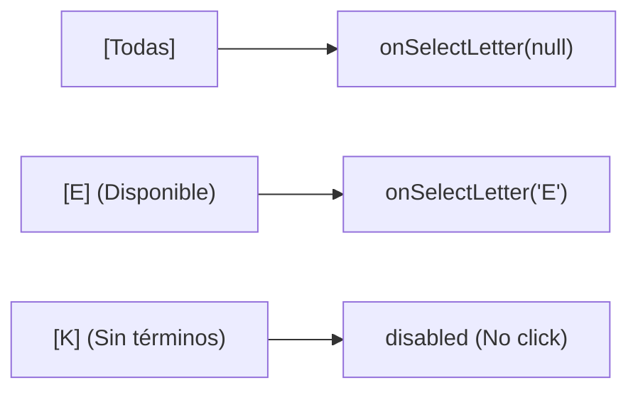

# Especificación Técnica: Fase 4 — Página Completa del Diccionario (/dictionary), Índice A-Z y Explorador Well-Architected

> **Módulo:** AWS Quest Dictionary (Glosario & Base de Conocimiento Arquitectónico)  
> **Fase:** 4 (Full Page Knowledge Base, A-Z Alphabetical Index, Category & Well-Architected Pillar Explorer)  
> **Ubicación:** `specs/aws-quest-dictionary/phase-4-frontend-full-page-spec.md`  
> **Documento de Referencia:** [`docs/22-aws-quest-dictionary-knowledge-base-plan.md`](file:///c:/workspace/aws/aws-game/docs/22-aws-quest-dictionary-knowledge-base-plan.md)  
> **Dependencias:** Fase 1 (`phase-1-backend-domain-data-api-spec.md`), Fase 2 (`phase-2-frontend-spotlight-modal-spec.md`) y Fase 3 (`phase-3-frontend-contextual-drawer-integrations-spec.md`) completadas  
> **Framework:** React 19, TypeScript 5.8, React Router v7 / v6, Tailwind CSS, TanStack Query (v5), Zustand, Vitest, Testing Library  
> **Estado:** Listo para Implementación  

---

## 1. Justificación y Objetivos de la Fase 4

Mientras que el **Spotlight (`Ctrl+K`)** está diseñado para búsquedas rápidas instantáneas y el **Drawer (`DictionaryDrawer`)** para consultas contextuales sin abandonar el área de trabajo, la **Página Completa del Diccionario (`/dictionary`)** ofrece una experiencia inmersiva de estudio, exploración sistemática y referencia continua para estudiantes y arquitectos cloud.

```
┌────────────────────────────────────────────────────────────────────────────────┐
│ 📚 Base de Conocimiento & Diccionario AWS Quest                                │
│ Explora servicios, patrones de diseño y los 6 pilares de Well-Architected      │
│                                                                                │
│ [ 🔍 Buscar servicio, concepto o pilar...                            ] [Filtros]│
│                                                                                │
│ Categorías: [Todos (75)] [Servicios AWS] [Conceptos] [Redes/Seguridad] [WAF]  │
│ Pilares WAF: [🛡️ Seguridad] [⚡ Fiabilidad] [🚀 Rendimiento] [💰 Costos] ...  │
├────────────────────────────────────────────────────────────────────────────────┤
│ Índice A-Z: [Todos] [A] [B] [C] [D] [E] [F] [G] ... [S] [T] [V] [W] [Z]       │
├────────────────────────────────────────────────────────────────────────────────┤
│  ┌──────────────────────┐ ┌──────────────────────┐ ┌──────────────────────┐   │
│  │ 💻 Amazon EC2        │ │ 🪣 Amazon S3         │ │ 🌐 Amazon VPC        │   │
│  │ Compute · AWS_EC2    │ │ Storage · AWS_S3     │ │ Network · NET_VPC    │   │
│  │ Capacidad de cómputo │ │ Almacenamiento de    │ │ Red virtual aislada  │   │
│  │ escalable en la nube.│ │ objetos con 99.9999% │ │ para tus recursos.   │   │
│  │ [Fiabilidad] [Costos]│ │ [Seguridad] [Costos] │ │ [Seguridad]          │   │
│  │ [Ver Ficha Técnica →]│ │ [Ver Ficha Técnica →]│ │ [Ver Ficha Técnica →]│   │
│  └──────────────────────┘ └──────────────────────┘ └──────────────────────┘   │
└────────────────────────────────────────────────────────────────────────────────┘
```

### 1.1 Objetivos Principales:
1. **Ruta `/dictionary` en React Router:**
   - Registrar la ruta dedicada en `apps/web/src/routes/index.tsx` bajo el `RootLayout`.
   - Soporte de enlaces de navegación activos en el Header persistente (`Catálogo` vs `Diccionario`).
2. **Componente de Página Principal `DictionaryPage.tsx`:**
   - **Hero Section:** Título pedagógico, descripción motivacional y contador reactivo de términos disponibles.
   - **Buscador Reactivo Integrado:** Barra de búsqueda con limpieza rápida (`✕`), debounce y sincronización con el store global y parámetros de URL opcionales (`?q=...&cat=...`).
   - **Barra de Filtrado por Categorías & Pilares Well-Architected:** Píldoras interactivas con conteos en vivo y estados activos destacados en tonos ámbar y azul cielo.
   - **Índice Alfabético Rápido (A-Z Quick Bar):** Barra de navegación con letras activas/deshabilitadas según disponibilidad de términos para salto inmediato.
   - **Grid Responsivo de Tarjetas de Términos (`DictionaryTermCard.tsx`):**
     - Icono temático según categoría.
     - Título oficial, código de servicio y categoría semántica.
     - Resumen conciso (`summary`).
     - Badges de pilares Well-Architected asociados (`wellArchitectedPillars`).
     - Botón de acción directo para abrir la ficha completa en el `DictionaryDrawer`.
   - **Estados de Carga, Error y Vacío (Empty State):** Skeleton loaders durante peticiones y diseño ilustrado con botón "Limpiar Filtros" si no hay coincidencias.
3. **Navegación Fluida con el Drawer y Desafíos:**
   - Al hacer clic en cualquier tarjeta, se abre el `DictionaryDrawer` contextual manteniendo la vista actual.
4. **Accesibilidad Integral (WCAG 2.1 AA):**
   - Encabezados semánticos (`h1`, `h2`, `h3`), etiquetas `aria-label`, estados `aria-selected` en filtros alfabéticos y de categoría.
5. **Pruebas Automatizadas en Vitest:**
   - Cobertura de interacción completa para `DictionaryPage.test.tsx` y `DictionaryTermCard.test.tsx`.

---

## 2. Mapa de Archivos e Impacto

```text
apps/web/src/
├── features/
│   ├── dictionary/
│   │   ├── components/
│   │   │   ├── DictionaryAlphabetBar.tsx                   [NEW] (Barra de índice A-Z interactiva)
│   │   │   ├── DictionaryTermCard.tsx                      [NEW] (Tarjeta visual de término para el catálogo)
│   │   │   ├── DictionaryPillarsFilter.tsx                 [NEW] (Selector de pilares Well-Architected)
│   │   │   └── __tests__/
│   │   │       ├── DictionaryAlphabetBar.test.tsx          [NEW]
│   │   │       └── DictionaryTermCard.test.tsx             [NEW]
│   │   ├── pages/
│   │   │   ├── DictionaryPage.tsx                          [NEW] (Página principal /dictionary)
│   │   │   └── __tests__/
│   │   │       └── DictionaryPage.test.tsx                 [NEW]
│   │   └── stores/
│   │       └── useDictionaryStore.ts                       [MODIFY] (Soporte para filtro de letra inicial y pilar WAF)
│   │
├── routes/
│   ├── index.tsx                                           [MODIFY] (Registrar ruta /dictionary)
│   └── RootLayout.tsx                                      [MODIFY] (Añadir enlace de navegación activa al Header)
```

---

## 3. Especificación Técnica de Componentes

### 3.1 `DictionaryAlphabetBar.tsx`
Componente accesible para filtrar o saltar por letra inicial:
- **Props:**
  - `selectedLetter: string | null` (e.g. `'A'`, `'E'`, o `null` para Todas).
  - `onSelectLetter: (letter: string | null) => void`.
  - `availableLetters: Set<string>` (letras que tienen al menos 1 término registrado).
- **Comportamiento:**
  - Renderiza botón `[Todas]` seguido de las letras `A-Z` (26 letras).
  - Si una letra no tiene términos disponibles, se muestra con opacidad reducida (`opacity-40 cursor-not-allowed`) y `disabled`.
  - La letra seleccionada se destaca con fondo `bg-amber-500 text-slate-950 font-bold shadow-md shadow-amber-500/20`.



---

### 3.2 `DictionaryTermCard.tsx`
Tarjeta interactiva para el grid de la página:
- **Props:**
  - `term: DictionaryTermSummaryDto`.
  - `onOpenDetail: (slug: string) => void`.
- **Estructura Visual:**
  - **Fondo:** `bg-white dark:bg-slate-900 border border-slate-200 dark:border-slate-800 rounded-2xl p-5 hover:border-amber-500/60 dark:hover:border-amber-500/60 transition-all shadow-sm hover:shadow-md hover:-translate-y-0.5 group cursor-pointer`.
  - **Cabecera de Tarjeta:**
    - Icono de categoría con fondo redondeado (`bg-slate-100 dark:bg-slate-800`).
    - Título (`term.title`) con hover `group-hover:text-amber-500`.
    - Badge de categoría con color semántico (Compute = azul, Storage = verde, Security = rojo, etc.).
  - **Cuerpo:**
    - Resumen conciso (`term.summary`) limitado a 2-3 líneas (`line-clamp-2 text-slate-600 dark:text-slate-400 text-sm`).
  - **Pie de Tarjeta:**
    - Badges de pilares Well-Architected (`wellArchitectedPillars`).
    - Indicador de acción `"Ver ficha →"` con icono flecha animada en hover.

---

### 3.3 `DictionaryPillarsFilter.tsx`
Filtro temático para los 6 pilares de AWS Well-Architected Framework:
- **Pilares Soportados:**
  1. `Operational Excellence` (Excelencia Operativa) ⚙️
  2. `Security` (Seguridad) 🛡️
  3. `Reliability` (Fiabilidad) ⚡
  4. `Performance Efficiency` (Eficiencia del Rendimiento) 🚀
  5. `Cost Optimization` (Optimización de Costos) 💰
  6. `Sustainability` (Sostenibilidad) 🌱
- **Comportamiento:**
  - Permite filtrar términos que aporten o pertenezcan a uno de los pilares seleccionados.
  - Botón toggleable tipo pill / chip con icono y texto.

---

### 3.4 `DictionaryPage.tsx`
Página centralizada en `apps/web/src/features/dictionary/pages/DictionaryPage.tsx`:
- **Hooks:**
  - `useDictionaryTerms({ search, category })` (TanStack Query).
  - `useDictionaryCategories()` (TanStack Query).
  - `useDictionaryStore()` para abrir el drawer y sincronizar filtros.
- **Lógica de Filtrado Compuesto en Cliente:**
  1. Filtro por búsqueda textual (`title`, `summary`, `serviceCode`, `tags`).
  2. Filtro por categoría (`activeCategory`).
  3. Filtro por pilar Well-Architected (`activePillar`).
  4. Filtro por letra inicial (`selectedLetter`).
- **Layout:**
  - `max-w-7xl mx-auto px-4 sm:px-6 lg:px-8 py-8 w-full`.
  - Hero Header con buscador central.
  - Barra de categorías + Pilares WAF en acordeón o sub-barra.
  - Barra alfabética interactiva.
  - Grid de tarjetas: `grid grid-cols-1 md:grid-cols-2 lg:grid-cols-3 gap-5`.
  - Contador de resultados: `"Mostrando X de Y términos"`.

---

### 3.5 Extensiones a `useDictionaryStore.ts`
Se agregarán selectores y acciones para soportar los nuevos filtros de la página sin romper la compatibilidad con el modal Spotlight:

```typescript
interface DictionaryState {
  isSpotlightOpen: boolean;
  isDrawerOpen: boolean;
  activeSlug: string | null;
  searchQuery: string;
  selectedCategory: string | null;
  selectedPillar: string | null;
  selectedLetter: string | null;

  // Acciones
  openSpotlight: () => void;
  closeSpotlight: () => void;
  openDrawer: (slug: string) => void;
  closeDrawer: () => void;
  setSearchQuery: (query: string) => void;
  setSelectedCategory: (category: string | null) => void;
  setSelectedPillar: (pillar: string | null) => void;
  setSelectedLetter: (letter: string | null) => void;
  resetFilters: () => void;
}
```

---

### 3.6 Actualización de Rutas y Header Global

#### 1. `apps/web/src/routes/index.tsx`
```tsx
import { DictionaryPage } from '../features/dictionary/pages/DictionaryPage';

export const router = createBrowserRouter([
  {
    path: '/',
    element: <RootLayout />,
    errorElement: <RootErrorBoundary />,
    children: [
      { index: true, element: <Navigate to="/catalog" replace /> },
      { path: 'catalog', element: <CatalogPage /> },
      { path: 'challenges/:id', element: <ChallengePage /> },
      { path: 'dictionary', element: <DictionaryPage /> }, // <-- NUEVA RUTA
      { path: 'login', element: <LoginPage /> },
      { path: 'register', element: <RegisterPage /> },
      { path: '*', element: <NotFoundPage /> }
    ]
  }
]);
```

#### 2. `apps/web/src/routes/RootLayout.tsx`
Añadir navegación entre el catálogo y el glosario en el header:
- Links de navegación:
  - `Desafíos` (`/catalog`)
  - `Glosario` (`/dictionary`)
- Mantener el botón Spotlight `Ctrl+K` a la derecha como atajo universal.

---

## 4. Plan de Pruebas Automatizadas (Vitest)

### 4.1 `DictionaryPage.test.tsx`
1. **Renderizado Inicial:**
   - Renderiza el título de la página, hero section, buscador y grid de términos.
   - Muestra el contador total de términos disponibles.
2. **Filtrado por Búsqueda:**
   - Al escribir `"EC2"` en el input, filtra correctamente las tarjetas visibles a sólo términos coincidentes.
3. **Filtrado por Categoría:**
   - Al hacer clic en la píldora `"Storage"`, filtra las tarjetas mostrando únicamente las de almacenamiento.
4. **Filtrado Alfabético (A-Z):**
   - Al hacer clic en la letra `'S'`, muestra únicamente términos que inician con 'S' (e.g., S3, SQS, SNS).
5. **Filtrado por Pilar Well-Architected:**
   - Al seleccionar `'Seguridad'`, muestra los términos asociados a dicho pilar.
6. **Apertura de Drawer Contextual:**
   - Al hacer clic en una tarjeta de término, invoca `openDrawer(slug)` abriendo el `DictionaryDrawer`.
7. **Empty State:**
   - Al ingresar una búsqueda sin resultados, muestra el mensaje amigable de "Sin resultados" y un botón "Limpiar Filtros" que restaura la vista.

### 4.2 `DictionaryAlphabetBar.test.tsx`
1. Renderiza las 26 letras y el botón "Todas".
2. Deshabilita letras sin términos disponibles.
3. Dispara callback `onSelectLetter` con la letra seleccionada.

### 4.3 `DictionaryTermCard.test.tsx`
1. Renderiza correctamente el título, categoría, resumen y badges WAF.
2. Dispara `onOpenDetail` al hacer clic en la tarjeta o botón de acción.

---

## 5. Criterios de Aceptación y Definición de Terminado (DoD)

- [ ] Ruta `/dictionary` accesible y registrada en React Router.
- [ ] Enlace de navegación persistente en el Header de `RootLayout.tsx`.
- [ ] Barra de búsqueda con filtrado reactivo en tiempo real.
- [ ] Barra alfabética interactiva A-Z con estados activos y deshabilitados automáticos.
- [ ] Filtro por categorías y pilares Well-Architected funcional.
- [ ] Integración perfecta con `DictionaryDrawer` al seleccionar cualquier tarjeta.
- [ ] Soporte completo de tema oscuro/claro y diseño responsive para móviles, tablets y desktop.
- [ ] Accesibilidad WCAG 2.1 AA (semántica HTML5, contraste AAA, focus rings visibles).
- [ ] 100% pruebas de Vitest aprobadas en la suite de pruebas del frontend.
