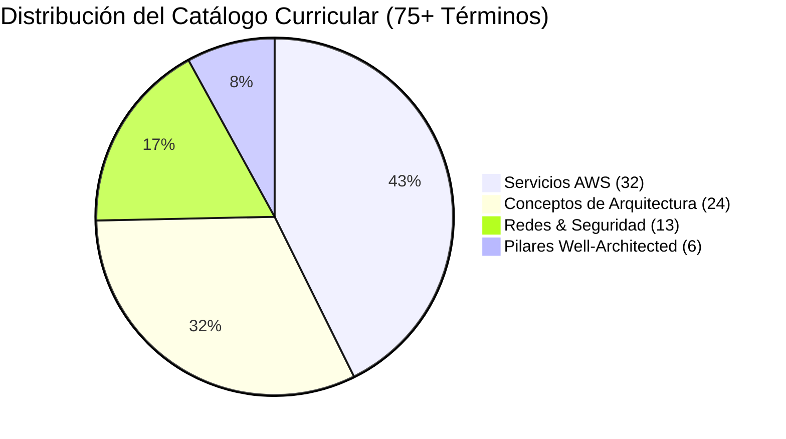

# Especificación Técnica: Fase 5 — Curación Curricular Exhaustiva & Grafo de Conocimiento Arquitectónico (75+ Términos)

> **Módulo:** AWS Quest Dictionary (Base de Conocimiento & Grafo Curricular)  
> **Fase:** 5 (Curated Curriculum Dataset, Comprehensive Technical Encyclopedia & Pedagogical Graph Validation)  
> **Ubicación:** `specs/aws-quest-dictionary/phase-5-curriculum-content-knowledge-graph-spec.md`  
> **Documento de Referencia:** [`docs/22-aws-quest-dictionary-knowledge-base-plan.md`](file:///c:/workspace/aws/aws-game/docs/22-aws-quest-dictionary-knowledge-base-plan.md)  
> **Dependencias:** Fase 1 a 4 completadas  
> **Formato de Datos:** JSON Declarativo (`content/dictionary/terms.json`), C# Seeder EF Core, TypeScript Types  
> **Estado:** Listo para Implementación  

---

## 1. Justificación y Objetivos de la Fase 5

Con la infraestructura de Backend (.NET 10), el Modal Spotlight (`Ctrl+K`), el Panel Deslizable (`DictionaryDrawer`) y la Página Completa (`/dictionary`) 100% implementados y probados, la **Fase 5** se enfoca en el **activo pedagógico central**: poblar y validar el catálogo exhaustivo de **75+ términos y conceptos clave de arquitectura en la nube**.

El objetivo es transformar el glosario en una **enciclopedia interactiva y grafo de conocimiento vivo**, donde cada servicio, patrón de diseño y principio del *Well-Architected Framework* esté rigurosamente definido, estructurado y vinculado a los desafíos y escenarios de práctica de AWS Quest.



### 1.1 Objetivos Clave:
1. **Redacción Técnica de Alta Calidad Pedagógica:**
   - Definiciones breves y precisas (`shortDefinition` / `summary`).
   - Explicación conceptual profunda de "¿Qué es?" (`whatIs`).
   - Casos de uso de la vida real ("¿Cuándo usarlo?") (`whenToUse`).
   - Análisis de compensaciones de arquitectura (*Trade-offs: Pros y Cons*) (`tradeOffs`).
2. **Grafo de Conocimiento Bidireccional (`relatedTermSlugs`):**
   - Asegurar que no existan enlaces rotos (slugs inexistentes en las relaciones).
   - Cohesión temática (ej. `amazon-sqs` ↔ `desacoplamiento-asincrono` ↔ `patron-fan-out` ↔ `aws-lambda`).
3. **Asociación Directa con Desafíos de AWS Quest (`associatedChallengeIds`):**
   - Vincular cada término con los desafíos prácticos correspondientes dentro de las 12 Unidades temáticas.
4. **Validación Automatizada de Integridad de Datos:**
   - Test unitario de backend que verifique la ausencia de duplicados, validez de slugs, consistencia de pilares WAF y resolución de términos relacionados.

---

## 2. Taxonomía y Distribución Curricular de los 75+ Términos

### 2.1 Categoría 1: Servicios AWS (`service` - 32 Términos)

| # | Slug | Título | Service Code | Pilar Principal |
|---|------|--------|--------------|-----------------|
| 1 | `amazon-ec2` | Amazon EC2 | `AWS_EC2` | Cost Optimization |
| 2 | `amazon-s3` | Amazon S3 | `AWS_S3` | Reliability |
| 3 | `amazon-rds` | Amazon RDS | `AWS_RDS` | Reliability |
| 4 | `amazon-dynamodb` | Amazon DynamoDB | `AWS_DYNAMODB` | Performance Efficiency |
| 5 | `amazon-vpc` | Amazon VPC | `NET_VPC` | Security |
| 6 | `amazon-cloudfront` | Amazon CloudFront | `AWS_CLOUDFRONT` | Performance Efficiency |
| 7 | `amazon-route-53` | Amazon Route 53 | `AWS_ROUTE53` | Reliability |
| 8 | `application-load-balancer` | Application Load Balancer (ALB) | `AWS_ALB` | Reliability |
| 9 | `network-load-balancer` | Network Load Balancer (NLB) | `AWS_NLB` | Performance Efficiency |
| 10 | `auto-scaling-group` | Auto Scaling Group (ASG) | `AWS_ASG` | Reliability |
| 11 | `amazon-ebs` | Amazon Elastic Block Store (EBS) | `AWS_EBS` | Reliability |
| 12 | `amazon-efs` | Amazon Elastic File System (EFS) | `AWS_EFS` | Reliability |
| 13 | `aws-lambda` | AWS Lambda | `AWS_LAMBDA` | Cost Optimization |
| 14 | `amazon-api-gateway` | Amazon API Gateway | `AWS_APIGW` | Performance Efficiency |
| 15 | `amazon-sqs` | Amazon Simple Queue Service (SQS) | `AWS_SQS` | Reliability |
| 16 | `amazon-sns` | Amazon Simple Notification Service (SNS) | `AWS_SNS` | Reliability |
| 17 | `amazon-eventbridge` | Amazon EventBridge | `AWS_EVENTBRIDGE` | Operational Excellence |
| 18 | `amazon-ecs` | Amazon Elastic Container Service (ECS) | `AWS_ECS` | Performance Efficiency |
| 19 | `aws-fargate` | AWS Fargate | `AWS_FARGATE` | Operational Excellence |
| 20 | `aws-waf` | AWS WAF (Web Application Firewall) | `AWS_WAF` | Security |
| 21 | `aws-secrets-manager` | AWS Secrets Manager | `AWS_SECRETS` | Security |
| 22 | `amazon-cloudwatch` | Amazon CloudWatch | `AWS_CLOUDWATCH` | Operational Excellence |
| 23 | `aws-cloudtrail` | AWS CloudTrail | `AWS_CLOUDTRAIL` | Security |
| 24 | `aws-cloudformation` | AWS CloudFormation | `AWS_CLOUDFORMATION` | Operational Excellence |
| 25 | `amazon-elasticache` | Amazon ElastiCache (Redis/Memcached) | `AWS_ELASTICACHE` | Performance Efficiency |
| 26 | `amazon-aurora` | Amazon Aurora | `AWS_AURORA` | Performance Efficiency |
| 27 | `aws-step-functions` | AWS Step Functions | `AWS_STEPFUNCTIONS` | Reliability |
| 28 | `aws-kms` | AWS Key Management Service (KMS) | `AWS_KMS` | Security |
| 29 | `aws-iam` | AWS Identity and Access Management (IAM) | `AWS_IAM` | Security |
| 30 | `amazon-athena` | Amazon Athena | `AWS_ATHENA` | Cost Optimization |
| 31 | `amazon-opensearch` | Amazon OpenSearch Service | `AWS_OPENSEARCH` | Performance Efficiency |
| 32 | `amazon-cognito` | Amazon Cognito | `AWS_COGNITO` | Security |

---

### 2.2 Categoría 2: Conceptos y Patrones de Arquitectura (`concept` - 24 Términos)

| # | Slug | Título | Pilar Principal |
|---|------|--------|-----------------|
| 33 | `alta-disponibilidad` | Alta Disponibilidad (High Availability) | Reliability |
| 34 | `escalabilidad-horizontal` | Escalabilidad Horizontal (Scale-Out) | Reliability |
| 35 | `escalabilidad-vertical` | Escalabilidad Vertical (Scale-Up) | Cost Optimization |
| 36 | `single-point-of-failure` | Punto Único de Falla (SPOF) | Reliability |
| 37 | `desacoplamiento-asincrono` | Desacoplamiento Asíncrono | Reliability |
| 38 | `patron-fan-out` | Patrón Fan-Out (SNS + SQS) | Reliability |
| 39 | `stateless-vs-stateful` | Arquitecturas Stateless vs Stateful | Reliability |
| 40 | `caching-perimetral` | Caching Perimetral (Edge Caching) | Performance Efficiency |
| 41 | `disaster-recovery-rpo-rto` | Recuperación ante Desastres (RPO & RTO) | Reliability |
| 42 | `patron-strangler-fig` | Patrón Strangler Fig (Monolito a Microservicios) | Operational Excellence |
| 43 | `idempotencia` | Idempotencia en Mensajería | Reliability |
| 44 | `multi-az-replication` | Replicación Síncrona Multi-AZ | Reliability |
| 45 | `read-replicas` | Réplicas de Lectura (Read Replicas) | Performance Efficiency |
| 46 | `event-driven-architecture` | Arquitectura Orientada a Eventos (EDA) | Reliability |
| 47 | `microservicios-serverless` | Microservicios Serverless | Cost Optimization |
| 48 | `patron-circuit-breaker` | Patrón Circuit Breaker | Reliability |
| 49 | `patron-bulkhead` | Patrón Bulkhead (Aislamiento de Fallas) | Reliability |
| 50 | `throttling-rate-limiting` | Throttling y Rate Limiting | Reliability |
| 51 | `blue-green-deployment` | Despliegues Blue/Green | Operational Excellence |
| 52 | `canary-deployment` | Despliegues Canary (Canario) | Operational Excellence |
| 53 | `cqrs-pattern` | Patrón CQRS (Command Query Responsibility Segregation) | Performance Efficiency |
| 54 | `zero-trust-architecture` | Arquitectura Zero Trust | Security |
| 55 | `least-privilege-principle` | Principio de Menor Privilegio (PoLP) | Security |
| 56 | `database-sharding` | Fragmentación de Bases de Datos (Sharding) | Performance Efficiency |

---

### 2.3 Categoría 3: Redes e Infraestructura Cloud (`infrastructure` - 13 Términos)

| # | Slug | Título | Service Code | Pilar Principal |
|---|------|--------|--------------|-----------------|
| 57 | `subnet-publica` | Subred Pública (Public Subnet) | `NET_SUBNET_PUB` | Security |
| 58 | `subnet-privada` | Subred Privada (Private Subnet) | `NET_SUBNET_PRIV` | Security |
| 59 | `internet-gateway` | Internet Gateway (IGW) | `NET_IGW` | Reliability |
| 60 | `nat-gateway` | NAT Gateway | `NET_NATGW` | Security |
| 61 | `security-group` | Security Group (Firewall Stateful) | `SEC_SG` | Security |
| 62 | `network-acl` | Network Access Control List (NACL Stateless) | `SEC_NACL` | Security |
| 63 | `route-table` | Tabla de Enrutamiento (Route Table) | `NET_RT` | Reliability |
| 64 | `bastion-host` | Bastion Host (Jump Box) | `SEC_BASTION` | Security |
| 65 | `vpc-peering` | Conexión de Interconexión de VPC (VPC Peering) | `NET_PEERING` | Performance Efficiency |
| 66 | `transit-gateway` | AWS Transit Gateway | `NET_TGW` | Operational Excellence |
| 67 | `cidr-block` | Bloque CIDR e Inter-Domain Routing | `NET_CIDR` | Security |
| 68 | `target-group-health-checks` | Target Groups & Health Checks | `NET_TG` | Reliability |
| 69 | `vpc-endpoint-privatelink` | VPC Endpoints & AWS PrivateLink | `NET_VPCE` | Security |

---

### 2.4 Categoría 4: Pilares de AWS Well-Architected Framework (`well-architected` - 6 Términos)

| # | Slug | Título | Pilar Principal |
|---|------|--------|-----------------|
| 70 | `excelencia-operativa` | Pilar 1: Excelencia Operativa (Operational Excellence) | Operational Excellence |
| 71 | `seguridad-cloud` | Pilar 2: Seguridad en la Nube (Security) | Security |
| 72 | `fiabilidad` | Pilar 3: Fiabilidad y Resiliencia (Reliability) | Reliability |
| 73 | `eficiencia-rendimiento` | Pilar 4: Eficiencia del Rendimiento (Performance Efficiency) | Performance Efficiency |
| 74 | `optimizacion-costos` | Pilar 5: Optimización de Costos (Cost Optimization) | Cost Optimization |
| 75 | `sostenibilidad` | Pilar 6: Sostenibilidad Ambiental (Sustainability) | Sustainability |

---

## 3. Estructura Estándar de Contenido por Término

Cada término en `content/dictionary/terms.json` debe cumplir estrictamente la siguiente estructura:

```json
{
  "slug": "amazon-eventbridge",
  "title": "Amazon EventBridge",
  "category": "service",
  "serviceCode": "AWS_EVENTBRIDGE",
  "pillar": "OperationalExcellence",
  "shortDefinition": "Bus de eventos serverless que simplifica la arquitectura orientada a eventos enrutando datos entre fuentes y destinos.",
  "whatIs": "Amazon EventBridge es un servicio de bus de eventos serverless que facilita la conexión de aplicaciones utilizando datos de sus propias aplicaciones, aplicaciones SaaS integradas y servicios de AWS. Permite desacoplar productores y consumidores mediante reglas declarativas de filtrado y enrutamiento con latencia casi nula.",
  "whenToUse": [
    "Coreografía de arquitecturas orientadas a eventos (EDA) desacopladas y escalables.",
    "Reaccionar automáticamente a cambios de estado en servicios de AWS (ej. cambios en S3, CloudTrail o ECS).",
    "Integración directa con aplicaciones SaaS de terceros sin escribir código de polling continuo."
  ],
  "tradeOffs": {
    "pros": "Filtrado avanzado de contenido de eventos (JSON Schema matching), más de 200 fuentes y destinos nativos, integración serverless sin servidores que administrar.",
    "cons": "Límites de throughput predeterminados que requieren cuotas ajustadas en cargas extremas; no garantiza ordenación estricta global como una partición de Kinesis o cola FIFO."
  },
  "relatedTermSlugs": [
    "event-driven-architecture",
    "desacoplamiento-asincrono",
    "amazon-sns",
    "amazon-sqs",
    "aws-lambda"
  ],
  "associatedChallengeIds": [
    "ch-event-driven-pipeline",
    "ch-serverless-notification"
  ],
  "displayOrder": 17
}
```

---

## 4. Estrategia de Validación y Aseguramiento de Calidad

Para garantizar que el dataset no presente incoherencias:

1. **Test Automatizado de Grafo en Backend (`DictionaryCurriculumTests.cs`):**
   - **Conteo mínimo**: Asegurar que existen al menos 75 términos cargados.
   - **Unicidad**: Slugs, títulos y `displayOrder` únicos sin duplicaciones.
   - **Integridad Referencial de Relaciones**: Todo slug presente en `relatedTermSlugs` DEBE existir como término registrado en el catálogo.
   - **Campos Obligatorios No Vacíos**: `slug`, `title`, `category`, `pillar`, `shortDefinition`, `whatIs`, `whenToUse` (>= 2 elementos), `tradeOffs.pros`, `tradeOffs.cons`.
   - **Validez de Pilares WAF**: Pertenencia estricta a los 6 pilares de `WellArchitectedPillar`.

2. **Sincronización Idempotente con la Base de Datos:**
   - La ejecución de `ChallengeSeeder.SeedAsync()` actualiza o inserta los 75+ términos en `DictionaryTerms` de SQLite/PostgreSQL sin duplicar registros.

---

## 5. Criterios de Aceptación y Definición de Terminado (DoD)

- [ ] Catálogo `content/dictionary/terms.json` actualizado con los **75 términos curriculares**.
- [ ] Grafo de términos relacionados 100% libre de referencias rotas o slugs inexistentes.
- [ ] Cada término cuenta con explicaciones técnicas completas (`whatIs`, `whenToUse`, `tradeOffs`).
- [ ] Test unitario `DictionaryCurriculumTests.cs` implementado y pasando en .NET 10.
- [ ] Ejecución exitosa de `dotnet test` y `npm run test` con 100% de suites en verde.
