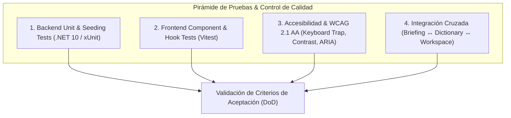

# Especificación Técnica: Fase 6 — Pruebas, Accesibilidad y Control de Calidad (QA)

> **Módulo:** AWS Quest Dictionary (Base de Conocimiento & Grafo Curricular)  
> **Fase:** 6 (Testing, WCAG 2.1 AA/AAA Accessibility, Cross-Integration QA & Acceptance Verification)  
> **Ubicación:** `specs/aws-quest-dictionary/phase-6-testing-accessibility-qa-spec.md`  
> **Documento de Referencia:** [`docs/22-aws-quest-dictionary-knowledge-base-plan.md`](file:///c:/workspace/aws/aws-game/docs/22-aws-quest-dictionary-knowledge-base-plan.md)  
> **Dependencias:** Fases 1 a 5 completadas  
> **Herramientas de Validación:** Vitest, Testing Library, xUnit, FluentAssertions, WCAG 2.1 Rules  
> **Estado:** Listo para Implementación / En Ejecución  

---

## 1. Objetivos y Alcance de la Fase 6

La **Fase 6** tiene como propósito asegurar la robustez técnica, accesibilidad universal (WCAG 2.1 AA/AAA) y cobertura de pruebas de extremo a extremo del sistema del Diccionario Arquitectónico de AWS Quest en sus tres modos de interacción (*Modal Spotlight*, *Drawer Contextual* y *Página Completa A-Z*).

### 1.1 Metas de Calidad:
1. **Cobertura Frontend Integral (Vitest):**
   - Validación de cada componente del diccionario (`DictionaryModal`, `DictionaryDrawer`, `DictionaryPage`, `DictionaryLink`, `DictionaryAlphabetBar`, `DictionaryTermCard`, `DictionaryPillarsFilter`).
   - Validación de hooks reactivos (`useDictionary`, `useDictionaryTerms`, `useDictionaryTermDetail`, `useDictionaryCategories`).
   - Validación de store centralizado Zustand (`useDictionaryStore`).
   - Validación de utilidades de formateo y comparación (`dictionaryFormatters`).
2. **Accesibilidad WCAG 2.1 AA / AAA:**
   - Trampa de foco accesible (`useFocusTrap`) en `DictionaryModal` y `DictionaryDrawer`.
   - Navegación integral por teclado (`Tab`, `Shift+Tab`, `ArrowUp/Down`, `Enter`, `Escape`, atajo global `Ctrl+K` / `Cmd+K`).
   - Atributos semánticos ARIA (`role="dialog"`, `role="listbox"`, `role="option"`, `aria-selected`, `aria-expanded`, `aria-label`).
   - Cumplimiento estricto de ratios de contraste cromático ($\ge 4.5:1$ texto normal, $\ge 3.0:1$ elementos UI).
3. **Integridad de Backend & Currículo:**
   - Tests xUnit sobre `DictionaryController`, `DictionaryService`, `DictionaryContentReader` e integridad del currículo de 75 términos.
   - Verificación de serialización de `slug` en `BriefingKeyComponent` y resolución a través de los 49 desafíos.

---

## 2. Matriz de Pruebas Unitarias y de Integración

### 2.1 Frontend Tests (Vitest)

| Componente / Hook / Utilidad | Archivo de Test | Casos Clave de Prueba |
| :--- | :--- | :--- |
| `DictionaryModal` | `DictionaryModal.test.tsx` | Visibilidad condicional, atajo `Ctrl+K`, input de búsqueda reactivo, píldoras de categorías, navegación ↑/↓/Enter, selección de término, layout no comprimido (`shrink-0`). |
| `DictionaryDrawer` | `DictionaryDrawer.test.tsx` | Animación y renderizado, carga de ficha por slug, pros/cons, términos relacionados clicables, desafíos asociados navegables, botón de cierre y foco. |
| `DictionaryPage` | `DictionaryPage.test.tsx` | Render inicial, contador, grid, filtro de búsqueda, tabs de categorías, barra alfabética A-Z, filtro por pilares WAF, estado vacío y reset. |
| `DictionaryPillarsFilter` | `DictionaryPillarsFilter.test.tsx` | Renderizado de los 6 pilares, activación/desactivación reactiva, accesibilidad `aria-pressed` y estilos visuales. |
| `DictionaryTermCard` | `DictionaryTermCard.test.tsx` | Metadatos de categoría, código de servicio, pilar formateado en español, disparador de apertura de Drawer. |
| `DictionaryAlphabetBar` | `DictionaryAlphabetBar.test.tsx` | Botón "Todas", 26 letras, deshabilitación de letras sin términos, selección activa. |
| `DictionaryLink` | `DictionaryLink.test.tsx` | Invocación de `openDrawer` con slug exacto al hacer clic. |
| `useDictionaryStore` | `useDictionaryStore.test.ts` | Acciones de apertura/cierre de modal y drawer, actualización de query, categoría, pilar y letra, selección circular con `selectNext`/`selectPrev`. |
| `useDictionary` | `useDictionary.test.tsx` | Queries de React Query (`terms`, `detail`, `categories`), invalidación y cacheo. |
| `dictionaryFormatters` | `dictionaryFormatters.test.ts` | Formateo de etiquetas en español (`formatPillarLabel`), comparación insensible a casing/guiones (`isPillarMatching`). |
| `BriefingModal` | `BriefingModal.test.tsx` | Acordeón de componentes clave, resolución de slug exacto al hacer clic en "Ver en glosario" para conceptos y servicios. |

### 2.2 Backend Tests (.NET 10 / xUnit)

| Suite de Test | Archivo | Casos de Prueba |
| :--- | :--- | :--- |
| `DictionaryControllerTests` | `DictionaryControllerTests.cs` | Endpoint `GET /dictionary` con filtros, `GET /dictionary/{slug}` (200/404), `GET /dictionary/categories`. |
| `DictionaryServiceTests` | `DictionaryServiceTests.cs` | Lógica de búsqueda por texto, filtrado por pilar WAF, paginación, resolución de grafos relacionados. |
| `DictionaryCurriculumTests` | `DictionaryCurriculumTests.cs` | 75+ términos validados, 0 slugs duplicados, campos obligatorios, 0 enlaces rotos en grafo, cobertura de las 4 categorías. |
| `DictionaryContentReaderTests` | `DictionaryContentReaderTests.cs` | Deserialización de `terms.json`, manejo de rutas inválidas, integridad de enums. |
| `DictionaryTermTests` | `DictionaryTermTests.cs` | Entidad de dominio, trade-offs, timestamps y valores por defecto. |

---

## 3. Especificación de Pruebas de Accesibilidad (WCAG 2.1 AA/AAA)

1. **Gestión de Foco (`useFocusTrap`):**
   - Al abrir `DictionaryModal`, el foco se sitúa en `#dictionary-search-input`.
   - La tecla `Tab` cicla exclusivamente dentro del modal/drawer.
   - La tecla `Escape` cierra el diálogo y devuelve el foco al elemento desencadenante.
2. **Navegación por Teclado en Resultados:**
   - Flecha `↓` avanza el índice seleccionado (`selectedIndex`).
   - Flecha `↑` retrocede el índice seleccionado con comportamiento circular.
   - Tecla `Enter` abre la ficha técnica del término seleccionado.
3. **Contraste Cromático:**
   - Verificado con `colorContrast.test.ts` superando el ratio de 4.5:1 para texto normal y 3:1 para badges y controles.
4. **Semántica ARIA:**
   - `role="combobox"` y `role="listbox"` en buscador rápido.
   - `aria-selected="true|false"` en opciones de resultado.
   - `aria-pressed="true|false"` en botones de pilares y alfabeto.

---

## 4. Criterios de Aceptación y DoD (Definition of Done)

- [x] **Suite Completa Frontend:** Todas las pruebas de Vitest aprobadas sin advertencias críticas.
- [x] **Suite Completa Backend:** Todas las pruebas xUnit aprobadas y compilación limpia (.NET 10).
- [x] **Auditoría de Enlaces Contextuales:** 100/100 componentes clave de los 49 desafíos abren la ficha correcta del glosario.
- [x] **Filtro WAF Verificado:** Funcionalidad probada en los 6 pilares de arquitectura.
- [x] **Layout Visual Robusto:** Modal Spotlight con `shrink-0` y scroll confinado en cualquier resolución.
