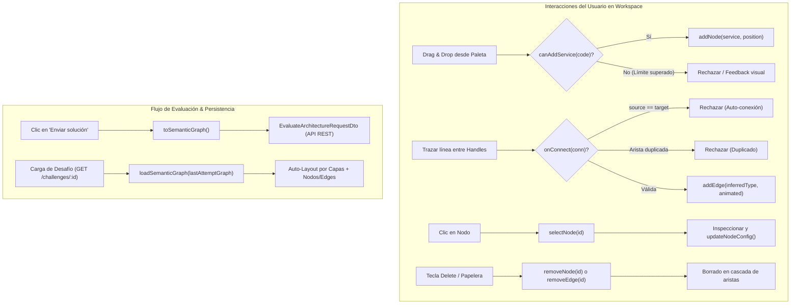

# Especificación Técnica: Store de Canvas Aislado (Fase 5 - Hito 5.1)

## 1. Introducción y Objetivos

Esta especificación técnica define la arquitectura, tipado estricto, modelo de datos, acciones reactivas, lógica de validación topológica, serialización bidireccional y estrategia de pruebas unitarias para el **Store de Canvas Aislado** (`useCanvasStore.ts`) ubicado en `apps/web/src/features/canvas/stores/useCanvasStore.ts`.

Este componente constituye la piedra angular de la **Fase 5 (Canvas Visual e Interacción Drag & Drop - Hito 5.1)** del plan de implementación ([`docs/12-implementation-plan.md`](file:///c:/workspace/aws/aws-game/docs/12-implementation-plan.md)), alineado con el contrato de API REST ([`docs/08-api-spec.md`](file:///c:/workspace/aws/aws-game/docs/08-api-spec.md)), el diseño UI/UX ([`docs/11-ui-ux.md`](file:///c:/workspace/aws/aws-game/docs/11-ui-ux.md)), las mecánicas de juego ([`docs/10-game-mechanics.md`](file:///c:/workspace/aws/aws-game/docs/10-game-mechanics.md)), las reglas de negocio ([`docs/04-business-rules.md`](file:///c:/workspace/aws/aws-game/docs/04-business-rules.md)) y los modelos del motor de evaluación del backend ([`specs/domain-models-enums-spec.md`](file:///c:/workspace/aws/aws-game/specs/domain-models-enums-spec.md)).

```text
┌─────────────────────────────────────────────────────────────────────────────────────────────┐
│                      ARQUITECTURA DEL STORE DE CANVAS AISLADO (Zustand v5)                  │
│                                                                                             │
│   ┌─────────────────────────────────────────────────────────────────────────────────────┐   │
│   │                        WORKSPACE: features/challenge/pages/ChallengePage.tsx        │   │
│   │  ├── ServicePalette (Drag & Drop) ────► addNode(service, position)                  │   │
│   │  ├── ArchitectureCanvas (React Flow) ─► onNodesChange, onEdgesChange, onConnect     │   │
│   │  ├── CanvasToolbar (Reset / Clear) ───► resetCanvas(), clearCanvas()                │   │
│   │  ├── NodeConfigInspector (Multi-AZ) ──► updateNodeConfig(nodeId, { isMultiAz: true })│   │
│   │  └── SubmitButton (Evaluación) ───────► toSemanticGraph()                           │   │
│   └──────────────────────────────────────────┬──────────────────────────────────────────┘   │
│                                              │ Invoca acciones y suscribe selectores        │
│                                              ▼                                              │
│   ┌─────────────────────────────────────────────────────────────────────────────────────┐   │
│   │                 STORE DE ZUSTAND (features/canvas/stores/useCanvasStore.ts)          │   │
│   │                                                                                     │   │
│   │  ESTADO:                                                                            │   │
│   │  • nodes: AwsCanvasNode[] (Nodos con metadata AWS y configuración técnica)          │   │
│   │  • edges: AwsCanvasEdge[] (Conexiones dirigidas con tipo semántico y animación)     │   │
│   │  • selectedNodeId: string | null                                                    │   │
│   │  • selectedEdgeId: string | null                                                    │   │
│   │  • isDirty: boolean                                                                 │   │
│   │  • initialSemanticGraph: SemanticGraph | null                                       │   │
│   │                                                                                     │   │
│   │  TRANSFORMACIONES BIDIRECCIONALES:                                                  │   │
│   │  • loadSemanticGraph(graph, allowedServices) ◄── [Backend Challenge Detail]        │   │
│   │  • toSemanticGraph()                         ──► [Payload POST /evaluate]           │   │
│   └─────────────────────────────────────────────────────────────────────────────────────┘   │
└─────────────────────────────────────────────────────────────────────────────────────────────┘
```

### Objetivos Clave:
1. **Rendimiento a 60 FPS Desacoplado de React Context (RNF-01):** Gestionar el grafo interactivo de React Flow (`@xyflow/react` v12) mediante un store atómico de **Zustand v5**, evitando re-renderizados innecesarios del workspace durante el arrastre, paneo y zoom.
2. **Tipado Estricto y Completo TypeScript (`features/canvas/types/canvas.types.ts`):** Tipar fielmente los nodos (`AwsCanvasNode`), aristas (`AwsCanvasEdge`), metadata de servicios AWS (`AwsServiceNodeData`), configuraciones arquitectónicas (`ComponentConfig`) y tipos de conexión (`ConnectionType`), garantizando compatibilidad total con el dominio .NET 10.
3. **Control Riguroso de Reglas de Negocio en Frontend:**
   * **RN-03 (Restricción de Catálogo):** Admisión exclusiva de servicios definidos en el desafío activo.
   * **RN-04 (Límites de Instanciación):** Control e impedimento de inserción de nodos cuando se alcanza el límite `maxInstances`.
   * **RN-05 (Coherencia y Validez de Enlaces):** Prevención de auto-conexiones (`source === target`) y duplicados de aristas en la misma dirección.
   * **RN-11 / CU-06 (Reinicio del Lienzo):** Capacidad de restaurar el estado inicial del desafío (`resetCanvas`) o limpiar el lienzo (`clearCanvas`).
4. **Serialización y Deserialización Bidireccional Limpia:**
   * **`toSemanticGraph()`:** Extraer un grafo semántico puro (`SemanticGraph`) libre de coordenadas visuales de pantalla (`x`, `y`, `width`, `height`), listo para el DTO `EvaluateArchitectureRequestDto` consumido por `POST /api/v1/challenges/:id/evaluate` (**CU-05**).
   * **`loadSemanticGraph()`:** Reconstruir un grafo visual completo a partir del JSON persistido del último intento (`lastAttemptGraph`) o de plantillas de desafíos con errores (*Fix the Architecture* - **CU-02**), aplicando posicionamiento y layout automático si no existen coordenadas.
5. **Inspección y Ajuste de Parámetros Técnicos (Mecánica 4.3):** Métodos dedicados para mutar propiedades como `isMultiAz`, `autoScaling`, `instanceCount`, `isPublic`, `subnetType` y `storageClass`.
6. **Estados Visuales de Feedback y Diagnóstico:** Soporte para destacar componentes y aristas con estados de evaluación (`default`, `selected`, `pass`, `error`, `warning`) facilitando la integración con la **Fase 6**.
7. **Suite de Pruebas Unitarias Exhaustiva con Vitest:** 100% de cobertura sobre mutaciones de nodos, aristas, límites de instancias, prevención de conexiones inválidas, serialización e idempotencia de reseteo.

---

## 2. Requerimientos y Reglas de Negocio Vinculadas

| Requisito / Regla | Concepto | Aplicación en el Store de Canvas (`useCanvasStore`) |
| :--- | :--- | :--- |
| **RF-05** | Agregar Servicios al Canvas | Acción `addNode(service, position)` que instancia un nuevo nodo con metadata AWS y configuración técnica inicial por defecto. |
| **RF-07** | Conexión entre Componentes | Acción `onConnect(connection)` que valida y crea una arista dirigida tipada con animación de flujo de datos. |
| **RF-08** | Configuración de Componentes | Acción `updateNodeConfig(nodeId, configPartial)` para modificar flags como Multi-AZ o Auto Scaling. |
| **RF-09** | Eliminación de Componentes | Acción `removeNode(nodeId)` con borrado en cascada de aristas vinculadas y `removeEdge(edgeId)`. |
| **RN-03** | Restricción del Catálogo | Verificación de que el `serviceCode` a instanciar pertenezca a los servicios autorizados del desafío. |
| **RN-04** | Límites de Instanciación | Método `canAddService(serviceCode, maxInstances)` y rechazo en `addNode` si se sobrepasa `maxInstances`. |
| **RN-05** | Coherencia de Conexiones | Detección y rechazo de auto-conexiones (`source === target`) y multi-conexiones idénticas. |
| **RN-11 / CU-06** | Reintentos y Reinicio | Acción `resetCanvas()` que restaura el lienzo al estado inicial del desafío y `clearCanvas()`. |
| **RN-12 / CU-05** | Evaluación Explícita | Método `toSemanticGraph()` que extrae el modelo topológico semántico únicamente cuando el usuario solicita la evaluación. |
| **RNF-01** | Fluidez a 60 FPS | Mutaciones inmutables de Zustand fuera del árbol de contexto de React para responder en $< 50$ ms. |
| **CU-02** | Inicialización del Workspace | Acción `loadSemanticGraph(graph, services)` que inicializa el lienzo desde `lastAttemptGraph` o plantilla base. |

---

## 3. Tipos TypeScript y Modelos de Datos (`features/canvas/types/canvas.types.ts`)

Los tipos del canvas están estrictamente sincronizados con los modelos de dominio de backend (`AwsQuest.Domain.Engine.Models`):

```typescript
import { Node, Edge, Connection, NodeChange, EdgeChange, XYPosition } from '@xyflow/react';

/**
 * Tipos de conexiones semánticas permitidas en la arquitectura AWS.
 * Alineado con ConnectionType.cs en backend.
 */
export type ConnectionType =
  | 'HTTP_HTTPS'
  | 'DATABASE'
  | 'ASYNC_QUEUE'
  | 'INTERNAL_VPC'
  | 'STORAGE'
  | 'SECURITY_GROUP';

/**
 * Configuración técnica detallada de un componente AWS.
 * Alineado con ComponentConfig.cs en backend.
 */
export interface ComponentConfig {
  isMultiAz?: boolean | null;
  autoScaling?: boolean | null;
  instanceCount?: number | null;
  isPublic?: boolean | null;
  subnetType?: string | null;
  storageClass?: string | null;
  customProperties?: Record<string, unknown>;
}

/**
 * Estado de validación o feedback visual de un nodo en el canvas.
 */
export type NodeVisualStatus = 'default' | 'selected' | 'pass' | 'error' | 'warning';

/**
 * Metadata del servicio AWS contenida en el payload `data` del nodo de React Flow.
 */
export interface AwsServiceNodeData {
  serviceCode: string;
  name: string;
  category: string;
  iconUrl: string;
  config: ComponentConfig;
  maxInstances?: number | null;
  isDistractor?: boolean;
  visualStatus?: NodeVisualStatus;
  statusMessage?: string | null;
  [key: string]: unknown; // Compatibilidad con Record<string, unknown> de React Flow
}

/**
 * Metadata contenida en el payload `data` de la arista de React Flow.
 */
export interface AwsEdgeData {
  connectionType: ConnectionType;
  label?: string;
  visualStatus?: 'default' | 'pass' | 'error' | 'warning';
  [key: string]: unknown;
}

/**
 * Nodo tipado de React Flow para servicios AWS.
 */
export type AwsCanvasNode = Node<AwsServiceNodeData, 'awsServiceNode'>;

/**
 * Arista tipada de React Flow para conexiones arquitectónicas.
 */
export type AwsCanvasEdge = Edge<AwsEdgeData, 'customConnectionEdge'>;

/**
 * DTO de componente en el grafo semántico de backend.
 * Alineado con GraphComponent.cs.
 */
export interface GraphComponentDto {
  id: string;
  serviceCode: string;
  label?: string | null;
  config: ComponentConfig;
}

/**
 * DTO de conexión en el grafo semántico de backend.
 * Alineado con GraphConnection.cs.
 */
export interface GraphConnectionDto {
  fromComponentId: string;
  toComponentId: string;
  connectionType: ConnectionType | string;
}

/**
 * Grafo semántico agnóstico de coordenadas visuales.
 * Alineado con SemanticGraph.cs y consumido por EvaluateArchitectureRequestDto.
 */
export interface SemanticGraphDto {
  components: GraphComponentDto[];
  connections: GraphConnectionDto[];
}

/**
 * Metadata mínima requerida para instanciar un nodo desde la paleta de servicios.
 */
export interface ServicePaletteItem {
  code: string;
  name: string;
  category: string;
  iconUrl: string;
  maxInstances?: number | null;
  isDistractor?: boolean;
  defaultConfig?: Partial<ComponentConfig>;
}
```

---

## 4. Definición de la Interfaz del Store (`CanvasState` & `CanvasActions`)

```typescript
export interface CanvasState {
  // Estado del Grafo React Flow
  nodes: AwsCanvasNode[];
  edges: AwsCanvasEdge[];
  selectedNodeId: string | null;
  selectedEdgeId: string | null;
  
  // Estado de Control y Auditoría
  isDirty: boolean;
  initialSemanticGraph: SemanticGraphDto | null;
  allowedServices: ServicePaletteItem[];
}

export interface CanvasActions {
  // Manejadores estándar de eventos de React Flow
  onNodesChange: (changes: NodeChange<AwsCanvasNode>[]) => void;
  onEdgesChange: (changes: EdgeChange<AwsCanvasEdge>[]) => void;
  onConnect: (connection: Connection) => boolean;

  // Acciones de Gestión de Nodos
  addNode: (service: ServicePaletteItem, position: XYPosition) => boolean;
  removeNode: (nodeId: string) => void;
  updateNodePosition: (nodeId: string, position: XYPosition) => void;
  updateNodeConfig: (nodeId: string, config: Partial<ComponentConfig>) => void;
  updateNodeData: (nodeId: string, dataPartial: Partial<AwsServiceNodeData>) => void;
  selectNode: (nodeId: string | null) => void;

  // Acciones de Gestión de Aristas
  removeEdge: (edgeId: string) => void;
  updateEdgeConnectionType: (edgeId: string, connectionType: ConnectionType) => void;
  selectEdge: (edgeId: string | null) => void;

  // Acciones de Ciclo de Vida y Serialización
  setAllowedServices: (services: ServicePaletteItem[]) => void;
  loadSemanticGraph: (graph: SemanticGraphDto | null, allowedServices?: ServicePaletteItem[]) => void;
  toSemanticGraph: () => SemanticGraphDto;
  resetCanvas: () => void;
  clearCanvas: () => void;

  // Acciones de Feedback Visual (Fase 6)
  setNodeVisualStatus: (nodeId: string, status: NodeVisualStatus, message?: string | null) => void;
  setEdgeVisualStatus: (edgeId: string, status: 'default' | 'pass' | 'error' | 'warning') => void;
  resetVisualStatuses: () => void;

  // Consultas y Selectores de Dominio (Getters)
  getNodeCountByService: (serviceCode: string) => number;
  canAddService: (serviceCode: string) => boolean;
  getSelectedNode: () => AwsCanvasNode | undefined;
  getSelectedEdge: () => AwsCanvasEdge | undefined;
  hasComponents: () => boolean;
}

export type CanvasStore = CanvasState & CanvasActions;
```

---

## 5. Especificación Detallada de la Lógica del Store (`useCanvasStore.ts`)

### 5.1. Inicialización y Estado Base
* El store se inicializa con `nodes: []`, `edges: []`, `selectedNodeId: null`, `selectedEdgeId: null`, `isDirty: false`, `initialSemanticGraph: null`, y `allowedServices: []`.

### 5.2. Lógica de Adición de Nodos (`addNode`)
* **Validación de Límites (RN-04):**
  1. Busca en `allowedServices` el servicio por `service.code`.
  2. Si tiene configurado `maxInstances` y `maxInstances > 0`, cuenta cuántos nodos existentes poseen dicho `serviceCode`.
  3. Si `count >= maxInstances`, la acción aborta y retorna `false`.
* **Generación de ID Único:** Formato `node_${service.code.toLowerCase()}_${Date.now()}_${Math.random().toString(36).substring(2, 6)}`.
* **Construcción del Nodo:**
  * `id`: ID generado.
  * `type`: `'awsServiceNode'`.
  * `position`: Coordenadas `{ x, y }` proporcionadas por el evento Drop.
  * `data`:
    * `serviceCode`: `service.code`.
    * `name`: `service.name`.
    * `category`: `service.category`.
    * `iconUrl`: `service.iconUrl || '/icons/aws/default.svg'`.
    * `config`: Configuración por defecto fusionada con `service.defaultConfig` (ej. `{ instanceCount: 1, isMultiAz: false, autoScaling: false, isPublic: false }`).
    * `maxInstances`: `service.maxInstances`.
    * `isDistractor`: `service.isDistractor ?? false`.
    * `visualStatus`: `'default'`.
* **Actualización:** Concatena el nuevo nodo, marca `isDirty: true`, y retorna `true`.

### 5.3. Lógica de Eliminación de Nodos (`removeNode`)
* Al remover un nodo por `nodeId`:
  1. Filtra los nodos removiendo el nodo coincidente.
  2. **Eliminación en Cascada de Aristas:** Filtra `edges` descartando todas las aristas donde `edge.source === nodeId || edge.target === nodeId`.
  3. Si el nodo eliminado estaba seleccionado (`selectedNodeId === nodeId`), restablece `selectedNodeId: null`.
  4. Marca `isDirty: true`.

### 5.4. Lógica de Conexión de Componentes (`onConnect`)
* **Validaciones de Integridad (RN-05):**
  1. **Auto-conexión Prohibida:** Si `connection.source === connection.target`, rechaza la conexión y retorna `false`.
  2. **Detección de Handles Inválidos:** Si `!connection.source || !connection.target`, rechaza.
  3. **Prevención de Aristas Duplicadas:** Si ya existe una arista con `source === connection.source` y `target === connection.target`, rechaza la conexión y retorna `false`.
* **Inferencia del Tipo de Conexión:**
  * Obtiene el nodo origen (`sourceNode`) y nodo destino (`targetNode`).
  * Infiere el `connectionType` semántico:
    * Si `targetNode` es de categoría `'Database'`, asigna `'DATABASE'`.
    * Si `sourceNode` o `targetNode` es `'AWS_SQS'` o `'AWS_SNS'`, asigna `'ASYNC_QUEUE'`.
    * Si `targetNode` es `'AWS_S3'`, asigna `'STORAGE'`.
    * Por defecto: `'HTTP_HTTPS'`.
* **Creación de la Arista (`AwsCanvasEdge`):**
  * `id`: `edge_${connection.source}_to_${connection.target}_${Date.now()}`.
  * `type`: `'customConnectionEdge'`.
  * `source`: `connection.source`.
  * `target`: `connection.target`.
  * `sourceHandle`: `connection.sourceHandle ?? 'source-bottom'`.
  * `targetHandle`: `connection.targetHandle ?? 'target-top'`.
  * `animated`: `true` (animación fluida de tráfico).
  * `data`: `{ connectionType: inferredType, visualStatus: 'default' }`.
* **Actualización:** Agrega la arista utilizando el helper optimizado `addEdge` de `@xyflow/react`, marca `isDirty: true`, y retorna `true`.

### 5.5. Lógica de Mutación de Parámetros Técnicos (`updateNodeConfig`)
* Localiza el nodo por `nodeId`.
* Realiza una copia inmutable del nodo actualizando `data.config`:
  ```typescript
  data: {
    ...node.data,
    config: {
      ...node.data.config,
      ...configPartial
    }
  }
  ```
* Marca `isDirty: true`.

### 5.6. Lógica de Serialización hacia el Backend (`toSemanticGraph`)
Transforma el estado visual actual en la estructura formal `SemanticGraphDto` requerida por `POST /api/v1/challenges/:id/evaluate`:
1. Mapea `nodes` a `GraphComponentDto[]`:
   * `id`: `node.id`.
   * `serviceCode`: `node.data.serviceCode`.
   * `label`: `node.data.name`.
   * `config`: Copia sanitizada de `node.data.config`.
2. Mapea `edges` a `GraphConnectionDto[]`:
   * `fromComponentId`: `edge.source`.
   * `toComponentId`: `edge.target`.
   * `connectionType`: `edge.data?.connectionType ?? 'HTTP_HTTPS'`.
3. Retorna `{ components, connections }`.

### 5.7. Lógica de Deserialización desde el Backend (`loadSemanticGraph`)
Carga un grafo persistido (`lastAttemptGraph` o plantilla de desafío):
1. Almacena una copia de respaldo en `initialSemanticGraph` (para permitir `resetCanvas`).
2. Si el grafo recibido es nulo o vacío (`components.length === 0`), inicializa el canvas vacío y termina.
3. **Algoritmo de Posicionamiento / Layout Automático:**
   * Si los componentes no traen coordenadas visuales, distribuye los nodos automáticamente en capas horizontales o columnas según su categoría:
     * *Capa 1 (Entrada / Edge / Redes):* `AWS_ALB`, `AWS_CLOUDFRONT`, `AWS_APIGATEWAY`, `AWS_VPC` ($y = 50$).
     * *Capa 2 (Cómputo / Lógica):* `AWS_EC2`, `AWS_LAMBDA`, `AWS_ECS` ($y = 200$).
     * *Capa 3 (Persistencia / Colas / Storage):* `AWS_RDS`, `AWS_DYNAMODB`, `AWS_S3`, `AWS_SQS`, `AWS_SNS` ($y = 350$).
     * Distribución en eje $X$ con espaciado constante ($x = 80 + index \times 220$).
4. Reconstruye los `AwsCanvasNode[]` asociando los iconos y metadata desde `allowedServices`.
5. Reconstruye las `AwsCanvasEdge[]` asignando `animated: true`, `type: 'customConnectionEdge'`, y su respectivo `connectionType`.
6. Establece `isDirty: false` y `selectedNodeId: null`.

### 5.8. Lógica de Reinicio y Limpieza
* **`resetCanvas()`:**
  * Si `initialSemanticGraph` existe, vuelve a invocar `loadSemanticGraph(initialSemanticGraph, allowedServices)`.
  * Si no existe, invoca `clearCanvas()`.
  * Restablece `isDirty: false`.
* **`clearCanvas()`:**
  * Establece `nodes: []`, `edges: []`, `selectedNodeId: null`, `selectedEdgeId: null`, `isDirty: true`.

---

## 6. Diagrama de Flujo de Operaciones del Store



---

## 7. Plan de Pruebas Unitarias (`useCanvasStore.test.ts`)

La suite de pruebas para `useCanvasStore.ts` se desarrollará con **Vitest** en `apps/web/src/features/canvas/stores/__tests__/useCanvasStore.test.ts`.

### Matriz Detallada de Pruebas:

```typescript
describe('useCanvasStore', () => {
  // 1. Estado Inicial
  it('debe inicializarse con colecciones vacías y sin selección');
  
  // 2. Adición y Configuración de Nodos
  it('debe agregar un nodo correctamente con coordenadas y configuración por defecto');
  it('debe respetar el límite máximo de instancias (RN-04) y rechazar nodos adicionales');
  it('debe permitir agregar instancias ilimitadas si maxInstances es nulo o indefinido');
  it('debe actualizar la configuración técnica de un nodo específico (updateNodeConfig)');
  it('debe actualizar la metadata general del nodo (updateNodeData)');

  // 3. Eliminación de Nodos y Cascada de Aristas
  it('debe eliminar un nodo por ID y remover en cascada todas sus conexiones asociadas (RN-09)');
  it('debe deseleccionar el nodo si el nodo eliminado estaba seleccionado');

  // 4. Gestión de Conexiones / Aristas
  it('debe registrar una nueva conexión dirigida animada entre dos nodos distintos');
  it('debe rechazar auto-conexiones donde source === target (RN-05)');
  it('debe rechazar conexiones duplicadas en la misma dirección');
  it('debe inferir el tipo de conexión semántico adecuado según el servicio destino');
  it('debe permitir eliminar una arista individualmente (removeEdge)');
  it('debe actualizar el tipo de conexión de una arista existente');

  // 5. React Flow Change Handlers
  it('debe procesar onNodesChange para actualización de posición y selección');
  it('debe procesar onEdgesChange para eliminación y selección de aristas');

  // 6. Serialización y Deserialización (CU-02, CU-05)
  it('debe serializar el estado visual actual hacia un SemanticGraphDto limpio sin coordenadas');
  it('debe deserializar un SemanticGraphDto reconstruyendo nodos y aristas con layout automático');
  it('debe marcar isDirty como false tras cargar un grafo inicial y true al modificarlo');

  // 7. Reset y Limpieza (RN-11 / CU-06)
  it('debe restaurar el canvas a su estado inicial del desafío al invocar resetCanvas()');
  it('debe vaciar completamente el canvas al invocar clearCanvas()');

  // 8. Feedback Visual (Fase 6 Preparación)
  it('debe actualizar y resetear estados visuales de nodos y aristas (pass/error/warning)');
});
```

---

## 8. Criterios de Aceptación y Checklist de Verificación

- [ ] **Tipado de Canvas (`types/canvas.types.ts`):** Definición completa de `ConnectionType`, `ComponentConfig`, `AwsServiceNodeData`, `AwsCanvasNode`, `AwsCanvasEdge`, `SemanticGraphDto` y `ServicePaletteItem`.
- [ ] **Store Zustand (`stores/useCanvasStore.ts`):** Implementación integral de `CanvasStore` con todos sus métodos y selectores.
- [ ] **Cumplimiento de Reglas de Negocio:**
  - [ ] Restricción de límites `maxInstances` (**RN-04**).
  - [ ] Prevención de auto-conexiones y duplicados (**RN-05**).
  - [ ] Borrado en cascada de aristas al eliminar un nodo.
  - [ ] Reinicio confiable del lienzo (**RN-11 / CU-06**).
- [ ] **Serialización / Deserialización:** Conversión bidireccional perfecta con el formato `SemanticGraph` del backend .NET 10.
- [ ] **Pruebas Unitarias:** 100% de los tests unitarios aprobados en Vitest (`npm test`).
- [ ] **Compilación TypeScript:** Cero errores de compilación (`tsc -b`).
