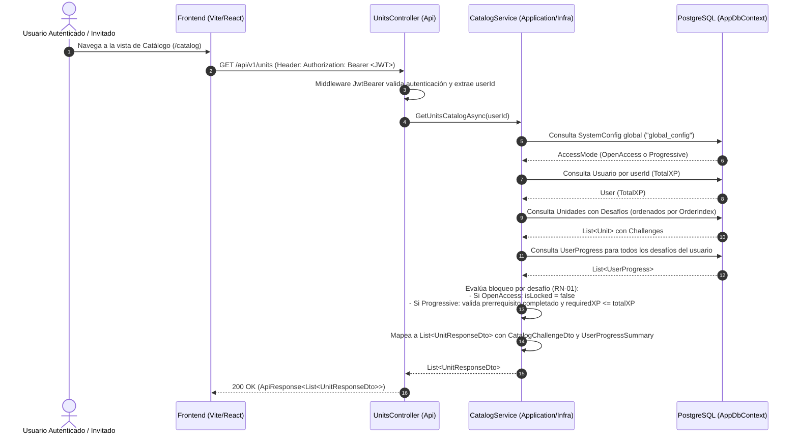
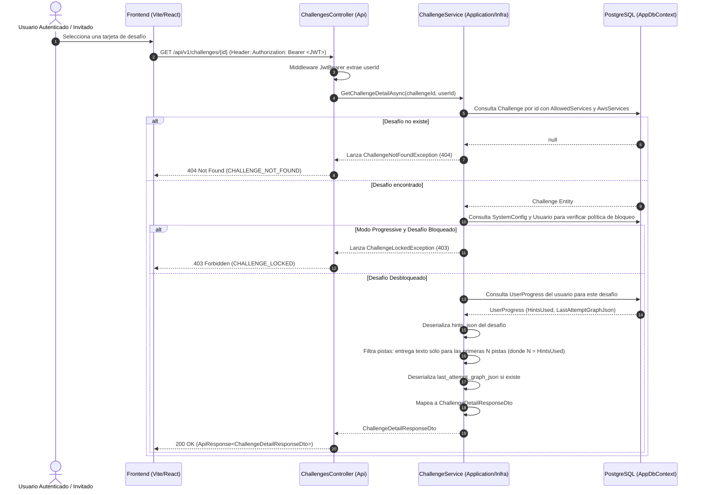

# Especificación Técnica: Módulo de Catálogo y Desafíos (Fase 3 - Hito 3.3)

## 1. Introducción y Objetivos

Esta especificación técnica define la arquitectura, diseño de interfaces, lógica de negocio de acceso condicional, servicios de infraestructura, endpoints REST y estrategia de pruebas para el **Módulo de Catálogo y Desafíos**, correspondiente a la **Tarea 3.3** de la **Fase 3** del plan de implementación ([`docs/12-implementation-plan.md`](file:///c:/workspace/aws/aws-game/docs/12-implementation-plan.md)), en estricto cumplimiento con el contrato de API REST ([`docs/08-api-spec.md`](file:///c:/workspace/aws/aws-game/docs/08-api-spec.md)), el modelo de datos ([`docs/07-data-model.md`](file:///c:/workspace/aws/aws-game/docs/07-data-model.md)) y los casos de uso ([`docs/05-use-cases.md`](file:///c:/workspace/aws/aws-game/docs/05-use-cases.md)).

### Objetivos Clave:
1. **Exploración Jerárquica del Catálogo (`GET /api/v1/units` - CU-01):** Proveer la lista ordenada de unidades temáticas de aprendizaje junto con sus desafíos, enriquecida con el progreso actual del usuario (`Status`, `HighScore`, `HintsUsed`, `CompletedAt`).
2. **Evaluación Dinámica de Políticas de Acceso (RN-01 / CU-07):**
   * **Modo Libre (`OpenAccess`):** Todos los desafíos y unidades están desbloqueados (`IsLocked = false`, `LockReason = null`).
   * **Modo Progresivo (`Progressive`):** Los desafíos se bloquean condicionalmente (`IsLocked = true`) si no se ha completado el desafío prerrequisito (`PrerequisiteChallengeId`) con estado `Completed` ($\ge 70$ pts - **RN-02**) o si el usuario no alcanza el umbral de `RequiredXP` requerido.
3. **Inicialización Contextual del Workspace (`GET /api/v1/challenges/{id}` - CU-02):** Entregar toda la información necesaria para renderizar el lienzo de trabajo: metadatos, catálogo de servicios permitidos con límites (`MaxInstances`) y distractores (`IsDistractor`), resumen de pistas y grafo del último intento (`LastAttemptGraph`).
4. **Protección Anti-Cheat en Pistas Educativas:** Garantizar que el backend serialice únicamente el texto de las pistas previamente desbloqueadas por el usuario, omitiendo los textos de pistas bloqueadas para evitar inspecciones indebidas en el cliente.
5. **Control de Acceso y Resiliencia REST:** Proteger el acceso a desafíos bloqueados devolviendo `403 Forbidden` (`CHALLENGE_LOCKED`) y desafíos inexistentes con `404 Not Found` (`CHALLENGE_NOT_FOUND`) utilizando el envelope canónico `ApiErrorResponse`.

```text
┌─────────────────────────────────────────────────────────────────────────────┐
│                   ARQUITECTURA DEL MÓDULO DE CATÁLOGO Y DESAFÍOS             │
├─────────────────────────────────────────────────────────────────────────────┤
│                                                                             │
│   [Cliente Web (React / React Flow)]                                        │
│            │                                                                │
│            │ HTTP Requests + Bearer Token (JWT)                             │
│            ▼                                                                │
│   ┌──────────────────────────────────────────────────────────────────────┐  │
│   │ AwsQuest.Api                                                         │  │
│   │ ├── Controllers/UnitsController.cs       (GET /api/v1/units)         │  │
│   │ └── Controllers/ChallengesController.cs  (GET /api/v1/challenges/{id}│
│   └──────────────────────┬───────────────────────────────────────────────┘  │
│                          │                                                  │
│                          ▼                                                  │
│   ┌──────────────────────────────────────────────────────────────────────┐  │
│   │ AwsQuest.Application                                                 │  │
│   │ ├── Common/Interfaces/ (ICatalogService, IChallengeService)          │  │
│   │ ├── Dtos/Catalog/ (UnitResponseDto, CatalogChallengeDto)             │  │
│   │ ├── Dtos/Challenge/ (ChallengeDetailResponseDto, HintsSummaryDto)    │  │
│   │ └── Exceptions/ (ChallengeNotFoundException, ChallengeLockedException│
│   └──────────────────────┬───────────────────────────────────────────────┘  │
│                          │                                                  │
│                          ▼                                                  │
│   ┌──────────────────────────────────────────────────────────────────────┐  │
│   │ AwsQuest.Infrastructure                                              │  │
│   │ ├── Services/ (CatalogService, ChallengeService)                     │  │
│   │ └── Persistence/AppDbContext.cs (Consultas AsNoTracking optimizadas) │  │
│   └──────────────────────────────────────────────────────────────────────┘  │
│                                                                             │
└─────────────────────────────────────────────────────────────────────────────┘
```

---

## 2. Requerimientos y Reglas de Negocio Vinculadas

| Requisito / Regla | Concepto | Aplicación en Catálogo y Desafíos |
| :--- | :--- | :--- |
| **RF-01** | Visualización del Catálogo | Listado jerárquico de unidades y desafíos con badges de dificultad y estado. |
| **RF-02** | Selección de Desafíos | Carga contextual de especificaciones, servicios y restricciones en el workspace. |
| **RF-03 / RF-04** | Catálogo de Servicios y Distractores | Provisión de `MaxInstances` e `IsDistractor` por servicio configurado. |
| **RN-01** | Accesibilidad Configurable | Comportamiento condicional según `SystemConfig.AccessMode` (`OpenAccess` vs `Progressive`). |
| **RN-02** | Criterio de Aprobación | Un desafío prerrequisito se considera cumplido sólo si `Status == ProgressStatus.Completed`. |
| **RN-06 / RN-07** | Pistas y Penalizaciones | Desglose de pistas reveladas y cómputo de penalización acumulada. |
| **CU-01** | Visualizar Catálogo | Flujo de consulta con enriquecimiento de progreso del usuario activo. |
| **CU-02** | Inicializar Desafío | Flujo de apertura y validación de permisos de desbloqueo. |

---

## 3. Diagramas de Secuencia y Flujos de Interacción

### 3.1. Flujo de Consulta del Catálogo (`GET /api/v1/units` - CU-01)



---

### 3.2. Flujo de Inicialización de Desafío (`GET /api/v1/challenges/{id}` - CU-02)



---

## 4. Diseño Detallado de Contratos e Interfaces (`AwsQuest.Application`)

### 4.1. Contrato `ICatalogService`

Ubicación: `apps/api/src/AwsQuest.Application/Common/Interfaces/ICatalogService.cs`

```csharp
namespace AwsQuest.Application.Common.Interfaces;

using AwsQuest.Application.Dtos.Catalog;

public interface ICatalogService
{
    /// <summary>
    /// Obtiene el catálogo jerárquico de unidades y desafíos evaluando la política de acceso activa
    /// (OpenAccess vs Progressive) y el progreso acumulado del usuario especificado.
    /// </summary>
    Task<List<UnitResponseDto>> GetUnitsCatalogAsync(Guid userId, CancellationToken cancellationToken = default);
}
```

---

### 4.2. Contrato `IChallengeService`

Ubicación: `apps/api/src/AwsQuest.Application/Common/Interfaces/IChallengeService.cs`

```csharp
namespace AwsQuest.Application.Common.Interfaces;

using AwsQuest.Application.Dtos.Challenge;

public interface IChallengeService
{
    /// <summary>
    /// Obtiene la información detallada del desafío y su contexto de workspace para el usuario.
    /// Verifica si el desafío está bloqueado en modo progresivo y sanitiza las pistas no reveladas.
    /// </summary>
    Task<ChallengeDetailResponseDto> GetChallengeDetailAsync(Guid challengeId, Guid userId, CancellationToken cancellationToken = default);
}
```

---

### 4.3. Excepciones de Catálogo y Desafíos

Ubicación: `apps/api/src/AwsQuest.Application/Common/Exceptions/CatalogExceptions.cs`

```csharp
namespace AwsQuest.Application.Common.Exceptions;

public class ChallengeNotFoundException : Exception
{
    public ChallengeNotFoundException(Guid challengeId) 
        : base($"No se encontró el desafío con identificador '{challengeId}'.")
    {
    }
}

public class ChallengeLockedException : Exception
{
    public ChallengeLockedException(string lockReason) 
        : base(lockReason)
    {
    }
}
```

---

### 4.4. Extensiones de Mapeo (`Mappings/CatalogMappingExtensions.cs`)

Ubicación: `apps/api/src/AwsQuest.Application/Mappings/CatalogMappingExtensions.cs`

```csharp
namespace AwsQuest.Application.Mappings;

using System.Text.Json;
using System.Text.Json.Serialization;
using AwsQuest.Application.Dtos.Catalog;
using AwsQuest.Application.Dtos.Challenge;
using AwsQuest.Domain.Engine.Models;
using AwsQuest.Domain.Entities;
using AwsQuest.Domain.Enums;

public static class CatalogMappingExtensions
{
    private static readonly JsonSerializerOptions JsonOptions = new()
    {
        PropertyNamingPolicy = JsonNamingPolicy.CamelCase,
        Converters = { new JsonStringEnumConverter(JsonNamingPolicy.CamelCase) }
    };

    public static CatalogChallengeDto ToCatalogDto(
        this Challenge challenge, 
        bool isLocked, 
        string? lockReason, 
        UserProgress? progress)
    {
        return new CatalogChallengeDto
        {
            Id = challenge.Id,
            Title = challenge.Title,
            Difficulty = challenge.Difficulty,
            Mode = Enum.TryParse<ChallengeMode>(challenge.Mode, true, out var m) ? m : ChallengeMode.Builder,
            BaseXP = challenge.BaseXP,
            RequiredXP = challenge.RequiredXP,
            OrderIndex = challenge.OrderIndex,
            IsLocked = isLocked,
            LockReason = lockReason,
            UserProgress = progress != null ? new ChallengeProgressSummaryDto
            {
                Status = progress.Status,
                HighScore = progress.HighScore,
                HintsUsed = progress.HintsUsed,
                CompletedAt = progress.FirstCompletedAt
            } : new ChallengeProgressSummaryDto
            {
                Status = ProgressStatus.NotStarted,
                HighScore = 0,
                HintsUsed = 0,
                CompletedAt = null
            }
        };
    }

    public static ChallengeDetailResponseDto ToDetailDto(
        this Challenge challenge, 
        UserProgress? progress)
    {
        // 1. Mapear servicios permitidos
        var allowedServices = challenge.AllowedServices
            .OrderBy(cs => cs.AwsService.Name)
            .Select(cs => new ChallengeAllowedServiceDto
            {
                Code = cs.AwsService.Code,
                Name = cs.AwsService.Name,
                Category = cs.AwsService.Category,
                ShortDescription = cs.AwsService.ShortDescription,
                IconUrl = cs.AwsService.IconUrl,
                MaxInstances = cs.MaxInstances,
                IsDistractor = cs.IsDistractor
            }).ToList();

        // 2. Deserializar definiciones de pistas
        var hintsDefinitions = !string.IsNullOrWhiteSpace(challenge.HintsJson)
            ? JsonSerializer.Deserialize<List<HintDefinition>>(challenge.HintsJson, JsonOptions) ?? []
            : [];

        var hintsUsedCount = progress?.HintsUsed ?? 0;

        // 3. Sanitizar pistas: filtrar sólo las pistas desbloqueadas
        var unlockedHints = hintsDefinitions
            .Where(h => h.OrderIndex <= hintsUsedCount)
            .OrderBy(h => h.OrderIndex)
            .Select(h => new UnlockedHintDto
            {
                OrderIndex = h.OrderIndex,
                Text = h.Text,
                PenaltyApplied = h.PenaltyPoints
            }).ToList();

        var hintsSummary = new HintsSummaryDto
        {
            TotalHints = hintsDefinitions.Count,
            UnlockedCount = hintsUsedCount,
            UnlockedHints = unlockedHints
        };

        // 4. Deserializar grafo del último intento si existe
        SemanticGraph? lastAttemptGraph = null;
        if (progress != null && !string.IsNullOrWhiteSpace(progress.LastAttemptGraphJson))
        {
            try
            {
                lastAttemptGraph = JsonSerializer.Deserialize<SemanticGraph>(progress.LastAttemptGraphJson, JsonOptions);
            }
            catch
            {
                lastAttemptGraph = null;
            }
        }

        return new ChallengeDetailResponseDto
        {
            Id = challenge.Id,
            Title = challenge.Title,
            Description = challenge.Description,
            Difficulty = challenge.Difficulty,
            Mode = Enum.TryParse<ChallengeMode>(challenge.Mode, true, out var m) ? m : ChallengeMode.Builder,
            BaseXP = challenge.BaseXP,
            AllowedServices = allowedServices,
            HintsSummary = hintsSummary,
            LastAttemptGraph = lastAttemptGraph
        };
    }
}
```

---

## 5. Especificación de Implementaciones en Infraestructura (`AwsQuest.Infrastructure`)

### 5.1. Implementación de `CatalogService`

Ubicación: `apps/api/src/AwsQuest.Infrastructure/Services/CatalogService.cs`

#### Algoritmo de Evaluación de Acceso Condicional (RN-01):
1. **Consulta de Configuración Global:** Obtiene la configuración singleton de `SystemConfig` (`Id = "global_config"`). Por defecto asume `AccessMode.OpenAccess` si no existiera registro.
2. **Consulta de Progreso y XP del Usuario:**
   * Carga el usuario para obtener `user.TotalXP`.
   * Carga en un diccionario indexado `Dictionary<Guid, UserProgress>` todo el progreso del usuario para resolución $O(1)$.
3. **Carga del Catálogo Completo:**
   * Carga todas las `Units` ordenadas por `OrderIndex` con sus `Challenges` ordenados por `OrderIndex` mediante `AsNoTracking()`.
4. **Evaluación de Desbloqueo por Desafío:**
   * Si `accessMode == AccessMode.OpenAccess`:
     * `isLocked = false`, `lockReason = null`.
   * Si `accessMode == AccessMode.Progressive`:
     * **Validación 1 (Prerrequisito de Desafío):** Si `challenge.PrerequisiteChallengeId` tiene valor:
       * Si el usuario no tiene registro de progreso o `progress.Status != ProgressStatus.Completed`:
         * `isLocked = true`
         * `lockReason = $"Requiere completar el desafío '{prerequisiteTitle}'"`
     * **Validación 2 (XP Requerido):** Si `challenge.RequiredXP > 0` y `user.TotalXP < challenge.RequiredXP`:
       * `isLocked = true`
       * `lockReason = $"Requiere {challenge.RequiredXP} XP (Actual: {user.TotalXP} XP)"`
     * Si supera ambas condiciones:
       * `isLocked = false`, `lockReason = null`.

```csharp
namespace AwsQuest.Infrastructure.Services;

using Microsoft.EntityFrameworkCore;
using AwsQuest.Application.Common.Interfaces;
using AwsQuest.Application.Dtos.Catalog;
using AwsQuest.Application.Mappings;
using AwsQuest.Domain.Entities;
using AwsQuest.Domain.Enums;

public class CatalogService : ICatalogService
{
    private readonly IAppDbContext _dbContext;

    public CatalogService(IAppDbContext dbContext)
    {
        _dbContext = dbContext;
    }

    public async Task<List<UnitResponseDto>> GetUnitsCatalogAsync(Guid userId, CancellationToken cancellationToken = default)
    {
        // 1. Obtener política global de acceso
        var config = await _dbContext.SystemConfigs
            .AsNoTracking()
            .FirstOrDefaultAsync(c => c.Id == "global_config", cancellationToken);

        var accessMode = config?.AccessMode ?? AccessMode.OpenAccess;

        // 2. Obtener datos y progreso del usuario
        var user = await _dbContext.Users
            .AsNoTracking()
            .FirstOrDefaultAsync(u => u.Id == userId, cancellationToken);

        var userTotalXp = user?.TotalXP ?? 0;

        var userProgressList = await _dbContext.UserProgresses
            .AsNoTracking()
            .Where(p => p.UserId == userId)
            .ToListAsync(cancellationToken);

        var progressMap = userProgressList.ToDictionary(p => p.ChallengeId);

        // 3. Obtener todas las unidades y desafíos
        var units = await _dbContext.Units
            .AsNoTracking()
            .Include(u => u.Challenges)
            .OrderBy(u => u.OrderIndex)
            .ToListAsync(cancellationToken);

        // Mapa de títulos para mensajes pedagógicos de bloqueo
        var challengeTitleMap = units
            .SelectMany(u => u.Challenges)
            .ToDictionary(c => c.Id, c => c.Title);

        // 4. Transformar jerarquía aplicando reglas de accesibilidad
        var result = new List<UnitResponseDto>();

        foreach (var unit in units)
        {
            var challengeDtos = new List<CatalogChallengeDto>();

            var orderedChallenges = unit.Challenges.OrderBy(c => c.OrderIndex).ToList();

            foreach (var challenge in orderedChallenges)
            {
                progressMap.TryGetValue(challenge.Id, out var progress);

                var (isLocked, lockReason) = EvaluateLockStatus(
                    challenge, 
                    accessMode, 
                    userTotalXp, 
                    progressMap, 
                    challengeTitleMap);

                challengeDtos.Add(challenge.ToCatalogDto(isLocked, lockReason, progress));
            }

            result.Add(new UnitResponseDto
            {
                Id = unit.Id,
                Title = unit.Title,
                Description = unit.Description,
                OrderIndex = unit.OrderIndex,
                Challenges = challengeDtos
            });
        }

        return result;
    }

    private static (bool IsLocked, string? LockReason) EvaluateLockStatus(
        Challenge challenge,
        AccessMode accessMode,
        int userTotalXp,
        Dictionary<Guid, UserProgress> progressMap,
        Dictionary<Guid, string> challengeTitleMap)
    {
        if (accessMode == AccessMode.OpenAccess)
        {
            return (false, null);
        }

        // Validación de Prerrequisito
        if (challenge.PrerequisiteChallengeId.HasValue)
        {
            var prereqId = challenge.PrerequisiteChallengeId.Value;
            var hasCompletedPrereq = progressMap.TryGetValue(prereqId, out var prereqProgress) 
                && prereqProgress.Status == ProgressStatus.Completed;

            if (!hasCompletedPrereq)
            {
                var prereqTitle = challengeTitleMap.TryGetValue(prereqId, out var title) 
                    ? title 
                    : "anterior";

                return (true, $"Requiere completar el desafío '{prereqTitle}'");
            }
        }

        // Validación de XP Requerido
        if (challenge.RequiredXP > 0 && userTotalXp < challenge.RequiredXP)
        {
            return (true, $"Requiere {challenge.RequiredXP} XP (Actual: {userTotalXp} XP)");
        }

        return (false, null);
    }
}
```

---

### 5.2. Implementación de `ChallengeService`

Ubicación: `apps/api/src/AwsQuest.Infrastructure/Services/ChallengeService.cs`

```csharp
namespace AwsQuest.Infrastructure.Services;

using Microsoft.EntityFrameworkCore;
using AwsQuest.Application.Common.Exceptions;
using AwsQuest.Application.Common.Interfaces;
using AwsQuest.Application.Dtos.Challenge;
using AwsQuest.Application.Mappings;
using AwsQuest.Domain.Entities;
using AwsQuest.Domain.Enums;

public class ChallengeService : IChallengeService
{
    private readonly IAppDbContext _dbContext;

    public ChallengeService(IAppDbContext dbContext)
    {
        _dbContext = dbContext;
    }

    public async Task<ChallengeDetailResponseDto> GetChallengeDetailAsync(
        Guid challengeId, 
        Guid userId, 
        CancellationToken cancellationToken = default)
    {
        // 1. Cargar desafío con servicios asociados
        var challenge = await _dbContext.Challenges
            .AsNoTracking()
            .Include(c => c.AllowedServices)
                .ThenInclude(cs => cs.AwsService)
            .FirstOrDefaultAsync(c => c.Id == challengeId, cancellationToken);

        if (challenge == null)
        {
            throw new ChallengeNotFoundException(challengeId);
        }

        // 2. Verificar política de bloqueo en modo progresivo
        var config = await _dbContext.SystemConfigs
            .AsNoTracking()
            .FirstOrDefaultAsync(c => c.Id == "global_config", cancellationToken);

        var accessMode = config?.AccessMode ?? AccessMode.OpenAccess;

        if (accessMode == AccessMode.Progressive)
        {
            var user = await _dbContext.Users
                .AsNoTracking()
                .FirstOrDefaultAsync(u => u.Id == userId, cancellationToken);

            var userTotalXp = user?.TotalXP ?? 0;

            if (challenge.PrerequisiteChallengeId.HasValue)
            {
                var prereqCompleted = await _dbContext.UserProgresses
                    .AsNoTracking()
                    .AnyAsync(p => p.UserId == userId 
                                && p.ChallengeId == challenge.PrerequisiteChallengeId.Value 
                                && p.Status == ProgressStatus.Completed, cancellationToken);

                if (!prereqCompleted)
                {
                    var prereqChallenge = await _dbContext.Challenges
                        .AsNoTracking()
                        .FirstOrDefaultAsync(c => c.Id == challenge.PrerequisiteChallengeId.Value, cancellationToken);

                    var prereqTitle = prereqChallenge?.Title ?? "anterior";
                    throw new ChallengeLockedException($"El desafío está bloqueado. Requiere completar el desafío '{prereqTitle}'.");
                }
            }

            if (challenge.RequiredXP > 0 && userTotalXp < challenge.RequiredXP)
            {
                throw new ChallengeLockedException($"El desafío está bloqueado. Requiere {challenge.RequiredXP} XP (Actual: {userTotalXp} XP).");
            }
        }

        // 3. Obtener progreso previo del usuario
        var progress = await _dbContext.UserProgresses
            .AsNoTracking()
            .FirstOrDefaultAsync(p => p.UserId == userId && p.ChallengeId == challengeId, cancellationToken);

        // 4. Mapear y sanitizar pistas
        return challenge.ToDetailDto(progress);
    }
}
```

---

## 6. Especificación de Endpoints y Controladores REST (`AwsQuest.Api`)

### 6.1. Controlador `UnitsController`

Ubicación: `apps/api/src/AwsQuest.Api/Controllers/UnitsController.cs`

```csharp
namespace AwsQuest.Api.Controllers;

using Microsoft.AspNetCore.Authorization;
using Microsoft.AspNetCore.Mvc;
using AwsQuest.Application.Common.Interfaces;
using AwsQuest.Application.Common.Models;
using AwsQuest.Application.Dtos.Catalog;

[ApiController]
[Route("api/v1/units")]
[Authorize]
[Produces("application/json")]
public class UnitsController : ControllerBase
{
    private readonly ICatalogService _catalogService;
    private readonly ICurrentUserService _currentUserService;

    public UnitsController(
        ICatalogService catalogService, 
        ICurrentUserService currentUserService)
    {
        _catalogService = catalogService;
        _currentUserService = currentUserService;
    }

    /// <summary>
    /// Obtiene el catálogo de unidades y desafíos con el estado de avance del usuario activo.
    /// </summary>
    [HttpGet]
    [ProducesResponseType(typeof(ApiResponse<List<UnitResponseDto>>), StatusCodes.Status200OK)]
    [ProducesResponseType(typeof(ApiErrorResponse), StatusCodes.Status401Unauthorized)]
    public async Task<IActionResult> GetUnitsCatalog(CancellationToken cancellationToken)
    {
        var userId = _currentUserService.UserId;
        if (!userId.HasValue)
        {
            return Unauthorized(new ApiErrorResponse
            {
                Error = new ApiErrorDetails
                {
                    Code = ErrorCodes.Unauthorized,
                    Message = "Usuario no autenticado o token inválido."
                }
            });
        }

        var units = await _catalogService.GetUnitsCatalogAsync(userId.Value, cancellationToken);
        return Ok(ApiResponse<List<UnitResponseDto>>.Ok(units));
    }
}
```

---

### 6.2. Controlador `ChallengesController`

Ubicación: `apps/api/src/AwsQuest.Api/Controllers/ChallengesController.cs`

```csharp
namespace AwsQuest.Api.Controllers;

using Microsoft.AspNetCore.Authorization;
using Microsoft.AspNetCore.Mvc;
using AwsQuest.Application.Common.Interfaces;
using AwsQuest.Application.Common.Models;
using AwsQuest.Application.Dtos.Challenge;

[ApiController]
[Route("api/v1/challenges")]
[Authorize]
[Produces("application/json")]
public class ChallengesController : ControllerBase
{
    private readonly IChallengeService _challengeService;
    private readonly ICurrentUserService _currentUserService;

    public ChallengesController(
        IChallengeService challengeService, 
        ICurrentUserService currentUserService)
    {
        _challengeService = challengeService;
        _currentUserService = currentUserService;
    }

    /// <summary>
    /// Obtiene el contexto y especificación completa de un desafío para inicializar el workspace.
    /// </summary>
    [HttpGet("{id:guid}")]
    [ProducesResponseType(typeof(ApiResponse<ChallengeDetailResponseDto>), StatusCodes.Status200OK)]
    [ProducesResponseType(typeof(ApiErrorResponse), StatusCodes.Status401Unauthorized)]
    [ProducesResponseType(typeof(ApiErrorResponse), StatusCodes.Status403Forbidden)]
    [ProducesResponseType(typeof(ApiErrorResponse), StatusCodes.Status404NotFound)]
    public async Task<IActionResult> GetChallengeDetail(
        [FromRoute] Guid id, 
        CancellationToken cancellationToken)
    {
        var userId = _currentUserService.UserId;
        if (!userId.HasValue)
        {
            return Unauthorized(new ApiErrorResponse
            {
                Error = new ApiErrorDetails
                {
                    Code = ErrorCodes.Unauthorized,
                    Message = "Usuario no autenticado o token inválido."
                }
            });
        }

        var challengeDetail = await _challengeService.GetChallengeDetailAsync(id, userId.Value, cancellationToken);
        return Ok(ApiResponse<ChallengeDetailResponseDto>.Ok(challengeDetail));
    }
}
```

---

### 6.3. Actualización de `ApiExceptionMiddleware.cs`

Se agregan las ramas de mapeo de excepciones de catálogo a respuestas HTTP estandarizadas:

```csharp
// En Middlewares/ApiExceptionMiddleware.cs
ChallengeNotFoundException notFoundEx => (
    HttpStatusCode.NotFound,
    ErrorCodes.ChallengeNotFound,
    notFoundEx.Message,
    null
),
ChallengeLockedException lockedEx => (
    HttpStatusCode.Forbidden,
    ErrorCodes.ChallengeLocked,
    lockedEx.Message,
    null
),
```

---

## 7. Registro de Inyección de Dependencias

### 7.1. Actualización en `AwsQuest.Infrastructure/DependencyInjection.cs`

```csharp
// Registro de servicios de Catálogo y Desafíos
services.AddScoped<ICatalogService, AwsQuest.Infrastructure.Services.CatalogService>();
services.AddScoped<IChallengeService, AwsQuest.Infrastructure.Services.ChallengeService>();
```

---

## 8. Estrategia de Pruebas Unitarias e Integración (`AwsQuest.UnitTests`)

Se estructuran suites de pruebas para cubrir todos los escenarios de evaluación de acceso condicional, serialización y anti-cheat:

### 8.1. Suite `CatalogServiceTests.cs`
* **Test 1:** `GetUnitsCatalogAsync_InOpenAccessMode_AllChallengesAreUnlocked`.
* **Test 2:** `GetUnitsCatalogAsync_InProgressiveMode_LocksChallengeWhenPrerequisiteNotCompleted`.
* **Test 3:** `GetUnitsCatalogAsync_InProgressiveMode_UnlocksChallengeWhenPrerequisiteIsCompleted`.
* **Test 4:** `GetUnitsCatalogAsync_InProgressiveMode_LocksChallengeWhenRequiredXPIsNotMet`.
* **Test 5:** `GetUnitsCatalogAsync_PopulatesUserProgressSummaryAccurately`.

### 8.2. Suite `ChallengeServiceTests.cs`
* **Test 1:** `GetChallengeDetailAsync_WithValidChallenge_ReturnsDetailWithAllowedServicesAndDistractors`.
* **Test 2:** `GetChallengeDetailAsync_SanitizesHints_OnlyReturnsUnlockedHintsText`.
* **Test 3:** `GetChallengeDetailAsync_WithLastAttempt_DeserializesLastAttemptGraph`.
* **Test 4:** `GetChallengeDetailAsync_WhenChallengeDoesNotExist_ThrowsChallengeNotFoundException`.
* **Test 5:** `GetChallengeDetailAsync_InProgressiveMode_WhenChallengeIsLocked_ThrowsChallengeLockedException`.

---

## 9. Matriz de Verificación y Criterios de Aceptación

```text
┌─────────────────────────────────────────────────────────────────────────────┐
│                 CRITERIOS DE ACEPTACIÓN - HITO 3.3 CATÁLOGO Y DESAFÍOS      │
├─────────────────────────────────────────────────────────────────────────────┤
│  [✓] GET /api/v1/units lista unidades y desafíos en orden por OrderIndex    │
│  [✓] OpenAccess desbloquea todos los desafíos sin LockReason                │
│  [✓] ProgressiveMode evalúa PrerequisiteChallengeId y RequiredXP con éxito  │
│  [✓] GET /api/v1/challenges/{id} entrega servicios permitidos y distractores│
│  [✓] Pistas bloqueadas nunca revelan su texto en el response JSON (AntiCheat│
│  [✓] Desafío bloqueado retorna 403 Forbidden (CHALLENGE_LOCKED)             │
│  [✓] Desafío no existente retorna 404 Not Found (CHALLENGE_NOT_FOUND)       │
│  [✓] 100% de tests unitarios de catálogo y desafíos aprobados               │
└─────────────────────────────────────────────────────────────────────────────┘
```
