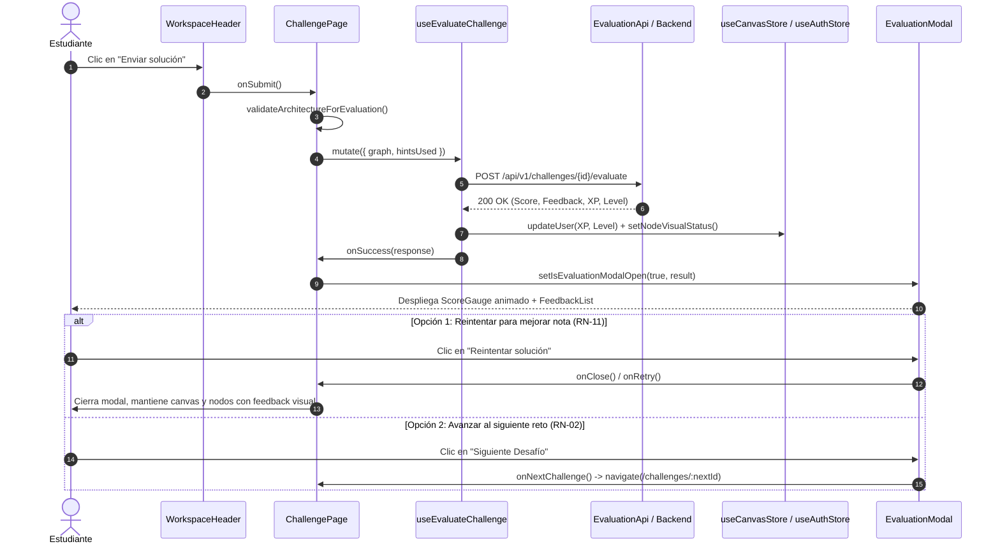

# Especificación Técnica: Modal de Evaluación y Resultados (Fase 6 - Hito 6.2)

## 1. Introducción y Objetivos

Esta especificación técnica define la arquitectura visual, experiencia de usuario, diseño de componentes, accesibilidad (a11y) y estrategia de testing para el **Modal de Evaluación y Resultados** (`EvaluationModal`), correspondiente a la **Tarea 6.2** de la **Fase 6** del plan de implementación ([`docs/12-implementation-plan.md`](file:///c:/workspace/aws/aws-game/docs/12-implementation-plan.md)).

El modal es el componente central de retroalimentación pedagógica y gamificación de la plataforma. Se despliega tras la ejecución exitosa de la mutación de evaluación (`POST /api/v1/challenges/{id}/evaluate` implementada en el Hito 6.1 - [`specs/graph-serialization-evaluation-mutation-spec.md`](file:///c:/workspace/aws/aws-game/specs/graph-serialization-evaluation-mutation-spec.md)) y presenta la calificación cuantitativa (0 a 100), la ganancia de XP, el veredicto de aprobación ($\ge 70$), el desglose cualitativo de aciertos/errores según el AWS Well-Architected Framework y las acciones para reintentar o avanzar al siguiente desafío.

```text
┌─────────────────────────────────────────────────────────────────────────────────────────────────────────────────┐
│                           ESTRUCTURA VISUAL DEL MODAL DE EVALUACIÓN Y RESULTADOS                                │
├─────────────────────────────────────────────────────────────────────────────────────────────────────────────────┤
│                                                                                                                 │
│   ┌─────────────────────────────────────────────────────────────────────────────────────────────────────────┐   │
│   │ CABECERA: Título del Desafío + Badge de Modalidad (Builder / Fix) + Botón Cerrar (X)                    │   │
│   ├─────────────────────────────────────────────────────────────────────────────────────────────────────────┤   │
│   │ CUERPO DEL MODAL (Grid Responsivo 2 Columnas en Desktop):                                               │   │
│   │                                                                                                         │   │
│   │   ┌──────────────────────────────────────────┐   ┌──────────────────────────────────────────────────┐   │   │
│   │   │       SECCIÓN 1: MEDIDOR RADIAL          │   │        SECCIÓN 2: DESGLOSE PEDAGÓGICO            │   │   │
│   │   │             (ScoreGauge.tsx)             │   │               (FeedbackList.tsx)                 │   │   │
│   │   │                                          │   │                                                  │   │   │
│   │   │            ┌───────────────┐             │   │  ┌────────────────────────────────────────────┐  │   │   │
│   │   │            │    95 / 100   │             │   │  │ Resumen: ¡Excelente arquitectura resiliente!│  │   │   │
│   │   │            │  ¡COMPLETADO! │             │   │  └────────────────────────────────────────────┘  │   │   │
│   │   │            └───────────────┘             │   │                                                  │   │   │
│   │   │                                          │   │  Filtros: [ Todos (4) ] [ Aciertos ] [ Fallos ]  │   │   │
│   │   │  • Animación radial SVG (0 -> Score)     │   │                                                  │   │   │
│   │   │  • Badge de Aprobación / No Aprobado     │   │  ✓ ALB correctamente configurado (Networking)    │   │   │
│   │   │  • Banner de XP Ganada: "+95 XP"         │   │  ✓ EC2 redundante Multi-AZ (Alta Disponibilidad) │   │   │
│   │   │  • Indicador de Nuevo Récord (High Score)│   │  ✓ RDS con Réplicas (Tolerancia a fallos)        │   │   │
│   │   │                                          │   │  ℹ Deducción por Pistas: -5 pts (Pistas)         │   │   │
│   │   └──────────────────────────────────────────┘   └──────────────────────────────────────────────────┘   │   │
│   ├─────────────────────────────────────────────────────────────────────────────────────────────────────────┤   │
│   │ PIE DE ACCIONES:                                                                                        │   │
│   │   [ ↺ Reintentar solución (Conserva Canvas) ]              [ Siguiente Desafío ➔ ] / [ Ver Catálogo ]   │   │
│   └─────────────────────────────────────────────────────────────────────────────────────────────────────────┘   │
└─────────────────────────────────────────────────────────────────────────────────────────────────────────────────┘
```

### Objetivos Clave:
1. **Medidor Radial Animado de Puntuación (`ScoreGauge.tsx`):**
   * Gráfico SVG circular interactivo con animación fluida `stroke-dashoffset` (0 a 100 puntos en 1.2 segundos).
   * Semáforo cromático dinámico:
     - **$\ge 70$ pts (Aprobado):** Verde esmeralda (`text-emerald-500`, `stroke-emerald-500`) + badge *"¡Desafío Aprobado!"*.
     - **$40-69$ pts (En Progreso):** Ámbar advertencia (`text-amber-500`, `stroke-amber-500`) + badge *"Casi lo logras (Mínimo 70 pts)"*.
     - **$< 40$ pts (Requiere Revisión):** Rojo pedagógico (`text-rose-500`, `stroke-rose-500`) + badge *"Revisa los requisitos"*.
   * Renderizado de badges de gamificación:
     - Badge destacado de **XP Ganada** (ej. `+95 XP`) con icono `Sparkles` y animación de entrada.
     - Badge de **"¡Nuevo Récord!"** cuando `isNewHighScore === true` (**RN-09**).
2. **Lista Desglosada de Retroalimentación Pedagógica (`FeedbackList.tsx`):**
   * Tarjetas individuales organizadas por estado (`pass`, `fail`, `warning`, `info`) con iconos semánticos de Lucide React (`CheckCircle2`, `XCircle`, `AlertTriangle`, `Info`).
   * Píldoras categóricas amigables mapeadas desde el enum de 9 categorías del Well-Architected Framework: *"Selección de Servicios"*, *"Conectividad"*, *"Alta Disponibilidad"*, *"Seguridad"*, *"Rendimiento"*, *"Optimización de Costos"*, *"Penalización de Pistas"*, *"Configuración"*, *"Patrones de Arquitectura"*.
   * Explicaciones conceptuales de AWS claras y constructivas vinculadas a las buenas prácticas de la nube (**RF-16**).
   * Filtro interactivo por pestañas: *Todos*, *Aciertos*, *Fallos/Advertencias*.
3. **Contenedor Modal Accesible (`EvaluationModal.tsx`):**
   * Integración en overlay accesible con backdrop blur, atajo de teclado `Escape`, trampa de foco y bloqueo de scroll de fondo (**RNF-04 / WCAG 2.1 AA**).
   * Botones de acción clave:
     - **"Reintentar solución":** Cierra el modal y conserva el estado intacto del lienzo para que el estudiante corrija los fallos detectados (**RN-11 / CU-05**).
     - **"Siguiente Desafío":** Navega automáticamente al siguiente reto de la unidad si el actual fue completado con éxito (**RN-02**), o botón alternativo *"Volver al Catálogo"*.
4. **Integración Fluida con `ChallengePage.tsx`:**
   * Conectar el botón *"Enviar solución"* del `WorkspaceHeader` con el hook de mutación `useEvaluateChallenge` y desplegar automáticamente el `EvaluationModal` al recibir la respuesta del backend.
5. **Soporte Dual de Tema (Dark / Light Mode):** Cumplimiento estricto de la paleta Tailwind institucional de AWS Quest.
6. **Suite Integral de Pruebas Unitarias (Vitest + React Testing Library):** Cobertura del 100% de renderizado, animaciones, cálculos cromáticos, filtrado de feedback y eventos de navegación.

---

## 2. Requerimientos y Reglas de Negocio Vinculadas

| Requisito / Regla | Concepto | Aplicación en el Modal de Evaluación |
| :--- | :--- | :--- |
| **RF-15 / RN-02** | Veredicto de Aprobación ($\ge 70$) | El modal muestra estado *Completado* con estilo verde si `score >= 70`; de lo contrario, muestra estado *En Progreso* con invitación a corregir. |
| **RF-16** | Retroalimentación Explicativa | Cada ítem de feedback expone el concepto de AWS y el motivo de la penalización o acierto. |
| **RF-17 / RN-10** | Gamificación y Anti-Farmeo | Despliegue de `earnedXP` real sumado. Si `earnedXP === 0` en un reintento sin superar récord, se muestra indicador informativo. |
| **RN-09** | Conservación de High Score | Indicador visual de "¡Nuevo Récord!" cuando el intento supera la nota histórica previa. |
| **RN-11 / CU-05** | Reintentos Ilimitados | El botón *"Reintentar solución"* no limpia el canvas, permitiendo depurar la arquitectura iterativamente. |
| **RN-12** | Mapeo Cromático en Canvas | El modal se coordina con los nodos pintados en verde/rojo en el canvas para una experiencia pedagógica 360°. |
| **RNF-04 / RNF-06** | UX y Rendimiento | Animaciones a 60 FPS, transición radial suave y tiempos de respuesta instantáneos. |
| **WCAG 2.1 AA** | Accesibilidad | Ratios de contraste $\ge 4.5:1$, navegación por teclado (`Escape`, `Enter`), atributos `aria-labelledby` y `role="dialog"`. |

---

## 3. Especificación de Componentes y Props Interfaces

### 3.1. Medidor Radial de Puntaje (`ScoreGauge.tsx`)

Ubicación: `apps/web/src/features/evaluation/components/ScoreGauge.tsx`

```typescript
export interface ScoreGaugeProps {
  score: number;
  passed: boolean;
  isNewHighScore?: boolean;
  earnedXP: number;
  className?: string;
}
```

* **Detalles de Implementación:**
  - Radio del círculo: `r = 70`, circunferencia: $2 \times \pi \times 70 \approx 439.82$ px.
  - Offset animado: $\text{offset} = 439.82 \times (1 - \text{score} / 100)$.
  - Transición CSS: `transition-all duration-1000 ease-out`.
  - Iconos de estado: `Trophy` o `CheckCircle` para aprobado ($\ge 70$), `AlertCircle` para no aprobado ($< 70$).
  - Animación de XP ganada: Píldora animada con gradiente `from-amber-500 to-aws-orange text-white font-bold` y efecto `animate-bounce-subtle`.

---

### 3.2. Lista de Retroalimentación Pedagógica (`FeedbackList.tsx`)

Ubicación: `apps/web/src/features/evaluation/components/FeedbackList.tsx`

```typescript
import { FeedbackItemDto } from '../types/evaluation.types';

export interface FeedbackListProps {
  summary: string;
  items: FeedbackItemDto[];
  className?: string;
}

export type FeedbackFilterTab = 'all' | 'pass' | 'issues';
```

* **Mapeo de Categorías de AWS Well-Architected:**
  - `serviceSelection` $\rightarrow$ *"Selección de Servicios"*
  - `connection` $\rightarrow$ *"Conectividad de Red"*
  - `architecturePattern` $\rightarrow$ *"Patrón de Arquitectura"*
  - `availability` $\rightarrow$ *"Alta Disponibilidad"*
  - `security` $\rightarrow$ *"Seguridad y Aislamiento"*
  - `performance` $\rightarrow$ *"Rendimiento"*
  - `costOptimization` $\rightarrow$ *"Optimización de Costos"*
  - `hintPenalty` $\rightarrow$ *"Uso de Pistas"*
  - `configuration` $\rightarrow$ *"Configuración de Componentes"*

* **Estilos Cromáticos por Estado:**
  - `pass`: Borde `border-emerald-500/30`, Fondo `bg-emerald-500/5 dark:bg-emerald-950/20`, Icono `CheckCircle2 text-emerald-500`.
  - `fail`: Borde `border-rose-500/30`, Fondo `bg-rose-500/5 dark:bg-rose-950/20`, Icono `XCircle text-rose-500`.
  - `warning`: Borde `border-amber-500/30`, Fondo `bg-amber-500/5 dark:bg-amber-950/20`, Icono `AlertTriangle text-amber-500`.
  - `info`: Borde `border-sky-500/30`, Fondo `bg-sky-500/5 dark:bg-sky-950/20`, Icono `Info text-sky-500`.

---

### 3.3. Modal Contenedor de Evaluación (`EvaluationModal.tsx`)

Ubicación: `apps/web/src/features/evaluation/components/EvaluationModal.tsx`

```typescript
import { EvaluateArchitectureResponseDto } from '../types/evaluation.types';

export interface EvaluationModalProps {
  isOpen: boolean;
  onClose: () => void;
  result: EvaluateArchitectureResponseDto | null;
  challengeTitle: string;
  nextChallengeId?: string | null;
  onRetry?: () => void;
  onNextChallenge?: () => void;
}
```

* **Comportamiento y Acciones:**
  - Si `isOpen === false` o `result === null`, el componente retorna `null`.
  - Atajo de teclado: Listener de `Escape` para invocar `onClose()`.
  - Bloqueo de scroll en el `body` (`overflow-hidden`) mientras el modal esté abierto.
  - Al presionar *"Reintentar solución"*: Invoca `onRetry()` (o `onClose()`), permitiendo al usuario ver el canvas con los nodos resaltados para depurar.
  - Al presionar *"Siguiente Desafío"*: Si `nextChallengeId` está presente, navega a `/challenges/${nextChallengeId}`; de lo contrario, redirige al catálogo `/catalog`.

---

## 4. Diagrama de Flujo y Ciclo de Vida del Modal



---

## 5. Diseño Detallado de Componentes (Código de Referencia)

### 5.1. `ScoreGauge.tsx`

```tsx
import React, { useEffect, useState } from 'react';
import { Trophy, CheckCircle, AlertCircle, Sparkles } from 'lucide-react';

export interface ScoreGaugeProps {
  score: number;
  passed: boolean;
  isNewHighScore?: boolean;
  earnedXP: number;
  className?: string;
}

export const ScoreGauge: React.FC<ScoreGaugeProps> = ({
  score,
  passed,
  isNewHighScore = false,
  earnedXP,
  className = ''
}) => {
  const [animatedScore, setAnimatedScore] = useState(0);

  // Animación del número y trazado de 0 al valor final
  useEffect(() => {
    const timer = setTimeout(() => {
      setAnimatedScore(score);
    }, 100);
    return () => clearTimeout(timer);
  }, [score]);

  const radius = 70;
  const circumference = 2 * Math.PI * radius;
  const strokeDashoffset = circumference - (animatedScore / 100) * circumference;

  // Semáforo cromático
  const getColorClasses = () => {
    if (score >= 70) {
      return {
        stroke: 'stroke-emerald-500',
        text: 'text-emerald-500 dark:text-emerald-400',
        badgeBg: 'bg-emerald-500/10 text-emerald-600 dark:text-emerald-400 border-emerald-500/20'
      };
    }
    if (score >= 40) {
      return {
        stroke: 'stroke-amber-500',
        text: 'text-amber-500 dark:text-amber-400',
        badgeBg: 'bg-amber-500/10 text-amber-600 dark:text-amber-400 border-amber-500/20'
      };
    }
    return {
      stroke: 'stroke-rose-500',
      text: 'text-rose-500 dark:text-rose-400',
      badgeBg: 'bg-rose-500/10 text-rose-600 dark:text-rose-400 border-rose-500/20'
    };
  };

  const colors = getColorClasses();

  return (
    <div className={`flex flex-col items-center justify-center p-6 text-center ${className}`}>
      {/* Gráfico Radial SVG */}
      <div className="relative w-44 h-44 flex items-center justify-center">
        <svg className="w-full h-full transform -rotate-90" viewBox="0 0 160 160">
          {/* Círculo de fondo */}
          <circle
            cx="80"
            cy="80"
            r={radius}
            className="stroke-slate-200 dark:stroke-slate-800"
            strokeWidth="12"
            fill="transparent"
          />
          {/* Círculo animado de progreso */}
          <circle
            cx="80"
            cy="80"
            r={radius}
            className={`${colors.stroke} transition-all duration-1000 ease-out`}
            strokeWidth="12"
            strokeDasharray={circumference}
            strokeDashoffset={strokeDashoffset}
            strokeLinecap="round"
            fill="transparent"
          />
        </svg>

        {/* Contenido Central */}
        <div className="absolute flex flex-col items-center justify-center">
          <span className={`text-4xl font-black tracking-tight ${colors.text}`}>
            {animatedScore}
          </span>
          <span className="text-xs font-semibold text-slate-400 dark:text-slate-500 uppercase tracking-wider">
            de 100 pts
          </span>
        </div>
      </div>

      {/* Badge de Estado */}
      <div
        className={`mt-4 inline-flex items-center gap-1.5 px-3.5 py-1.5 rounded-full text-xs font-bold border ${colors.badgeBg}`}
      >
        {passed ? (
          <>
            <CheckCircle className="w-4 h-4" />
            <span>¡Desafío Aprobado!</span>
          </>
        ) : (
          <>
            <AlertCircle className="w-4 h-4" />
            <span>No Aprobado (Mínimo 70 pts)</span>
          </>
        )}
      </div>

      {/* Badges de Gamificación: XP y High Score */}
      <div className="mt-3 flex flex-wrap items-center justify-center gap-2">
        {earnedXP > 0 && (
          <div className="inline-flex items-center gap-1 px-3 py-1 rounded-md bg-gradient-to-r from-amber-500 to-aws-orange text-white text-xs font-extrabold shadow-sm animate-pulse">
            <Sparkles className="w-3.5 h-3.5" />
            <span>+{earnedXP} XP Ganada</span>
          </div>
        )}

        {isNewHighScore && (
          <div className="inline-flex items-center gap-1 px-2.5 py-1 rounded-md bg-purple-500/10 dark:bg-purple-900/30 text-purple-600 dark:text-purple-300 text-xs font-bold border border-purple-500/20">
            <Trophy className="w-3.5 h-3.5" />
            <span>¡Nuevo Récord!</span>
          </div>
        )}
      </div>
    </div>
  );
};
```

---

### 5.2. `FeedbackList.tsx`

```tsx
import React, { useState, useMemo } from 'react';
import { CheckCircle2, XCircle, AlertTriangle, Info } from 'lucide-react';
import { FeedbackItemDto, FeedbackCategory } from '../types/evaluation.types';

export interface FeedbackListProps {
  summary: string;
  items: FeedbackItemDto[];
  className?: string;
}

export type FeedbackFilterTab = 'all' | 'pass' | 'issues';

const categoryLabels: Record<FeedbackCategory, string> = {
  serviceSelection: 'Selección de Servicios',
  connection: 'Conectividad de Red',
  architecturePattern: 'Patrón Arquitectónico',
  availability: 'Alta Disponibilidad',
  security: 'Seguridad y Aislamiento',
  performance: 'Rendimiento',
  costOptimization: 'Optimización de Costos',
  hintPenalty: 'Penalización de Pistas',
  configuration: 'Configuración'
};

export const FeedbackList: React.FC<FeedbackListProps> = ({
  summary,
  items,
  className = ''
}) => {
  const [activeFilter, setActiveFilter] = useState<FeedbackFilterTab>('all');

  const filteredItems = useMemo(() => {
    if (activeFilter === 'pass') {
      return items.filter((item) => item.status === 'pass');
    }
    if (activeFilter === 'issues') {
      return items.filter((item) => item.status === 'fail' || item.status === 'warning');
    }
    return items;
  }, [items, activeFilter]);

  const passCount = useMemo(() => items.filter((i) => i.status === 'pass').length, [items]);
  const issueCount = useMemo(
    () => items.filter((i) => i.status === 'fail' || i.status === 'warning').length,
    [items]
  );

  const renderStatusIcon = (status: FeedbackItemDto['status']) => {
    switch (status) {
      case 'pass':
        return <CheckCircle2 className="w-5 h-5 text-emerald-500 shrink-0 mt-0.5" />;
      case 'fail':
        return <XCircle className="w-5 h-5 text-rose-500 shrink-0 mt-0.5" />;
      case 'warning':
        return <AlertTriangle className="w-5 h-5 text-amber-500 shrink-0 mt-0.5" />;
      case 'info':
      default:
        return <Info className="w-5 h-5 text-sky-500 shrink-0 mt-0.5" />;
    }
  };

  const getCardStyle = (status: FeedbackItemDto['status']) => {
    switch (status) {
      case 'pass':
        return 'border-emerald-500/20 bg-emerald-500/5 dark:bg-emerald-950/20';
      case 'fail':
        return 'border-rose-500/20 bg-rose-500/5 dark:bg-rose-950/20';
      case 'warning':
        return 'border-amber-500/20 bg-amber-500/5 dark:bg-amber-950/20';
      case 'info':
      default:
        return 'border-sky-500/20 bg-sky-500/5 dark:bg-sky-950/20';
    }
  };

  return (
    <div className={`flex flex-col h-full min-h-0 ${className}`}>
      {/* Banner de Resumen Pedagógico */}
      {summary && (
        <div className="p-3.5 mb-3 rounded-lg bg-slate-100 dark:bg-slate-900 border border-slate-200 dark:border-slate-800 text-sm font-medium text-slate-700 dark:text-slate-300">
          {summary}
        </div>
      )}

      {/* Selector de Filtros */}
      <div className="flex items-center gap-2 mb-3 pb-2 border-b border-slate-200 dark:border-slate-800">
        <button
          type="button"
          onClick={() => setActiveFilter('all')}
          className={`px-3 py-1 rounded-md text-xs font-semibold transition-colors ${
            activeFilter === 'all'
              ? 'bg-slate-900 text-white dark:bg-slate-100 dark:text-slate-900'
              : 'text-slate-600 dark:text-slate-400 hover:bg-slate-100 dark:hover:bg-slate-800'
          }`}
        >
          Todos ({items.length})
        </button>
        <button
          type="button"
          onClick={() => setActiveFilter('pass')}
          className={`px-3 py-1 rounded-md text-xs font-semibold transition-colors ${
            activeFilter === 'pass'
              ? 'bg-emerald-600 text-white dark:bg-emerald-500 dark:text-slate-950'
              : 'text-emerald-600 dark:text-emerald-400 hover:bg-emerald-50 dark:hover:bg-emerald-950/30'
          }`}
        >
          Aciertos ({passCount})
        </button>
        <button
          type="button"
          onClick={() => setActiveFilter('issues')}
          className={`px-3 py-1 rounded-md text-xs font-semibold transition-colors ${
            activeFilter === 'issues'
              ? 'bg-rose-600 text-white dark:bg-rose-500 dark:text-slate-950'
              : 'text-rose-600 dark:text-rose-400 hover:bg-rose-50 dark:hover:bg-rose-950/30'
          }`}
        >
          Observaciones ({issueCount})
        </button>
      </div>

      {/* Lista Scrolleable de Diagnósticos */}
      <div className="flex-1 overflow-y-auto space-y-2.5 pr-1 min-h-0 max-h-[340px]">
        {filteredItems.length === 0 ? (
          <div className="py-8 text-center text-sm text-slate-400">
            No hay elementos en esta categoría.
          </div>
        ) : (
          filteredItems.map((item, index) => (
            <div
              key={`${item.category}-${index}`}
              className={`p-3 rounded-lg border flex gap-3 items-start transition-all ${getCardStyle(
                item.status
              )}`}
            >
              {renderStatusIcon(item.status)}

              <div className="flex-1 min-w-0">
                <div className="flex items-center justify-between gap-2 mb-1">
                  <span className="text-xs font-bold uppercase tracking-wider text-slate-500 dark:text-slate-400">
                    {categoryLabels[item.category] || item.category}
                  </span>

                  {item.penaltyApplied > 0 && (
                    <span className="text-xs font-extrabold text-rose-500">
                      -{item.penaltyApplied} pts
                    </span>
                  )}
                </div>

                <h4 className="text-sm font-semibold text-slate-900 dark:text-slate-100 mb-0.5">
                  {item.title}
                </h4>

                <p className="text-xs text-slate-600 dark:text-slate-300 leading-relaxed">
                  {item.explanation}
                </p>
              </div>
            </div>
          ))
        )}
      </div>
    </div>
  );
};
```

---

### 5.3. `EvaluationModal.tsx`

```tsx
import React, { useEffect } from 'react';
import { useNavigate } from 'react-router-dom';
import { X, RotateCcw, ArrowRight, LayoutGrid } from 'lucide-react';
import { ScoreGauge } from './ScoreGauge';
import { FeedbackList } from './FeedbackList';
import { EvaluateArchitectureResponseDto } from '../types/evaluation.types';

export interface EvaluationModalProps {
  isOpen: boolean;
  onClose: () => void;
  result: EvaluateArchitectureResponseDto | null;
  challengeTitle: string;
  nextChallengeId?: string | null;
  onRetry?: () => void;
  onNextChallenge?: () => void;
}

export const EvaluationModal: React.FC<EvaluationModalProps> = ({
  isOpen,
  onClose,
  result,
  challengeTitle,
  nextChallengeId,
  onRetry,
  onNextChallenge
}) => {
  const navigate = useNavigate();

  // Atajo de teclado Escape para cerrar
  useEffect(() => {
    const handleKeyDown = (e: KeyboardEvent) => {
      if (e.key === 'Escape' && isOpen) {
        onClose();
      }
    };
    window.addEventListener('keydown', handleKeyDown);
    return () => window.removeEventListener('keydown', handleKeyDown);
  }, [isOpen, onClose]);

  // Bloqueo de scroll en body
  useEffect(() => {
    if (isOpen) {
      document.body.style.overflow = 'hidden';
    } else {
      document.body.style.overflow = '';
    }
    return () => {
      document.body.style.overflow = '';
    };
  }, [isOpen]);

  if (!isOpen || !result) {
    return null;
  }

  const handleRetry = () => {
    if (onRetry) {
      onRetry();
    } else {
      onClose();
    }
  };

  const handleNext = () => {
    if (onNextChallenge) {
      onNextChallenge();
    } else if (nextChallengeId) {
      onClose();
      navigate(`/challenges/${nextChallengeId}`);
    } else {
      onClose();
      navigate('/catalog');
    }
  };

  return (
    <div
      role="dialog"
      aria-modal="true"
      aria-labelledby="evaluation-modal-title"
      className="fixed inset-0 z-50 flex items-center justify-center p-4 sm:p-6 bg-slate-950/70 backdrop-blur-sm animate-in fade-in duration-200"
    >
      {/* Contenedor Modal */}
      <div className="relative w-full max-w-4xl max-h-[90vh] flex flex-col bg-white dark:bg-slate-900 border border-slate-200 dark:border-slate-800 rounded-2xl shadow-2xl overflow-hidden animate-in zoom-in-95 duration-200">
        {/* Cabecera */}
        <div className="flex items-center justify-between px-6 py-4 border-b border-slate-200 dark:border-slate-800 bg-slate-50/50 dark:bg-slate-900/50">
          <div>
            <span className="text-xs font-bold text-aws-orange uppercase tracking-wider">
              Diagnóstico de Arquitectura
            </span>
            <h2
              id="evaluation-modal-title"
              className="text-lg font-bold text-slate-900 dark:text-slate-100"
            >
              {challengeTitle}
            </h2>
          </div>

          <button
            type="button"
            onClick={onClose}
            aria-label="Cerrar modal de evaluación"
            className="p-1.5 rounded-lg text-slate-400 hover:text-slate-700 dark:hover:text-slate-200 hover:bg-slate-100 dark:hover:bg-slate-800 transition-colors"
          >
            <X className="w-5 h-5" />
          </button>
        </div>

        {/* Cuerpo Principal: Grid de 2 Columnas */}
        <div className="flex-1 min-h-0 overflow-y-auto p-6 grid grid-cols-1 md:grid-cols-12 gap-6 items-start">
          {/* Columna Izquierda: Gauge Radial */}
          <div className="md:col-span-5 bg-slate-50 dark:bg-slate-950/50 border border-slate-200 dark:border-slate-800 rounded-xl p-4 flex flex-col justify-center h-full">
            <ScoreGauge
              score={result.score}
              passed={result.passed}
              isNewHighScore={result.isNewHighScore}
              earnedXP={result.earnedXP}
            />
          </div>

          {/* Columna Derecha: Feedback List */}
          <div className="md:col-span-7 flex flex-col h-full min-h-0">
            <FeedbackList
              summary={result.feedback.summary}
              items={result.feedback.items}
            />
          </div>
        </div>

        {/* Pie de Acciones */}
        <div className="flex flex-wrap items-center justify-between gap-3 px-6 py-4 border-t border-slate-200 dark:border-slate-800 bg-slate-50 dark:bg-slate-950/80">
          {/* Acción Secundaria: Reintentar */}
          <button
            type="button"
            onClick={handleRetry}
            className="inline-flex items-center gap-2 px-4 py-2 rounded-lg text-sm font-semibold text-slate-700 dark:text-slate-200 bg-white dark:bg-slate-800 border border-slate-300 dark:border-slate-700 hover:bg-slate-50 dark:hover:bg-slate-700/80 shadow-sm transition-all focus:outline-none focus:ring-2 focus:ring-slate-400"
          >
            <RotateCcw className="w-4 h-4" />
            <span>Reintentar solución</span>
          </button>

          {/* Acción Principal: Siguiente Desafío / Catálogo */}
          <div className="flex items-center gap-2">
            {result.passed ? (
              <button
                type="button"
                onClick={handleNext}
                className="inline-flex items-center gap-2 px-5 py-2 rounded-lg text-sm font-bold text-white bg-gradient-to-r from-aws-orange to-amber-600 hover:from-amber-600 hover:to-aws-orange shadow-md transition-all transform hover:scale-[1.02] focus:outline-none focus:ring-2 focus:ring-aws-orange"
              >
                <span>{nextChallengeId ? 'Siguiente Desafío' : 'Volver al Catálogo'}</span>
                {nextChallengeId ? <ArrowRight className="w-4 h-4" /> : <LayoutGrid className="w-4 h-4" />}
              </button>
            ) : (
              <button
                type="button"
                onClick={() => {
                  onClose();
                  navigate('/catalog');
                }}
                className="inline-flex items-center gap-2 px-4 py-2 rounded-lg text-sm font-medium text-slate-600 dark:text-slate-400 hover:text-slate-900 dark:hover:text-slate-100 transition-colors"
              >
                <LayoutGrid className="w-4 h-4" />
                <span>Explorar Catálogo</span>
              </button>
            )}
          </div>
        </div>
      </div>
    </div>
  );
};
```

---

## 6. Integración en `ChallengePage.tsx`

Ubicación: `apps/web/src/features/challenge/pages/ChallengePage.tsx`

```tsx
// Conexión del botón "Enviar solución" con el hook de mutación y el modal de resultados:
import { useEvaluateChallenge } from '../../evaluation/hooks/useEvaluateChallenge';
import { validateArchitectureForEvaluation, createEvaluateArchitecturePayload } from '../../evaluation/utils/graphSerializer';
import { EvaluationModal } from '../../evaluation/components/EvaluationModal';
import { EvaluateArchitectureResponseDto } from '../../evaluation/types/evaluation.types';

// En el cuerpo del componente ChallengePage:
const [evaluationResult, setEvaluationResult] = useState<EvaluateArchitectureResponseDto | null>(null);
const [isEvaluationModalOpen, setIsEvaluationModalOpen] = useState(false);

const { mutate: evaluateMutation, isPending: isEvaluating } = useEvaluateChallenge(id ?? '', {
  onSuccess: (data) => {
    setEvaluationResult(data);
    setIsEvaluationModalOpen(true);
  },
  onError: (err) => {
    // Manejo de feedback de error (toast o alert)
    console.error('Error durante la evaluación:', err);
  }
});

const handleSubmit = () => {
  const nodes = useCanvasStore.getState().nodes;
  const edges = useCanvasStore.getState().edges;

  const validation = validateArchitectureForEvaluation(nodes, edges);
  if (!validation.isValid) {
    alert(validation.errorMessage);
    return;
  }

  const payload = createEvaluateArchitecturePayload(nodes, edges, challengeDto.hintsSummary.unlockedCount);
  evaluateMutation(payload);
};
```

---

## 7. Estrategia y Suite de Pruebas Unitarias (Vitest)

### 7.1. Pruebas de `ScoreGauge.test.tsx`
* Casos de prueba:
  1. Renderiza puntuación $\ge 70$ con estilos y badge de aprobación (*"¡Desafío Aprobado!"*).
  2. Renderiza puntuación $< 70$ con estilos de advertencia/error (*"No Aprobado"*).
  3. Renderiza badge de XP ganada si `earnedXP > 0`.
  4. Renderiza badge de *"¡Nuevo Récord!"* si `isNewHighScore === true`.

### 7.2. Pruebas de `FeedbackList.test.tsx`
* Casos de prueba:
  1. Renderiza el resumen pedagógico y los ítems con iconos correctos (`CheckCircle2`, `XCircle`, `AlertTriangle`).
  2. Mapea adecuadamente las etiquetas de categoría de AWS (ej. `serviceSelection` a *"Selección de Servicios"*).
  3. Filtra ítems correctamente al alternar entre pestañas *Todos*, *Aciertos* y *Observaciones*.
  4. Muestra la penalización aplicada en puntos (`-15 pts`) cuando corresponde.

### 7.3. Pruebas de `EvaluationModal.test.tsx`
* Casos de prueba:
  1. No renderiza nada en el DOM cuando `isOpen === false`.
  2. Renderiza el título del desafío, `ScoreGauge` y `FeedbackList` cuando `isOpen === true`.
  3. Cierra el modal al presionar la tecla `Escape` o el botón de cierre `X`.
  4. Invoca `onRetry` al presionar *"Reintentar solución"*.
  5. Muestra botón *"Siguiente Desafío"* cuando `result.passed === true` e invoca `onNextChallenge` / `navigate`.
  6. Muestra botón *"Explorar Catálogo"* cuando `result.passed === false`.

---

## 8. Matriz de Trazabilidad y Verificación

| Componente | Requisitos Relacionados | Criterio de Aceptación |
| :--- | :--- | :--- |
| `ScoreGauge.tsx` | RF-15, RF-17, RN-02, RN-09, RN-10 | Gauge circular con animación de 0 a Score, badge de XP y New High Score. |
| `FeedbackList.tsx` | RF-16, RN-08, RN-09, RN-12 | Desglose pedagógico categorizado por Well-Architected Framework con filtros. |
| `EvaluationModal.tsx` | RF-15, RF-16, RN-11, CU-05, WCAG 2.1 AA | Overlay accesible con acciones *"Reintentar"* y *"Siguiente Desafío"*. |
| `ChallengePage.tsx` | RF-13, RF-14, CU-05 | Integración completa entre Canvas $\rightarrow$ Validación $\rightarrow$ Mutación $\rightarrow$ Modal. |

---

## 9. Conclusión

La especificación técnica para la **Tarea 6.2 (Modal de Evaluación y Resultados)** cubre integralmente el diseño visual, la interacción pedagógica, la accesibilidad y la verificación automatizada del componente culminante del ciclo de resolución de desafíos.
