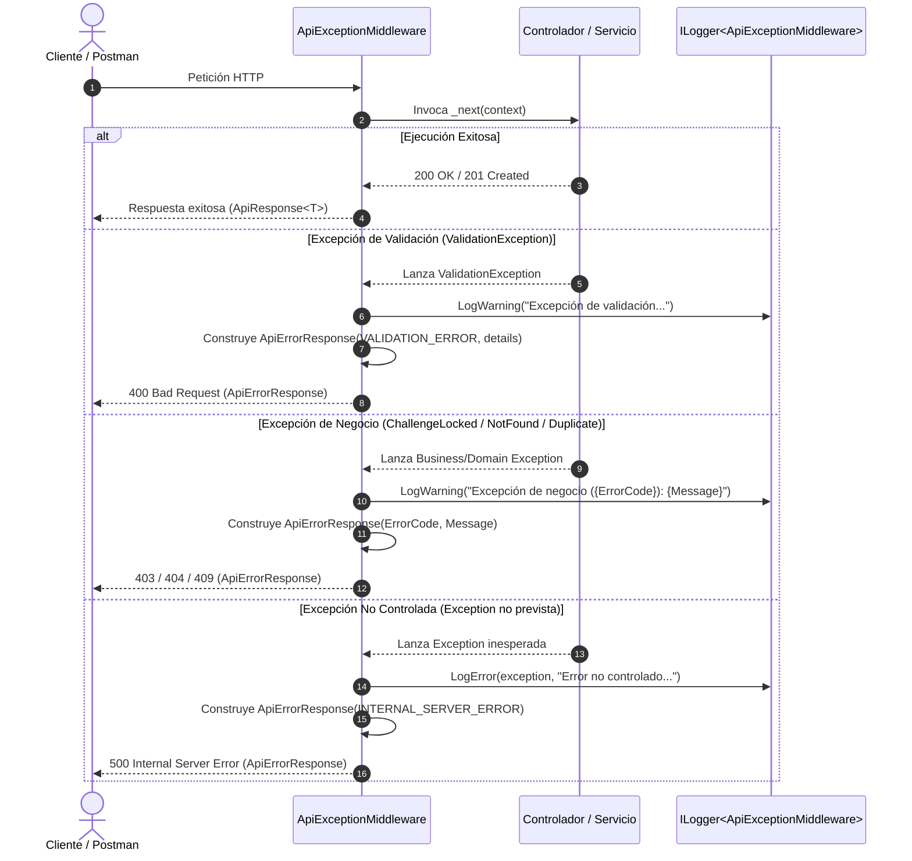
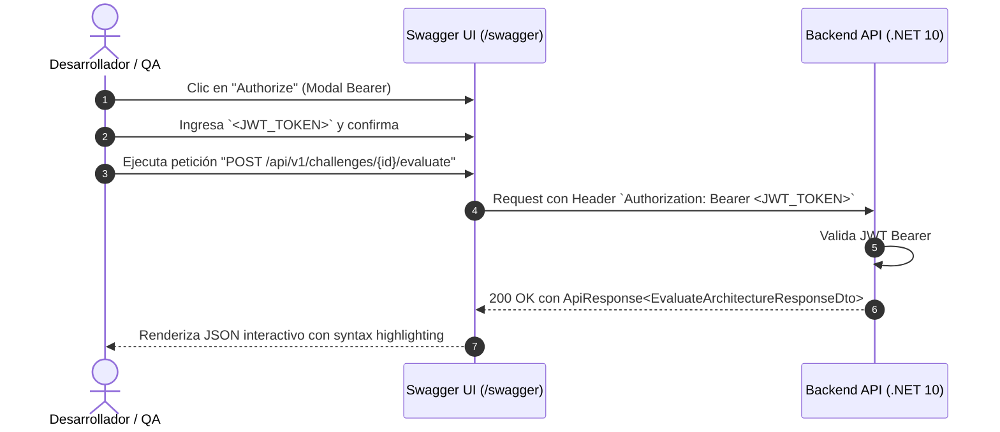

# Especificación Técnica: Manejo Global de Excepciones y Swagger / OpenAPI (Fase 3 - Hito 3.6)

## 1. Introducción y Objetivos

Esta especificación técnica define el diseño, arquitectura, contratos de respuesta de error unificados, configuración de Swagger / OpenAPI con soporte interactivo de autenticación Bearer JWT, colección de pruebas de Postman y suite de pruebas unitarias para el **Módulo de Manejo Global de Excepciones y Documentación Swagger / OpenAPI**, correspondiente a la **Tarea 3.6** de la **Fase 3** del plan de implementación ([`docs/12-implementation-plan.md`](file:///c:/workspace/aws/aws-game/docs/12-implementation-plan.md)).

Con este hito se culmina la **Fase 3: Capa de Aplicación y Endpoints de la API REST** alcanzando el **Milestone 3 (Backend API 100% Funcional y Verificable)**, garantizando que todos los endpoints responden de acuerdo con [`docs/08-api-spec.md`](file:///c:/workspace/aws/aws-game/docs/08-api-spec.md), protegen rutas mediante JWT, gestionan sesiones de invitado y transacciones de XP sin errores no controlados, y están documentados interactivamente en Swagger UI.

### Objetivos Clave:
1. **Manejo Global y Estandarizado de Excepciones (`ApiExceptionMiddleware`):** Capturar de manera determinista todas las excepciones de dominio, validación, negocio y errores no controlados en el pipeline HTTP, transformándolas en el envelope estándar `ApiErrorResponse` con códigos de error canónicos (`ErrorCodes`), mensajes amigables y detalle estructurado para validaciones.
2. **Documentación Interactiva con Swagger UI / OpenAPI (`/swagger`):** Configurar Swashbuckle / OpenAPI en .NET 10 con:
   - Esquema de seguridad `Bearer` (`Authorization: Bearer <JWT>`) con botón interactivo "Authorize" en Swagger UI.
   - Inclusión de comentarios XML (`<summary>`, `<param>`, `<response>`) generados en compilación para controladores y DTOs.
   - Metadatos de la API (Título, versión, descripción, contacto y licencia).
   - Agrupación por módulos / tags (`Authentication`, `Catalog & Challenges`, `Master Services`, `System Configuration`).
3. **Colección de Postman Automatizada (`postman/global_exception_swagger/`):** Crear la colección con pruebas automatizadas en JavaScript para validar la disponibilidad del schema OpenAPI (`/openapi/v1.json` y `/swagger/v1/swagger.json`), la interfaz Swagger UI (`/swagger/index.html`) y todos los códigos de error HTTP (400, 401, 403, 404, 409, 500).
4. **Suite de Pruebas Unitarias de Middleware al 100%:** Desarrollar pruebas unitarias completas con xUnit, Moq/NSubstitute, FluentAssertions y `DefaultHttpContext` para verificar el comportamiento de `ApiExceptionMiddleware` ante cada tipo de excepción.

```text
┌─────────────────────────────────────────────────────────────────────────────┐
│              ARQUITECTURA DE MANEJO DE EXCEPCIONES Y SWAGGER/OPENAPI         │
├─────────────────────────────────────────────────────────────────────────────┤
│                                                                             │
│   [Cliente Frontend / Postman / Swagger UI]                                 │
│            │                                                                │
│            │ HTTP Requests (Público / Bearer JWT)                           │
│            ▼                                                                │
│   ┌──────────────────────────────────────────────────────────────────────┐  │
│   │ ApiExceptionMiddleware (Global Error Interceptor)                    │  │
│   │ ├── Intercepta excepciones de cualquier capa del backend             │  │
│   │ ├── Mapea a HTTP Status Code canónico (400, 401, 403, 404, 409, 500) │  │
│   │ ├── Serializa envelope estándar ApiErrorResponse en camelCase        │  │
│   │ └── Registra logs estructurados (ILogger<ApiExceptionMiddleware>)    │  │
│   └──────────────────────┬───────────────────────────────────────────────┘  │
│                          │                                                  │
│            ┌─────────────┴─────────────┐                                    │
│            ▼                           ▼                                    │
│   ┌───────────────────┐       ┌──────────────────────────────────────────┐  │
│   │ Controladores REST│       │ Swagger / OpenAPI Endpoint & UI          │  │
│   │ ├── Auth          │       │ ├── GET /swagger/v1/swagger.json         │  │
│   │ ├── Units         │       │ ├── GET /openapi/v1.json                 │  │
│   │ ├── Challenges    │       │ └── GET /swagger/index.html (Swagger UI) │  │
│   │ ├── Services      │       │     └── Bearer Auth Dialog Activo        │  │
│   │ └── SystemConfig  │       └──────────────────────────────────────────┘  │
│   └───────────────────┘                                                     │
│                                                                             │
└─────────────────────────────────────────────────────────────────────────────┘
```

---

## 2. Requerimientos y Reglas de Negocio Vinculadas

| Requisito / Regla | Concepto | Aplicación en Middleware y Swagger |
| :--- | :--- | :--- |
| **RNF-06** | Documentación de API | La API debe documentarse exhaustivamente con Swagger/OpenAPI con endpoints, tipos y códigos de error. |
| **RNF-07** | Consistencia de Errores | Todas las respuestas de error deben usar el envelope estándar `ApiErrorResponse` con códigos canónicos en `ErrorCodes`. |
| **RNF-08** | Seguridad de Logs | Los errores internos no controlados (500) no deben exponer detalles sensibles o trazas de pila (*stack traces*) al cliente en producción. |
| **RF-20** | Modo Invitado y JWT | Swagger UI debe permitir ingresar el token JWT tanto de usuarios registrados como de sesiones de invitado para probar rutas autenticadas. |
| **Milestone 3** | Cierre de Backend API | Verificación formal del funcionamiento y trazabilidad de todos los endpoints de la API REST (.NET 10). |

---

## 3. Matriz Exhaustiva de Mapeo de Excepciones a Errores HTTP

El middleware global `ApiExceptionMiddleware` debe capturar y procesar la siguiente jerarquía de excepciones:

| Tipo de Excepción | Capa de Origen | Código HTTP | `ErrorCodes` | Mensaje por Defecto | Campo `Details` |
| :--- | :--- | :---: | :--- | :--- | :--- |
| `ValidationException` | `FluentValidation` | `400 BadRequest` | `VALIDATION_ERROR` | "Se encontraron errores de validación en la solicitud." | Lista de `ValidationErrorDetail` (`field`, `message`, `attemptedValue`). |
| `AllHintsUnlockedException`| `AwsQuest.Application`| `400 BadRequest` | `ALL_HINTS_UNLOCKED`| Mensaje de la excepción. | `null` |
| `InvalidGraphException` | `AwsQuest.Domain` | `400 BadRequest` | `INVALID_GRAPH_PAYLOAD` | Mensaje de la excepción. | `null` |
| `ServiceLimitExceededException`| `AwsQuest.Domain` | `400 BadRequest` | `SERVICE_LIMIT_EXCEEDED` | Mensaje de la excepción. | `null` |
| `DomainException` | `AwsQuest.Domain` | `400 BadRequest` | `VALIDATION_ERROR` | Mensaje de la excepción. | `null` |
| `BadHttpRequestException` | `ASP.NET Core` | `400 BadRequest` | `VALIDATION_ERROR` | "Formato de solicitud HTTP no válido o JSON mal formado." | `null` |
| `JsonException` | `System.Text.Json` | `400 BadRequest` | `VALIDATION_ERROR` | "Error al procesar el cuerpo JSON de la solicitud." | `null` |
| `InvalidCredentialsException`| `AwsQuest.Application`| `401 Unauthorized` | `INVALID_CREDENTIALS`| Mensaje de la excepción. | `null` |
| `ChallengeLockedException` | `AwsQuest.Application`| `403 Forbidden` | `CHALLENGE_LOCKED` | Mensaje de la excepción. | `null` |
| `UserNotFoundException` | `AwsQuest.Application`| `404 NotFound` | `USER_NOT_FOUND` | Mensaje de la excepción. | `null` |
| `ChallengeNotFoundException`| `AwsQuest.Application`| `404 NotFound` | `CHALLENGE_NOT_FOUND` | Mensaje de la excepción. | `null` |
| `DuplicateEmailException` | `AwsQuest.Application`| `409 Conflict` | `EMAIL_ALREADY_EXISTS` | Mensaje de la excepción. | `null` |
| `Exception` (No controlada) | Genérica / Sistema | `500 InternalServerError`| `INTERNAL_SERVER_ERROR`| "Ha ocurrido un error interno no controlado en el servidor." | `null` |

---

## 4. Diagramas de Secuencia y Flujos de Manejo de Errores

### 4.1. Flujo de Captura de Excepciones en el Middleware



---

### 4.2. Flujo de Autenticación en Swagger UI



---

## 5. Diseño e Implementación de Componentes

### 5.1. Extensión de Swagger (`Extensions/SwaggerExtensions.cs`)

Se creará una clase de extensión para encapsular de manera limpia y modular toda la configuración de Swashbuckle / OpenAPI:

```csharp
namespace AwsQuest.Api.Extensions;

using System.Reflection;
using Microsoft.OpenApi.Models;
using Swashbuckle.AspNetCore.SwaggerGen;

public static class SwaggerExtensions
{
    public static IServiceCollection AddSwaggerDocumentation(this IServiceCollection services)
    {
        services.AddEndpointsApiExplorer();
        services.AddSwaggerGen(options =>
        {
            options.SwaggerDoc("v1", new OpenApiInfo
            {
                Title = "AWS Architecture Quest API",
                Version = "v1",
                Description = "API REST modular para la plataforma gamificada de aprendizaje de arquitecturas en la nube AWS Architecture Quest (.NET 10).",
                Contact = new OpenApiContact
                {
                    Name = "Equipo AWS Quest",
                    Email = "contacto@awsquest.dev"
                },
                License = new OpenApiLicense
                {
                    Name = "MIT License"
                }
            });

            // 1. Configuración de Esquema de Seguridad Bearer JWT
            var securityScheme = new OpenApiSecurityScheme
            {
                Name = "Authorization",
                Description = "Ingrese el token JWT con el prefijo Bearer. Ejemplo: 'Bearer {token}'",
                In = ParameterLocation.Header,
                Type = SecuritySchemeType.ApiKey,
                Scheme = "Bearer",
                BearerFormat = "JWT",
                Reference = new OpenApiReference
                {
                    Id = "Bearer",
                    Type = ReferenceType.SecurityScheme
                }
            };

            options.AddSecurityDefinition("Bearer", securityScheme);

            options.AddSecurityRequirement(new OpenApiSecurityRequirement
            {
                {
                    securityScheme,
                    Array.Empty<string>()
                }
            });

            // 2. Inclusión de Comentarios XML para documentación en Swagger UI
            var xmlApiFile = $"{Assembly.GetExecutingAssembly().GetName().Name}.xml";
            var xmlApiPath = Path.Combine(AppContext.BaseDirectory, xmlApiFile);
            if (File.Exists(xmlApiPath))
            {
                options.IncludeXmlComments(xmlApiPath);
            }

            var xmlApplicationFile = "AwsQuest.Application.xml";
            var xmlApplicationPath = Path.Combine(AppContext.BaseDirectory, xmlApplicationFile);
            if (File.Exists(xmlApplicationPath))
            {
                options.IncludeXmlComments(xmlApplicationPath);
            }
        });

        return services;
    }

    public static IApplicationBuilder UseSwaggerDocumentation(this IApplicationBuilder app)
    {
        app.UseSwagger();
        app.UseSwaggerUI(options =>
        {
            options.SwaggerEndpoint("/swagger/v1/swagger.json", "AWS Architecture Quest API v1");
            options.RoutePrefix = "swagger";
            options.DocumentTitle = "AWS Architecture Quest - API Docs";
            options.DisplayRequestDuration();
            options.EnablePersistAuthorization();
        });

        return app;
    }
}
```

---

### 5.2. Actualización de `AwsQuest.Api.csproj` y `AwsQuest.Application.csproj`

Para habilitar la generación de comentarios XML requeridos por Swagger:

```xml
<PropertyGroup>
  <GenerateDocumentationFile>true</GenerateDocumentationFile>
  <NoWarn>$(NoWarn);1591</NoWarn>
</PropertyGroup>
```

---

### 5.3. Middleware Global de Excepciones (`Middlewares/ApiExceptionMiddleware.cs`)

El middleware se asegurará de capturar de forma homogénea todas las excepciones conocidas y no controladas:

```csharp
namespace AwsQuest.Api.Middlewares;

using System.Net;
using System.Text.Json;
using Microsoft.AspNetCore.Http;
using Microsoft.Extensions.Logging;
using FluentValidation;
using AwsQuest.Application.Common.Exceptions;
using AwsQuest.Application.Common.Models;
using AwsQuest.Domain.Exceptions;

public class ApiExceptionMiddleware
{
    private readonly RequestDelegate _next;
    private readonly ILogger<ApiExceptionMiddleware> _logger;

    private static readonly JsonSerializerOptions JsonOptions = new()
    {
        PropertyNamingPolicy = JsonNamingPolicy.CamelCase
    };

    public ApiExceptionMiddleware(RequestDelegate next, ILogger<ApiExceptionMiddleware> logger)
    {
        _next = next;
        _logger = logger;
    }

    public async Task InvokeAsync(HttpContext context)
    {
        try
        {
            await _next(context);
        }
        catch (Exception ex)
        {
            await HandleExceptionAsync(context, ex);
        }
    }

    private async Task HandleExceptionAsync(HttpContext context, Exception exception)
    {
        context.Response.ContentType = "application/json";

        var (statusCode, errorCode, message, details) = exception switch
        {
            ValidationException validationEx => (
                HttpStatusCode.BadRequest,
                ErrorCodes.ValidationError,
                "Se encontraron errores de validación en la solicitud.",
                (object)validationEx.Errors.Select(e => new ValidationErrorDetail
                {
                    Field = e.PropertyName,
                    Message = e.ErrorMessage,
                    AttemptedValue = e.AttemptedValue
                }).ToList()
            ),
            DuplicateEmailException dupEx => (
                HttpStatusCode.Conflict,
                ErrorCodes.EmailAlreadyExists,
                dupEx.Message,
                null
            ),
            InvalidCredentialsException credEx => (
                HttpStatusCode.Unauthorized,
                ErrorCodes.InvalidCredentials,
                credEx.Message,
                null
            ),
            UserNotFoundException userNotFoundEx => (
                HttpStatusCode.NotFound,
                ErrorCodes.UserNotFound,
                userNotFoundEx.Message,
                null
            ),
            ChallengeNotFoundException challengeNotFoundEx => (
                HttpStatusCode.NotFound,
                ErrorCodes.ChallengeNotFound,
                challengeNotFoundEx.Message,
                null
            ),
            ChallengeLockedException challengeLockedEx => (
                HttpStatusCode.Forbidden,
                ErrorCodes.ChallengeLocked,
                challengeLockedEx.Message,
                null
            ),
            AllHintsUnlockedException allHintsEx => (
                HttpStatusCode.BadRequest,
                ErrorCodes.AllHintsUnlocked,
                allHintsEx.Message,
                null
            ),
            InvalidGraphException graphEx => (
                HttpStatusCode.BadRequest,
                ErrorCodes.InvalidGraphPayload,
                graphEx.Message,
                null
            ),
            ServiceLimitExceededException limitEx => (
                HttpStatusCode.BadRequest,
                ErrorCodes.ServiceLimitExceeded,
                limitEx.Message,
                null
            ),
            DomainException domainEx => (
                HttpStatusCode.BadRequest,
                ErrorCodes.ValidationError,
                domainEx.Message,
                null
            ),
            BadHttpRequestException badHttpEx => (
                HttpStatusCode.BadRequest,
                ErrorCodes.ValidationError,
                "Formato de solicitud HTTP no válido o JSON mal formado.",
                null
            ),
            JsonException jsonEx => (
                HttpStatusCode.BadRequest,
                ErrorCodes.ValidationError,
                "Error al procesar el cuerpo JSON de la solicitud.",
                null
            ),
            _ => (
                HttpStatusCode.InternalServerError,
                ErrorCodes.InternalServerError,
                "Ha ocurrido un error interno no controlado en el servidor.",
                null
            )
        };

        if (statusCode == HttpStatusCode.InternalServerError)
        {
            _logger.LogError(exception, "Error no controlado en el servidor: {Message}", exception.Message);
        }
        else
        {
            _logger.LogWarning("Excepción de aplicación controlada ({ErrorCode}): {Message}", errorCode, exception.Message);
        }

        context.Response.StatusCode = (int)statusCode;

        var errorResponse = new ApiErrorResponse
        {
            Success = false,
            Error = new ApiErrorDetails
            {
                Code = errorCode,
                Message = message,
                Details = details
            }
        };

        var json = JsonSerializer.Serialize(errorResponse, JsonOptions);
        await context.Response.WriteAsync(json);
    }
}
```

---

### 5.4. Integración en `Program.cs`

```csharp
using AwsQuest.Api.Extensions;
using AwsQuest.Api.Middlewares;
using AwsQuest.Application;
using AwsQuest.Application.Common.Interfaces;
using AwsQuest.Infrastructure;

var builder = WebApplication.CreateBuilder(args);

// Servicios de Aplicación e Infraestructura
builder.Services.AddApplication();
builder.Services.AddInfrastructure(builder.Configuration);

// Autenticación JWT y Autorización
builder.Services.AddJwtAuthentication(builder.Configuration);
builder.Services.AddAuthorization();

// Controladores y Serialización JSON
builder.Services.AddControllers()
    .AddJsonOptions(options =>
    {
        options.JsonSerializerOptions.Converters.Add(new System.Text.Json.Serialization.JsonStringEnumConverter(System.Text.Json.JsonNamingPolicy.CamelCase));
        options.JsonSerializerOptions.PropertyNamingPolicy = System.Text.Json.JsonNamingPolicy.CamelCase;
    });

// Documentación Swagger / OpenAPI
builder.Services.AddSwaggerDocumentation();

var app = builder.Build();

// Middleware Global de Captura de Excepciones (Primero en el pipeline)
app.UseMiddleware<ApiExceptionMiddleware>();

// Documentación Swagger UI
app.UseSwaggerDocumentation();

// Inicialización de Datos Semilla en Desarrollo
if (app.Environment.IsDevelopment())
{
    using var scope = app.Services.CreateScope();
    var seeder = scope.ServiceProvider.GetRequiredService<IChallengeSeeder>();
    await seeder.SeedAsync();
}

app.UseHttpsRedirection();

app.UseAuthentication();
app.UseAuthorization();

app.MapControllers();

app.Run();

public partial class Program { }
```

---

## 6. Especificación de la Colección de Postman (`postman/global_exception_swagger/`)

Se organizarán las carpetas y archivos en la ruta `postman/global_exception_swagger/`:

### 6.1. Estructura de Archivos:
```text
postman/
└── global_exception_swagger/
    ├── README.md
    ├── awsquest-local.postman_environment.json
    └── awsquest-global-exception-swagger.postman_collection.json
```

### 6.2. Detalle de Peticiones y Aserciones en la Colección:

#### Carpeta `00 - Documentación Swagger y OpenAPI`:
1. `GET /swagger/v1/swagger.json` (Swagger JSON Specification)
   - Test: `Status 200 OK`, `info.title == "AWS Architecture Quest API"`, contiene componentes de seguridad Bearer.
2. `GET /swagger/index.html` (Swagger UI HTML)
   - Test: `Status 200 OK`, `Content-Type` contiene `text/html`, contiene texto `Swagger UI`.

#### Carpeta `01 - Escenarios de Error 400 Bad Request`:
1. `POST /api/v1/auth/register` (Validation Error - Campos Faltantes)
   - Body: `{ "email": "invalido", "password": "123", "name": "" }`
   - Test: `Status 400 Bad Request`, `error.code == "VALIDATION_ERROR"`, `error.details` contiene array de 3 errores.
2. `POST /api/v1/challenges/{id}/evaluate` (Invalid Graph Payload - Grafo Vacío)
   - Body: `{ "graph": { "components": [] } }`
   - Test: `Status 400 Bad Request`, `error.code == "INVALID_GRAPH_PAYLOAD"`.
3. `PATCH /api/v1/system/config` (Bad Request - Enum Fuera de Rango)
   - Body: `{ "accessMode": 999 }`
   - Test: `Status 400 Bad Request`, `error.code == "VALIDATION_ERROR"`.

#### Carpeta `02 - Escenarios de Error 401 Unauthorized`:
1. `GET /api/v1/auth/me` (Sin Token JWT)
   - Test: `Status 401 Unauthorized`, `error.code == "UNAUTHORIZED"`.
2. `POST /api/v1/auth/login` (Credenciales Inválidas)
   - Body: `{ "email": "noexiste@test.com", "password": "Password123!" }`
   - Test: `Status 401 Unauthorized`, `error.code == "INVALID_CREDENTIALS"`.

#### Carpeta `03 - Escenarios de Error 403 Forbidden`:
1. `GET /api/v1/challenges/{id}` (Desafío Bloqueado en Modo Progresivo)
   - Test: `Status 403 Forbidden`, `error.code == "CHALLENGE_LOCKED"`.

#### Carpeta `04 - Escenarios de Error 404 Not Found`:
1. `GET /api/v1/challenges/00000000-0000-0000-0000-000000000000` (Desafío Inexistente)
   - Test: `Status 404 Not Found`, `error.code == "CHALLENGE_NOT_FOUND"`.

#### Carpeta `05 - Escenarios de Error 409 Conflict`:
1. `POST /api/v1/auth/register` (Email Duplicado)
   - Test: `Status 409 Conflict`, `error.code == "EMAIL_ALREADY_EXISTS"`.

---

## 7. Suite de Pruebas Unitarias (`AwsQuest.UnitTests/Middlewares/`)

Se creará la clase `ApiExceptionMiddlewareTests.cs` en `apps/api/tests/AwsQuest.UnitTests/Middlewares/` cubriendo todos los casos:

### Casos de Prueba Unitarios Previstos (11 tests):
1. `InvokeAsync_WhenNoExceptionOccurs_CallsNextDelegateSuccessfully`
2. `InvokeAsync_WhenValidationExceptionThrown_Returns400WithValidationErrorDetails`
3. `InvokeAsync_WhenInvalidCredentialsExceptionThrown_Returns401WithInvalidCredentialsCode`
4. `InvokeAsync_WhenChallengeLockedExceptionThrown_Returns403WithChallengeLockedCode`
5. `InvokeAsync_WhenChallengeNotFoundExceptionThrown_Returns404WithChallengeNotFoundCode`
6. `InvokeAsync_WhenUserNotFoundExceptionThrown_Returns404WithUserNotFoundCode`
7. `InvokeAsync_WhenDuplicateEmailExceptionThrown_Returns409WithEmailAlreadyExistsCode`
8. `InvokeAsync_WhenAllHintsUnlockedExceptionThrown_Returns400WithAllHintsUnlockedCode`
9. `InvokeAsync_WhenInvalidGraphExceptionThrown_Returns400WithInvalidGraphPayloadCode`
10. `InvokeAsync_WhenServiceLimitExceededExceptionThrown_Returns400WithServiceLimitExceededCode`
11. `InvokeAsync_WhenUnhandledExceptionThrown_Returns500WithInternalServerErrorCode`

---

## 8. Matriz de Trazabilidad y Criterios de Aceptación (Definition of Done)

| Elemento | Criterio de Aceptación | Verificación |
| :--- | :--- | :--- |
| **`ApiExceptionMiddleware`** | Captura el 100% de las excepciones y responde en formato canónico `ApiErrorResponse` con camelCase y sin filtrar stack traces. | `ApiExceptionMiddlewareTests` |
| **`SwaggerExtensions` & Swagger UI** | Swagger UI disponible en `/swagger/index.html` con documentación de todos los endpoints, Bearer Auth interactivo y comentarios XML. | Navegación Swagger UI & Postman |
| **Colección Postman** | Colección y entorno en `postman/global_exception_swagger/` cubriendo Swagger y cada código de error HTTP. | Postman Collection Runner (100% PASS) |
| **Cobertura de Tests** | Todos los tests unitarios del middleware y tests previos pasando al 100%. | `dotnet test apps/api/AwsQuest.slnx` |
| **Milestone 3 Alcanzado** | Cierre formal de la Fase 3 del plan de implementación con 100% de endpoints REST operativos. | `docs/13-implementation-status.md` |
