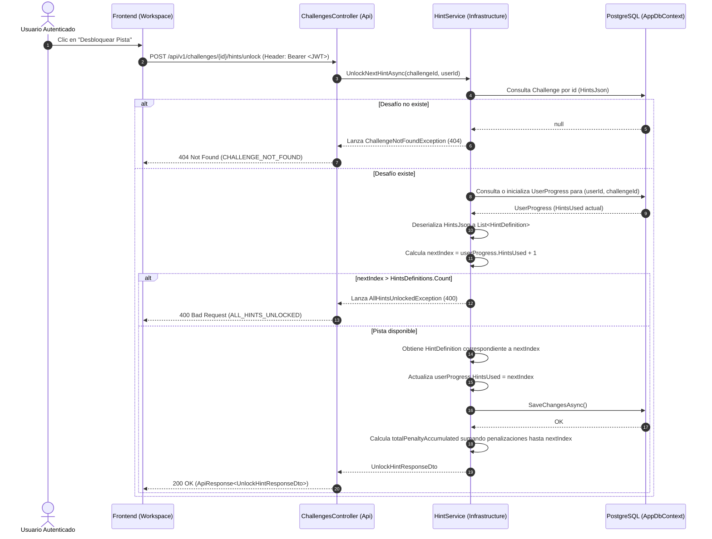
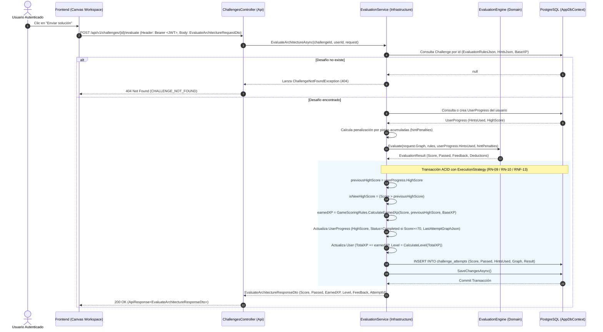

# Especificación Técnica: Módulo de Pistas y Evaluación (Fase 3 - Hito 3.4)

## 1. Introducción y Objetivos

Esta especificación técnica define la arquitectura, diseño de interfaces, lógica de negocio del motor de evaluación, transaccionalidad de puntuación y experiencia (XP), endpoints REST, colección de Postman y suite de pruebas para el **Módulo de Pistas y Evaluación**, correspondiente a la **Tarea 3.4** de la **Fase 3** del plan de implementación ([`docs/12-implementation-plan.md`](file:///c:/workspace/aws/aws-game/docs/12-implementation-plan.md)), en estricto cumplimiento con el contrato de API REST ([`docs/08-api-spec.md`](file:///c:/workspace/aws/aws-game/docs/08-api-spec.md)), el modelo de datos ([`docs/07-data-model.md`](file:///c:/workspace/aws/aws-game/docs/07-data-model.md)), las mecánicas de juego ([`docs/10-game-mechanics.md`](file:///c:/workspace/aws/aws-game/docs/10-game-mechanics.md)) y los casos de uso ([`docs/05-use-cases.md`](file:///c:/workspace/aws/aws-game/docs/05-use-cases.md)).

### Objetivos Clave:
1. **Desbloqueo Secuencial de Pistas (`POST /challenges/{id}/hints/unlock` - RN-06 / RN-07 / CU-04):** Permitir a los usuarios revelar pistas pedagógicas en orden estricto ($1 \rightarrow 2 \rightarrow 3$), acumulando penalizaciones sobre la puntuación máxima alcanzable y persistiendo el estado en `UserProgress`. Rechazar solicitudes cuando todas las pistas han sido reveladas (`ALL_HINTS_UNLOCKED`).
2. **Evaluación Transaccional de Arquitecturas (`POST /challenges/{id}/evaluate` - RF-13 a RF-19 / CU-05):** Ejecutar en memoria el motor de evaluación (`IEvaluationEngine`), calculando la puntuación cuantitativa $[0, 100]$, estado de aprobación ($\ge 70$ pts - **RN-02**) y feedback pedagógico con categorización de aciertos, advertencias y fallos.
3. **Persistencia Atómica y XP Anti-Farmeo (RN-09 / RN-10 / RNF-13):** Ejecutar una transacción ACID (`IDbContextTransaction` con `CreateExecutionStrategy`) para:
   * Conservar el récord histórico (`HighScore`) sin degradación en intentos con menor nota (**RN-09**).
   * Calcular y sumar XP incremental únicamente cuando se supera el récord personal previo (**RN-10**).
   * Actualizar el nivel del usuario en tiempo real según `GameScoringRules`.
   * Registrar la auditoría inmutable del envío en `ChallengeAttempt` con el grafo y resultado serializados en `JSONB`.
4. **Historial de Intentos (`GET /challenges/{id}/attempts` - CU-05 / CU-06):** Proveer la lista cronológica de soluciones enviadas por el usuario para análisis retrospectivo y corrección iterativa.
5. **Colección de Postman Automatizada:** Diseñar la colección completa en `postman/hints_evaluation/` con tests automáticos para validar el ciclo completo de juego (*gameplay loop*).

```text
┌─────────────────────────────────────────────────────────────────────────────┐
│                   ARQUITECTURA DEL MÓDULO DE PISTAS Y EVALUACIÓN            │
├─────────────────────────────────────────────────────────────────────────────┤
│                                                                             │
│   [Cliente Web (React / React Flow)]                                        │
│            │                                                                │
│            │ HTTP Requests + Bearer Token (JWT)                             │
│            ▼                                                                │
│   ┌──────────────────────────────────────────────────────────────────────┐  │
│   │ AwsQuest.Api                                                         │  │
│   │ ├── Controllers/ChallengesController.cs                              │  │
│   │ │   ├── POST /api/v1/challenges/{id}/hints/unlock                    │  │
│   │ │   ├── POST /api/v1/challenges/{id}/evaluate                        │  │
│   │ │   └── GET  /api/v1/challenges/{id}/attempts                        │  │
│   │ └── Middlewares/ApiExceptionMiddleware.cs (Mapeo 400, 403, 404)      │  │
│   └──────────────────────┬───────────────────────────────────────────────┘  │
│                          │                                                  │
│                          ▼                                                  │
│   ┌──────────────────────────────────────────────────────────────────────┐  │
│   │ AwsQuest.Application                                                 │  │
│   │ ├── Common/Interfaces/ (IHintService, IEvaluationService)            │  │
│   │ ├── Dtos/Challenge/ (UnlockHintResponseDto, HintsSummaryDto)         │  │
│   │ ├── Dtos/Evaluation/ (EvaluateRequest, EvaluateResponse, AttemptDto) │  │
│   │ └── Exceptions/ (AllHintsUnlockedException, CatalogExceptions)       │  │
│   └──────────────────────┬───────────────────────────────────────────────┘  │
│                          │                                                  │
│                          ▼                                                  │
│   ┌──────────────────────────────────────────────────────────────────────┐  │
│   │ AwsQuest.Infrastructure                                              │  │
│   │ ├── Services/HintService.cs                                          │  │
│   │ ├── Services/EvaluationService.cs (Transaccional ACID + EF Core 10)  │  │
│   │ └── Engine/EvaluationEngine.cs (Evaluación en memoria < 100ms)       │  │
│   └──────────────────────────────────────────────────────────────────────┘  │
│                                                                             │
└─────────────────────────────────────────────────────────────────────────────┘
```

---

## 2. Requerimientos y Reglas de Negocio Vinculadas

| Requisito / Regla | Concepto | Aplicación en Pistas y Evaluación |
| :--- | :--- | :--- |
| **RF-13 a RF-19** | Motor de Evaluación y Diagnóstico | Ejecución del pipeline de evaluadores de presencia, conexiones, límites y antipatrones. |
| **RN-02** | Criterio de Aprobación | Un desafío se aprueba con $\text{Score} \ge 70$. Marca `Passed = true` y estado `Completed`. |
| **RN-06** | Desbloqueo Secuencial de Pistas | Se exige desbloquear la pista $N$ antes de acceder a la pista $N+1$. |
| **RN-07** | Deducción por Pistas | Cada pista desbloqueada resta penalización fija sobre la nota máxima alcanzable. |
| **RN-08** | Penalización por Antipatrones | Deducción de puntos por SPOF, base de datos pública o falta de alta disponibilidad. |
| **RN-09** | Conservación de High Score | La mejor nota histórica nunca se sobrescribe si un nuevo intento obtiene menor puntuación. |
| **RN-10** | XP Incremental Anti-Farmeo | Otorga XP únicamente sobre el diferencial: $\text{EarnedXP} = \lfloor (\text{NewScore} - \text{PrevHighScore}) \times (\text{BaseXP} / 100) \rfloor$. |
| **RN-11 / RN-12** | Reintentos Ilimitados | Intentos ilimitados; la evaluación se dispara exclusivamente al presionar "Enviar solución". |
| **CU-04 / CU-05** | Casos de Uso de Gameplay | Flujo de desbloqueo de pistas, envío de arquitectura y consulta de auditoría histórica. |

---

## 3. Diagramas de Secuencia y Flujos de Interacción

### 3.1. Flujo de Desbloqueo de Pista (`POST /api/v1/challenges/{id}/hints/unlock` - CU-04)



---

### 3.2. Flujo de Evaluación de Arquitectura (`POST /api/v1/challenges/{id}/evaluate` - CU-05)



---

## 4. Diseño Detallado de Contratos e Interfaces (`AwsQuest.Application`)

### 4.1. Contrato `IHintService`

Ubicación: `apps/api/src/AwsQuest.Application/Common/Interfaces/IHintService.cs`

```csharp
namespace AwsQuest.Application.Common.Interfaces;

using AwsQuest.Application.Dtos.Challenge;

public interface IHintService
{
    /// <summary>
    /// Desbloquea la siguiente pista disponible en orden secuencial para el desafío y usuario especificados.
    /// Acumula la penalización correspondiente y persiste el nuevo contador de pistas usadas.
    /// </summary>
    Task<UnlockHintResponseDto> UnlockNextHintAsync(Guid challengeId, Guid userId, CancellationToken cancellationToken = default);
}
```

---

### 4.2. Contrato `IEvaluationService`

Ubicación: `apps/api/src/AwsQuest.Application/Common/Interfaces/IEvaluationService.cs`

```csharp
namespace AwsQuest.Application.Common.Interfaces;

using AwsQuest.Application.Dtos.Evaluation;

public interface IEvaluationService
{
    /// <summary>
    /// Evalúa la arquitectura enviada contra las reglas declarativas del desafío en memoria,
    /// actualiza atómicamente el progreso, récords de puntuación y XP anti-farmeo, y registra el intento histórico.
    /// </summary>
    Task<EvaluateArchitectureResponseDto> EvaluateArchitectureAsync(
        Guid challengeId, 
        Guid userId, 
        EvaluateArchitectureRequestDto request, 
        CancellationToken cancellationToken = default);

    /// <summary>
    /// Obtiene el historial de envíos de intentos realizados por el usuario para este desafío.
    /// </summary>
    Task<List<ChallengeAttemptHistoryDto>> GetChallengeAttemptsHistoryAsync(
        Guid challengeId, 
        Guid userId, 
        CancellationToken cancellationToken = default);
}
```

---

### 4.3. Excepciones de Aplicación

Ubicación: `apps/api/src/AwsQuest.Application/Common/Exceptions/EvaluationExceptions.cs`

```csharp
namespace AwsQuest.Application.Common.Exceptions;

public class AllHintsUnlockedException : Exception
{
    public AllHintsUnlockedException() 
        : base("Se han desbloqueado todas las pistas disponibles para este desafío.")
    {
    }
}
```

---

## 5. Especificación de Implementaciones en Infraestructura (`AwsQuest.Infrastructure`)

### 5.1. Implementación de `HintService`

Ubicación: `apps/api/src/AwsQuest.Infrastructure/Services/HintService.cs`

```csharp
namespace AwsQuest.Infrastructure.Services;

using System.Text.Json;
using System.Text.Json.Serialization;
using Microsoft.EntityFrameworkCore;
using AwsQuest.Application.Common.Exceptions;
using AwsQuest.Application.Common.Interfaces;
using AwsQuest.Application.Dtos.Challenge;
using AwsQuest.Domain.Engine.Models;
using AwsQuest.Domain.Entities;
using AwsQuest.Domain.Enums;

public class HintService : IHintService
{
    private readonly IAppDbContext _dbContext;
    private static readonly JsonSerializerOptions JsonOptions = new()
    {
        PropertyNamingPolicy = JsonNamingPolicy.CamelCase,
        Converters = { new JsonStringEnumConverter(JsonNamingPolicy.CamelCase) }
    };

    public HintService(IAppDbContext dbContext)
    {
        _dbContext = dbContext;
    }

    public async Task<UnlockHintResponseDto> UnlockNextHintAsync(Guid challengeId, Guid userId, CancellationToken cancellationToken = default)
    {
        // 1. Cargar desafío
        var challenge = await _dbContext.Challenges
            .AsNoTracking()
            .FirstOrDefaultAsync(c => c.Id == challengeId, cancellationToken);

        if (challenge == null)
        {
            throw new ChallengeNotFoundException(challengeId);
        }

        // 2. Deserializar definiciones de pistas
        var hintsDefinitions = !string.IsNullOrWhiteSpace(challenge.HintsJson)
            ? JsonSerializer.Deserialize<List<HintDefinition>>(challenge.HintsJson, JsonOptions) ?? []
            : [];

        // 3. Obtener o inicializar registro de progreso
        var progress = await _dbContext.UserProgresses
            .FirstOrDefaultAsync(p => p.UserId == userId && p.ChallengeId == challengeId, cancellationToken);

        if (progress == null)
        {
            progress = new UserProgress
            {
                Id = Guid.NewGuid(),
                UserId = userId,
                ChallengeId = challengeId,
                Status = ProgressStatus.InProgress,
                HighScore = 0,
                HintsUsed = 0,
                CreatedAt = DateTime.UtcNow,
                UpdatedAt = DateTime.UtcNow
            };
            _dbContext.UserProgresses.Add(progress);
        }

        var nextIndex = progress.HintsUsed + 1;

        if (nextIndex > hintsDefinitions.Count)
        {
            throw new AllHintsUnlockedException();
        }

        var nextHint = hintsDefinitions.FirstOrDefault(h => h.OrderIndex == nextIndex)
            ?? throw new AllHintsUnlockedException();

        // 4. Actualizar estado y persistir
        progress.HintsUsed = nextIndex;
        progress.UpdatedAt = DateTime.UtcNow;
        await _dbContext.SaveChangesAsync(cancellationToken);

        var totalPenalty = hintsDefinitions
            .Where(h => h.OrderIndex <= nextIndex)
            .Sum(h => h.PenaltyPoints);

        return new UnlockHintResponseDto
        {
            UnlockedHint = new UnlockedHintDto
            {
                OrderIndex = nextHint.OrderIndex,
                Text = nextHint.Text,
                PenaltyApplied = nextHint.PenaltyPoints
            },
            TotalHintsUnlocked = nextIndex,
            TotalPenaltyAccumulated = totalPenalty
        };
    }
}
```

---

### 5.2. Implementación de `EvaluationService`

Ubicación: `apps/api/src/AwsQuest.Infrastructure/Services/EvaluationService.cs`

```csharp
namespace AwsQuest.Infrastructure.Services;

using System.Text.Json;
using System.Text.Json.Serialization;
using Microsoft.EntityFrameworkCore;
using AwsQuest.Application.Common.Exceptions;
using AwsQuest.Application.Common.Interfaces;
using AwsQuest.Application.Dtos.Evaluation;
using AwsQuest.Domain.Engine;
using AwsQuest.Domain.Engine.Models;
using AwsQuest.Domain.Entities;
using AwsQuest.Domain.Enums;

public class EvaluationService : IEvaluationService
{
    private readonly IAppDbContext _dbContext;
    private readonly IEvaluationEngine _evaluationEngine;

    private static readonly JsonSerializerOptions JsonOptions = new()
    {
        PropertyNamingPolicy = JsonNamingPolicy.CamelCase,
        Converters = { new JsonStringEnumConverter(JsonNamingPolicy.CamelCase) }
    };

    public EvaluationService(
        IAppDbContext dbContext,
        IEvaluationEngine evaluationEngine)
    {
        _dbContext = dbContext;
        _evaluationEngine = evaluationEngine;
    }

    public async Task<EvaluateArchitectureResponseDto> EvaluateArchitectureAsync(
        Guid challengeId, 
        Guid userId, 
        EvaluateArchitectureRequestDto request, 
        CancellationToken cancellationToken = default)
    {
        // 1. Cargar desafío
        var challenge = await _dbContext.Challenges
            .AsNoTracking()
            .FirstOrDefaultAsync(c => c.Id == challengeId, cancellationToken);

        if (challenge == null)
        {
            throw new ChallengeNotFoundException(challengeId);
        }

        // 2. Deserializar reglas de evaluación y pistas
        var evaluationRules = !string.IsNullOrWhiteSpace(challenge.EvaluationRulesJson)
            ? JsonSerializer.Deserialize<ChallengeEvaluationRules>(challenge.EvaluationRulesJson, JsonOptions) ?? new()
            : new();

        var hintsDefinitions = !string.IsNullOrWhiteSpace(challenge.HintsJson)
            ? JsonSerializer.Deserialize<List<HintDefinition>>(challenge.HintsJson, JsonOptions) ?? []
            : [];

        // 3. Obtener progreso actual para determinar pistas desbloqueadas
        var progress = await _dbContext.UserProgresses
            .FirstOrDefaultAsync(p => p.UserId == userId && p.ChallengeId == challengeId, cancellationToken);

        var hintsUsedCount = progress?.HintsUsed ?? 0;
        var hintPenalties = hintsDefinitions
            .Where(h => h.OrderIndex <= hintsUsedCount)
            .Sum(h => h.PenaltyPoints);

        // 4. Evaluar en memoria con IEvaluationEngine
        var evaluationResult = _evaluationEngine.Evaluate(
            request.Graph, 
            evaluationRules, 
            hintsUsed: hintsUsedCount, 
            hintPenalties: hintPenalties);

        // 5. Ejecutar persistencia atómica con CreateExecutionStrategy (RNF-13)
        var strategy = _dbContext.Database.CreateExecutionStrategy();
        EvaluateArchitectureResponseDto response = null!;

        await strategy.ExecuteAsync(async () =>
        {
            var isRelational = _dbContext.Database.IsRelational();
            Microsoft.EntityFrameworkCore.Storage.IDbContextTransaction? transaction = null;
            if (isRelational)
            {
                transaction = await _dbContext.Database.BeginTransactionAsync(cancellationToken);
            }

            try
            {
                var user = await _dbContext.Users
                    .FirstOrDefaultAsync(u => u.Id == userId, cancellationToken);

                if (user == null)
                {
                    throw new UserNotFoundException(userId);
                }

                if (progress == null)
                {
                    progress = new UserProgress
                    {
                        Id = Guid.NewGuid(),
                        UserId = userId,
                        ChallengeId = challengeId,
                        Status = ProgressStatus.InProgress,
                        HighScore = 0,
                        HintsUsed = 0,
                        CreatedAt = DateTime.UtcNow,
                        UpdatedAt = DateTime.UtcNow
                    };
                    _dbContext.UserProgresses.Add(progress);
                }

                var previousHighScore = progress.HighScore;
                var isNewHighScore = evaluationResult.Score > previousHighScore;
                var earnedXp = GameScoringRules.CalculateEarnedXp(evaluationResult.Score, previousHighScore, challenge.BaseXP);

                // Actualizar progreso
                if (isNewHighScore)
                {
                    progress.HighScore = evaluationResult.Score;
                }

                if (evaluationResult.Passed)
                {
                    progress.Status = ProgressStatus.Completed;
                    progress.FirstCompletedAt ??= DateTime.UtcNow;
                }
                else if (progress.Status == ProgressStatus.NotStarted)
                {
                    progress.Status = ProgressStatus.InProgress;
                }

                progress.LastAttemptGraphJson = JsonSerializer.Serialize(request.Graph, JsonOptions);
                progress.UpdatedAt = DateTime.UtcNow;

                // Actualizar usuario XP y Nivel
                user.TotalXP += earnedXp;
                user.Level = GameScoringRules.CalculateLevel(user.TotalXP);
                user.UpdatedAt = DateTime.UtcNow;

                // Registrar intento histórico
                var attempt = new ChallengeAttempt
                {
                    Id = Guid.NewGuid(),
                    ProgressId = progress.Id,
                    Score = evaluationResult.Score,
                    Passed = evaluationResult.Passed,
                    HintsUsed = progress.HintsUsed,
                    GraphSubmittedJson = JsonSerializer.Serialize(request.Graph, JsonOptions),
                    EvaluationResultJson = JsonSerializer.Serialize(evaluationResult, JsonOptions),
                    CreatedAt = DateTime.UtcNow
                };
                _dbContext.ChallengeAttempts.Add(attempt);

                await _dbContext.SaveChangesAsync(cancellationToken);

                if (transaction != null)
                {
                    await transaction.CommitAsync(cancellationToken);
                }

                response = new EvaluateArchitectureResponseDto
                {
                    Score = evaluationResult.Score,
                    Passed = evaluationResult.Passed,
                    IsNewHighScore = isNewHighScore,
                    EarnedXP = earnedXp,
                    CurrentUserXP = user.TotalXP,
                    CurrentUserLevel = user.Level,
                    Feedback = evaluationResult.Feedback,
                    AttemptId = attempt.Id
                };
            }
            catch
            {
                if (transaction != null)
                {
                    await transaction.RollbackAsync(cancellationToken);
                }
                throw;
            }
        });

        return response;
    }

    public async Task<List<ChallengeAttemptHistoryDto>> GetChallengeAttemptsHistoryAsync(
        Guid challengeId, 
        Guid userId, 
        CancellationToken cancellationToken = default)
    {
        var progress = await _dbContext.UserProgresses
            .AsNoTracking()
            .FirstOrDefaultAsync(p => p.UserId == userId && p.ChallengeId == challengeId, cancellationToken);

        if (progress == null)
        {
            return [];
        }

        var attempts = await _dbContext.ChallengeAttempts
            .AsNoTracking()
            .Where(a => a.ProgressId == progress.Id)
            .OrderByDescending(a => a.CreatedAt)
            .ToListAsync(cancellationToken);

        return attempts.Select(a =>
        {
            SemanticGraph graph = new();
            if (!string.IsNullOrWhiteSpace(a.GraphSubmittedJson))
            {
                try
                {
                    graph = JsonSerializer.Deserialize<SemanticGraph>(a.GraphSubmittedJson, JsonOptions) ?? new();
                }
                catch
                {
                    graph = new();
                }
            }

            return new ChallengeAttemptHistoryDto
            {
                Id = a.Id,
                Score = a.Score,
                Passed = a.Passed,
                HintsUsed = a.HintsUsed,
                CreatedAt = a.CreatedAt,
                GraphSubmitted = graph
            };
        }).ToList();
    }
}
```

---

## 6. Especificación de Endpoints REST (`AwsQuest.Api`)

### 6.1. Endpoints en `ChallengesController.cs`

Ubicación: `apps/api/src/AwsQuest.Api/Controllers/ChallengesController.cs`

Se agregan las 3 rutas REST para pistas, evaluación e intentos:

```csharp
/// <summary>
/// Desbloquea la siguiente pista secuencial para el desafío.
/// </summary>
[HttpPost("{id:guid}/hints/unlock")]
[ProducesResponseType(typeof(ApiResponse<UnlockHintResponseDto>), StatusCodes.Status200OK)]
[ProducesResponseType(typeof(ApiErrorResponse), StatusCodes.Status400BadRequest)]
[ProducesResponseType(typeof(ApiErrorResponse), StatusCodes.Status401Unauthorized)]
[ProducesResponseType(typeof(ApiErrorResponse), StatusCodes.Status404NotFound)]
public async Task<IActionResult> UnlockNextHint(
    [FromRoute] Guid id, 
    CancellationToken cancellationToken)
{
    var userId = _currentUserService.UserId;
    if (!userId.HasValue) return Unauthorized();

    var result = await _hintService.UnlockNextHintAsync(id, userId.Value, cancellationToken);
    return Ok(ApiResponse<UnlockHintResponseDto>.Ok(result));
}

/// <summary>
/// Evalúa la arquitectura diseñada contra las reglas declarativas del desafío.
/// </summary>
[HttpPost("{id:guid}/evaluate")]
[ProducesResponseType(typeof(ApiResponse<EvaluateArchitectureResponseDto>), StatusCodes.Status200OK)]
[ProducesResponseType(typeof(ApiErrorResponse), StatusCodes.Status400BadRequest)]
[ProducesResponseType(typeof(ApiErrorResponse), StatusCodes.Status401Unauthorized)]
[ProducesResponseType(typeof(ApiErrorResponse), StatusCodes.Status404NotFound)]
public async Task<IActionResult> EvaluateArchitecture(
    [FromRoute] Guid id,
    [FromBody] EvaluateArchitectureRequestDto request,
    CancellationToken cancellationToken)
{
    var userId = _currentUserService.UserId;
    if (!userId.HasValue) return Unauthorized();

    var result = await _evaluationService.EvaluateArchitectureAsync(id, userId.Value, request, cancellationToken);
    return Ok(ApiResponse<EvaluateArchitectureResponseDto>.Ok(result));
}

/// <summary>
/// Obtiene el historial cronológico de intentos enviados por el usuario para este desafío.
/// </summary>
[HttpGet("{id:guid}/attempts")]
[ProducesResponseType(typeof(ApiResponse<List<ChallengeAttemptHistoryDto>>), StatusCodes.Status200OK)]
[ProducesResponseType(typeof(ApiErrorResponse), StatusCodes.Status401Unauthorized)]
public async Task<IActionResult> GetAttemptsHistory(
    [FromRoute] Guid id,
    CancellationToken cancellationToken)
{
    var userId = _currentUserService.UserId;
    if (!userId.HasValue) return Unauthorized();

    var result = await _evaluationService.GetChallengeAttemptsHistoryAsync(id, userId.Value, cancellationToken);
    return Ok(ApiResponse<List<ChallengeAttemptHistoryDto>>.Ok(result));
}
```

---

### 6.2. Actualización de `ApiExceptionMiddleware.cs`

Mapeo de la nueva excepción de aplicación:

```csharp
AllHintsUnlockedException hintsEx => (
    HttpStatusCode.BadRequest,
    ErrorCodes.AllHintsUnlocked,
    hintsEx.Message,
    null
),
```

---

## 7. Colección de Pruebas Postman (`postman/hints_evaluation/`)

Se especifican los artefactos a crear en la raíz del proyecto para pruebas manuales y automatizadas:

1. **`postman/hints_evaluation/awsquest-hints-evaluation.postman_collection.json`:**
   * **`00 - Setup de Autenticación y Catálogo`:**
     * `POST /auth/guest`: Obtiene JWT y almacena `authToken`.
     * `GET /units`: Consulta el catálogo y captura el primer `challengeId` disponible.
   * **`01 - Desbloqueo de Pistas (/hints/unlock)`:**
     * `POST Desbloquear Pista 1`: Valida `OrderIndex: 1`, penalización aplicada y actualiza `hintsUsed`.
     * `POST Desbloquear Pista 2`: Valida orden secuencial ($N+1$).
     * `POST Desbloquear Pista Excedida (Error 400 ALL_HINTS_UNLOCKED)`: Valida el rechazo al agotar pistas.
   * **`02 - Evaluación de Arquitectura (/evaluate)`:**
     * `POST Evaluar Arquitectura Exitosa (100 Puntos)`: Envía solución válida (ej. ALB + EC2 + RDS), valida `Passed: true`, `Score: 100`, cálculo de XP y nuevo nivel.
     * `POST Re-evaluar Misma Nota (Anti-Farmeo RN-10)`: Envía idéntica solución y valida `EarnedXP: 0`.
     * `POST Evaluar con Antipatrón SPOF`: Envía solución sin redundancia y valida deducciones y feedback de error.
     * `POST Evaluar Grafo Vacío (Error 400 INVALID_GRAPH_PAYLOAD)`: Valida el rechazo de payload sin componentes.
   * **`03 - Historial de Intentos (/attempts)`:**
     * `GET Listar Intentos`: Valida el retorno de los intentos previos ordenados con notas y grafos.
2. **`postman/hints_evaluation/awsquest-local.postman_environment.json`:** Base URL `https://localhost:7234`.
3. **`postman/hints_evaluation/README.md`:** Documentación de uso.

---

## 8. Estrategia de Pruebas Unitarias (`AwsQuest.UnitTests`)

Se diseñan las suites de pruebas unitarias para validar exhaustivamente todos los escenarios:

### 8.1. Suite `HintServiceTests.cs` (4 tests)
* **Test 1:** `UnlockNextHintAsync_WhenFirstHintRequested_UnlocksHint1AndPersistsInDb`.
* **Test 2:** `UnlockNextHintAsync_WhenSequentialHintRequested_UnlocksHint2AndCalculatesCumulativePenalty`.
* **Test 3:** `UnlockNextHintAsync_WhenAllHintsAlreadyUnlocked_ThrowsAllHintsUnlockedException`.
* **Test 4:** `UnlockNextHintAsync_WhenChallengeDoesNotExist_ThrowsChallengeNotFoundException`.

### 8.2. Suite `EvaluationServiceTests.cs` (6 tests)
* **Test 1:** `EvaluateArchitectureAsync_WhenArchitectureIsValid_CalculatesHighScoreEarnsXPAndAdvancesLevel`.
* **Test 2:** `EvaluateArchitectureAsync_WhenRetryingWithLowerScore_PreservesHighScoreAndEarnsZeroXP` (**RN-09 / RN-10**).
* **Test 3:** `EvaluateArchitectureAsync_WhenRetryingWithHigherScore_EarnsIncrementalXPOnly` (**RN-10**).
* **Test 4:** `EvaluateArchitectureAsync_DeductsUnlockedHintPenaltiesFromFinalScore` (**RN-07**).
* **Test 5:** `EvaluateArchitectureAsync_CreatesImmutableChallengeAttemptHistory`.
* **Test 6:** `GetChallengeAttemptsHistoryAsync_ReturnsChronologicalAttempts`.

---

## 9. Matriz de Verificación y Criterios de Aceptación

```text
┌─────────────────────────────────────────────────────────────────────────────┐
│              CRITERIOS DE ACEPTACIÓN - HITO 3.4 PISTAS Y EVALUACIÓN         │
├─────────────────────────────────────────────────────────────────────────────┤
│  [✓] POST /challenges/{id}/hints/unlock revela pistas en orden secuencial   │
│  [✓] Desbloqueo sin pistas disponibles retorna 400 (ALL_HINTS_UNLOCKED)     │
│  [✓] POST /challenges/{id}/evaluate procesa el grafo con IEvaluationEngine   │
│  [✓] Aprobación con Score >= 70 marca Passed y status Completed (RN-02)     │
│  [✓] High Score se conserva inmutable ante notas inferiores (RN-09)         │
│  [✓] XP se otorga únicamente de manera incremental sin re-farmeo (RN-10)    │
│  [✓] Transacción atómica actualiza User, UserProgress y ChallengeAttempt   │
│  [✓] GET /challenges/{id}/attempts retorna el historial cronológico        │
│  [✓] Colección de Postman en postman/hints_evaluation/ creada y operativa   │
│  [✓] 100% de tests unitarios de pistas y evaluación aprobados               │
└─────────────────────────────────────────────────────────────────────────────┘
```
