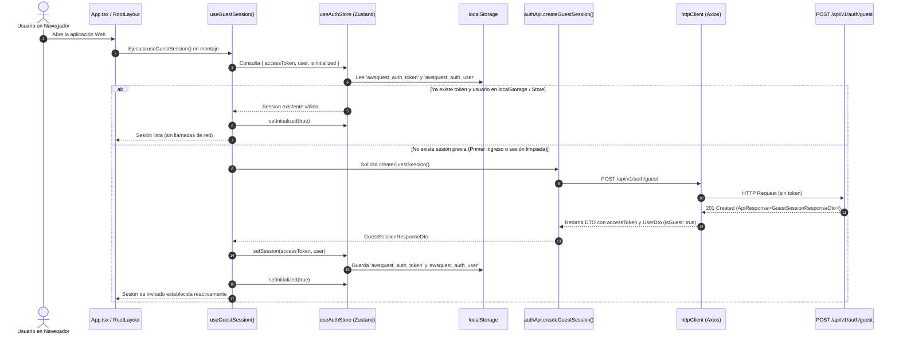
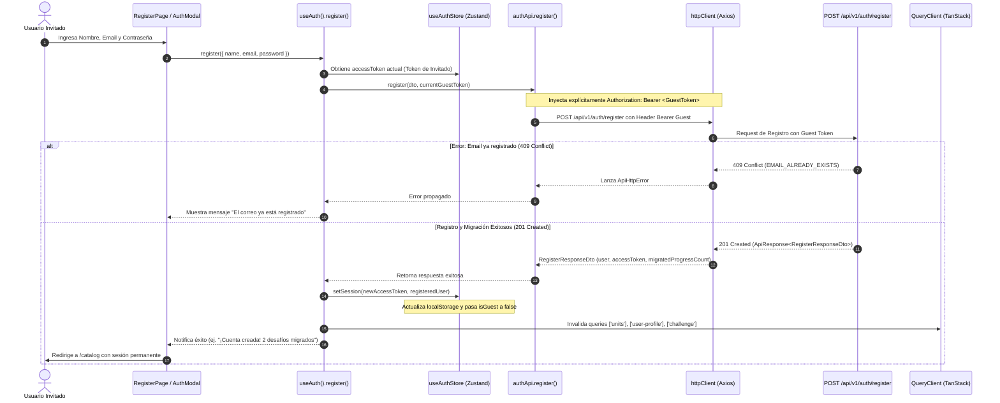
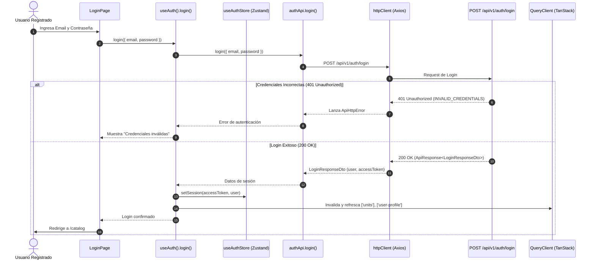

# Especificación Técnica: Configuración de Cliente HTTP y Autenticación (Fase 4 - Hito 4.1)

## 1. Introducción y Objetivos

Esta especificación técnica define la arquitectura, diseño de tipos TypeScript, cliente HTTP con interceptores JWT, gestión de estado global de sesión con Zustand y persistencia, ciclo de vida automático de Modo Invitado y servicios API para el módulo de comunicación y autenticación de la aplicación web (**`apps/web`**), correspondiente a la **Tarea 4.1** de la **Fase 4** del plan de implementación ([`docs/12-implementation-plan.md`](file:///c:/workspace/aws/aws-game/docs/12-implementation-plan.md)), en estricto cumplimiento con el contrato de API REST ([`docs/08-api-spec.md`](file:///c:/workspace/aws/aws-game/docs/08-api-spec.md)), el diseño UI/UX ([`docs/11-ui-ux.md`](file:///c:/workspace/aws/aws-game/docs/11-ui-ux.md)), la arquitectura de frontend ([`docs/09-frontend-bootstrap.md`](file:///c:/workspace/aws/aws-game/docs/09-frontend-bootstrap.md)) y el módulo de backend correspondiente ([`specs/auth-guest-module-spec.md`](file:///c:/workspace/aws/aws-game/specs/auth-guest-module-spec.md)).

### Objetivos Clave:
1. **Cliente HTTP Centralizado y Tipado (`shared/api/httpClient.ts`):** Configurar una instancia de Axios optimizada con base URL dinámica, timeout, headers estándar y un pipeline de interceptores bidireccionales (inyección automática del token Bearer JWT y transformación uniforme de respuestas y errores).
2. **Gestión de Estado de Autenticación Reactiva y Persistente (`shared/stores/useAuthStore.ts`):** Implementar un store de Zustand que administre el token JWT, los datos del usuario activo (`UserSession`), estados de inicialización, banderas de conveniencia (`isGuest`, `isAuthenticated`) y sincronización robusta con `localStorage` tolerante a fallos de serialización.
3. **Aprovisionamiento Automático de Invitado (`useGuestSession.ts`):** Implementar un hook de ciclo de vida que detecte en el arranque de la aplicación si el usuario carece de una sesión válida. En tal caso, aprovisiona de forma silenciosa e idempotente (resistente a la doble ejecución de React 18/19 StrictMode) una identidad anónima mediante `POST /api/v1/auth/guest` (**RF-20 / CU-08**).
4. **Capa de Servicios de Autenticación (`features/auth/api/authApi.ts`):** Desarrollar funciones puras y fuertemente tipadas para consumir los endpoints `/api/v1/auth/guest`, `/api/v1/auth/register`, `/api/v1/auth/login` y `/api/v1/auth/me`.
5. **Soporte Transaccional para Migración de Progreso (RN-13 / CU-08):** Permitir que el proceso de registro (`register`) envíe de forma explícita el Bearer token de la sesión de invitado en el encabezado `Authorization`, permitiendo al backend transferir atómicamente el progreso acumulado (`UserProgress`, `ChallengeAttempt`, `TotalXP`, `Level`) a la nueva cuenta permanente.
6. **Integración con TanStack Query y Facade Hook (`useAuth.ts`):** Proveer hooks reutilizables (`useAuth`, `useLoginMutation`, `useRegisterMutation`, `useUserProfileQuery`) que encapsulen el manejo de loading, error, mutaciones y la invalidación reactiva de cachés del catálogo tras autenticarse o registrarse.

```text
┌─────────────────────────────────────────────────────────────────────────────┐
│                 ARQUITECTURA DE CLIENTE HTTP Y AUTENTICACIÓN (apps/web)     │
│                                                                             │
│   ┌─────────────────────────────────────────────────────────────────────┐   │
│   │                      COMPONENTES UI / PÁGINAS                       │   │
│   │   (App.tsx, RootLayout.tsx, LoginPage.tsx, RegisterPage.tsx, etc.)  │   │
│   └──────────────────────────────────┬──────────────────────────────────┘   │
│                                      │ Consumen                                │
│   ┌──────────────────────────────────▼──────────────────────────────────┐   │
│   │                    HOOKS DE AUTENTICACIÓN Y SERVIDOR                │   │
│   │   - useGuestSession(): Inicialización silenciosa e idempotente      │   │
│   │   - useAuth(): Facade de sesión (login, register, logout, etc.)     │   │
│   │   - useLoginMutation(), useRegisterMutation(), useUserProfileQuery()│   │
│   └──────────────────┬──────────────────────────────────┬───────────────┘   │
│                      │                                  │                   │
│         Lee / Modifica                  Ejecuta llamadas│                   │
│                      ▼                                  ▼                   │
│   ┌─────────────────────────────────────┐   ┌───────────────────────────┐   │
│   │          ZUSTAND STORE              │   │     API SERVICE LAYER     │   │
│   │      (useAuthStore.ts)              │   │       (authApi.ts)        │   │
│   │  - accessToken: string | null       │   │  - createGuestSession()   │   │
│   │  - user: UserSession | null         │   │  - register()             │   │
│   │  - isInitialized: boolean           │   │  - login()                │   │
│   │  - setSession(), clearSession()     │   │  - getMe()                │   │
│   │  - Persistencia en localStorage     │   └─────────────┬─────────────┘   │
│   └──────────────────┬──────────────────┘                 │                 │
│                      │                                    │                 │
│                      │ Inyecta Bearer Token               │                 │
│                      ▼                                    ▼                 │
│   ┌─────────────────────────────────────────────────────────────────────┐   │
│   │                     AXIOS HTTP CLIENT (httpClient.ts)               │   │
│   │  - Request Interceptor: Authorization: Bearer <JWT>                 │   │
│   │  - Response Interceptor: Unwrapping / Captura de 401 & Errores      │   │
│   └──────────────────────────────────┬──────────────────────────────────┘   │
│                                      │ HTTP / JSON                          │
│                                      ▼                                      │
│   ┌─────────────────────────────────────────────────────────────────────┐   │
│   │                    BACKEND ASP.NET CORE (.NET 10)                   │   │
│   │     /api/v1/auth/{guest, register, login, me}                       │   │
│   └─────────────────────────────────────────────────────────────────────┘   │
└─────────────────────────────────────────────────────────────────────────────┘
```

---

## 2. Requerimientos, Reglas de Negocio y Trazabilidad

| Requisito / Regla | Concepto | Aplicación en Cliente HTTP y Autenticación |
| :--- | :--- | :--- |
| **RF-20** | Modo Invitado y Registro sin Fricción | El cliente debe aprovisionar una sesión de invitado al iniciar (`useGuestSession`) y permitir jugar sin pedir credenciales. |
| **RN-13** | Migración Atómica de Progreso | Al registrarse desde Modo Invitado, el cliente envía el token invitado en `Authorization: Bearer <GuestToken>` para que el backend migre el progreso sin pérdida. |
| **RN-01** | Accesibilidad Configurable | La sesión activa (invitado o registrado) se envía en cada petición para que el catálogo evalúe los permisos de desbloqueo según la política activa. |
| **RN-09 / RN-10** | High Score y XP sin Refarmeo | Los datos del usuario (`totalXP`, `level`) se sincronizan en el store global para reflejarse inmediatamente en la cabecera (`RootLayout`). |
| **RNF-03** | Compatibilidad y Rendimiento | El cliente HTTP debe operar asíncronamente con tiempos mínimos de serialización sin bloquear el renderizado a 60 FPS. |
| **RNF-07** | Desacoplamiento de Capas | Separación estricta entre capas: UI $\rightarrow$ Hooks $\rightarrow$ API Services $\rightarrow$ HTTP Client $\rightarrow$ Backend. |
| **RNF-12** | Seguridad y Almacenamiento | Almacenamiento seguro del token JWT en `localStorage`, limpieza en logout o ante `401 Unauthorized` expirado. |
| **CU-08** | Registrarse / Iniciar Sesión con Migración | Implementación de flujos de login, registro con migración e hidratación de sesión de usuario en el frontend. |
| **`08-api-spec`** | Contrato de API REST | Cumplimiento total de los envelopes `ApiResponse<T>` y `ApiErrorResponse`, DTOs y códigos de error estándar. |

---

## 3. Diagramas de Secuencia y Flujos de Autenticación en el Frontend

### 3.1. Flujo de Inicialización Automática de Modo Invitado (`useGuestSession`)



---

### 3.2. Flujo de Registro con Migración de Progreso de Invitado (`RN-13 / CU-08`)



---

### 3.3. Flujo de Inicio de Sesión (`Login`)



---

## 4. Tipos TypeScript e Interfaces del Contrato de API

Se definen los tipos estandarizados en **`apps/web/src/shared/types/api.types.ts`** y **`apps/web/src/features/auth/types/auth.types.ts`**, asegurando un mapeo 1:1 con el contrato del backend (`08-api-spec.md` y `specs/dtos-envelopes-validators-spec.md`).

### 4.1. Envelopes Estándar de API (`shared/types/api.types.ts`)

```typescript
/**
 * Metadatos de paginación devueltos en peticiones paginadas.
 */
export interface PaginationMetadataDto {
  total: number;
  page: number;
  limit: number;
}

/**
 * Metadatos de respuesta estándar de la API.
 */
export interface ApiMetaDto {
  timestamp: string;
  pagination?: PaginationMetadataDto;
}

/**
 * Envelope canónico de respuesta exitosa de la API.
 */
export interface ApiResponse<T> {
  success: true;
  data: T;
  meta?: ApiMetaDto;
}

/**
 * Detalle de error de validación de un campo específico.
 */
export interface ValidationErrorDetail {
  field: string;
  message: string;
}

/**
 * Estructura del cuerpo de error en ApiErrorResponse.
 */
export interface ApiErrorDetails {
  code: string;
  message: string;
  details?: ValidationErrorDetail[] | Record<string, unknown> | null;
}

/**
 * Envelope canónico de respuesta de error de la API.
 */
export interface ApiErrorResponse {
  success: false;
  error: ApiErrorDetails;
}

/**
 * Catálogo de códigos de error estándar devueltos por el backend ASP.NET Core.
 */
export const ErrorCodes = {
  UNAUTHORIZED: 'UNAUTHORIZED',
  FORBIDDEN: 'FORBIDDEN',
  CHALLENGE_NOT_FOUND: 'CHALLENGE_NOT_FOUND',
  CHALLENGE_LOCKED: 'CHALLENGE_LOCKED',
  INVALID_GRAPH_PAYLOAD: 'INVALID_GRAPH_PAYLOAD',
  SERVICE_LIMIT_EXCEEDED: 'SERVICE_LIMIT_EXCEEDED',
  ALL_HINTS_UNLOCKED: 'ALL_HINTS_UNLOCKED',
  EMAIL_ALREADY_EXISTS: 'EMAIL_ALREADY_EXISTS',
  INVALID_CREDENTIALS: 'INVALID_CREDENTIALS',
  VALIDATION_ERROR: 'VALIDATION_ERROR',
  INTERNAL_SERVER_ERROR: 'INTERNAL_SERVER_ERROR',
  NETWORK_ERROR: 'NETWORK_ERROR'
} as const;

export type ErrorCode = (typeof ErrorCodes)[keyof typeof ErrorCodes];
```

---

### 4.2. DTOs y Modelos de Autenticación (`features/auth/types/auth.types.ts`)

```typescript
/**
 * Representación del usuario dentro del estado de la aplicación y tokens.
 */
export interface UserSession {
  id: string;
  name: string;
  email: string | null;
  isGuest: boolean;
  totalXP: number;
  level: number;
}

/**
 * DTO de usuario devuelto por la API.
 */
export interface UserDto {
  id: string;
  name: string;
  email: string | null;
  isGuest: boolean;
  totalXP: number;
  level: number;
}

/**
 * DTO de respuesta para la creación de una sesión de invitado (POST /auth/guest).
 */
export interface GuestSessionResponseDto {
  accessToken: string;
  user: UserDto;
}

/**
 * DTO de petición para el registro de usuario (POST /auth/register).
 */
export interface RegisterRequestDto {
  email: string;
  password: string;
  name: string;
}

/**
 * DTO de respuesta tras el registro exitoso con migración (POST /auth/register).
 */
export interface RegisterResponseDto {
  accessToken: string;
  user: UserDto;
  migratedProgressCount: number;
}

/**
 * DTO de petición para el inicio de sesión (POST /auth/login).
 */
export interface LoginRequestDto {
  email: string;
  password: string;
}

/**
 * DTO de respuesta tras el inicio de sesión exitoso (POST /auth/login).
 */
export interface LoginResponseDto {
  accessToken: string;
  user: UserDto;
}

/**
 * DTO de perfil del usuario actual (GET /auth/me).
 */
export interface UserProfileDto {
  id: string;
  name: string;
  email: string | null;
  isGuest: boolean;
  totalXP: number;
  level: number;
  completedChallengesCount: number;
}
```

---

### 4.3. Clase de Excepción Especializada de HTTP (`shared/api/ApiHttpError.ts`)

```typescript
import { ApiErrorResponse, ErrorCodes } from '../types/api.types';

/**
 * Excepción personalizada para encapsular errores devueltos por la API REST
 * o fallos de red en Axios.
 */
export class ApiHttpError extends Error {
  public readonly code: string;
  public readonly statusCode: number;
  public readonly details?: unknown;
  public readonly isNetworkError: boolean;

  constructor(message: string, statusCode: number, code: string = ErrorCodes.INTERNAL_SERVER_ERROR, details?: unknown) {
    super(message);
    this.name = 'ApiHttpError';
    this.statusCode = statusCode;
    this.code = code;
    this.details = details;
    this.isNetworkError = statusCode === 0 || code === ErrorCodes.NETWORK_ERROR;
    Object.setPrototypeOf(this, ApiHttpError.prototype);
  }

  /**
   * Determina si el error es una instancia de ApiHttpError.
   */
  public static isApiHttpError(error: unknown): error is ApiHttpError {
    return error instanceof ApiHttpError;
  }
}
```

---

## 5. Configuración del Cliente HTTP con Interceptores (`shared/api/httpClient.ts`)

La capa de comunicación HTTP utiliza **Axios** con un diseño resiliente:
* Inyección dinámica del token JWT desde el store de Zustand en cada request.
* Soporte para sobreescribir el token en peticiones puntuales (ej. enviar `GuestToken` en `/auth/register`).
* Interceptor de respuestas para extraer directamente `data` y mapear fallos a `ApiHttpError`.
* Detección de token expirado (`401 UNAUTHORIZED`) que dispara la limpieza y renovación segura de sesión.

```typescript
// apps/web/src/shared/api/httpClient.ts
import axios, { AxiosError, AxiosInstance, InternalAxiosRequestConfig } from 'axios';
import { useAuthStore } from '../stores/useAuthStore';
import { ApiResponse, ApiErrorResponse, ErrorCodes } from '../types/api.types';
import { ApiHttpError } from './ApiHttpError';

const API_BASE_URL = import.meta.env.VITE_API_BASE_URL || '/api/v1';

export const httpClient: AxiosInstance = axios.create({
  baseURL: API_BASE_URL,
  timeout: 15000,
  headers: {
    'Content-Type': 'application/json',
    Accept: 'application/json'
  }
});

// ==========================================
// REQUEST INTERCEPTOR: Inyección de Bearer JWT
// ==========================================
httpClient.interceptors.request.use(
  (config: InternalAxiosRequestConfig) => {
    // Si la petición ya trae un Authorization header explícito (ej. registro con migración), no se sobreescribe
    if (!config.headers.Authorization) {
      const token = useAuthStore.getState().accessToken;
      if (token) {
        config.headers.Authorization = `Bearer ${token}`;
      }
    }
    return config;
  },
  (error: unknown) => {
    return Promise.reject(error);
  }
);

// ==========================================
// RESPONSE INTERCEPTOR: Unwrapping y Manejo de Errores
// ==========================================
httpClient.interceptors.response.use(
  (response) => {
    // Retorna la respuesta HTTP directamente (los servicios extraerán response.data.data)
    return response;
  },
  (error: AxiosError<ApiErrorResponse>) => {
    // 1. Error de Red / Servidor Inaccesible
    if (!error.response) {
      const message = error.message === 'Network Error' 
        ? 'No se pudo conectar con el servidor. Verifica tu conexión a internet.' 
        : error.message || 'Error de conexión desconocido.';
      return Promise.reject(new ApiHttpError(message, 0, ErrorCodes.NETWORK_ERROR));
    }

    const { status, data } = error.response;

    // 2. Manejo de Token Expirado o Inválido (401 Unauthorized)
    if (status === 401) {
      const currentToken = useAuthStore.getState().accessToken;
      // Si había un token almacenado y fue rechazado, se limpia la sesión expirada
      if (currentToken) {
        console.warn('[HttpClient] Sesión expirada o token inválido (401). Limpiando credenciales locales.');
        useAuthStore.getState().clearSession();
      }
    }

    // 3. Error Estructurado del Backend (ApiErrorResponse canónico)
    if (data && typeof data === 'object' && data.success === false && data.error) {
      const { code, message, details } = data.error;
      return Promise.reject(new ApiHttpError(message, status, code, details));
    }

    // 4. Fallback para errores HTTP no estructurados (ej. 502 Bad Gateway / 500 HTML)
    const fallbackMessage = `Error ${status}: ${error.response.statusText || 'Error en el servidor'}`;
    return Promise.reject(new ApiHttpError(fallbackMessage, status, ErrorCodes.INTERNAL_SERVER_ERROR));
  }
);
```

---

## 6. Gestor de Estado de Autenticación con Zustand (`shared/stores/useAuthStore.ts`)

El store administra el estado de autenticación reactivo con sincronización automática en `localStorage`, exponiendo getters y métodos de mutación claros:

```typescript
// apps/web/src/shared/stores/useAuthStore.ts
import { create } from 'zustand';
import { UserSession } from '../../features/auth/types/auth.types';

const STORAGE_KEYS = {
  TOKEN: 'awsquest_auth_token',
  USER: 'awsquest_auth_user'
} as const;

export interface AuthState {
  accessToken: string | null;
  user: UserSession | null;
  isInitialized: boolean;
  isLoading: boolean;
  
  // Getters computados
  isAuthenticated: () => boolean;
  isGuest: () => boolean;
  
  // Acciones
  setSession: (token: string, user: UserSession) => void;
  updateUser: (partialUser: Partial<UserSession>) => void;
  clearSession: () => void;
  setInitialized: (isInitialized: boolean) => void;
  setLoading: (isLoading: boolean) => void;
}

/**
 * Carga de forma segura el usuario persistido desde localStorage.
 */
function loadPersistedUser(): UserSession | null {
  try {
    const raw = localStorage.getItem(STORAGE_KEYS.USER);
    if (!raw) return null;
    return JSON.parse(raw) as UserSession;
  } catch (err) {
    console.error('[useAuthStore] Error parsing persisted user from localStorage:', err);
    localStorage.removeItem(STORAGE_KEYS.USER);
    return null;
  }
}

/**
 * Carga de forma segura el token persistido desde localStorage.
 */
function loadPersistedToken(): string | null {
  try {
    return localStorage.getItem(STORAGE_KEYS.TOKEN);
  } catch (err) {
    console.error('[useAuthStore] Error reading token from localStorage:', err);
    return null;
  }
}

export const useAuthStore = create<AuthState>((set, get) => ({
  accessToken: loadPersistedToken(),
  user: loadPersistedUser(),
  isInitialized: false,
  isLoading: false,

  isAuthenticated: () => {
    const state = get();
    return Boolean(state.accessToken && state.user);
  },

  isGuest: () => {
    const state = get();
    return Boolean(state.user?.isGuest);
  },

  setSession: (token: string, user: UserSession) => {
    try {
      localStorage.setItem(STORAGE_KEYS.TOKEN, token);
      localStorage.setItem(STORAGE_KEYS.USER, JSON.stringify(user));
    } catch (err) {
      console.error('[useAuthStore] Error persisting session to localStorage:', err);
    }
    set({ accessToken: token, user, isInitialized: true, isLoading: false });
  },

  updateUser: (partialUser: Partial<UserSession>) => {
    const currentUser = get().user;
    if (!currentUser) return;

    const updatedUser: UserSession = { ...currentUser, ...partialUser };
    try {
      localStorage.setItem(STORAGE_KEYS.USER, JSON.stringify(updatedUser));
    } catch (err) {
      console.error('[useAuthStore] Error updating user in localStorage:', err);
    }
    set({ user: updatedUser });
  },

  clearSession: () => {
    try {
      localStorage.removeItem(STORAGE_KEYS.TOKEN);
      localStorage.removeItem(STORAGE_KEYS.USER);
    } catch (err) {
      console.error('[useAuthStore] Error clearing localStorage session:', err);
    }
    set({ accessToken: null, user: null, isInitialized: false, isLoading: false });
  },

  setInitialized: (isInitialized: boolean) => set({ isInitialized }),
  setLoading: (isLoading: boolean) => set({ isLoading })
}));
```

---

## 7. Capa de Servicios de API de Autenticación (`features/auth/api/authApi.ts`)

Funciones asíncronas desacopladas que invocan los endpoints del backend y extraen el payload `data`:

```typescript
// apps/web/src/features/auth/api/authApi.ts
import { httpClient } from '../../../shared/api/httpClient';
import { ApiResponse } from '../../../shared/types/api.types';
import {
  GuestSessionResponseDto,
  RegisterRequestDto,
  RegisterResponseDto,
  LoginRequestDto,
  LoginResponseDto,
  UserProfileDto
} from '../types/auth.types';

export const authApi = {
  /**
   * Crea una sesión anónima en Modo Invitado.
   * POST /api/v1/auth/guest
   */
  async createGuestSession(): Promise<GuestSessionResponseDto> {
    const response = await httpClient.post<ApiResponse<GuestSessionResponseDto>>('/auth/guest');
    return response.data.data;
  },

  /**
   * Registra una cuenta de usuario permanente.
   * Si se provee guestToken, se incluye en Authorization header para migración atómica (RN-13 / CU-08).
   * POST /api/v1/auth/register
   */
  async register(data: RegisterRequestDto, guestToken?: string | null): Promise<RegisterResponseDto> {
    const headers: Record<string, string> = {};
    if (guestToken) {
      headers.Authorization = `Bearer ${guestToken}`;
    }

    const response = await httpClient.post<ApiResponse<RegisterResponseDto>>('/auth/register', data, {
      headers: Object.keys(headers).length > 0 ? headers : undefined
    });
    return response.data.data;
  },

  /**
   * Inicia sesión con credenciales de usuario registrado.
   * POST /api/v1/auth/login
   */
  async login(data: LoginRequestDto): Promise<LoginResponseDto> {
    const response = await httpClient.post<ApiResponse<LoginResponseDto>>('/auth/login', data);
    return response.data.data;
  },

  /**
   * Consulta el perfil y progreso acumulado del usuario actual.
   * GET /api/v1/auth/me
   */
  async getMe(): Promise<UserProfileDto> {
    const response = await httpClient.get<ApiResponse<UserProfileDto>>('/auth/me');
    return response.data.data;
  }
};
```

---

## 8. Hooks de Autenticación y Ciclo de Vida

### 8.1. Hook de Inicialización Automática de Modo Invitado (`features/auth/hooks/useGuestSession.ts`)

Garantiza que cualquier usuario que ingrese a la aplicación disponga inmediatamente de una identidad y un token JWT válido para consultar el catálogo y jugar:

```typescript
// apps/web/src/features/auth/hooks/useGuestSession.ts
import { useEffect, useRef } from 'react';
import { useAuthStore } from '../../../shared/stores/useAuthStore';
import { authApi } from '../api/authApi';

/**
 * Hook que asegura la existencia de una sesión de usuario al arrancar la app.
 * Si no existe token ni usuario en el store, aprovisiona una sesión anónima de invitado.
 * Incluye un guard de ejecución para prevenir llamadas duplicadas en React StrictMode.
 */
export function useGuestSession() {
  const { accessToken, user, isInitialized, setSession, setInitialized, setLoading } = useAuthStore();
  const initializingRef = useRef(false);

  useEffect(() => {
    // Si ya está inicializado o ya existe un token con usuario válido, marcar como listo
    if (isInitialized || (accessToken && user)) {
      if (!isInitialized) {
        setInitialized(true);
      }
      return;
    }

    // Evitar invocaciones concurrentes durante montajes dobles de StrictMode
    if (initializingRef.current) return;
    initializingRef.current = true;

    async function initializeGuest() {
      setLoading(true);
      try {
        const guestData = await authApi.createGuestSession();
        setSession(guestData.accessToken, guestData.user);
      } catch (error) {
        console.error('[useGuestSession] Error al aprovisionar sesión de invitado:', error);
        setInitialized(true); // Se marca inicializado para no bloquear la UI indefinidadmente
      } finally {
        setLoading(false);
        initializingRef.current = false;
      }
    }

    initializeGuest();
  }, [accessToken, user, isInitialized, setSession, setInitialized, setLoading]);

  return {
    isInitialized,
    isGuest: user?.isGuest ?? true
  };
}
```

---

### 8.2. Hooks con TanStack Query y Facade de Autenticación (`features/auth/hooks/useAuth.ts`)

Provee una API reactiva y ergonómica para componentes de autenticación y modales de registro/login:

```typescript
// apps/web/src/features/auth/hooks/useAuth.ts
import { useMutation, useQuery, useQueryClient } from '@tanstack/react-query';
import { useNavigate } from 'react-router-dom';
import { useAuthStore } from '../../../shared/stores/useAuthStore';
import { authApi } from '../api/authApi';
import { LoginRequestDto, RegisterRequestDto, UserProfileDto } from '../types/auth.types';
import { ApiHttpError } from '../../../shared/api/ApiHttpError';

export const authKeys = {
  all: ['auth'] as const,
  profile: () => [...authKeys.all, 'profile'] as const
};

export function useAuth() {
  const queryClient = useQueryClient();
  const navigate = useNavigate();
  const { user, accessToken, isInitialized, isLoading, setSession, clearSession, updateUser } = useAuthStore();

  // 1. Query: Perfil de usuario (/auth/me)
  const profileQuery = useQuery({
    queryKey: authKeys.profile(),
    queryFn: authApi.getMe,
    enabled: Boolean(accessToken),
    staleTime: 1000 * 60 * 2 // 2 minutos
  });

  // 2. Mutation: Login
  const loginMutation = useMutation({
    mutationFn: (credentials: LoginRequestDto) => authApi.login(credentials),
    onSuccess: (data) => {
      setSession(data.accessToken, data.user);
      queryClient.invalidateQueries({ queryKey: ['units'] });
      queryClient.invalidateQueries({ queryKey: authKeys.profile() });
      navigate('/catalog');
    }
  });

  // 3. Mutation: Register (con soporte para migración de invitado RN-13 / CU-08)
  const registerMutation = useMutation({
    mutationFn: (dto: RegisterRequestDto) => {
      const currentGuestToken = user?.isGuest ? accessToken : null;
      return authApi.register(dto, currentGuestToken);
    },
    onSuccess: (data) => {
      setSession(data.accessToken, data.user);
      queryClient.invalidateQueries({ queryKey: ['units'] });
      queryClient.invalidateQueries({ queryKey: authKeys.profile() });
      navigate('/catalog');
    }
  });

  // 4. Logout
  const logout = () => {
    clearSession();
    queryClient.clear();
    navigate('/catalog');
  };

  return {
    user,
    accessToken,
    isAuthenticated: Boolean(accessToken && user),
    isGuest: Boolean(user?.isGuest),
    isInitialized,
    isLoading: isLoading || loginMutation.isPending || registerMutation.isPending,
    
    // Acciones y Mutaciones
    login: loginMutation.mutateAsync,
    loginMutation,
    register: registerMutation.mutateAsync,
    registerMutation,
    logout,
    updateUser,
    
    // Datos de perfil adicionales
    profile: profileQuery.data,
    isProfileLoading: profileQuery.isLoading,
    refetchProfile: profileQuery.refetch
  };
}
```

---

## 9. Integración en el Punto de Entrada (`apps/web/src/app/App.tsx`)

Se actualiza `App.tsx` para incluir el hook de inicialización `useGuestSession` dentro del árbol de providers:

```tsx
// apps/web/src/app/App.tsx
import { QueryClient, QueryClientProvider } from '@tanstack/react-query';
import { RouterProvider } from 'react-router-dom';
import { router } from '../routes';
import { useGuestSession } from '../features/auth/hooks/useGuestSession';

export const queryClient = new QueryClient({
  defaultOptions: {
    queries: {
      staleTime: 1000 * 60 * 5, // 5 minutos de caché por defecto
      refetchOnWindowFocus: false,
      retry: 1
    }
  }
});

function AppContent() {
  // Inicializa la sesión de invitado de manera transparente si no hay sesión activa
  useGuestSession();

  return <RouterProvider router={router} />;
}

export function App() {
  return (
    <QueryClientProvider client={queryClient}>
      <AppContent />
    </QueryClientProvider>
  );
}
```

---

## 10. Estructura de Archivos a Crear y Modificar

```text
apps/web/src/
├── app/
│   └── App.tsx                             # [MODIFICAR] Integración de useGuestSession()
│
├── features/
│   └── auth/
│       ├── api/
│       │   └── authApi.ts                  # [CREAR] Capa de servicios REST de autenticación
│       ├── hooks/
│       │   ├── useAuth.ts                  # [CREAR] Facade hook y mutaciones TanStack Query
│       │   └── useGuestSession.ts          # [CREAR] Hook de inicialización automática de invitado
│       └── types/
│           └── auth.types.ts               # [CREAR] DTOs e interfaces TypeScript de autenticación
│
└── shared/
    ├── api/
    │   ├── httpClient.ts                   # [MODIFICAR] Axios con interceptores JWT y errores
    │   └── ApiHttpError.ts                 # [CREAR] Clase personalizada para errores de la API
    ├── stores/
    │   └── useAuthStore.ts                 # [MODIFICAR] Zustand store con persistencia y helpers
    └── types/
        └── api.types.ts                    # [CREAR] Envelopes canónicos ApiResponse y ErrorCodes
```

---

## 11. Estrategia de Pruebas Unitarias y Criterios de Aceptación

### 11.1. Pruebas Unitarias Propuestas

1. **`useAuthStore.test.ts`:**
   * Debe inicializar con valores nulos si `localStorage` está vacío.
   * Debe hidratar correctamente la sesión desde `localStorage` si existen datos válidos.
   * Debe recuperarse gracefully si `localStorage` contiene JSON corrupto.
   * Debe actualizar `accessToken` y `user` al invocar `setSession`.
   * Debe limpiar `localStorage` y el estado en memoria al invocar `clearSession`.
   * `isAuthenticated()` e `isGuest()` deben devolver los booleanos esperados según el estado.

2. **`httpClient.test.ts`:**
   * Debe inyectar el header `Authorization: Bearer <token>` cuando `useAuthStore` tenga un token activo.
   * No debe sobreescribir un header `Authorization` explícito provisto en la configuración de la petición.
   * Debe interceptar respuestas con error `401 Unauthorized` y disparar `clearSession()`.
   * Debe transformar las respuestas de error estructuradas (`ApiErrorResponse`) en instancias de `ApiHttpError`.
   * Debe manejar errores de red devolviendo `ApiHttpError` con código `NETWORK_ERROR`.

3. **`authApi.test.ts`:**
   * `createGuestSession()` debe realizar `POST /api/v1/auth/guest` y retornar `GuestSessionResponseDto`.
   * `register()` debe enviar el header `Authorization: Bearer <guestToken>` si se le proporciona un token de invitado.
   * `login()` debe enviar las credenciales en el cuerpo y retornar `LoginResponseDto`.
   * `getMe()` debe realizar `GET /api/v1/auth/me` con el token activo.

4. **`useGuestSession.test.ts`:**
   * Debe invocar `authApi.createGuestSession` si el usuario no tiene sesión previa.
   * No debe invocar `authApi.createGuestSession` si ya existe un usuario y token en el store.
   * Debe evitar ejecuciones concurrentes o duplicadas en montajes rápidos (StrictMode safety).

### 11.2. Criterios de Aceptación Técnicos (Milestone 4.1)

* [ ] La aplicación web inicializa automáticamente una sesión en Modo Invitado al abrirse por primera vez sin intervención del usuario (**RF-20**).
* [ ] El token JWT y el perfil se persisten de forma transparente en `localStorage` bajo las claves `awsquest_auth_token` y `awsquest_auth_user`.
* [ ] Todas las peticiones HTTP subsiguientes realizadas con `httpClient` incorporan el encabezado `Authorization: Bearer <token>`.
* [ ] La llamada de registro `POST /api/v1/auth/register` incluye el token de invitado previo, permitiendo al backend ejecutar la migración atómica de progreso (**RN-13 / CU-08**).
* [ ] Errores HTTP con status 401 limpian el estado local para evitar peticiones en bucle con credenciales expiradas.
* [ ] Todas las interfaces y DTOs están fuertemente tipados en TypeScript y no se utiliza el tipo `any`.
