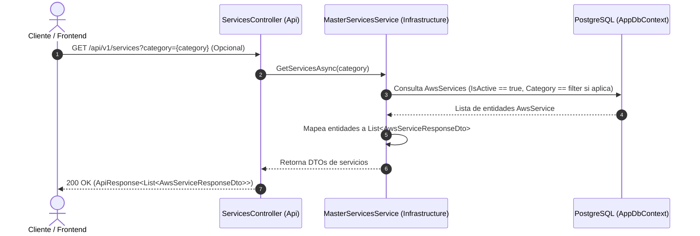
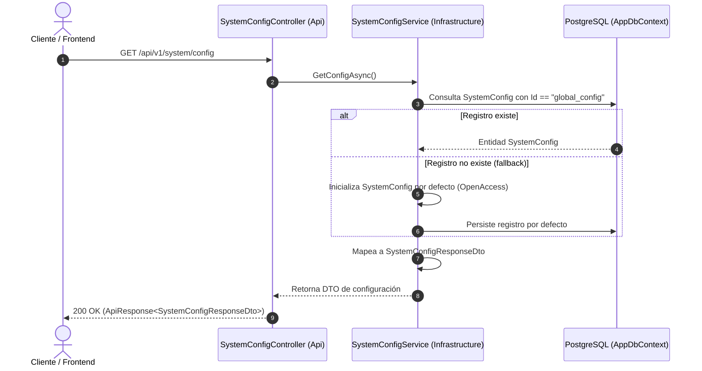
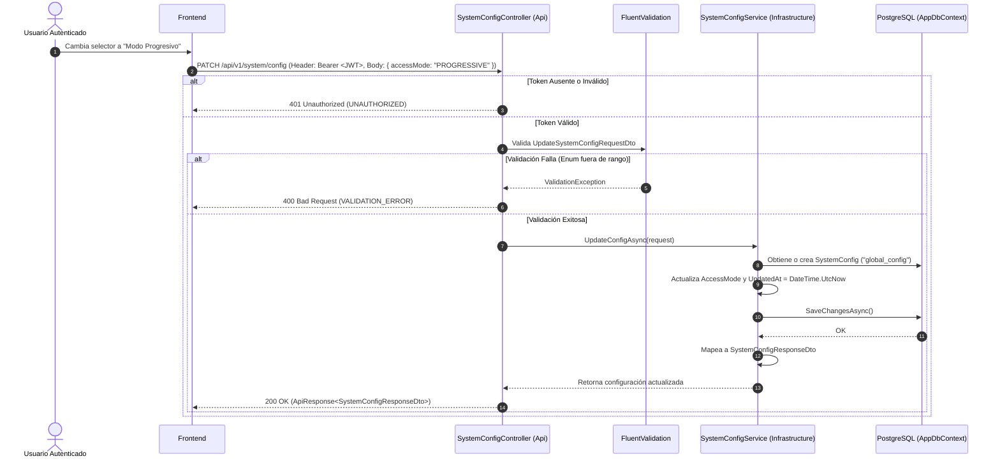

# Especificación Técnica: Módulo de Servicios Maestros y Configuración del Sistema (Fase 3 - Hito 3.5)

## 1. Introducción y Objetivos

Esta especificación técnica define la arquitectura, diseño de interfaces, lógica de servicios de aplicación, contratos REST, colección de pruebas de Postman y suite de pruebas unitarias para el **Módulo de Servicios Maestros y Configuración del Sistema**, correspondiente a la **Tarea 3.5** de la **Fase 3** del plan de implementación ([`docs/12-implementation-plan.md`](file:///c:/workspace/aws/aws-game/docs/12-implementation-plan.md)).

El módulo asegura el cumplimiento con los requisitos de la API REST ([`docs/08-api-spec.md`](file:///c:/workspace/aws/aws-game/docs/08-api-spec.md)), el modelo de datos relacional ([`docs/07-data-model.md`](file:///c:/workspace/aws/aws-game/docs/07-data-model.md)), las reglas de negocio de accesibilidad ([`docs/04-business-rules.md`](file:///c:/workspace/aws/aws-game/docs/04-business-rules.md)) y los casos de uso del sistema ([`docs/05-use-cases.md`](file:///c:/workspace/aws/aws-game/docs/05-use-cases.md)).

### Objetivos Clave:
1. **Catálogo Maestro de Servicios AWS (`GET /api/v1/services` - RF-06):** Exponer el listado completo de servicios de AWS disponibles en la plataforma, permitiendo filtrado opcional por categoría (`Compute`, `Storage`, `Database`, `Networking`, `Security`, etc.) y retornando metadatos visuales (icono, descripción corta, categoría).
2. **Consulta de Configuración Global (`GET /api/v1/system/config` - RN-01 / CU-07):** Permitir a clientes anónimos y autenticados consultar la política de acceso y progresión activa en la plataforma (`OpenAccess` vs `Progressive`).
3. **Actualización de Política de Accesibilidad (`PATCH /api/v1/system/config` - RN-01 / CU-07):** Permitir a usuarios autenticados alternar la política global entre Modo Libre y Modo Progresivo, actualizando el timestamp de modificación y validando el payload mediante FluentValidation.
4. **Colección de Postman Automatizada (`postman/master_services_config/`):** Crear la colección y entorno de Postman con scripts de prueba en JavaScript para validar flujos nominales, filtrados y respuestas de error (400, 401).
5. **Cobertura de Pruebas Unitarias al 100%:** Desarrollar pruebas unitarias completas con xUnit, FluentAssertions y base de datos InMemory para `MasterServicesService` y `SystemConfigService`.

```text
┌─────────────────────────────────────────────────────────────────────────────┐
│             ARQUITECTURA DE SERVICIOS MAESTROS Y CONFIGURACIÓN              │
├─────────────────────────────────────────────────────────────────────────────┤
│                                                                             │
│   [Cliente Frontend (React / Vite)]                                         │
│            │                                                                │
│            │ HTTP Requests (Público / Bearer JWT)                           │
│            ▼                                                                │
│   ┌──────────────────────────────────────────────────────────────────────┐  │
│   │ AwsQuest.Api                                                         │  │
│   │ ├── Controllers/ServicesController.cs                                │  │
│   │ │   └── GET   /api/v1/services (Filtro ?category=...)                │  │
│   │ └── Controllers/SystemConfigController.cs                            │  │
│   │     ├── GET   /api/v1/system/config                                  │  │
│   │     └── PATCH /api/v1/system/config ([Authorize])                    │  │
│   └──────────────────────┬───────────────────────────────────────────────┘  │
│                          │                                                  │
│                          ▼                                                  │
│   ┌──────────────────────────────────────────────────────────────────────┐  │
│   │ AwsQuest.Application                                                 │  │
│   │ ├── Common/Interfaces/ (IMasterServicesService, ISystemConfigService)│  │
│   │ ├── Dtos/MasterServices/ (AwsServiceResponseDto)                     │  │
│   │ ├── Dtos/SystemConfig/ (SystemConfigResponseDto, UpdateConfigDto)    │  │
│   │ └── Validators/ (UpdateSystemConfigRequestDtoValidator)              │  │
│   └──────────────────────┬───────────────────────────────────────────────┘  │
│                          │                                                  │
│                          ▼                                                  │
│   ┌──────────────────────────────────────────────────────────────────────┐  │
│   │ AwsQuest.Infrastructure                                              │  │
│   │ ├── Services/MasterServicesService.cs                                │  │
│   │ ├── Services/SystemConfigService.cs                                  │  │
│   │ └── Persistence/AppDbContext.cs (PostgreSQL / EF Core 10)            │  │
│   └──────────────────────────────────────────────────────────────────────┘  │
│                                                                             │
└─────────────────────────────────────────────────────────────────────────────┘
```

---

## 2. Requerimientos y Reglas de Negocio Vinculadas

| Requisito / Regla | Concepto | Aplicación en Servicios Maestros y Configuración |
| :--- | :--- | :--- |
| **RF-04** | Gestión de Acceso y Progresión | Soporte de configuración de política global de acceso (`OpenAccess` vs `Progressive`). |
| **RF-06** | Paleta de Servicios AWS | Exposición del catálogo maestro de componentes con metadatos para inicializar la paleta de diseño. |
| **RN-01** | Accesibilidad de Desafíos | En `OpenAccess`, todos los desafíos están abiertos. En `Progressive`, se exigen prerrequisitos y XP mínima. |
| **CU-07** | Configurar Accesibilidad | Flujo de consulta y cambio dinámico de la modalidad de acceso a través del endpoint PATCH. |
| **RNF-01** | Tiempo de Respuesta | Consultas de catálogo y configuración ejecutadas en menos de 50 ms mediante queries optimizadas `AsNoTracking()`. |
| **RNF-06** | Compatibilidad OpenAPI | Documentación completa con XML comments, tipos de respuesta HTTP 200, 400, 401 en Swagger UI. |

---

## 3. Diagramas de Secuencia y Flujos de Interacción

### 3.1. Flujo de Consulta de Servicios Maestros (`GET /api/v1/services` - RF-06)



---

### 3.2. Flujo de Consulta de Configuración Global (`GET /api/v1/system/config` - RN-01)



---

### 3.3. Flujo de Actualización de Política de Acceso (`PATCH /api/v1/system/config` - CU-07)



---

## 4. Diseño de Interfaces y Contratos (`AwsQuest.Application`)

### 4.1. Interfaces de Servicios (`Common/Interfaces/`)

#### `IMasterServicesService.cs`
```csharp
namespace AwsQuest.Application.Common.Interfaces;

using AwsQuest.Application.Dtos.MasterServices;

public interface IMasterServicesService
{
    /// <summary>
    /// Obtiene la lista completa de servicios AWS activos en la plataforma, con soporte de filtrado opcional por categoría.
    /// </summary>
    Task<List<AwsServiceResponseDto>> GetServicesAsync(string? category = null, CancellationToken cancellationToken = default);
}
```

#### `ISystemConfigService.cs`
```csharp
namespace AwsQuest.Application.Common.Interfaces;

using AwsQuest.Application.Dtos.SystemConfig;

public interface ISystemConfigService
{
    /// <summary>
    /// Obtiene la configuración global del sistema y la modalidad de acceso a desafíos activa.
    /// </summary>
    Task<SystemConfigResponseDto> GetConfigAsync(CancellationToken cancellationToken = default);

    /// <summary>
    /// Actualiza la política global de accesibilidad al contenido (Modo Libre vs. Progresivo).
    /// </summary>
    Task<SystemConfigResponseDto> UpdateConfigAsync(UpdateSystemConfigRequestDto request, CancellationToken cancellationToken = default);
}
```

---

### 4.2. DTOs de Petición y Respuesta

#### En `Dtos/MasterServices/MasterServicesDtos.cs`:
```csharp
namespace AwsQuest.Application.Dtos.MasterServices;

public class AwsServiceResponseDto
{
    public Guid Id { get; init; }
    public string Code { get; init; } = string.Empty;
    public string Name { get; init; } = string.Empty;
    public string Category { get; init; } = string.Empty;
    public string ShortDescription { get; init; } = string.Empty;
    public string IconUrl { get; init; } = string.Empty;
    public bool IsActive { get; init; }
}
```

#### En `Dtos/SystemConfig/SystemConfigDtos.cs`:
```csharp
namespace AwsQuest.Application.Dtos.SystemConfig;

using AwsQuest.Domain.Enums;

public class SystemConfigResponseDto
{
    public AccessMode AccessMode { get; init; }
    public DateTime UpdatedAt { get; init; }
}

public class UpdateSystemConfigRequestDto
{
    public AccessMode AccessMode { get; init; }
}
```

---

### 4.3. Extensiones de Mapeo (`Mappings/`)

#### `MasterServicesMappingExtensions.cs`
```csharp
namespace AwsQuest.Application.Mappings;

using AwsQuest.Application.Dtos.MasterServices;
using AwsQuest.Domain.Entities;

public static class MasterServicesMappingExtensions
{
    public static AwsServiceResponseDto ToDto(this AwsService service) => new()
    {
        Id = service.Id,
        Code = service.Code,
        Name = service.Name,
        Category = service.Category,
        ShortDescription = service.ShortDescription,
        IconUrl = service.IconUrl,
        IsActive = service.IsActive
    };
}
```

#### `SystemConfigMappingExtensions.cs`
```csharp
namespace AwsQuest.Application.Mappings;

using AwsQuest.Application.Dtos.SystemConfig;
using AwsQuest.Domain.Entities;

public static class SystemConfigMappingExtensions
{
    public static SystemConfigResponseDto ToDto(this SystemConfig config) => new()
    {
        AccessMode = config.AccessMode,
        UpdatedAt = config.UpdatedAt
    };
}
```

---

### 4.4. Validador FluentValidation (`Validators/`)

#### `UpdateSystemConfigRequestDtoValidator.cs`
```csharp
namespace AwsQuest.Application.Validators;

using FluentValidation;
using AwsQuest.Application.Dtos.SystemConfig;

public class UpdateSystemConfigRequestDtoValidator : AbstractValidator<UpdateSystemConfigRequestDto>
{
    public UpdateSystemConfigRequestDtoValidator()
    {
        RuleFor(x => x.AccessMode)
            .IsInEnum().WithMessage("El modo de acceso especificado no es válido (Valores permitidos: OpenAccess, Progressive).");
    }
}
```

---

## 5. Diseño de la Capa de Infraestructura (`AwsQuest.Infrastructure`)

### 5.1. Implementación de `MasterServicesService.cs`

**Aspectos Clave:**
- Consulta solo registros activos (`IsActive == true`).
- Filtrado opcional por `Category` insensible a mayúsculas/minúsculas (`string.Equals` / `EF.Functions.ILike` o normalización en LINQ).
- Ordenamiento consistente por `Category` ascendente y luego `Name` ascendente.
- Consultas `AsNoTracking()` para maximizar el throughput.

```csharp
namespace AwsQuest.Infrastructure.Services;

using Microsoft.EntityFrameworkCore;
using AwsQuest.Application.Common.Interfaces;
using AwsQuest.Application.Dtos.MasterServices;
using AwsQuest.Application.Mappings;

public class MasterServicesService : IMasterServicesService
{
    private readonly IAppDbContext _dbContext;

    public MasterServicesService(IAppDbContext dbContext)
    {
        _dbContext = dbContext;
    }

    public async Task<List<AwsServiceResponseDto>> GetServicesAsync(string? category = null, CancellationToken cancellationToken = default)
    {
        var query = _dbContext.AwsServices
            .AsNoTracking()
            .Where(s => s.IsActive);

        if (!string.IsNullOrWhiteSpace(category))
        {
            var normalizedCategory = category.Trim().ToUpperInvariant();
            query = query.Where(s => s.Category.ToUpper() == normalizedCategory);
        }

        var services = await query
            .OrderBy(s => s.Category)
            .ThenBy(s => s.Name)
            .ToListAsync(cancellationToken);

        return services.Select(s => s.ToDto()).ToList();
    }
}
```

---

### 5.2. Implementación de `SystemConfigService.cs`

**Aspectos Clave:**
- Clave fija `"global_config"`.
- Mecanismo de fallback resiliente: si el registro no existe en la base de datos, se inicializa automáticamente con `AccessMode.OpenAccess` y se persiste.
- En `UpdateConfigAsync`, actualiza el enum `AccessMode` y refresca `UpdatedAt = DateTime.UtcNow`.

```csharp
namespace AwsQuest.Infrastructure.Services;

using Microsoft.EntityFrameworkCore;
using AwsQuest.Application.Common.Interfaces;
using AwsQuest.Application.Dtos.SystemConfig;
using AwsQuest.Application.Mappings;
using AwsQuest.Domain.Entities;
using AwsQuest.Domain.Enums;

public class SystemConfigService : ISystemConfigService
{
    private const string GlobalConfigId = "global_config";
    private readonly IAppDbContext _dbContext;

    public SystemConfigService(IAppDbContext dbContext)
    {
        _dbContext = dbContext;
    }

    public async Task<SystemConfigResponseDto> GetConfigAsync(CancellationToken cancellationToken = default)
    {
        var config = await _dbContext.SystemConfigs
            .AsNoTracking()
            .FirstOrDefaultAsync(c => c.Id == GlobalConfigId, cancellationToken);

        if (config == null)
        {
            config = new SystemConfig
            {
                Id = GlobalConfigId,
                AccessMode = AccessMode.OpenAccess,
                UpdatedAt = DateTime.UtcNow
            };
            _dbContext.SystemConfigs.Add(config);
            await _dbContext.SaveChangesAsync(cancellationToken);
        }

        return config.ToDto();
    }

    public async Task<SystemConfigResponseDto> UpdateConfigAsync(UpdateSystemConfigRequestDto request, CancellationToken cancellationToken = default)
    {
        var config = await _dbContext.SystemConfigs
            .FirstOrDefaultAsync(c => c.Id == GlobalConfigId, cancellationToken);

        if (config == null)
        {
            config = new SystemConfig
            {
                Id = GlobalConfigId,
                AccessMode = request.AccessMode,
                UpdatedAt = DateTime.UtcNow
            };
            _dbContext.SystemConfigs.Add(config);
        }
        else
        {
            config.AccessMode = request.AccessMode;
            config.UpdatedAt = DateTime.UtcNow;
        }

        await _dbContext.SaveChangesAsync(cancellationToken);
        return config.ToDto();
    }
}
```

---

### 5.3. Registro en `DependencyInjection.cs`

En `AwsQuest.Infrastructure/DependencyInjection.cs`:
```csharp
// Servicios Maestros y Configuración del Sistema
services.AddScoped<IMasterServicesService, AwsQuest.Infrastructure.Services.MasterServicesService>();
services.AddScoped<ISystemConfigService, AwsQuest.Infrastructure.Services.SystemConfigService>();
```

---

## 6. Diseño de la Capa de API REST (`AwsQuest.Api`)

### 6.1. `ServicesController.cs`

```csharp
namespace AwsQuest.Api.Controllers;

using Microsoft.AspNetCore.Mvc;
using AwsQuest.Application.Common.Interfaces;
using AwsQuest.Application.Common.Models;
using AwsQuest.Application.Dtos.MasterServices;

[ApiController]
[Route("api/v1/services")]
[Produces("application/json")]
public class ServicesController : ControllerBase
{
    private readonly IMasterServicesService _masterServicesService;

    public ServicesController(IMasterServicesService masterServicesService)
    {
        _masterServicesService = masterServicesService;
    }

    /// <summary>
    /// Obtiene la lista completa de servicios AWS disponibles, con soporte de filtrado por categoría.
    /// </summary>
    [HttpGet]
    [ProducesResponseType(typeof(ApiResponse<List<AwsServiceResponseDto>>), StatusCodes.Status200OK)]
    public async Task<IActionResult> GetServices(
        [FromQuery] string? category,
        CancellationToken cancellationToken)
    {
        var services = await _masterServicesService.GetServicesAsync(category, cancellationToken);
        return Ok(ApiResponse<List<AwsServiceResponseDto>>.Ok(services));
    }
}
```

---

### 6.2. `SystemConfigController.cs`

```csharp
namespace AwsQuest.Api.Controllers;

using Microsoft.AspNetCore.Authorization;
using Microsoft.AspNetCore.Mvc;
using AwsQuest.Application.Common.Interfaces;
using AwsQuest.Application.Common.Models;
using AwsQuest.Application.Dtos.SystemConfig;

[ApiController]
[Route("api/v1/system/config")]
[Produces("application/json")]
public class SystemConfigController : ControllerBase
{
    private readonly ISystemConfigService _systemConfigService;

    public SystemConfigController(ISystemConfigService systemConfigService)
    {
        _systemConfigService = systemConfigService;
    }

    /// <summary>
    /// Obtiene la política global de accesibilidad y configuración activa del sistema.
    /// </summary>
    [HttpGet]
    [ProducesResponseType(typeof(ApiResponse<SystemConfigResponseDto>), StatusCodes.Status200OK)]
    public async Task<IActionResult> GetConfig(CancellationToken cancellationToken)
    {
        var config = await _systemConfigService.GetConfigAsync(cancellationToken);
        return Ok(ApiResponse<SystemConfigResponseDto>.Ok(config));
    }

    /// <summary>
    /// Actualiza la política global de accesibilidad al contenido (Modo Libre vs. Progresivo).
    /// </summary>
    [HttpPatch]
    [Authorize]
    [ProducesResponseType(typeof(ApiResponse<SystemConfigResponseDto>), StatusCodes.Status200OK)]
    [ProducesResponseType(typeof(ApiErrorResponse), StatusCodes.Status400BadRequest)]
    [ProducesResponseType(typeof(ApiErrorResponse), StatusCodes.Status401Unauthorized)]
    public async Task<IActionResult> UpdateConfig(
        [FromBody] UpdateSystemConfigRequestDto request,
        CancellationToken cancellationToken)
    {
        var updatedConfig = await _systemConfigService.UpdateConfigAsync(request, cancellationToken);
        return Ok(ApiResponse<SystemConfigResponseDto>.Ok(updatedConfig));
    }
}
```

---

## 7. Especificación de la Colección de Postman (`postman/master_services_config/`)

Se organizarán las carpetas y archivos en la ruta `postman/master_services_config/`:

### 7.1. Estructura de Carpetas:
```text
postman/
└── master_services_config/
    ├── README.md
    ├── awsquest-local.postman_environment.json
    └── awsquest-master-services-config.postman_collection.json
```

### 7.2. Detalle de Peticiones y Aserciones en la Colección:

#### Carpeta `00 - Setup de Autenticación`:
1. `POST /api/v1/auth/guest`
   - Test: `Status 201 Created`, extrae `accessToken` y lo guarda en `authToken`.

#### Carpeta `01 - Catálogo Maestro de Servicios AWS (/services)`:
1. `GET /api/v1/services` (Listar todos los servicios)
   - Test: `Status 200 OK`, `success: true`, `data` es un array no vacío con campos `id`, `code`, `name`, `category`, `shortDescription`, `iconUrl`, `isActive`.
2. `GET /api/v1/services?category=Compute` (Filtrar por categoría Cómputo)
   - Test: `Status 200 OK`, todos los elementos retornados tienen `category == "Compute"`.
3. `GET /api/v1/services?category=Storage` (Filtrar por categoría Almacenamiento)
   - Test: `Status 200 OK`, todos los elementos retornados tienen `category == "Storage"`.
4. `GET /api/v1/services?category=NonExistentCategory` (Filtrar por categoría inexistente)
   - Test: `Status 200 OK`, `data` es un array vacío `[]`.

#### Carpeta `02 - Configuración del Sistema (/system/config)`:
1. `GET /api/v1/system/config` (Consultar configuración pública)
   - Test: `Status 200 OK`, `data.accessMode` presente (`OPEN_ACCESS` o `PROGRESSIVE`), `data.updatedAt` presente.
2. `PATCH /api/v1/system/config` (Cambiar a Modo Progresivo)
   - Auth: Bearer `{{authToken}}`.
   - Body: `{"accessMode": "PROGRESSIVE"}` (o `{"accessMode": 2}`).
   - Test: `Status 200 OK`, `data.accessMode == "PROGRESSIVE"`.
3. `PATCH /api/v1/system/config` (Cambiar a Modo Libre / Open Access)
   - Auth: Bearer `{{authToken}}`.
   - Body: `{"accessMode": "OPEN_ACCESS"}` (o `{"accessMode": 1}`).
   - Test: `Status 200 OK`, `data.accessMode == "OPEN_ACCESS"`.

#### Carpeta `03 - Escenarios de Error y Casos Borde`:
1. `PATCH /api/v1/system/config` sin Token (401 Unauthorized)
   - Test: `Status 401 Unauthorized`, `error.code == "UNAUTHORIZED"`.
2. `PATCH /api/v1/system/config` con Payload Inválido (400 Bad Request)
   - Auth: Bearer `{{authToken}}`.
   - Body: `{"accessMode": 999}`.
   - Test: `Status 400 Bad Request`, `error.code == "VALIDATION_ERROR"`.

---

## 8. Suite de Pruebas Unitarias (`AwsQuest.UnitTests/Services/`)

### 8.1. `MasterServicesServiceTests.cs` (4 pruebas)
1. `GetServicesAsync_WithoutFilter_ReturnsAllActiveServicesOrderedByCategoryAndName`:
   - Inserta servicios activos de categorías Compute, Storage, Database y un servicio inactivo.
   - Verifica que solo retorne los activos ordenados alfabéticamente.
2. `GetServicesAsync_WithCategoryFilter_ReturnsOnlyMatchingCategory`:
   - Filtra por `"Compute"`.
   - Verifica que solo retorne servicios de cómputo.
3. `GetServicesAsync_WithCaseInsensitiveCategory_ReturnsMatchingCategory`:
   - Filtra por `"cOmPuTe"`.
   - Verifica coincidencia independientemente del casing.
4. `GetServicesAsync_WithNonExistentCategory_ReturnsEmptyList`:
   - Filtra por `"Blockchain"`.
   - Verifica que retorne lista vacía sin errores.

### 8.2. `SystemConfigServiceTests.cs` (4 pruebas)
1. `GetConfigAsync_WhenConfigExists_ReturnsExistingConfig`:
   - Inserta registro `global_config` con `Progressive`.
   - Verifica que retorne `Progressive` y timestamp correspondiente.
2. `GetConfigAsync_WhenConfigDoesNotExist_CreatesDefaultOpenAccessConfig`:
   - Base de datos vacía.
   - Verifica creación y persistencia automática de `OpenAccess`.
3. `UpdateConfigAsync_WhenUpdatingMode_PersistsNewModeAndRefreshesTimestamp`:
   - Actualiza de `OpenAccess` a `Progressive`.
   - Verifica persistencia en base de datos.
4. `UpdateConfigAsync_WhenConfigDoesNotExistInitially_CreatesAndAppliesNewMode`:
   - Base de datos vacía, llamada directa a `UpdateConfigAsync(Progressive)`.
   - Verifica inserción y retorno exitoso.

---

## 9. Matriz de Trazabilidad y Criterios de Aceptación (Definition of Done)

| Elemento | Criterio de Aceptación | Verificación |
| :--- | :--- | :--- |
| **`IMasterServicesService` & `MasterServicesService`** | Listado de servicios activos, ordenamiento y filtro por categoría. | `MasterServicesServiceTests` |
| **`ISystemConfigService` & `SystemConfigService`** | Consulta y actualización de `AccessMode` con timestamp UTC y fallback resiliente. | `SystemConfigServiceTests` |
| **`ServicesController`** | `GET /api/v1/services` responde 200 OK con `ApiResponse<List<AwsServiceResponseDto>>`. | Pruebas de integración / Postman |
| **`SystemConfigController`** | `GET /api/v1/system/config` responde 200 OK; `PATCH` exige `[Authorize]` y actualiza la política. | Pruebas de integración / Postman |
| **Colección Postman** | Colección y entorno en `postman/master_services_config/` ejecutables con 100% de éxito. | Postman Collection Runner |
| **Integración en Solución** | Registro limpio en `DependencyInjection.cs`, compilación sin warnings ni errores y suite global de tests pasando al 100%. | `dotnet test apps/api/AwsQuest.slnx` |
