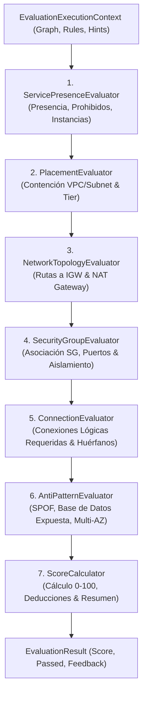

# Especificación Técnica: Fase 2 — Motor de Evaluación Topológico y Reglas de Red

> **Documento de Especificación de Implementación**  
> **Fase:** 2 (Evaluation Engine, Topological Evaluators & Network Rules)  
> **Proyecto:** AWS Architecture Quest (`AwsQuest.Domain`)  
> **Documento de Referencia:** [`docs/14-aws-network-expansion-plan.md`](file:///c:/workspace/aws/aws-game/docs/14-aws-network-expansion-plan.md)  
> **Dependencias:** Fase 1 completada (`specs/phase-1-domain-models-network-expansion-spec.md`)  
> **Estado:** Listo para Implementación

---

## 1. Introducción y Objetivos de la Fase 2

La **Fase 2** evoluciona el motor de evaluación en memoria de `AwsQuest.Domain` desde un validador plano de conexiones 1 a 1 hacia un **analizador topológico de arquitecturas de red AWS**.

### 1.1 Objetivos Principales:
1. **Pipeline de 7 Pasos Especializados:**
   * Orquestar la ejecución desacoplada de evaluadores mediante la interfaz `IEvaluatorStep`.
2. **Implementación de `PlacementEvaluator`:**
   * Validar contención jerárquica: `Subnet ∈ VPC`, `EC2/RDS/ALB ∈ Subnet`.
   * Validar cumplimiento de reglas de ubicación (`PlacementRules`), verificando que los servicios residan en el `SubnetTier` correcto (`Public`, `Private`, `Isolated`).
3. **Implementación de `NetworkTopologyEvaluator`:**
   * Validar reglas de enrutamiento (`RoutingRules`): alcance hacia `NET_IGW` para subredes públicas y ruteo saliente vía `NET_NAT_GATEWAY` para subredes privadas.
   * Detectar rutas públicas indebidas en subredes privadas o aisladas.
4. **Implementación de `SecurityGroupEvaluator`:**
   * Validar vinculación de `NET_SECURITY_GROUP` a componentes.
   * Validar reglas de filtrado de tráfico (`SecurityGroupRules`): autorización de protocolos (TCP/UDP), puertos específicos (ej. 5432, 3306, 80, 443) y fuentes autorizadas (SG de origen o CIDR).
5. **Evolución de `AntiPatternEvaluator`:**
   * Enriquecer la detección de `PublicDatabaseExposure` y `DirectInternetToCompute` aprovechando las consultas topológicas de `SemanticGraph` además de los flags legados.
6. **Integración en `EvaluationEngine`:**
   * Configurar el pipeline en el orden óptimo garantizando 100% de compatibilidad hacia atrás con los 8 desafíos MVP.
7. **Suite Exhaustiva de Pruebas Unitarias:**
   * Implementar suites dedicadas en `tests/AwsQuest.UnitTests/Engine/` con cobertura $\ge 95\%$.

---

## 2. Mapa de Clases y Estructura de Archivos

```text
apps/api/src/AwsQuest.Domain/
└── Engine/
    ├── IEvaluationEngine.cs
    ├── EvaluationEngine.cs                   [MODIFY] (Pipeline de 7 pasos)
    └── Evaluators/
        ├── IEvaluatorStep.cs
        ├── ServicePresenceEvaluator.cs       (Paso 1 - Existente)
        ├── PlacementEvaluator.cs             [NEW] (Paso 2)
        ├── NetworkTopologyEvaluator.cs       [NEW] (Paso 3)
        ├── SecurityGroupEvaluator.cs         [NEW] (Paso 4)
        ├── ConnectionEvaluator.cs            (Paso 5 - Existente)
        ├── AntiPatternEvaluator.cs           [MODIFY] (Paso 6)
        └── ScoreCalculator.cs                (Paso 7 - Existente)

apps/api/tests/AwsQuest.UnitTests/
└── Engine/
    ├── PlacementEvaluatorTests.cs            [NEW]
    ├── NetworkTopologyEvaluatorTests.cs      [NEW]
    ├── SecurityGroupEvaluatorTests.cs        [NEW]
    ├── AntiPatternEvaluatorTests.cs          [MODIFY]
    └── EvaluationEngineTests.cs              [MODIFY]
```

---

## 3. Pipeline de Evaluación Secuencial



---

## 4. Especificación Detallada de los Nuevos Evaluadores

### 4.1 `PlacementEvaluator.cs` (Paso 2)

#### Responsabilidades:
1. Validar cada `PlacementRule` definida en `rules.PlacementRules`.
2. Para cada regla:
   * Obtener los componentes que coinciden con `rule.ServiceCode`.
   * Si no hay componentes del servicio y el servicio era requerido, `ServicePresenceEvaluator` ya emitió feedback; `PlacementEvaluator` solo evalúa los componentes presentes.
   * Para cada instancia:
     * Verificar si tiene `ParentId` correspondiente a un contenedor válido (`rule.RequiredContainerCode`, ej. `NET_SUBNET`).
     * Si `rule.RequiredSubnetTier` está especificado, verificar que la subred contenedora posea ese tier (`SubnetTier.Private`, `SubnetTier.Public`, `SubnetTier.Isolated`).
3. **Validación Implícita de Jerarquía:**
   * Si existen subredes `NET_SUBNET` en el grafo, verificar que pertenezcan a una `NET_VPC` (`subnet.ParentId != null` y su padre es `NET_VPC`).
4. **Retrocompatibilidad:** Si `rules.PlacementRules` está vacío y no hay subredes en el grafo, no emite penalizaciones (No-Op).

#### Feedback Items Generados:
* **Aprobado:**
  * `Status: FeedbackItemStatus.Pass`
  * `Category: FeedbackCategory.Placement`
  * `Title: "Ubicación Correcta de {serviceCode}"`
  * `Explanation: "El recurso '{serviceCode}' ({componentId}) reside correctamente en una subred {tier}."`
* **Fallido:**
  * `Status: FeedbackItemStatus.Fail`
  * `Category: FeedbackCategory.Placement`
  * `Title: "Ubicación Inválida de {serviceCode}"`
  * `Explanation: rule.Description ?? "El recurso '{serviceCode}' debe residir en una subred {tier} dentro de una VPC."`
  * `PenaltyApplied: rule.PenaltyIfViolated`

---

### 4.2 `NetworkTopologyEvaluator.cs` (Paso 3)

#### Responsabilidades:
1. Validar cada `RoutingRule` definida en `rules.RoutingRules`.
2. Para cada regla:
   * Buscar las subredes en el grafo cuyo tier coincida con `rule.SubnetTier`.
   * Si `rule.RequiresRouteTo` está presente (ej. `"NET_IGW"` o `"NET_NAT_GATEWAY"`):
     * Verificar mediante `graph.HasRouteToGateway(subnet.Id, rule.RequiresRouteTo)` si la subred tiene ruta activa al Gateway objetivo (sea vía `RouteTableId`, `Routes` o arista de conexión).
     * Si no tiene ruta: emitir fallo con `rule.PenaltyIfMissing`.
   * Si `rule.ForbiddenRouteTo` está presente (ej. `"NET_IGW"` en subred privada):
     * Verificar si la subred tiene ruta indebida al Gateway prohibido.
     * Si tiene ruta prohibida: emitir fallo con `rule.PenaltyIfMissing`.
3. **Retrocompatibilidad:** Si `rules.RoutingRules` está vacío, no emite penalizaciones (No-Op).

#### Feedback Items Generados:
* **Aprobado:**
  * `Status: FeedbackItemStatus.Pass`
  * `Category: FeedbackCategory.NetworkTopology`
  * `Title: "Enrutamiento Correcto en Subred {tier}"`
  * `Explanation: "La subred '{subnet.Id}' dispone del enrutamiento adecuado hacia {targetGateway}."`
* **Fallido:**
  * `Status: FeedbackItemStatus.Fail`
  * `Category: FeedbackCategory.NetworkTopology`
  * `Title: "Ruta de Red Faltante o Inválida en Subred {tier}"`
  * `Explanation: rule.Description ?? "La subred '{subnet.Id}' ({tier}) no posee la ruta requerida hacia {targetGateway}."`
  * `PenaltyApplied: rule.PenaltyIfMissing`

---

### 4.3 `SecurityGroupEvaluator.cs` (Paso 4)

#### Responsabilidades:
1. Validar cada `SecurityGroupRuleModel` definida en `rules.SecurityGroupRules`.
2. Para cada regla:
   * Obtener componentes destino (`rule.TargetServiceCode`, ej. `AWS_RDS`).
   * Para cada componente destino:
     * Obtener los Security Groups asociados mediante `graph.GetAttachedSecurityGroups(target.Id)`.
     * Si no tiene ningún Security Group asociado:
       * Emitir fallo por falta de grupo de seguridad con `rule.PenaltyIfViolated`.
     * Si tiene Security Groups asociados:
       * Verificar si las reglas del SG (`Config.SecurityGroupRules`) permiten tráfico entrante (`RuleDirection.Ingress`) en el puerto `rule.Port` (ej. 5432) y protocolo `rule.Protocol` (ej. "TCP").
       * Verificar si el origen (`Source`) coincide con el código o Security Group de la capa origen (`rule.AllowedSourceServiceCode`, ej. `"AWS_EC2"` o `"sg-ec2"`).
       * Si `rule.ProhibitPublicAccess` es `true` y el SG tiene una regla `0.0.0.0/0` abierta al puerto de la base de datos: emitir fallo de seguridad.
3. **Retrocompatibilidad:** Si `rules.SecurityGroupRules` está vacío, no emite penalizaciones (No-Op).

#### Feedback Items Generados:
* **Aprobado:**
  * `Status: FeedbackItemStatus.Pass`
  * `Category: FeedbackCategory.SecurityGroup`
  * `Title: "Regla de Seguridad Verificada: {targetServiceCode}"`
  * `Explanation: "El Security Group de '{targetServiceCode}' restringe correctamente el acceso al puerto {port} desde {allowedSource}."`
* **Fallido:**
  * `Status: FeedbackItemStatus.Fail`
  * `Category: FeedbackCategory.SecurityGroup`
  * `Title: "Fallo de Seguridad en Security Group de {targetServiceCode}"`
  * `Explanation: rule.Description ?? "El Security Group de '{targetServiceCode}' no autoriza el tráfico requerido o expone el puerto públicamente."`
  * `PenaltyApplied: rule.PenaltyIfViolated`

---

### 4.4 `AntiPatternEvaluator.cs` (Actualización - Paso 6)

Se actualizan y potencian las evaluaciones de antipatrones para soportar la topología real:

1. **`EvaluatePublicDatabase`**:
   * Detecta vulnerabilidad si `rds.Config.IsPublic == true` **O** si `graph.IsLocatedInPublicSubnet(rds.Id)` **O** si `graph.HasRouteToInternet(subnetId)`.
2. **`EvaluateDirectInternetToCompute`**:
   * Si hay instancias `AWS_EC2` en una subred pública (`graph.IsLocatedInPublicSubnet(ec2.Id)` o `ec2.Config.IsPublic == true`) y no hay `AWS_ALB` ni `AWS_CLOUDFRONT` protegiendo el tráfico entrante.
3. **Preservación Total:**
   * Mantiene intactas las comprobaciones de `SinglePointOfFailure`, `MissingMultiAz` y `MissingAutoScaling`.

---

## 5. Implementación del Orquestador `EvaluationEngine.cs`

```csharp
namespace AwsQuest.Domain.Engine;

using AwsQuest.Domain.Engine.Context;
using AwsQuest.Domain.Engine.Evaluators;
using AwsQuest.Domain.Engine.Models;
using AwsQuest.Domain.Exceptions;

public class EvaluationEngine : IEvaluationEngine
{
    private readonly List<IEvaluatorStep> _steps;
    private readonly ScoreCalculator _scoreCalculator;

    public EvaluationEngine()
        : this(null, null)
    {
    }

    public EvaluationEngine(IEnumerable<IEvaluatorStep>? customSteps, ScoreCalculator? scoreCalculator = null)
    {
        var stepsList = customSteps?.ToList();
        _steps = (stepsList != null && stepsList.Count > 0)
            ? stepsList
            : [
                new ServicePresenceEvaluator(),
                new PlacementEvaluator(),
                new NetworkTopologyEvaluator(),
                new SecurityGroupEvaluator(),
                new ConnectionEvaluator(),
                new AntiPatternEvaluator()
              ];
        _scoreCalculator = scoreCalculator ?? new ScoreCalculator();
    }

    public EvaluationResult Evaluate(
        SemanticGraph graph,
        ChallengeEvaluationRules rules,
        int hintsUsed = 0,
        int hintPenalties = 0)
    {
        ArgumentNullException.ThrowIfNull(graph);
        ArgumentNullException.ThrowIfNull(rules);

        if (graph.IsEmpty)
        {
            throw new InvalidGraphException("No se puede evaluar una arquitectura vacía sin componentes.");
        }

        var context = new EvaluationExecutionContext(graph, rules, hintsUsed, hintPenalties);

        foreach (var step in _steps)
        {
            step.Evaluate(context);
        }

        return _scoreCalculator.Calculate(context);
    }
}
```

---

## 6. Plan de Pruebas Unitarias de Fase 2 (`AwsQuest.UnitTests`)

### 6.1 `PlacementEvaluatorTests.cs` [NEW]
* `Evaluate_WhenRdsIsInPrivateSubnet_ShouldPassWithNoPenalty`
* `Evaluate_WhenRdsIsInPublicSubnetAndPrivateRequired_ShouldFailWithPenalty`
* `Evaluate_WhenServiceHasNoParentSubnetAndPlacementRuleExists_ShouldFailWithPenalty`
* `Evaluate_WhenNoPlacementRulesDefined_ShouldPassSilently` (Retrocompatibilidad)

### 6.2 `NetworkTopologyEvaluatorTests.cs` [NEW]
* `Evaluate_WhenPublicSubnetHasRouteToIgw_ShouldPass`
* `Evaluate_WhenPublicSubnetLacksRouteToIgw_ShouldFailWithPenalty`
* `Evaluate_WhenPrivateSubnetHasDirectRouteToIgw_ShouldFailDueToForbiddenRoute`
* `Evaluate_WhenPrivateSubnetHasRouteViaNatGateway_ShouldPass`

### 6.3 `SecurityGroupEvaluatorTests.cs` [NEW]
* `Evaluate_WhenRdsHasSecurityGroupAllowingEc2OnPort5432_ShouldPass`
* `Evaluate_WhenRdsHasNoSecurityGroupAttached_ShouldFailWithPenalty`
* `Evaluate_WhenRdsSecurityGroupHasPublicAccessOpen_ShouldFailWithPenalty`
* `Evaluate_WhenEc2SecurityGroupAllowsHttpOnPort80_ShouldPass`

### 6.4 `AntiPatternEvaluatorTests.cs` [MODIFY]
* `Evaluate_WhenRdsIsInPublicSubnet_ShouldDetectPublicDatabaseExposure`
* `Evaluate_WhenEc2InPublicSubnetWithoutAlb_ShouldDetectDirectInternetToCompute`

### 6.5 `EvaluationEngineTests.cs` [MODIFY]
* `Evaluate_FullThreeTierVpcArchitecture_ShouldScore100` (VPC + PublicSubnet con ALB + PrivateSubnet con EC2 ASG + PrivateSubnet con RDS Multi-AZ + IGW + NAT GW + SGs).
* `Evaluate_MvpLegacyChallenges_ShouldPreserve100Score` (Verificación de compatibilidad directa).

---

## 7. Criterios de Aceptación de la Fase 2

- [ ] `PlacementEvaluator`, `NetworkTopologyEvaluator` y `SecurityGroupEvaluator` están implementados y registrados en `EvaluationEngine`.
- [ ] `AntiPatternEvaluator` detecta bases de datos públicas y accesos directos por topología y por flags.
- [ ] `EvaluationEngine` evalúa arquitecturas complejas de red en $< 50$ms.
- [ ] Todos los tests de soluciones Gold de los 8 desafíos MVP continúan obteniendo 100/100 puntos sin modificaciones.
- [ ] Todas las nuevas pruebas unitarias en `AwsQuest.UnitTests` pasan al 100% sin advertencias ni fallos.
